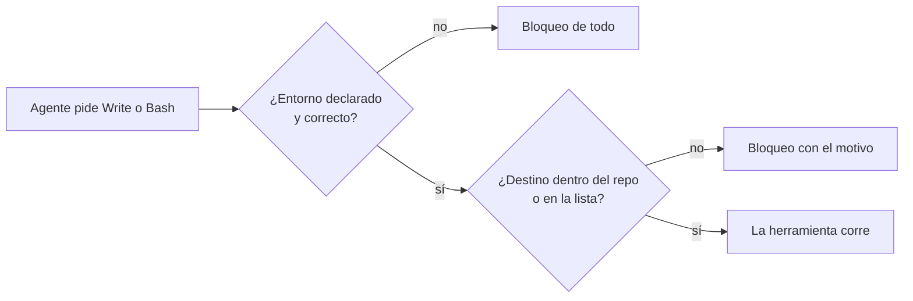
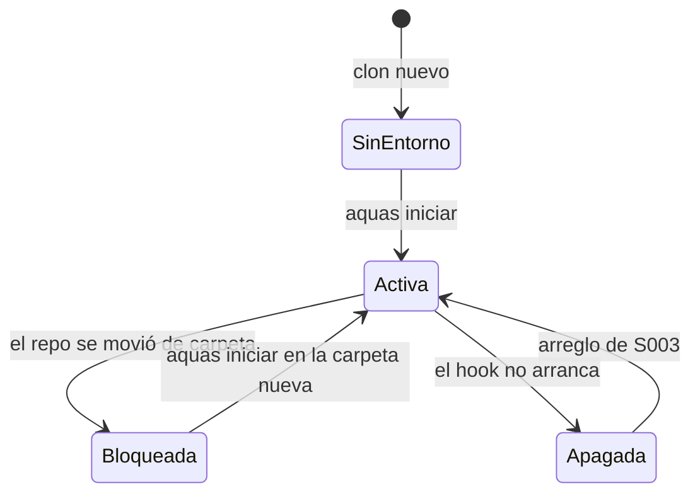
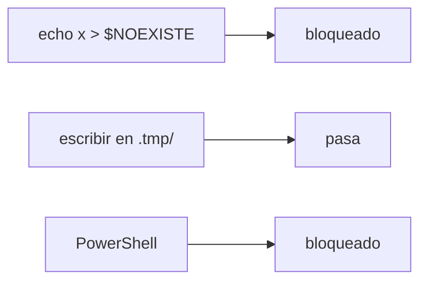

# F001 · Guardia del repo

[Inicio](../../README.md) › [E000](../README.md) › F001

[Feature](../../glosario.md#feature) que impide al [agente](../../glosario.md#agente) escribir fuera de este repositorio. Cómo funciona hoy está en el manual [Guardia](../../ref/guardia.md). Esta página cuenta qué se pidió, qué se hizo y con qué pruebas.

## En una frase

Un programa revisa cada escritura antes de que pase, y la frena si sale del repositorio.

## Para qué existe

**El problema.** Jesús pidió una regla de oro: nada se escribe fuera del repo. Una regla escrita depende de la memoria del agente, y la memoria falla.

**La solución.** Un [gate](../../glosario.md#gate) en [Go](../../glosario.md#go) que corre como [hook](../../glosario.md#hook) antes de cada herramienta. Se construyó en cuatro [slices](../../glosario.md#slice):

- S001 crea la guardia.
- S002 abre una puerta controlada: la caché de Go.
- S003 arregla un fallo grave: en Windows la guardia nunca arrancaba.
- S004 ata la guardia a la máquina y la carpeta reales.

Por qué esos cuatro: S001 y S002 venían en el pedido. S003 y S004 nacieron de fallos que aparecieron al usarla.

## Analogía

Piensa en una **alarma de casa**.

- S001 instala los sensores en puertas y ventanas.
- S002 deja una ventana de la cocina abierta a propósito, anotada en la lista.
- S003 descubre que la alarma nunca estuvo enchufada.
- S004 escribe en la alarma la dirección de la casa. Si alguien la lleva a otra casa, no se activa sin revisarla.

Límite de la analogía: una alarma suena después. La guardia frena antes de que la escritura ocurra.

## Diagrama

Proceso: qué pasa con cada herramienta.

Estados de la guardia en una máquina:

Slices de esta feature:

| Slice | Qué entrega |
|---|---|
| [S001 Regla de oro 5](S001.md) | La guardia y su hook |
| [S002 Lista de permitidos](S002.md) | Carpetas de fuera con motivo |
| [S003 Hooks en Windows](S003.md) | El hook arranca con Git Bash |
| [S004 Entorno declarado](S004.md) | Sistema y raíz en config; ajustes generados |

## Ejemplo de punta a punta

continúa: [EJ-E000](../README.md#EJ-E000)

En la [iniciativa](../../glosario.md#iniciativa), Jesús pidió que nada se escriba fuera. Aquí vemos cómo esa guardia pasó por cada estado.

1. S001 la deja **Activa**. Las pruebas pasan.
2. S002 agrega la caché de Go a la lista. Sigue Activa.
3. Jesús prueba `echo x > "$NOEXISTE"` y pasa. La guardia estaba **Apagada** desde el principio.
4. S003 arregla el arranque. El mismo comando ahora se bloquea.
5. S004 pregunta: ¿en qué máquina y carpeta estamos? Un clon nuevo queda en **SinEntorno** hasta correr `aquas iniciar`.

## Paso a paso

Orden en que se construyó:

1. Pruebas de comandos que deben fallar y que deben pasar.
2. El programa `aquas guardia`, conectado como hook.
3. La lista de permitidos en `gobierno/config/guardia.json`.
4. El arranque con Git Bash.
5. El entorno declarado y los ajustes generados.

## Cómo se usa

- Manual de uso: [Guardia: nada se escribe fuera del repo](../../ref/guardia.md).
- Probar: `go test ./internal/guardia/ ./internal/entorno/`.

## Contrato y evidencia

**Objetivo.** Ninguna herramienta del agente escribe fuera del repositorio sin una excepción escrita.

Decisiones de Jesús:

- La caché de Go es una excepción, pero declarada con su motivo (S002).
- El entorno vive en un archivo local que no se versiona (S004, 2026-10-20).
- Si el entorno falta o no coincide, se bloquea todo. Mover el repo de carpeta está mal (S004, 2026-10-20).

**Prueba integral.**

- Escenario: en la sesión, con el hook real, se probaron tres comandos.
- Resultado: `echo x > "$NOEXISTE"` → bloqueado. Escribir en `.tmp/` → pasa. PowerShell → bloqueado.
- [Commit](../../glosario.md#commit): `2c418d1`.

Límite que sigue abierto: la guardia no ve programas que escriben por su cuenta. Es criterio humano.

## Navegación

<!-- GENERADO por aquas desde trabajo/: no editar a mano; `aquas compilar` lo rehace. -->

| Hijo | Qué es | Estado |
|---|---|---|
| [S001](S001.md) | Regla de oro 5: nada fuera del repo | Hecho |
| [S002](S002.md) | Lista de permitidos | Hecho |
| [S003](S003.md) | Hooks en Windows | Hecho |
| [S004](S004.md) | Entorno declarado | Hecho |

<!-- /GENERADO -->

- ↑ Subir: [E000 · Mantenimiento del gobierno](../README.md)
- Abajo: [S001 · Regla de oro 5](S001.md)
- Abajo: [S002 · Lista de permitidos](S002.md)
- Abajo: [S003 · Hooks en Windows](S003.md)
- Abajo: [S004 · Entorno declarado](S004.md)
