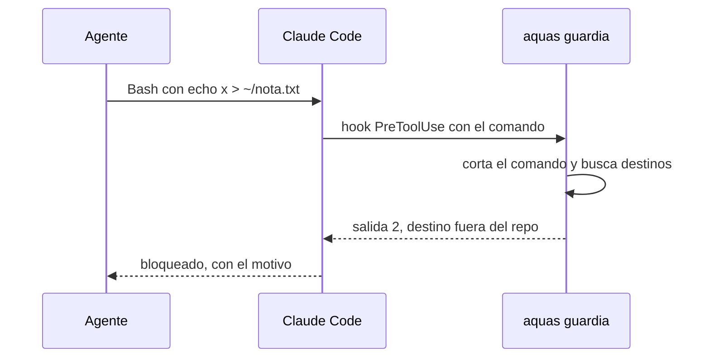
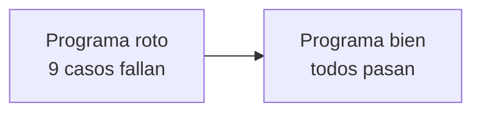

# S001 · Regla de oro 5

[Inicio](../../README.md) › [E000](../README.md) › [F001](README.md) › S001

[Slice](../../glosario.md#slice) que crea la guardia: un programa que revisa cada escritura del [agente](../../glosario.md#agente) antes de que ocurra.

## En una frase

Si el destino de una escritura queda fuera del repositorio, el programa la frena.

## Para qué existe

**El problema.** Una prueba mal hecha puede dejar archivos en tu perfil o pisar tu configuración personal. La regla «no escribas fuera» dependía de la memoria del agente.

**La solución.** `aquas guardia` corre como [hook](../../glosario.md#hook) antes de cada herramienta. Lee la ruta o el comando y responde «sigue» o «bloqueado».

Contrato del slice:

| Campo | Valor |
|---|---|
| Objetivo | Write, Edit, NotebookEdit y Bash no escriben fuera de la raíz del repo |
| Incluye | Rutas de archivo, redirecciones, `cd` y destinos de `rm`, `mv`, `cp`, `mkdir`, `tee`, `sed -i` y otros |
| Excluye | Programas que escriben por su cuenta, como un script de Python |
| Regla | Si no puede probar que el destino está dentro, bloquea |
| Prueba | `go test ./internal/guardia/` |

## Analogía

Piensa en el **portero de un edificio**.

- Puedes mirar por la ventana todo lo que quieras: leer fuera está permitido.
- Si sacas un paquete, el portero lee la dirección.
- Si la dirección está borrosa, no lo deja salir.

Límite de la analogía: el portero solo ve la puerta. Si un programa sale por la ventana, no lo ve.

## Diagrama

Secuencia: una escritura revisada.

## Ejemplo de punta a punta

continúa: [EJ-E000-F001](README.md#EJ-E000-F001)

En la [feature](../../glosario.md#feature), la guardia pasó a Activa. Aquí está cómo se llegó.

1. Primero se escribieron las pruebas: 18 comandos que deben fallar y 11 que deben pasar.
2. Un caso que debe fallar: `echo x > ~/nota.txt`. Uno que debe pasar: `cat ~/.claude/settings.json`, que solo lee.
3. Se programó la guardia y las pruebas pasaron.
4. Para ver que las pruebas vigilan, se rompió el programa a propósito. Fallaron 9 casos.
5. Al conectar el hook apareció otro error. `go run` cambia la salida 2 por 1, y la salida 1 no bloquea.
6. La solución fue `.claude/hooks/aquas.sh`: compila el programa en `.tmp/` y lo corre directo.

## Paso a paso

1. Escribir los casos que deben fallar y los que deben pasar.
2. Programar la revisión de rutas y comandos.
3. Romper el programa a propósito y ver fallar las pruebas.
4. Conectar el hook PreToolUse.
5. Probar el hook en la sesión real.

## Cómo se usa

- Corre sola; no hay que llamarla.
- Manual completo: [Guardia](../../ref/guardia.md).

## Contrato y evidencia

<!-- GENERADO por aquas desde trabajo/: no editar a mano; `aquas compilar` lo rehace. -->

| Prueba | Qué demuestra | Rojo | Verde |
|---|---|---|---|
| — | ficha anterior al registro de pruebas | — | — |

<!-- /GENERADO -->

Pruebas del slice, en `internal/guardia/guardia_test.go`:

| Prueba | Qué demuestra |
|---|---|
| `TestArchivoDentroPasa` | Write o Edit dentro del repo siguen |
| `TestArchivoFueraFalla` | Write o Edit fuera del repo se bloquean |
| `TestBashDentroPasa` | Comandos que leen o escriben dentro siguen |
| `TestBashFueraFalla` | Comandos que escriben fuera se bloquean |
| `TestBashConCwdFuera` | Si el comando arranca fuera del repo, se bloquea |
| `TestEntradaHook` | Lee bien el mensaje que manda Claude Code |

Rojo visto: sí. Con el programa roto a propósito, fallaron 9 casos.

[Commit](../../glosario.md#commit): `6756b1d`.

Decisión de Jesús: nada se escribe fuera del repo, y es regla de oro del [orquestador](../../glosario.md#orquestador) con su [gate](../../glosario.md#gate).

## Navegación

- ↑ Subir: [F001 · Guardia del repo](README.md)
