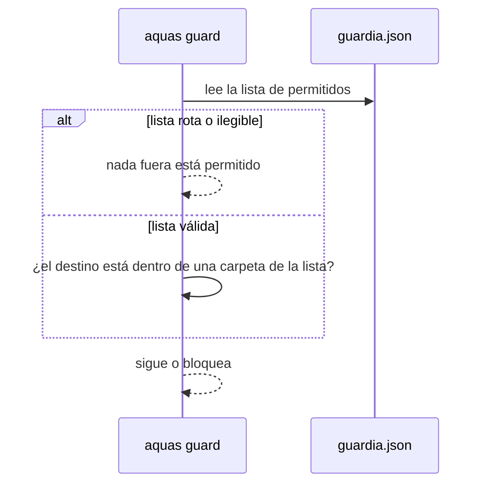
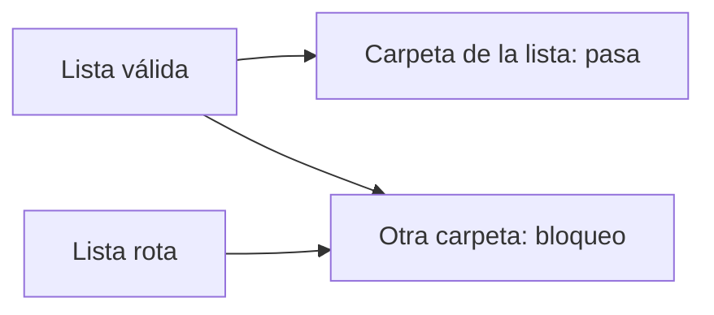

# S002 · Lista de permitidos

[Inicio](../../README.md) › [E000](../README.md) › [F001](README.md) › S002

[Slice](../../glosario.md#slice) que permite escribir en unas pocas carpetas de fuera, cada una con su motivo.

## En una frase

Fuera del repo solo se escribe en lo que está en la lista; todo lo demás se bloquea.

## Para qué existe

**El problema.** [Go](../../glosario.md#go) guarda su caché de compilación fuera del repositorio. Con la guardia estricta, comandos como `go clean -cache` quedaban bloqueados.

**La solución.** Jesús decidió que la caché es una excepción, pero escrita. La lista vive en `gobierno/config/guardia.json`, con la ruta y el motivo de cada carpeta.

Contrato del slice:

| Campo | Valor |
|---|---|
| Objetivo | Escribir fuera solo en carpetas de la lista |
| Incluye | La lista con motivo y su revisión en `aquas verify` |
| Regla | Lista rota o ilegible = nada fuera |
| Límite | Nada impide que el agente edite la lista; revisarlo en el [commit](../../glosario.md#commit) es criterio humano |
| Prueba | `go test ./internal/guardia/` |

## Analogía

Piensa en la **lista de invitados de una fiesta**.

- En la puerta solo entra quien está en la lista.
- Cada nombre lleva quién lo invitó.
- Si la lista se moja y no se lee, no entra nadie.

Límite de la analogía: aquí la lista no es de personas sino de carpetas, y el portero es un programa.

## Diagrama

Secuencia: una escritura en la caché de Go.

## Ejemplo de punta a punta

continúa: [EJ-E000-F001](README.md#EJ-E000-F001)

En la [feature](../../glosario.md#feature), S002 dejó la guardia Activa y con una puerta controlada.

1. El comando `go clean -cache` borra la caché de Go en `${LOCALAPPDATA}/go-build`.
2. Antes de S002, la guardia lo bloqueaba.
3. Se agregó esa carpeta a la lista, con el motivo «caché de compilación de Go en Windows».
4. Ahora el comando pasa. Escribir en `~/Documentos` sigue bloqueado.

## Paso a paso

1. Escribir pruebas: permitido pasa, no permitido sigue bloqueado, sin lista todo bloqueado.
2. Crear la lista con su motivo por carpeta.
3. Hacer que `aquas verify` revise la lista.
4. Rechazar rutas relativas y rutas que permiten todo un disco.

## Cómo se usa

- Agregar una carpeta: añade `ruta` y `motivo` en `gobierno/config/guardia.json`.
- Revisar: `go build -o .tmp/aquas.exe ./cmd/aquas && ./.tmp/aquas.exe verify`.

## Contrato y evidencia

<!-- GENERADO por aquas desde trabajo/: no editar a mano; `aquas compile` lo rehace. -->

| Prueba | Valida | Rojo cuando | Verde cuando | Rojo | Verde |
|---|---|---|---|---|---|
| — | ficha anterior al registro de pruebas | — | — | — | — |

### Código

Sin código registrado: sus cambios no tocaron código ni configuración, o no nombran el ID (`aquas backlog code E000/F001/S002 <commit>…` los asigna).

<!-- /GENERADO -->

Pruebas del slice, en `internal/guardia/permitidos_test.go`:

| Prueba | Qué demuestra |
|---|---|
| `TestPermitidoFueraPasa` | Escribir en una carpeta de la lista sigue |
| `TestNoPermitidoSigueBloqueado` | Lo que no está en la lista sigue bloqueado |
| `TestSinConfigTodoFueraBloqueado` | Sin lista, nada de fuera pasa |
| `TestConfigInvalida` | La lista rota, sin motivo o con todo un disco falla |

Rojo visto: no quedó registrado. NO CONFIRMADO. `TestSinConfigTodoFueraBloqueado` se endureció y vio su rojo en [E000/F005/S002](../F005/S002.md).

[Commit](../../glosario.md#commit): `9e94e35`.

Decisión de Jesús: la caché de Go es una excepción, pero declarada en config con su motivo.

## Navegación

- ↑ Subir: [F001 · Guardia del repo](README.md)
