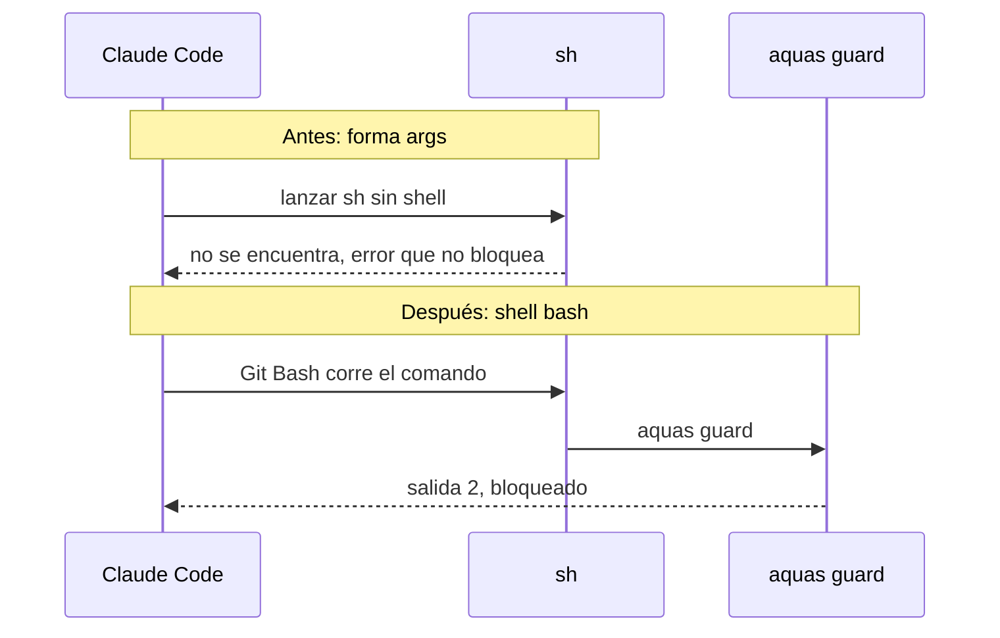
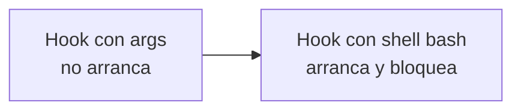

# S003 · Hooks en Windows

[Inicio](../../README.md) › [E000](../README.md) › [F001](README.md) › S003

[Slice](../../glosario.md#slice) que arregla un fallo escondido: en Windows, los [hooks](../../glosario.md#hook) nunca arrancaban.

## En una frase

La guardia existía, pero nadie la encendía; ahora arranca con Git Bash.

## Para qué existe

**El problema.** Jesús probó `echo x > "$NOEXISTE"` y el comando pasó. La guardia debía bloquearlo.

La causa: el hook usaba la forma `args`. Con esa forma, Claude Code lanza `sh` directo, sin shell. En Windows, el PATH solo trae `Git\cmd`, y ahí no hay `sh.exe`.

El arranque fallaba en silencio, porque ese error no bloquea. La guardia y el recompilado nunca corrieron.

**La solución.** El hook pasa a ser un comando de texto con `shell: bash`. Claude Code lo corre con Git Bash, que sí encuentra `sh`.

Contrato del slice:

| Campo | Valor |
|---|---|
| Objetivo | Los dos hooks arrancan en Windows |
| Incluye | El cambio en `.claude/settings.json` |
| Límite | Sin prueba automática: se comprobó en la sesión real |

## Analogía

Piensa en una **alarma sin enchufar**.

- La alarma estaba instalada y probada en el taller.
- En la casa, nadie la enchufó.
- Como no sonaba nunca, parecía que todo estaba tranquilo.

Límite de la analogía: una alarma apagada suele tener una luz que lo avisa. Este hook no avisaba nada.

## Diagrama

Secuencia: antes y después del arreglo.

## Ejemplo de punta a punta

continúa: [EJ-E000-F001](README.md#EJ-E000-F001)

En la [feature](../../glosario.md#feature), la guardia estuvo Apagada sin que nadie lo supiera.

1. Jesús corrió `echo x > "$NOEXISTE"`. Pasó.
2. Se buscó la causa: el PATH de Windows no trae `sh.exe`.
3. Se cambió el hook a `shell: bash`.
4. El mismo comando quedó bloqueado. Escribir dentro del repo siguió pasando.
5. También se bloqueó escribir en la carpeta temporal del sistema, fuera del repo.

## Paso a paso

1. Reproducir el fallo con el comando de Jesús.
2. Encontrar dónde vive `sh.exe` y qué trae el PATH.
3. Cambiar la forma del hook.
4. Repetir el comando y ver el bloqueo.

## Cómo se usa

- No hay nada que hacer: desde S004, `.claude/settings.json` se genera solo con el shell correcto.

## Contrato y evidencia

<!-- GENERADO por aquas desde trabajo/: no editar a mano; `aquas compile` lo rehace. -->

| Prueba | Valida | Rojo cuando | Verde cuando | Rojo | Verde |
|---|---|---|---|---|---|
| — | ficha anterior al registro de pruebas | — | — | — | — |

### Código

| Archivo | Función | Parámetros | Qué hace |
|---|---|---|---|
| [.claude/settings.json](../../../.claude/settings.json) | — | — | — |

<!-- /GENERADO -->

Pruebas del slice: no hay prueba automática. La evidencia es la prueba en la sesión real:

| Comando | Antes | Después |
|---|---|---|
| `echo x > "$NOEXISTE"` | pasa | bloqueado |
| Escribir en `.tmp/` | pasa | pasa |
| Escribir en la carpeta temporal del sistema | pasa | bloqueado |

[Commit](../../glosario.md#commit): `bae7091`.

Lección: un ajuste escrito a mano no pasaba por ningún [gate](../../glosario.md#gate). Por eso S004 genera esos ajustes y el gate los revisa.

Decisión de Jesús: un fallo se arregla antes de seguir con otra tarea.

## Navegación

- ↑ Subir: [F001 · Guardia del repo](README.md)
