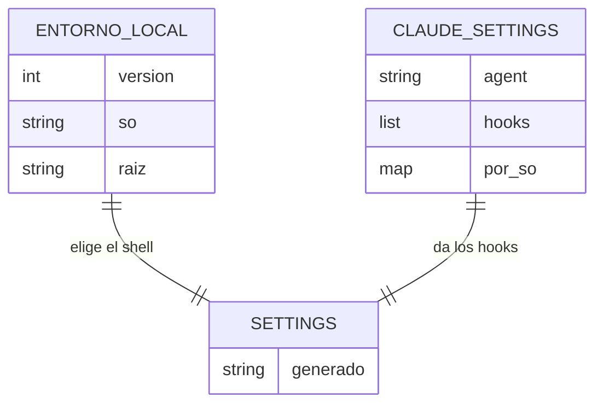
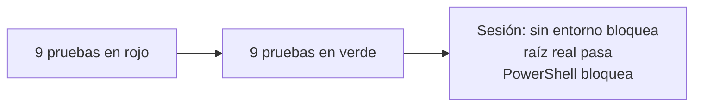

# S004 · Entorno declarado

[Inicio](../../README.md) › [E000](../README.md) › [F001](README.md) › S004

[Slice](../../glosario.md#slice) que escribe en config el sistema operativo y la carpeta del repositorio. Con eso, los ajustes de Claude Code se generan solos.

## En una frase

La guardia sabe en qué máquina y en qué carpeta está, y bloquea todo si no coincide.

## Para qué existe

**El problema.** Hubo dos huecos:

- La guardia tomaba como raíz la carpeta donde arrancaba, sin compararla con nada.
- `.claude/settings.json` se escribía a mano. Por eso el fallo de S003 llegó sin aviso.

Además, PowerShell no estaba vigilado.

**La solución.**

- `aquas init` detecta el sistema y la raíz real, y escribe `gobierno/config/entorno.local.json`.
- La guardia bloquea todo si ese archivo falta o no coincide.
- `.claude/settings.json` se genera desde `gobierno/config/claude_settings.json`, con el shell del sistema.
- En Windows, PowerShell se vigila y se bloquea siempre.

Contrato del slice:

| Campo | Valor |
|---|---|
| Objetivo | Raíz y sistema declarados; ajustes generados y revisados por el gate |
| Incluye | `aquas init`, revisión del entorno, ajustes generados, PowerShell |
| Excluye | Mover el repo de carpeta: está mal y se bloquea |
| Límite | Un clon nuevo no tiene hooks hasta correr `aquas init` |
| Prueba | `go test ./internal/entorno/ ./internal/guardia/` |

## Analogía

Piensa en la **dirección escrita en la alarma**.

- La alarma sabe en qué casa está instalada.
- Si alguien la lleva a otra casa, no se activa sin revisarla.
- Las instrucciones de la alarma salen de un manual, no de notas a mano.

Límite de la analogía: aquí «revisarla» es correr un comando, no llamar a un técnico.

## Diagrama

Datos: qué archivo sale de cuál.

## Ejemplo de punta a punta

continúa: [EJ-E000-F001](README.md#EJ-E000-F001)

En la [feature](../../glosario.md#feature), un clon nuevo queda en SinEntorno. Así se ve en la práctica.

1. Sin `entorno.local.json`, cualquier escritura sale bloqueada con «entorno no verificado».
2. Se corre `go run ./cmd/aquas init`. Escribe `so=windows` y la raíz real.
3. Ahora escribir dentro del repo pasa.
4. Se pide un comando de PowerShell. Sale bloqueado: la guardia no sabe leerlo.
5. Alguien edita `.claude/settings.json` a mano. `aquas verify` falla hasta regenerarlo.

## Paso a paso

1. Escribir las pruebas y verlas fallar.
2. Programar `aquas init` y la revisión del entorno.
3. Generar `.claude/settings.json` desde la config.
4. Sacar ese archivo de git, porque depende de la máquina.
5. Probar el binario real en la sesión.

## Cómo se usa

- Clon nuevo: `go run ./cmd/aquas init` en la raíz.
- Cambiar los [hooks](../../glosario.md#hook): edita `gobierno/config/claude_settings.json` y corre `go run ./cmd/aquas compile`.

## Contrato y evidencia

<!-- GENERADO por aquas desde trabajo/: no editar a mano; `aquas compile` lo rehace. -->

| Prueba | Valida | Rojo cuando | Verde cuando | Rojo | Verde |
|---|---|---|---|---|---|
| — | ficha anterior al registro de pruebas | — | — | — | — |

### Código

| Archivo | Función | Parámetros | Qué hace |
|---|---|---|---|
| [.claude/settings.json](../../../.claude/settings.json) | — | — | — |
| [cmd/aquas/main.go](../../../cmd/aquas/main.go) | `main` | `()` | main despacha el subcomando de aquas (compilar, verificar, backlog, hooks…) y sale con su código. |
| [cmd/aquas/main.go](../../../cmd/aquas/main.go) | `hook` | `(raiz string)` | hook: exit 0 = nada que reportar; exit 2 = stderr se muestra a Claude. |
| [cmd/aquas/main.go](../../../cmd/aquas/main.go) | `compilarSettings` | `(w io.Writer)` | compilarSettings regenera .claude/settings.json; sin entorno declarado no inventa uno. |
| [cmd/aquas/main.go](../../../cmd/aquas/main.go) | `reportar` | `(w io.Writer, inf compilador.Informe)` | reportar imprime qué derivados escribió la compilación, o que todo estaba al día. |
| [cmd/aquas/main.go](../../../cmd/aquas/main.go) | `listar` | `(titulo string, problemas []string)` | listar imprime en stderr un título y cada problema en su viñeta. |
| [cmd/aquas/main.go](../../../cmd/aquas/main.go) | `lista` | `(xs []string) string` | lista une los textos con comas, o «—» si no hay ninguno. |
| [cmd/aquas/main.go](../../../cmd/aquas/main.go) | `fallar` | `(codigo int, err error)` | fallar imprime el error en stderr y termina con el código dado. |
| [cmd/aquas/main.go](../../../cmd/aquas/main.go) | `memoriaCLI` | `(raiz string, args []string)` | memoriaCLI: `ver` imprime la memoria; `fijar campo=valor…` la actualiza y la sella. |
| [cmd/aquas/main.go](../../../cmd/aquas/main.go) | `memoriaArchivada` | `(raiz, id string) error` | memoriaArchivada: CERRADO exige el archivo de memoria del slice, apunte o no la memoria a él (E001/F002/S009, X01). |
| [cmd/aquas/main.go](../../../cmd/aquas/main.go) | `focoEnBacklog` | `(raiz string, f memoria.Foco) error` | focoEnBacklog: la memoria solo fija el slice que el backlog tiene en curso (S003). |
| [cmd/aquas/main.go](../../../cmd/aquas/main.go) | `backlogCLI` | `(raiz string, args []string)` | backlogCLI: nuevo \\| ver [id] \\| tabla \\| prioridad \\| estado \\| siguiente \\| pruebas \\| rojo \\| verde. |
| [cmd/aquas/main.go](../../../cmd/aquas/main.go) | `turnoCLI` | `(raiz string, args []string)` | turnoCLI: auditoría de turnos (E001/F002/S001). Lee el JSON del hook por stdin. No imprime nada |
| [cmd/aquas/main.go](../../../cmd/aquas/main.go) | `defectoCLI` | `(raiz string, args []string) error` | defectoCLI: nuevo \\| ocurre \\| ver (E001/F004/S001). |
| [cmd/aquas/main.go](../../../cmd/aquas/main.go) | `versionBinario` | `() string` | versionBinario: versión del módulo con que se compiló el binario (= versión del gobierno embebido). |
| [cmd/aquas/main.go](../../../cmd/aquas/main.go) | `registrarCierre` | `(raiz, tipo, transcript, primera, resultado string)` | registrarCierre (E001/F004/S005, D000068) anota cada llamada del gancho cierre-agente en .tmp/hooks/cierre-agente.jsonl. |
| [gobierno/config/claude_settings.json](../../../gobierno/config/claude_settings.json) | — | — | — |
| [internal/entorno/entorno.go](../../../internal/entorno/entorno.go) | `Leer` | `(raiz string) (Entorno, error)` | Leer carga el entorno declarado. |
| [internal/entorno/entorno.go](../../../internal/entorno/entorno.go) | `Validar` | `(raiz string) string` | Validar compara el entorno declarado con el real; "" = coincide, si no, el motivo del bloqueo. |
| [internal/entorno/entorno.go](../../../internal/entorno/entorno.go) | `Iniciar` | `(raiz string) (Entorno, error)` | Iniciar detecta SO y raíz (git) y escribe entorno.local.json; exige correr desde la raíz. |
| [internal/entorno/entorno.go](../../../internal/entorno/entorno.go) | `mismaRuta` | `(a, b string) bool` | mismaRuta compara dos rutas limpias; en Windows sin distinguir mayúsculas. |
| [internal/entorno/entorno.go](../../../internal/entorno/entorno.go) | `generarSettings` | `(fuente []byte, so string) ([]byte, error)` | generarSettings arma settings.json para un SO desde la plantilla canónica. Bytes estables. |
| [internal/entorno/entorno.go](../../../internal/entorno/entorno.go) | `Settings` | `(raiz string) ([]byte, error)` | Settings genera el settings.json esperado para el entorno declarado. |
| [internal/entorno/entorno.go](../../../internal/entorno/entorno.go) | `CompilarSettings` | `(raiz string) (bool, error)` | CompilarSettings escribe .claude/settings.json; devuelve true si cambió. |
| [internal/entorno/entorno.go](../../../internal/entorno/entorno.go) | `VerificarSettings` | `(raiz string) string` | VerificarSettings: "" si .claude/settings.json coincide con lo regenerado. |
| [internal/guardia/guardia.go](../../../internal/guardia/guardia.go) | `Revisar` | `(raiz string, entrada []byte) string` | Revisar recibe el JSON del hook PreToolUse; "" = permitido, si no, el motivo del bloqueo. |
| [internal/guardia/guardia.go](../../../internal/guardia/guardia.go) | `RevisarArchivo` | `(raiz, p string) string` | RevisarArchivo valida una ruta de Write/Edit (absoluta o relativa a la raíz). |
| [internal/guardia/guardia.go](../../../internal/guardia/guardia.go) | `protegida` | `(raiz, abs, p string) string` | protegida: carpetas que solo escribe `aquas` (E001/F005, E001/F002). Las rutas salen de los |
| [internal/guardia/guardia.go](../../../internal/guardia/guardia.go) | `resolver` | `(base, p string) (string, bool)` | resolver lleva p a ruta absoluta del sistema. Entiende ~, /c/… (Git Bash) y relativas a base. |
| [internal/guardia/guardia.go](../../../internal/guardia/guardia.go) | `dentro` | `(raiz, abs string) bool` | dentro: la ruta absoluta queda dentro de la raíz del repo. |
| [internal/guardia/guardia.go](../../../internal/guardia/guardia.go) | `sinHeredocs` | `(c string) string` | sinHeredocs quita el cuerpo de cada heredoc: su contenido es texto, no comandos. |
| [internal/guardia/guardia.go](../../../internal/guardia/guardia.go) | `lexear` | `(c string) []palabra` | lexear parte un comando de shell en palabras, respetando comillas y operadores. |
| [internal/guardia/guardia.go](../../../internal/guardia/guardia.go) | `variable` | `(r []rune, i int) (string, int)` | variable reconoce $NOMBRE, ${NOMBRE}, $(…), `…` y %NOMBRE%; devuelve nombre ("?" = desconocida) y largo. |
| [internal/guardia/guardia.go](../../../internal/guardia/guardia.go) | `esNombre` | `(c rune) bool` | esNombre: el carácter vale en un nombre de variable de shell. |
| [internal/guardia/guardia.go](../../../internal/guardia/guardia.go) | `RevisarBash` | `(raiz, cwd, comando string) string` | RevisarBash analiza un comando de Bash; cwd es el directorio donde arranca. |
| [internal/guardia/guardia.go](../../../internal/guardia/guardia.go) | `segmento` | `(raiz string, cwd *string, cwdOK *bool, vars map[string]string, ps []palabra) string` | segmento revisa un comando simple: sigue cd y variables y devuelve el primer destino fuera del repo. |
| [internal/guardia/guardia.go](../../../internal/guardia/guardia.go) | `posicionales` | `(args []string) []string` | posicionales: argumentos que no son opciones (los que empiezan con «-», salvo «-» solo). |
| [internal/guardia/guardia.go](../../../internal/guardia/guardia.go) | `revisarDestino` | `(raiz, cwd string, cwdOK bool, vars map[string]string, d string) string` | revisarDestino: motivo de bloqueo si la ruta no se resuelve o cae fuera del repo; vacío si vale. |
| [internal/guardia/guardia.go](../../../internal/guardia/guardia.go) | `expandir` | `(s string, vars map[string]string, cwd string) (string, bool)` | expandir sustituye variables conocidas; HOME/USERPROFILE/TEMP/TMP salen del entorno real. |
| [internal/guardia/guardia.go](../../../internal/guardia/guardia.go) | `legible` | `(s string) string` | legible muestra las variables internas como $NOMBRE en los mensajes. |

### Arreglos

| Arreglo | Qué arregla | Por qué | Pruebas | Fecha | Rojo | Verde |
|---|---|---|---|---|---|---|
| X01 | El gate avisa si el binario de aquas es más viejo que el código | D000026: validar con un binario viejo dio un falso GATE FALLIDO | `TestBinarioViejoSeNombra` | 2026-10-23 | 2026-10-23 | 2026-10-23 |

<!-- /GENERADO -->

Pruebas del slice:

| Prueba | Qué demuestra |
|---|---|
| `TestValidarSinArchivoBloquea` | Sin archivo de entorno, se bloquea |
| `TestValidarSODistintoBloquea` | Otro sistema operativo, se bloquea |
| `TestValidarRaizDistintaBloquea` | Otra carpeta, se bloquea |
| `TestValidarArchivoRotoBloquea` | Archivo roto, se bloquea |
| `TestValidarCorrectoPasa` | Sistema y carpeta reales, pasa |
| `TestSettingsWindowsIncluyePowerShell` | En Windows, el hook vigila PowerShell |
| `TestSettingsLinuxSinPowerShell` | En Linux, no aparece PowerShell |
| `TestSettingsSOSinConfigFalla` | Sistema sin config, falla al generar |
| `TestPowerShellSeBloquea` | La guardia bloquea PowerShell |

Rojo visto: sí, las nueve antes de escribir el código.

[Commit](../../glosario.md#commit): `2c418d1`.

Decisiones de Jesús (2026-10-20):

- El entorno va en un archivo local que no se versiona.
- Si falta o no coincide, se bloquea todo.
- `.claude/settings.json` se genera entero y no se versiona.

El [gate](../../glosario.md#gate) avisa si el binario de aquas es más viejo que el código: `TestBinarioViejoSeNombra` (D000026).

## Navegación

- ↑ Subir: [F001 · Guardia del repo](README.md)
