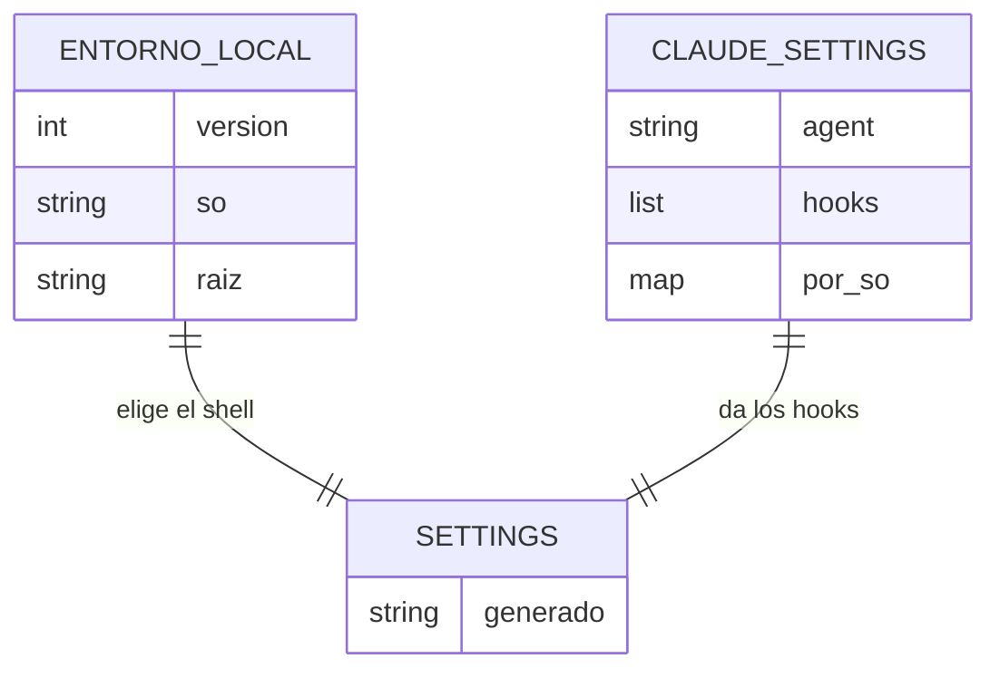
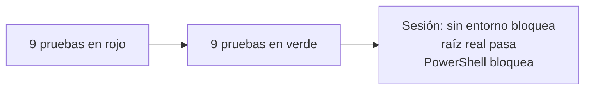

# S004 · Entorno declarado

[Inicio](../../README.md) › [E000](../README.md) › [F001](README.md) › S004

[Slice](../../glosario.md#slice) que escribe en config el sistema operativo y la carpeta del repositorio. Con eso, los ajustes de Claude Code se generan solos.

## En una frase

La guardia sabe en qué máquina y en qué carpeta está, y bloquea todo si no coincide.

## Para qué existe

**El problema.** Hubo dos huecos:

- La guardia tomaba como raíz la carpeta donde arrancaba, sin compararla con nada.
- `.claude/settings.json` se escribía a mano. Por eso el fallo de S003 llegó sin aviso.

Además, PowerShell no estaba vigilado.

**La solución.**

- `aquas iniciar` detecta el sistema y la raíz real, y escribe `gobierno/config/entorno.local.json`.
- La guardia bloquea todo si ese archivo falta o no coincide.
- `.claude/settings.json` se genera desde `gobierno/config/claude_settings.json`, con el shell del sistema.
- En Windows, PowerShell se vigila y se bloquea siempre.

Contrato del slice:

| Campo | Valor |
|---|---|
| Objetivo | Raíz y sistema declarados; ajustes generados y revisados por el gate |
| Incluye | `aquas iniciar`, revisión del entorno, ajustes generados, PowerShell |
| Excluye | Mover el repo de carpeta: está mal y se bloquea |
| Límite | Un clon nuevo no tiene hooks hasta correr `aquas iniciar` |
| Prueba | `go test ./internal/entorno/ ./internal/guardia/` |

## Analogía

Piensa en la **dirección escrita en la alarma**.

- La alarma sabe en qué casa está instalada.
- Si alguien la lleva a otra casa, no se activa sin revisarla.
- Las instrucciones de la alarma salen de un manual, no de notas a mano.

Límite de la analogía: aquí «revisarla» es correr un comando, no llamar a un técnico.

## Diagrama

Datos: qué archivo sale de cuál.

## Ejemplo de punta a punta

continúa: [EJ-E000-F001](README.md#EJ-E000-F001)

En la [feature](../../glosario.md#feature), un clon nuevo queda en SinEntorno. Así se ve en la práctica.

1. Sin `entorno.local.json`, cualquier escritura sale bloqueada con «entorno no verificado».
2. Se corre `go run ./cmd/aquas iniciar`. Escribe `so=windows` y la raíz real.
3. Ahora escribir dentro del repo pasa.
4. Se pide un comando de PowerShell. Sale bloqueado: la guardia no sabe leerlo.
5. Alguien edita `.claude/settings.json` a mano. `aquas verificar` falla hasta regenerarlo.

## Paso a paso

1. Escribir las pruebas y verlas fallar.
2. Programar `aquas iniciar` y la revisión del entorno.
3. Generar `.claude/settings.json` desde la config.
4. Sacar ese archivo de git, porque depende de la máquina.
5. Probar el binario real en la sesión.

## Cómo se usa

- Clon nuevo: `go run ./cmd/aquas iniciar` en la raíz.
- Cambiar los [hooks](../../glosario.md#hook): edita `gobierno/config/claude_settings.json` y corre `go run ./cmd/aquas compilar`.

## Contrato y evidencia

<!-- GENERADO por aquas desde trabajo/: no editar a mano; `aquas compilar` lo rehace. -->

| Prueba | Qué demuestra | Rojo | Verde |
|---|---|---|---|
| — | ficha anterior al registro de pruebas | — | — |

<!-- /GENERADO -->

Pruebas del slice:

| Prueba | Qué demuestra |
|---|---|
| `TestValidarSinArchivoBloquea` | Sin archivo de entorno, se bloquea |
| `TestValidarSODistintoBloquea` | Otro sistema operativo, se bloquea |
| `TestValidarRaizDistintaBloquea` | Otra carpeta, se bloquea |
| `TestValidarArchivoRotoBloquea` | Archivo roto, se bloquea |
| `TestValidarCorrectoPasa` | Sistema y carpeta reales, pasa |
| `TestSettingsWindowsIncluyePowerShell` | En Windows, el hook vigila PowerShell |
| `TestSettingsLinuxSinPowerShell` | En Linux, no aparece PowerShell |
| `TestSettingsSOSinConfigFalla` | Sistema sin config, falla al generar |
| `TestPowerShellSeBloquea` | La guardia bloquea PowerShell |

Rojo visto: sí, las nueve antes de escribir el código.

[Commit](../../glosario.md#commit): `2c418d1`.

Decisiones de Jesús (2026-10-20):

- El entorno va en un archivo local que no se versiona.
- Si falta o no coincide, se bloquea todo.
- `.claude/settings.json` se genera entero y no se versiona.

## Navegación

- ↑ Subir: [F001 · Guardia del repo](README.md)
