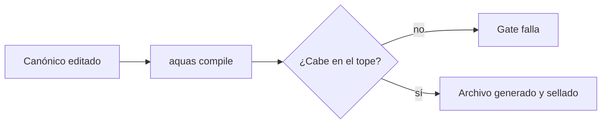
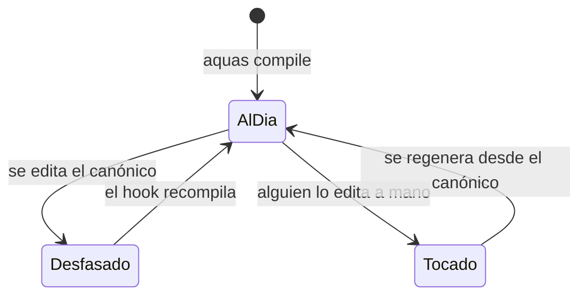
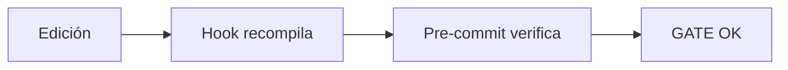

# F002 · Compilador y sello

[Inicio](../../README.md) › [E000](../README.md) › F002

[Feature](../../glosario.md#feature) que convierte las reglas en los archivos de Claude Code y vigila que nadie los toque a mano. El manual de uso está en «Cómo se usa». Esta página cuenta qué se hizo y con qué pruebas.

## En una frase

Las reglas se escriben una vez y un programa arma las copias, las sella y avisa si alguien las cambia.

## Para qué existe

**El problema.** Una regla copiada a mano en varios archivos termina diciendo cosas distintas. Además, el contexto permanente del [agente](../../glosario.md#agente) tiende a engordar.

**La solución.** Un [compilador](../../glosario.md#compilador) en [Go](../../glosario.md#go), construido en dos [slices](../../glosario.md#slice):

- S001 genera los archivos y los sella.
- S002 pone un tope de caracteres a cada archivo generado.

Por qué esos dos: S001 resuelve las copias que se separan. S002 nació cuando Jesús pidió comprimir el [orquestador](../../glosario.md#orquestador) sin perder reglas.

Esta feature es anterior al método E/F/S. Sus páginas se escribieron después, para que cada prueba tenga dueño.

## Analogía

Piensa en una **imprenta de menús**.

- El recetario es el original; los menús se imprimen desde ahí.
- Cada menú lleva un [sello](../../glosario.md#sello) que dice de qué versión salió.
- El menú tiene un tamaño fijo: si la receta no cabe, no se imprime.

Límite de la analogía: un menú impreso no cambia solo. Aquí alguien puede editar el archivo generado, y por eso el sello lo revisa en cada [commit](../../glosario.md#commit).

## Diagrama

Proceso: de la regla al archivo sellado.

Estados de un archivo generado:

Slices de esta feature:

| Slice | Qué entrega |
|---|---|
| [S001 Compilar y sellar](S001.md) | Archivos generados con sello SHA-256 |
| [S002 Tope de caracteres](S002.md) | Tope obligatorio por archivo generado |

## Ejemplo de punta a punta

continúa: [EJ-E000](../README.md#EJ-E000)

En la [iniciativa](../../glosario.md#iniciativa), la guardia nació como regla de oro del orquestador. Esa regla tuvo que llegar al archivo que lee Claude Code.

1. Se escribió la regla en `gobierno/canonico/agentes/orquestador.md`.
2. El [hook](../../glosario.md#hook) corrió el compilador. El archivo `.claude/agents/orchestrator.md` pasó de Desfasado a AlDia.
3. El compilador revisó el tope de 11.500 caracteres. Cabía.
4. El sello guardó la huella nueva. El [pre-commit](../../glosario.md#pre-commit) la comprobó.

## Paso a paso

Orden en que se construyó:

1. El compilador, el sello y el [gate](../../glosario.md#gate) de desfase.
2. El tope obligatorio por archivo generado.

## Cómo se usa

- Manual de uso: [Compilador](../../ref/compilador.md).
- Probar: `go test ./internal/compilador/`.

## Contrato y evidencia

**Objetivo.** Cada archivo generado sale de un [canónico](../../glosario.md#canónico), cabe en su tope y no se edita a mano.

Decisiones de Jesús:

- Se edita solo el canónico; todo lo generado se regenera y se sella.
- Cada archivo generado declara su tope de caracteres; sin tope, no compila.
- Estas pruebas viven en E000 como feature hecha a posteriori (2026-10-20).

**Prueba integral.**

- Escenario: el hook y el pre-commit corren el compilador en cada edición y cada commit.
- Resultado: cada commit de este repo pasó `GATE OK`.
- Commit de referencia: `084a3e2`.

## Navegación

<!-- GENERADO por aquas desde trabajo/: no editar a mano; `aquas compile` lo rehace. -->

| Hijo | Qué es | Estado |
|---|---|---|
| [S001](S001.md) | Compilar y sellar | Hecho |
| [S002](S002.md) | Tope de caracteres | Hecho |

<!-- /GENERADO -->

- ↑ Subir: [E000 · Mantenimiento del gobierno](../README.md)
- Abajo: [S001 · Compilar y sellar](S001.md)
- Abajo: [S002 · Tope de caracteres](S002.md)
