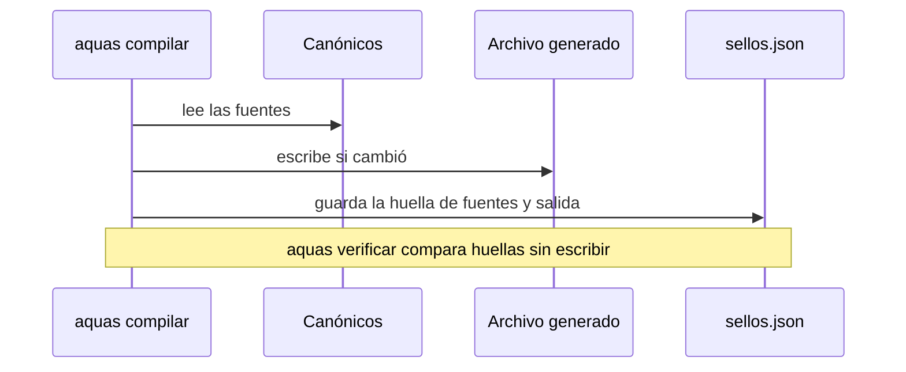
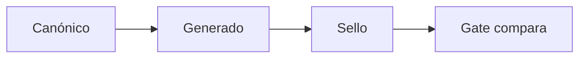

# S001 · Compilar y sellar

[Inicio](../../README.md) › [E000](../README.md) › [F002](README.md) › S001

[Slice](../../glosario.md#slice) que crea el [compilador](../../glosario.md#compilador): lee los [canónicos](../../glosario.md#canónico), genera los archivos y les pone un [sello](../../glosario.md#sello).

## En una frase

Un programa arma `CLAUDE.md` y los [agentes](../../glosario.md#agente), y guarda su huella para saber si alguien los toca.

## Para qué existe

**El problema.** Las reglas vivían copiadas a mano. Una copia vieja podía seguir mandando sin que nadie lo notara.

**La solución.** Tres órdenes en `aquas`:

- `compilar` genera los archivos y actualiza el sello.
- `verificar` es el [gate](../../glosario.md#gate): falla si algo está desfasado o editado a mano.
- `hook` recompila cada vez que Claude Code edita un archivo.

Contrato del slice:

| Campo | Valor |
|---|---|
| Objetivo | Cada archivo generado sale de sus canónicos y su huella está en el sello |
| Incluye | Compilar, sellar con SHA-256, gate de desfase, hook de recompilado |
| Regla | Una fuente fuera de `gobierno/canonico/` se rechaza |
| Prueba | `go test ./internal/compilador/` |

## Analogía

Piensa en una **fotocopia con firma**.

- El original está guardado bajo llave.
- Cada copia lleva la firma de la página original.
- Si alguien escribe a mano sobre la copia, la firma ya no coincide.

Límite de la analogía: una firma se puede imitar. La huella [SHA-256](../../glosario.md#sha-256) no, en la práctica.

## Diagrama

Secuencia: compilar y verificar.

## Ejemplo de punta a punta

continúa: [EJ-E000-F002](README.md#EJ-E000-F002)

En la [feature](../../glosario.md#feature), la regla de la guardia llegó al archivo del [orquestador](../../glosario.md#orquestador). Ahora alguien edita ese archivo a mano.

1. Se cambia una línea de `.claude/agents/orchestrator.md`.
2. `aquas verificar` compara la huella con el sello. No coincide.
3. El gate falla y dice que el archivo es GENERADO.
4. Se corre `aquas compilar`. El archivo vuelve a salir del canónico y el gate pasa.

## Paso a paso

1. Leer la config de qué se compila.
2. Juntar las fuentes de cada salida.
3. Escribir la salida solo si cambió.
4. Guardar las huellas en el sello.

## Cómo se usa

- Compilar: `go run ./cmd/aquas compilar`.
- Verificar: `go run ./cmd/aquas verificar`.

## Contrato y evidencia

<!-- GENERADO por aquas desde trabajo/: no editar a mano; `aquas compilar` lo rehace. -->

| Prueba | Valida | Rojo cuando | Verde cuando | Rojo | Verde |
|---|---|---|---|---|---|
| — | ficha anterior al registro de pruebas | — | — | — | — |

<!-- /GENERADO -->

Pruebas del slice, en `internal/compilador/compilador_test.go`:

| Prueba | Qué demuestra |
|---|---|
| `TestCompilarGeneraAgenteYDocumento` | Genera el agente y el documento con su contenido |
| `TestCambioEnCanonicoRecompilaAgente` | Un cambio en el canónico llega al archivo generado |
| `TestEdicionManualDeDerivadoFallaGate` | Editar a mano un archivo generado hace fallar el gate |
| `TestFuenteFueraDeCanonicoSeRechaza` | Una fuente fuera de los canónicos se rechaza |
| `TestCompilarEsIdempotente` | Compilar dos veces no cambia nada la segunda vez |

Rojo visto: no quedó registrado. NO CONFIRMADO. Tres de estas pruebas se endurecieron y vieron su rojo en [E000/F005/S001](../F005/S001.md).

[Commit](../../glosario.md#commit): `d2b7f3d`.

Decisión de Jesús: se edita solo el canónico; lo generado lleva la marca GENERADO.

## Navegación

- ↑ Subir: [F002 · Compilador y sello](README.md)
