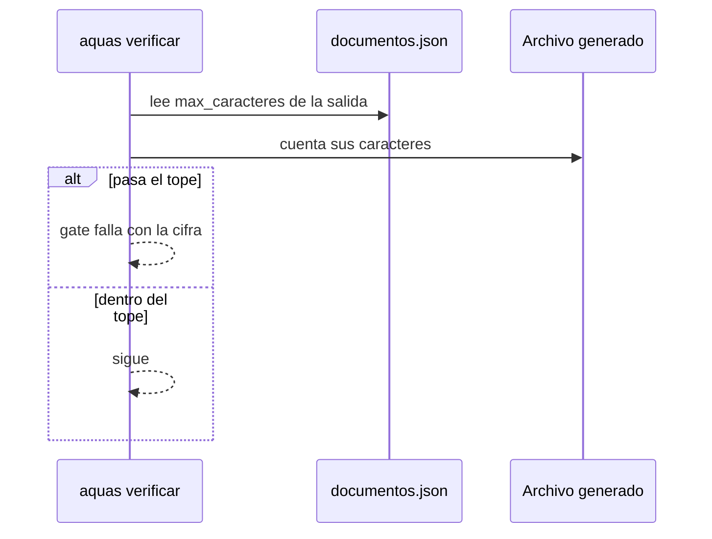
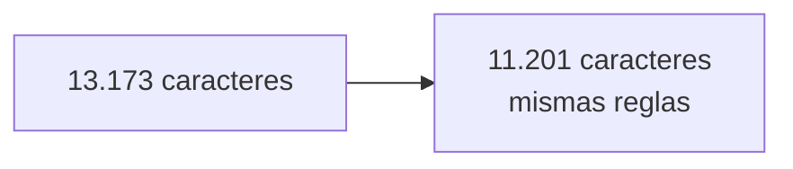

# S002 · Tope de caracteres

[Inicio](../../README.md) › [E000](../README.md) › [F002](README.md) › S002

[Slice](../../glosario.md#slice) que pone un tope de caracteres a cada archivo generado por el [compilador](../../glosario.md#compilador).

## En una frase

Si un archivo generado pasa su tope, la máquina no deja guardar.

## Para qué existe

**El problema.** Todo lo que está en `CLAUDE.md` y en el [orquestador](../../glosario.md#orquestador) se lee en cada turno. Cada palabra de más cuesta [tokens](../../glosario.md#token) siempre.

**La solución.** Jesús pidió quitar palabras sin quitar reglas. El orquestador bajó de 13.173 a 11.201 caracteres. Para que no vuelva a engordar, cada salida declara `max_caracteres` y el [gate](../../glosario.md#gate) lo revisa.

Contrato del slice:

| Campo | Valor |
|---|---|
| Objetivo | Ningún archivo generado pasa su tope |
| Incluye | Campo `max_caracteres` obligatorio y su revisión en el gate |
| Regla | Salida sin tope = config rechazada |
| Prueba | `go test ./internal/compilador/` |

## Analogía

Piensa en una **maleta de cabina**.

- La aerolínea marca el tamaño máximo.
- Si la maleta no cabe en el medidor, no sube al avión.
- Para meter algo nuevo, hay que sacar otra cosa.

Límite de la analogía: aquí el medidor cuenta caracteres, no sabe si lo que sobra es útil.

## Diagrama

Secuencia: revisión del tope.

## Ejemplo de punta a punta

continúa: [EJ-E000-F002](README.md#EJ-E000-F002)

En la [feature](../../glosario.md#feature), el compilador revisó que la regla cupiera. Así pasó con `CLAUDE.md` en S004 de la guardia.

1. Se agregó a la constitución la línea del clon nuevo.
2. El gate dijo: 2.936 caracteres, tope 2.700.
3. Se comprimieron líneas sin quitar ninguna regla. Quedó en 2.708: todavía no cabía.
4. Una compresión más y pasó.

## Paso a paso

1. Leer el tope de cada salida.
2. Rechazar la config si falta un tope.
3. Contar los caracteres del archivo generado.
4. Fallar si pasa el tope.

## Cómo se usa

- Cambiar un tope: edita `max_caracteres` en `gobierno/config/documentos.json` o `agentes.json`.
- Subir un tope es decisión humana: el contexto permanente cuesta en cada turno.

## Contrato y evidencia

Pruebas del slice, en `internal/compilador/compilador_test.go`:

| Prueba | Qué demuestra |
|---|---|
| `TestPresupuestoExcedidoFallaGate` | Un archivo que pasa su tope hace fallar el gate |
| `TestPresupuestoDentroPasaGate` | Un archivo dentro del tope pasa |
| `TestSinPresupuestoSeRechaza` | Una salida sin tope se rechaza |

Rojo visto: no quedó registrado. NO CONFIRMADO.

[Commit](../../glosario.md#commit): `458614f`.

Decisión de Jesús: quitar palabras sin quitar proceso; el tope es obligatorio.

## Navegación

- ↑ Subir: [F002 · Compilador y sello](README.md)
