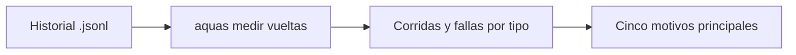
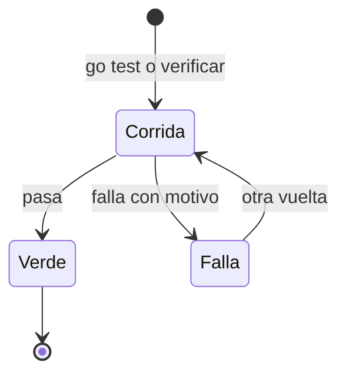

# F004 · Vueltas de pruebas y gate

[Inicio](../../README.md) › [E000](../README.md) › F004

[Feature](../../glosario.md#feature) que mide cuántas veces se repiten las pruebas y el [gate](../../glosario.md#gate) antes de pasar. Cada repetición cuesta llamadas y contexto.

## En una frase

Antes de abaratar las vueltas, contarlas y saber por qué ocurren.

## Para qué existe

**El problema.** Una muestra a mano del 2026-10-21 vio que casi la mitad de las corridas fallaban. Nadie sabía cuáles ni por qué.

**La solución.** Un [slice](../../glosario.md#slice) que cuenta corridas, fallas y motivos leyendo el historial de Claude Code.

## Analogía

Piensa en un **taller que anota cada devolución**.

- Sin la libreta, solo hay una sensación de «se devuelven muchos».
- Con la libreta, se ve que casi todas vienen de la misma pieza.

Límite de la analogía: aquí la libreta la llena un programa, no una persona.

## Diagrama

Estados de una vuelta:

| Slice | Qué entrega |
|---|---|
| [S001 Medir vueltas](S001.md) | `aquas medir vueltas` con motivos |

## Ejemplo de punta a punta

continúa: [EJ-E000](../README.md#EJ-E000)

1. Se corre `aquas medir vueltas`.
2. Sale `verificar 417/166 (wiki 143, derivados 22, …)`.
3. Se ve que la [wiki](../../glosario.md#wiki) causa casi todas las caídas del gate.

## Paso a paso

1. Medir vueltas de pruebas y gate (S001).

## Cómo se usa

- Medir: `aquas medir vueltas`.
- Ver las fichas: `aquas backlog ver E000/F004`.

## Contrato y evidencia

**Objetivo.** Saber, con números, cuántas corridas fallan y por qué.

Prueba integral: `TestCuentaVueltasPorMotivo`, en S001.

## Navegación

<!-- GENERADO por aquas desde trabajo/: no editar a mano; `aquas compilar` lo rehace. -->

| Hijo | Qué es | Estado |
|---|---|---|
| [S001](S001.md) | Medir vueltas de pruebas y gate | Hecho |

<!-- /GENERADO -->

- ↑ Subir: [E000 · Mantenimiento del gobierno](../README.md)
- Abajo: [S001 · Medir vueltas](S001.md)
