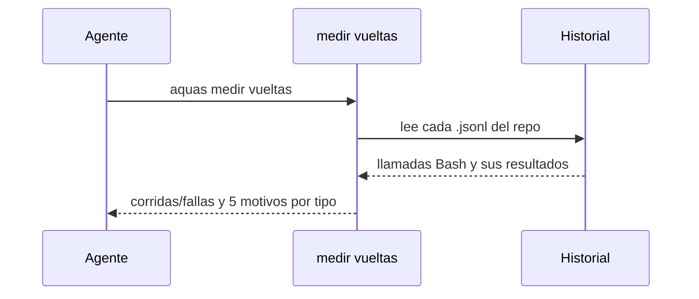

# S001 · Medir vueltas de pruebas y gate

[Inicio](../../README.md) › [E000](../README.md) › [F004](README.md) › S001

`aquas medir vueltas` cuenta cuántas veces corrieron `go test` y `aquas verificar`, cuántas fallaron y por qué. Solo lee el historial de Claude Code; nunca lo cambia.

## En una frase

Contar las vueltas antes de intentar ahorrarlas.

## Para qué existe

**El problema.** Cada prueba o [gate](../../glosario.md#gate) fallido obliga a otra vuelta. No sabíamos cuántas ni cuál era la causa más común.

**La solución.** Este [slice](../../glosario.md#slice) de la [feature](../../glosario.md#feature) F004 lee el historial y agrupa las fallas por motivo.

Contrato del slice:

| Campo | Valor |
|---|---|
| Objetivo | Corridas, fallas y motivos de pruebas y gate, por sesión y en total |
| Incluye | `internal/vueltas`, el comando `aquas medir vueltas` |
| Excluye | Diagnosticar cada falla: eso es el registro de defectos |
| Prueba | `go test ./internal/vueltas/ -run TestCuentaVueltasPorMotivo` |

## Analogía

Piensa en un **contador de devoluciones** en una tienda.

- Anota cada devolución y su causa.
- Al final del mes, la causa más repetida salta a la vista.

Límite de la analogía: aquí solo se cuentan dos tipos de corrida.

## Diagrama

## Ejemplo de punta a punta

continúa: [EJ-E000-F004](README.md#EJ-E000-F004)

1. Se corre `aquas medir vueltas`.
2. Sale una línea por sesión y una de total.
3. El total del 2026-10-22: `verificar 417/166 (wiki 143, derivados 22, otro 2, lista 1)`.

## Paso a paso

Así decide el comando:

1. Cuenta una llamada Bash si contiene `go test` o `aquas verificar`.
2. Ignora las llamadas sin resultado, porque no corrieron.
3. Toma como motivo la prueba fallida, la compilación o la revisión del gate.
4. Una subprueba cuenta bajo su prueba.
5. Un error sin señal clara cuenta como «otro».
6. Muestra solo los cinco motivos principales.

## Cómo se usa

- Todo el historial del repo: `aquas medir vueltas`.
- Un archivo puntual: `aquas medir vueltas ruta.jsonl`.

## Contrato y evidencia

<!-- GENERADO por aquas desde trabajo/: no editar a mano; `aquas compilar` lo rehace. -->

| Prueba | Valida | Rojo cuando | Verde cuando | Rojo | Verde |
|---|---|---|---|---|---|
| `TestCuentaVueltasPorMotivo` | cuenta corridas, fallas y motivos del historial | las corridas, fallas o motivos no coinciden con los conocidos | el historial de muestra da exactamente su conteo y línea | 2026-10-22 | 2026-10-22 |

### Código

| Archivo | Función | Parámetros | Qué hace |
|---|---|---|---|
| [cmd/aquas/main.go](../../../cmd/aquas/main.go) | `main` | `()` | main despacha el subcomando de aquas (compilar, verificar, backlog, hooks…) y sale con su código. |
| [cmd/aquas/main.go](../../../cmd/aquas/main.go) | `hook` | `(raiz string)` | hook: exit 0 = nada que reportar; exit 2 = stderr se muestra a Claude. |
| [cmd/aquas/main.go](../../../cmd/aquas/main.go) | `compilarSettings` | `(w io.Writer)` | compilarSettings regenera .claude/settings.json; sin entorno declarado no inventa uno. |
| [cmd/aquas/main.go](../../../cmd/aquas/main.go) | `reportar` | `(w io.Writer, inf compilador.Informe)` | reportar imprime qué derivados escribió la compilación, o que todo estaba al día. |
| [cmd/aquas/main.go](../../../cmd/aquas/main.go) | `listar` | `(titulo string, problemas []string)` | listar imprime en stderr un título y cada problema en su viñeta. |
| [cmd/aquas/main.go](../../../cmd/aquas/main.go) | `lista` | `(xs []string) string` | lista une los textos con comas, o «—» si no hay ninguno. |
| [cmd/aquas/main.go](../../../cmd/aquas/main.go) | `fallar` | `(codigo int, err error)` | fallar imprime el error en stderr y termina con el código dado. |
| [cmd/aquas/main.go](../../../cmd/aquas/main.go) | `memoriaCLI` | `(raiz string, args []string)` | memoriaCLI: `ver` imprime la memoria; `fijar campo=valor…` la actualiza y la sella. |
| [cmd/aquas/main.go](../../../cmd/aquas/main.go) | `memoriaArchivada` | `(raiz, id string) error` | memoriaArchivada: CERRADO exige el archivo de memoria del slice, apunte o no la memoria a él (E001/F002/S009, X01). |
| [cmd/aquas/main.go](../../../cmd/aquas/main.go) | `focoEnBacklog` | `(raiz string, f memoria.Foco) error` | focoEnBacklog: la memoria solo fija el slice que el backlog tiene en curso (S003). |
| [cmd/aquas/main.go](../../../cmd/aquas/main.go) | `backlogCLI` | `(raiz string, args []string)` | backlogCLI: nuevo \\| ver [id] \\| tabla \\| prioridad \\| estado \\| siguiente \\| pruebas \\| rojo \\| verde. |
| [cmd/aquas/main.go](../../../cmd/aquas/main.go) | `turnoCLI` | `(raiz string, args []string)` | turnoCLI: auditoría de turnos (E001/F002/S001). Lee el JSON del hook por stdin. No imprime nada |
| [cmd/aquas/main.go](../../../cmd/aquas/main.go) | `defectoCLI` | `(raiz string, args []string) error` | defectoCLI: nuevo \\| ocurre \\| ver (E001/F004/S001). |
| [cmd/aquas/main.go](../../../cmd/aquas/main.go) | `versionBinario` | `() string` | versionBinario: versión del módulo con que se compiló el binario (= versión del gobierno embebido). |
| [cmd/aquas/main.go](../../../cmd/aquas/main.go) | `registrarCierre` | `(raiz, tipo, transcript, primera, resultado string)` | registrarCierre (E001/F004/S005, D000068) anota cada llamada del gancho cierre-agente en .tmp/hooks/cierre-agente.jsonl. |
| [internal/vueltas/vueltas.go](../../../internal/vueltas/vueltas.go) | `motivos` | `(tipo, salida string) []string` | motivos de una salida para un tipo; vacío = sin señal propia de fallo. |
| [internal/vueltas/vueltas.go](../../../internal/vueltas/vueltas.go) | `regla` | `(txt string) string` | regla: el mensaje del gate sin lo que cambia de página a página (citas, paréntesis, números). |
| [internal/vueltas/vueltas.go](../../../internal/vueltas/vueltas.go) | `Contar` | `(r io.Reader) (map[string]Conteo, error)` | Contar lee un historial .jsonl y agrupa por tipo ("go test", "verificar"). |
| [internal/vueltas/vueltas.go](../../../internal/vueltas/vueltas.go) | `texto` | `(raw json.RawMessage) string` | texto: el contenido de un resultado viene como cadena o como lista de bloques {type,text}. |
| [internal/vueltas/vueltas.go](../../../internal/vueltas/vueltas.go) | `Carpeta` | `(home, raiz string) string` | Carpeta del historial de Claude Code para este repo: ~/.claude/projects/<raíz con :\/ y espacios → ->. |
| [internal/vueltas/vueltas.go](../../../internal/vueltas/vueltas.go) | `Medir` | `(w io.Writer, home, raiz string, archivos []string) error` | Medir imprime una línea por historial y el total. Sin archivos: todos los .jsonl de Carpeta. |
| [internal/vueltas/vueltas.go](../../../internal/vueltas/vueltas.go) | `Linea` | `(nombre string, c map[string]Conteo) string` | Linea: «nombre · go test 92/47 (TestA 3, compilación 2) · verificar 102/37 (wiki 20)»; motivos de más a menos. |

<!-- /GENERADO -->

Estado: hecho.

Límites:

- `grep verificar` no cuenta, pero un comando que nombre `aquas verificar` sin correrlo sí.
- La muestra a mano del 2026-10-21 no cuadra con este conteo; la causa no está confirmada.

## Navegación

- ↑ Subir: [F004 · Vueltas de pruebas y gate](README.md)
