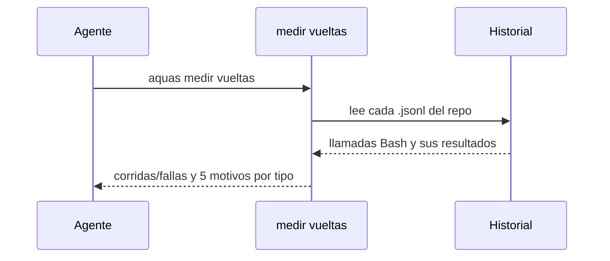

# S001 · Medir vueltas de pruebas y gate

[Inicio](../../README.md) › [E000](../README.md) › [F004](README.md) › S001

`aquas medir vueltas` cuenta cuántas veces corrieron `go test` y `aquas verificar`, cuántas fallaron y por qué. Solo lee el historial de Claude Code; nunca lo cambia.

## En una frase

Contar las vueltas antes de intentar ahorrarlas.

## Para qué existe

**El problema.** Cada prueba o [gate](../../glosario.md#gate) fallido obliga a otra vuelta. No sabíamos cuántas ni cuál era la causa más común.

**La solución.** Este [slice](../../glosario.md#slice) de la [feature](../../glosario.md#feature) F004 lee el historial y agrupa las fallas por motivo.

Contrato del slice:

| Campo | Valor |
|---|---|
| Objetivo | Corridas, fallas y motivos de pruebas y gate, por sesión y en total |
| Incluye | `internal/vueltas`, el comando `aquas medir vueltas` |
| Excluye | Diagnosticar cada falla: eso es el registro de defectos |
| Prueba | `go test ./internal/vueltas/ -run TestCuentaVueltasPorMotivo` |

## Analogía

Piensa en un **contador de devoluciones** en una tienda.

- Anota cada devolución y su causa.
- Al final del mes, la causa más repetida salta a la vista.

Límite de la analogía: aquí solo se cuentan dos tipos de corrida.

## Diagrama

## Ejemplo de punta a punta

continúa: [EJ-E000-F004](README.md#EJ-E000-F004)

1. Se corre `aquas medir vueltas`.
2. Sale una línea por sesión y una de total.
3. El total del 2026-10-22: `verificar 417/166 (wiki 143, derivados 22, otro 2, lista 1)`.

## Paso a paso

Así decide el comando:

1. Cuenta una llamada Bash si contiene `go test` o `aquas verificar`.
2. Ignora las llamadas sin resultado, porque no corrieron.
3. Toma como motivo la prueba fallida, la compilación o la revisión del gate.
4. Una subprueba cuenta bajo su prueba.
5. Un error sin señal clara cuenta como «otro».
6. Muestra solo los cinco motivos principales.

## Cómo se usa

- Todo el historial del repo: `aquas medir vueltas`.
- Un archivo puntual: `aquas medir vueltas ruta.jsonl`.

## Contrato y evidencia

<!-- GENERADO por aquas desde trabajo/: no editar a mano; `aquas compilar` lo rehace. -->

| Prueba | Qué demuestra | Rojo | Verde |
|---|---|---|---|
| `TestCuentaVueltasPorMotivo` | un historial de muestra con corridas de go test y aquas verificar conocidas da exactamente sus corridas, fallas y motivos | 2026-10-22 | 2026-10-22 |

<!-- /GENERADO -->

Estado: hecho.

Límites:

- `grep verificar` no cuenta, pero un comando que nombre `aquas verificar` sin correrlo sí.
- La muestra a mano del 2026-10-21 no cuadra con este conteo; la causa no está confirmada.

## Navegación

- ↑ Subir: [F004 · Vueltas de pruebas y gate](README.md)
