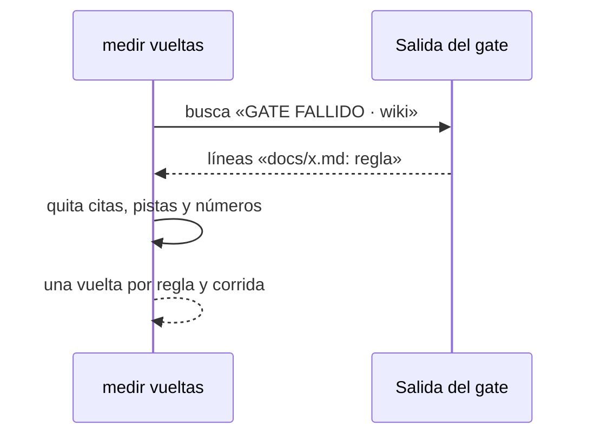

# S002 · Por qué cae la wiki

[Inicio](../../README.md) › [E000](../README.md) › [F004](README.md) › S002

`aquas measure runs` ya no da un motivo genérico. Dice qué regla de la [wiki](../../glosario.md#wiki) hizo caer el [gate](../../glosario.md#gate).

## En una frase

Saber qué regla de la wiki cuesta más vueltas.

## Para qué existe

**El problema.** La wiki causaba 143 de 166 caídas del gate. Sin saber qué regla, no se podía decidir qué cambiar.

**La solución.** Este [slice](../../glosario.md#slice) lee el detalle que el gate ya imprime y lo agrupa por regla.

Contrato del slice:

| Campo | Valor |
|---|---|
| Objetivo | Cada caída de la wiki cuenta por la regla que la causó |
| Incluye | La lectura del detalle del gate en `internal/vueltas` |
| Excluye | Cambiar las reglas de la wiki: eso lo decide el humano con estos números |
| Prueba | `go test ./internal/vueltas/ -run TestMotivoDeWikiPorRegla` |

## Analogía

Piensa en el **parte de un mecánico**.

- «Falla del motor» no ayuda mucho.
- «Bujía sucia, tres veces» dice qué comprar.

Límite de la analogía: aquí el parte sale del texto del gate, no de una revisión.

## Diagrama

## Ejemplo de punta a punta

continúa: [EJ-E000-F004](README.md#EJ-E000-F004)

1. El gate falla con `docs/b.md: primera aparición de «agente» sin enlace al glosario (escribe …)`.
2. La regla queda como `wiki: primera aparición de «…» sin enlace al glosario`.
3. El total del 2026-10-22 la muestra 110 veces.

## Paso a paso

1. Busca la sección de la wiki en la salida del gate.
2. De cada línea toma el texto después de la página.
3. Cambia las citas por «…» y quita la pista final y los números.
4. Si la misma regla falla en dos páginas, cuenta una vez por corrida.
5. Sin detalle legible, el motivo queda «wiki», como antes.

## Cómo se usa

- `aquas measure runs`: las reglas de la wiki salen como `wiki: …`.

## Contrato y evidencia

<!-- GENERADO por aquas desde trabajo/: no editar a mano; `aquas compile` lo rehace. -->

| Prueba | Valida | Rojo cuando | Verde cuando | Rojo | Verde |
|---|---|---|---|---|---|
| `TestMotivoDeWikiPorRegla` | una caída de wiki cuenta por la regla que falló | varias páginas con la misma regla cuentan más de una vuelta | cada regla de wiki es un motivo y repetida cuenta una vez | 2026-10-22 | 2026-10-22 |

### Código

| Archivo | Función | Parámetros | Qué hace |
|---|---|---|---|
| [internal/vueltas/vueltas.go](../../../internal/vueltas/vueltas.go) | `motivos` | `(tipo, salida string) []string` | motivos de una salida para un tipo; vacío = sin señal propia de fallo. |
| [internal/vueltas/vueltas.go](../../../internal/vueltas/vueltas.go) | `regla` | `(txt string) string` | regla: el mensaje del gate sin lo que cambia de página a página (citas, paréntesis, números). |
| [internal/vueltas/vueltas.go](../../../internal/vueltas/vueltas.go) | `Contar` | `(r io.Reader) (map[string]Conteo, error)` | Contar lee un historial .jsonl y agrupa por tipo ("go test", "verificar"). |
| [internal/vueltas/vueltas.go](../../../internal/vueltas/vueltas.go) | `texto` | `(raw json.RawMessage) string` | texto: el contenido de un resultado viene como cadena o como lista de bloques {type,text}. |
| [internal/vueltas/vueltas.go](../../../internal/vueltas/vueltas.go) | `Carpeta` | `(home, raiz string) string` | Carpeta del historial de Claude Code para este repo: ~/.claude/projects/<raíz con :\/ y espacios → ->. |
| [internal/vueltas/vueltas.go](../../../internal/vueltas/vueltas.go) | `Medir` | `(w io.Writer, home, raiz string, archivos []string) error` | Medir imprime una línea por historial y el total. Sin archivos: todos los .jsonl de Carpeta. |
| [internal/vueltas/vueltas.go](../../../internal/vueltas/vueltas.go) | `Linea` | `(nombre string, c map[string]Conteo) string` | Linea: «nombre · go test 92/47 (TestA 3, compilación 2) · verificar 102/37 (wiki 20)»; motivos de más a menos. |

<!-- /GENERADO -->

Estado: hecho.

Hallazgo del 2026-10-22:

- Enlace al glosario faltante: 110 vueltas.
- Oración demasiado larga: 50.
- Prueba sin slice dueño: 24.

## Navegación

- ↑ Subir: [F004 · Vueltas de pruebas y gate](README.md)
