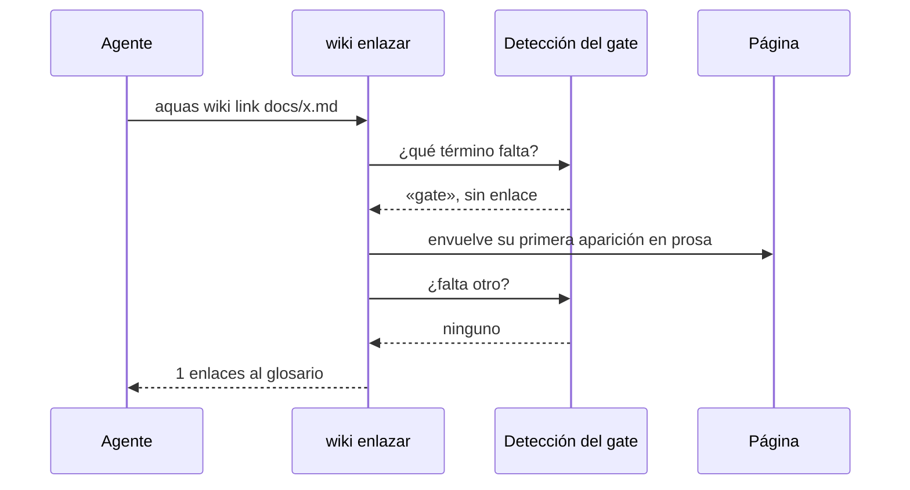

# S003 · Enlazar el glosario solo

[Inicio](../../README.md) › [E000](../README.md) › [F004](README.md) › S003

`aquas wiki link docs/x.md` pone el enlace al glosario donde el [gate](../../glosario.md#gate) lo pide. Usa la misma detección que el gate, así que arregla justo lo que el gate reclama.

## En una frase

El enlace que falta lo pone un programa, no una vuelta más.

## Para qué existe

**El problema.** El enlace faltante al glosario causaba 110 de 166 caídas del gate. Cada caída era una vuelta mecánica.

**La solución.** Este [slice](../../glosario.md#slice) escribe el enlace solo, en la primera aparición en prosa de cada término.

Contrato del slice:

| Campo | Valor |
|---|---|
| Objetivo | Enlazar la primera aparición en prosa de cada término del glosario |
| Incluye | `wiki.Enlazar`, la detección compartida con el gate, `aquas wiki link` |
| Excluye | Oraciones largas y otras reglas que piden criterio |
| Prueba | `go test ./internal/wiki/ -run TestEnlazaGlosarioSolo` |

## Analogía

Piensa en el **corrector ortográfico** de un editor de texto.

- No reescribe tu idea.
- Solo arregla lo que tiene una única respuesta correcta.

Límite de la analogía: aquí no hay sugerencias; el cambio se aplica directo.

## Diagrama

## Ejemplo de punta a punta

continúa: [EJ-E000-F004](README.md#EJ-E000-F004)

1. Se quitó a propósito el enlace de «gate» en la página de S002.
2. `aquas verify` cayó: «primera aparición de «gate» sin enlace».
3. `aquas wiki link docs/E000/F004/S002.md` respondió «1 enlaces».
4. La página quedó idéntica a la original, y el gate volvió a pasar.

## Paso a paso

1. Pregunta a la detección del gate qué término falta.
2. Busca su primera aparición en prosa.
3. Salta código, títulos, tablas, comentarios, navegación y enlaces.
4. Envuelve la palabra con su enlace y vuelve al paso 1.
5. Si un término ya tiene un enlace equivocado, para y avisa.

## Cómo se usa

- Antes del gate: `aquas wiki link docs/E000/F004/S003.md`.
- Una segunda corrida no cambia nada.

## Contrato y evidencia

<!-- GENERADO por aquas desde trabajo/: no editar a mano; `aquas compile` lo rehace. -->

| Prueba | Valida | Rojo cuando | Verde cuando | Rojo | Verde |
|---|---|---|---|---|---|
| `TestEnlazaGlosarioSolo` | wiki enlazar pone el enlace solo en la primera aparición en prosa y es idempotente | enlaza más de una vez, toca código, títulos o tablas, o una segunda corrida cambia la página | la primera corrida enlaza 2 términos y deja la página esperada; la segunda enlaza 0 | 2026-10-22 | 2026-10-22 |

### Código

| Archivo | Función | Parámetros | Qué hace |
|---|---|---|---|
| [cmd/aquas/main.go](../../../cmd/aquas/main.go) | `main` | `()` | main despacha el subcomando de aquas (compilar, verificar, backlog, hooks…) y sale con su código. |
| [cmd/aquas/main.go](../../../cmd/aquas/main.go) | `hook` | `(raiz string)` | hook: exit 0 = nada que reportar; exit 2 = stderr se muestra a Claude. |
| [cmd/aquas/main.go](../../../cmd/aquas/main.go) | `compilarSettings` | `(w io.Writer)` | compilarSettings regenera .claude/settings.json; sin entorno declarado no inventa uno. |
| [cmd/aquas/main.go](../../../cmd/aquas/main.go) | `reportar` | `(w io.Writer, inf compilador.Informe)` | reportar imprime qué derivados escribió la compilación, o que todo estaba al día. |
| [cmd/aquas/main.go](../../../cmd/aquas/main.go) | `listar` | `(titulo string, problemas []string)` | listar imprime en stderr un título y cada problema en su viñeta. |
| [cmd/aquas/main.go](../../../cmd/aquas/main.go) | `lista` | `(xs []string) string` | lista une los textos con comas, o «—» si no hay ninguno. |
| [cmd/aquas/main.go](../../../cmd/aquas/main.go) | `fallar` | `(codigo int, err error)` | fallar imprime el error en stderr y termina con el código dado. |
| [cmd/aquas/main.go](../../../cmd/aquas/main.go) | `memoriaCLI` | `(raiz string, args []string)` | memoriaCLI: `ver` imprime la memoria; `fijar campo=valor…` la actualiza y la sella. |
| [cmd/aquas/main.go](../../../cmd/aquas/main.go) | `memoriaArchivada` | `(raiz, id string) error` | memoriaArchivada: CERRADO exige el archivo de memoria del slice, apunte o no la memoria a él (E001/F002/S009, X01). |
| [cmd/aquas/main.go](../../../cmd/aquas/main.go) | `focoEnBacklog` | `(raiz string, f memoria.Foco) error` | focoEnBacklog: la memoria solo fija el slice que el backlog tiene en curso (S003). |
| [cmd/aquas/main.go](../../../cmd/aquas/main.go) | `backlogCLI` | `(raiz string, args []string)` | backlogCLI: nuevo \\| ver [id] \\| tabla \\| prioridad \\| estado \\| siguiente \\| pruebas \\| rojo \\| verde. |
| [cmd/aquas/main.go](../../../cmd/aquas/main.go) | `turnoCLI` | `(raiz string, args []string)` | turnoCLI: auditoría de turnos (E001/F002/S001). Lee el JSON del hook por stdin. No imprime nada |
| [cmd/aquas/main.go](../../../cmd/aquas/main.go) | `defectoCLI` | `(raiz string, args []string) error` | defectoCLI: nuevo \\| ocurre \\| ver (E001/F004/S001). |
| [cmd/aquas/main.go](../../../cmd/aquas/main.go) | `versionBinario` | `() string` | versionBinario: versión del módulo con que se compiló el binario (= versión del gobierno embebido). |
| [cmd/aquas/main.go](../../../cmd/aquas/main.go) | `registrarCierre` | `(raiz, tipo, transcript, primera, resultado string)` | registrarCierre (E001/F004/S005, D000068) anota cada llamada del gancho cierre-agente en .tmp/hooks/cierre-agente.jsonl. |
| [internal/wiki/enlazar.go](../../../internal/wiki/enlazar.go) | `Enlazar` | `(raiz, rel string) (int, error)` | Enlazar pone el enlace al glosario en la primera aparición en prosa de cada término (E000/F004/S003). |
| [internal/wiki/enlazar.go](../../../internal/wiki/enlazar.go) | `envolver` | `(raiz, rel string, f falta) (bool, error)` | envolver enlaza la primera aparición en prosa del término en el archivo. |
| [internal/wiki/glosario.go](../../../internal/wiki/glosario.go) | `terminos` | `(pg *pagina) []termino` | terminos extrae las entradas del glosario con sus formas (nombre + variantes). |
| [internal/wiki/glosario.go](../../../internal/wiki/glosario.go) | `revisarGlosario` | `(pg *pagina) []string` | revisarGlosario: cada término del glosario lleva definición y ejemplo. |
| [internal/wiki/glosario.go](../../../internal/wiki/glosario.go) | `revisarTerminos` | `(pg *pagina, ts []termino) []string` | revisarTerminos exige que la primera aparición en prosa de cada término enlace a su entrada. |
| [internal/wiki/glosario.go](../../../internal/wiki/glosario.go) | `faltantes` | `(pg *pagina, ts []termino) []falta` | faltantes: la detección que comparten el gate (revisarTerminos) y el arreglo (Enlazar). |
| [internal/wiki/glosario.go](../../../internal/wiki/glosario.go) | `relDesde` | `(desde, destino string) string` | relDesde da la ruta relativa de destino vista desde la carpeta de la página. |

<!-- /GENERADO -->

Estado: hecho.

## Navegación

- ↑ Subir: [F004 · Vueltas de pruebas y gate](README.md)
