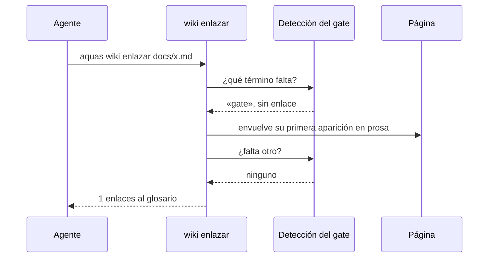

# S003 · Enlazar el glosario solo

[Inicio](../../README.md) › [E000](../README.md) › [F004](README.md) › S003

`aquas wiki enlazar docs/x.md` pone el enlace al glosario donde el [gate](../../glosario.md#gate) lo pide. Usa la misma detección que el gate, así que arregla justo lo que el gate reclama.

## En una frase

El enlace que falta lo pone un programa, no una vuelta más.

## Para qué existe

**El problema.** El enlace faltante al glosario causaba 110 de 166 caídas del gate. Cada caída era una vuelta mecánica.

**La solución.** Este [slice](../../glosario.md#slice) escribe el enlace solo, en la primera aparición en prosa de cada término.

Contrato del slice:

| Campo | Valor |
|---|---|
| Objetivo | Enlazar la primera aparición en prosa de cada término del glosario |
| Incluye | `wiki.Enlazar`, la detección compartida con el gate, `aquas wiki enlazar` |
| Excluye | Oraciones largas y otras reglas que piden criterio |
| Prueba | `go test ./internal/wiki/ -run TestEnlazaGlosarioSolo` |

## Analogía

Piensa en el **corrector ortográfico** de un editor de texto.

- No reescribe tu idea.
- Solo arregla lo que tiene una única respuesta correcta.

Límite de la analogía: aquí no hay sugerencias; el cambio se aplica directo.

## Diagrama

## Ejemplo de punta a punta

continúa: [EJ-E000-F004](README.md#EJ-E000-F004)

1. Se quitó a propósito el enlace de «gate» en la página de S002.
2. `aquas verificar` cayó: «primera aparición de «gate» sin enlace».
3. `aquas wiki enlazar docs/E000/F004/S002.md` respondió «1 enlaces».
4. La página quedó idéntica a la original, y el gate volvió a pasar.

## Paso a paso

1. Pregunta a la detección del gate qué término falta.
2. Busca su primera aparición en prosa.
3. Salta código, títulos, tablas, comentarios, navegación y enlaces.
4. Envuelve la palabra con su enlace y vuelve al paso 1.
5. Si un término ya tiene un enlace equivocado, para y avisa.

## Cómo se usa

- Antes del gate: `aquas wiki enlazar docs/E000/F004/S003.md`.
- Una segunda corrida no cambia nada.

## Contrato y evidencia

<!-- GENERADO por aquas desde trabajo/: no editar a mano; `aquas compilar` lo rehace. -->

| Prueba | Valida | Rojo cuando | Verde cuando | Rojo | Verde |
|---|---|---|---|---|---|
| `TestEnlazaGlosarioSolo` | aquas wiki enlazar pone el enlace en la primera aparición en prosa de cada término, no toca código, títulos, tablas ni enlaces, y una segunda corrida no cambia nada | — | — | 2026-10-22 | 2026-10-22 |

<!-- /GENERADO -->

Estado: hecho.

## Navegación

- ↑ Subir: [F004 · Vueltas de pruebas y gate](README.md)
