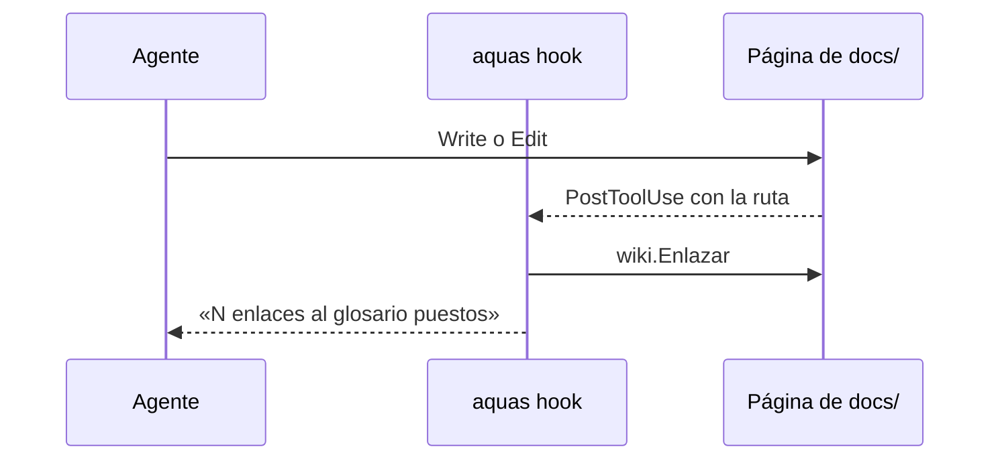

# S004 · Enlazar al guardar

[Inicio](../../README.md) › [E000](../README.md) › [F004](README.md) › S004

Al guardar una página de `docs/`, el [hook](../../glosario.md#hook) de edición pone solo los enlaces al glosario que faltan. Así el [agente](../../glosario.md#agente) no tiene que acordarse.

## En una frase

El enlace ya no depende de que alguien se acuerde.

## Para qué existe

**El problema.** `aquas wiki enlazar` (S003) arreglaba los enlaces, pero solo si el agente lo llamaba. Acordarse es probabilístico.

**La solución.** Este [slice](../../glosario.md#slice) lo conecta al hook PostToolUse, que ya corre después de cada edición.

Contrato del slice:

| Campo | Valor |
|---|---|
| Objetivo | Enlazar el glosario al guardar cualquier página de `docs/` |
| Incluye | El paso nuevo en `aquas hook` |
| Excluye | El glosario mismo y archivos fuera de `docs/` |
| Prueba | `go test ./cmd/aquas/ -run TestHookEnlazaAlGuardar` |

## Analogía

Piensa en el **autoguardado con corrector** de un editor.

- Escribes y guardas como siempre.
- El editor corrige lo que tiene una sola respuesta, sin que lo pidas.

Límite de la analogía: aquí solo se corrigen enlaces al glosario, nada más.

## Diagrama

## Ejemplo de punta a punta

continúa: [EJ-E000-F004](README.md#EJ-E000-F004)

1. El agente escribe esta misma página sin enlaces al glosario.
2. El hook los pone al guardar y avisa cuántos.
3. El [gate](../../glosario.md#gate) pasa sin una vuelta extra.

## Paso a paso

1. El hook recibe la ruta del archivo editado.
2. Si es una página `.md` de `docs/` y no es el glosario, llama a `wiki.Enlazar`.
3. Si puso enlaces, avisa con exit 2 para que el agente relea el archivo.
4. Si hay un enlace equivocado previo, no frena: el gate lo reporta.

## Cómo se usa

- No hace falta hacer nada: corre al guardar.
- A mano sigue disponible: `aquas wiki enlazar docs/x.md`.

## Contrato y evidencia

<!-- GENERADO por aquas desde trabajo/: no editar a mano; `aquas compilar` lo rehace. -->

| Prueba | Valida | Rojo cuando | Verde cuando | Rojo | Verde |
|---|---|---|---|---|---|
| `TestHookEnlazaAlGuardar` | el hook enlaza al glosario al guardar una página de docs/ y no toca otros archivos | la página de docs/ queda sin enlazar, el hook no avisa, o cambia un archivo fuera de docs/ | docs/ queda enlazada y el hook avisa lo cambiado; fuera de docs/ el archivo queda igual | 2026-10-22 | 2026-10-22 |

### Código

| Archivo | Función | Parámetros | Qué hace |
|---|---|---|---|
| [cmd/aquas/main.go](../../../cmd/aquas/main.go) | `main` | `()` | main despacha el subcomando de aquas (compilar, verificar, backlog, hooks…) y sale con su código. |
| [cmd/aquas/main.go](../../../cmd/aquas/main.go) | `hook` | `(raiz string)` | hook: exit 0 = nada que reportar; exit 2 = stderr se muestra a Claude. |
| [cmd/aquas/main.go](../../../cmd/aquas/main.go) | `compilarSettings` | `(w io.Writer)` | compilarSettings regenera .claude/settings.json; sin entorno declarado no inventa uno. |
| [cmd/aquas/main.go](../../../cmd/aquas/main.go) | `reportar` | `(w io.Writer, inf compilador.Informe)` | reportar imprime qué derivados escribió la compilación, o que todo estaba al día. |
| [cmd/aquas/main.go](../../../cmd/aquas/main.go) | `listar` | `(titulo string, problemas []string)` | listar imprime en stderr un título y cada problema en su viñeta. |
| [cmd/aquas/main.go](../../../cmd/aquas/main.go) | `lista` | `(xs []string) string` | lista une los textos con comas, o «—» si no hay ninguno. |
| [cmd/aquas/main.go](../../../cmd/aquas/main.go) | `fallar` | `(codigo int, err error)` | fallar imprime el error en stderr y termina con el código dado. |
| [cmd/aquas/main.go](../../../cmd/aquas/main.go) | `memoriaCLI` | `(raiz string, args []string)` | memoriaCLI: `ver` imprime la memoria; `fijar campo=valor…` la actualiza y la sella. |
| [cmd/aquas/main.go](../../../cmd/aquas/main.go) | `memoriaArchivada` | `(raiz, id string) error` | memoriaArchivada: CERRADO exige que la memoria que apunta al slice ya esté archivada (E001/F002/S009). |
| [cmd/aquas/main.go](../../../cmd/aquas/main.go) | `focoEnBacklog` | `(raiz string, f memoria.Foco) error` | focoEnBacklog: la memoria solo fija el slice que el backlog tiene en curso (S003). |
| [cmd/aquas/main.go](../../../cmd/aquas/main.go) | `backlogCLI` | `(raiz string, args []string)` | backlogCLI: nuevo \\| ver [id] \\| prioridad \\| estado \\| siguiente \\| pruebas \\| rojo \\| verde. |
| [cmd/aquas/main.go](../../../cmd/aquas/main.go) | `turnoCLI` | `(raiz string, args []string)` | turnoCLI: auditoría de turnos (E001/F002/S001). Lee el JSON del hook por stdin. No imprime nada |
| [cmd/aquas/main.go](../../../cmd/aquas/main.go) | `defectoCLI` | `(raiz string, args []string) error` | defectoCLI: nuevo \\| ocurre \\| ver (E001/F004/S001). |
| [cmd/aquas/main.go](../../../cmd/aquas/main.go) | `versionBinario` | `() string` | versionBinario: versión del módulo con que se compiló el binario (= versión del gobierno embebido). |

<!-- /GENERADO -->

Estado: hecho.

## Navegación

- ↑ Subir: [F004 · Vueltas de pruebas y gate](README.md)
