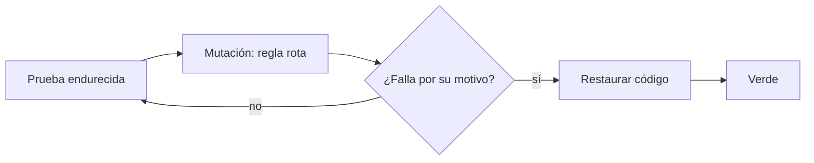
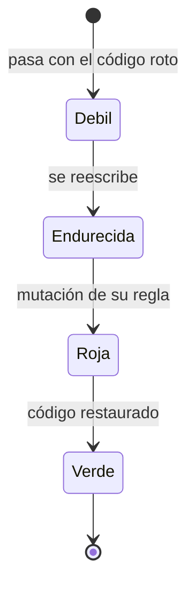

# F005 · Calidad de las pruebas

[Inicio](../../README.md) › [E000](../README.md) › F005

[Feature](../../glosario.md#feature) que endurece las pruebas débiles del repo. Una prueba débil pasa en verde aunque el código esté roto.

## En una frase

Cada prueba debe fallar cuando se rompe la regla que vigila, y por esa razón, no por otra.

## Para qué existe

**El problema.** Una revisión del 2026-10-21 leyó las 92 pruebas del repo. Halló 15 débiles o vacías. Luego rompió el código a propósito en 14 lugares: en 11, `go test` siguió en verde.

Ejemplo real: la prueba de «fuente fuera de los [canónicos](../../glosario.md#canónico)» pasaba porque a su configuración le faltaba un dato. La regla que decía vigilar nunca corría.

**La solución.** Seis [slices](../../glosario.md#slice), cada uno con sus pruebas y su intención:

- S001 a S003 corrigen pruebas que miran «hubo un error» y no cuál.
- S004 prueba el programa entero: `aquas verify`, `aquas guard` y los [hooks](../../glosario.md#hook) reales.
- S005 saca de un solo lugar las carpetas que protege la guardia.
- S006 muestra el rojo de cuatro slices viejos que se cerraron sin él.

**Rojo por mutación.** Aquí el código funciona; lo débil es la prueba. Por eso el rojo se ve así:

1. Se rompe a propósito la regla que vigila la prueba. Eso es una mutación.
2. `aquas backlog red` corre cada prueba. Cada una debe fallar por su mutación.
3. Se restaura el código y se registra el verde.

Decisión de Jesús, 2026-10-21.

## Analogía

Piensa en una **alarma de humo**.

- Que la luz esté prendida no prueba que suene.
- Para saberlo, acercas humo de prueba y escuchas.
- Si no suena, la alarma no sirve, aunque la luz siga verde.

Límite de la analogía: el humo de prueba no daña la casa. Aquí la mutación sí rompe el código, y por eso se restaura siempre.

## Diagrama

Proceso del rojo por mutación:

Estados de una prueba en esta feature:

Slices de esta feature:

| Slice | Qué entrega |
|---|---|
| [S001 Pruebas del compilador](S001.md) | Tres pruebas que miden la causa |
| [S002 Bloqueos con su motivo](S002.md) | Cinco pruebas de guardia y entorno |
| [S003 Aserciones aisladas](S003.md) | Seis pruebas que pasaban por otra entrada |
| [S004 Cableado de punta a punta](S004.md) | `verify`, `guard` y hooks reales |
| [S005 Carpetas protegidas](S005.md) | Una sola fuente para sus rutas |
| [S006 Rojo de slices viejos](S006.md) | Rojo de cuatro slices sin evidencia |

## Ejemplo de punta a punta

continúa: [EJ-E000](../README.md#EJ-E000)

En la [iniciativa](../../glosario.md#iniciativa), el [compilador](../../glosario.md#compilador) ya genera y sella los archivos. Ahora se pregunta si sus pruebas lo vigilan de verdad.

1. Se quita la regla «solo canónicos» del compilador.
2. La prueba vieja sigue en verde: fallaba por otra causa.
3. La prueba endurecida falla y dice por qué.
4. Se restaura el código. La prueba pasa.

## Paso a paso

1. Pruebas del compilador (S001).
2. Bloqueos de guardia y entorno (S002).
3. Aserciones aisladas (S003).
4. Cableado de punta a punta (S004).
5. Carpetas protegidas (S005).
6. Rojo de los slices viejos (S006).

## Cómo se usa

- Ver las fichas: `aquas backlog show E000/F005`.
- Probar: `go test ./...`.

## Contrato y evidencia

**Objetivo.** Ninguna prueba del repo pasa en verde con la regla que vigila rota.

Prueba integral: `TestVerificarDePuntaAPunta`, en S004. Corre el binario real sobre la config real. Su rojo se vio el 2026-10-21, con la primera mutación de S004. Un [derivado](../../glosario.md#derivado) editado o una [wiki](../../glosario.md#wiki) rota dan exit 1.

## Navegación

<!-- GENERADO por aquas desde trabajo/: no editar a mano; `aquas compile` lo rehace. -->

| Hijo | Qué es | Estado |
|---|---|---|
| [S001](S001.md) | Pruebas del compilador que miden la causa | Hecho |
| [S002](S002.md) | Bloqueos de guardia y entorno con su motivo | Hecho |
| [S003](S003.md) | Aserciones que no se cumplen por otra entrada | Hecho |
| [S004](S004.md) | Cableado del CLI probado de punta a punta | Hecho |
| [S005](S005.md) | Una sola fuente para las carpetas protegidas | Hecho |
| [S006](S006.md) | Rojo de los slices viejos sin evidencia | Hecho |

<!-- /GENERADO -->

- ↑ Subir: [E000 · Mantenimiento del gobierno](../README.md)
- Abajo: [S001 · Pruebas del compilador](S001.md)
- Abajo: [S002 · Bloqueos con su motivo](S002.md)
- Abajo: [S003 · Aserciones aisladas](S003.md)
