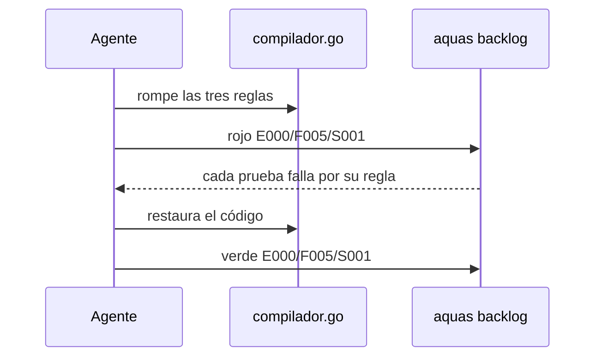
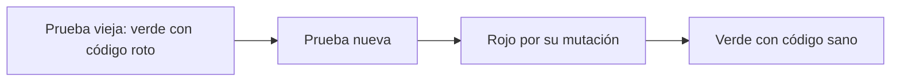

# S001 · Pruebas del compilador

[Inicio](../../README.md) › [E000](../README.md) › [F005](README.md) › S001

[Slice](../../glosario.md#slice) que endurece tres pruebas del [compilador](../../glosario.md#compilador). Antes pasaban con el código roto.

## En una frase

Cada prueba dice qué causa espera, y falla si la causa es otra.

## Para qué existe

**El problema.** Tres pruebas solo miraban si hubo un error:

- `TestFuenteFueraDeCanonicoSeRechaza` fallaba por un dato que faltaba en su configuración. La regla nunca corría.
- `TestEdicionManualDeDerivadoFallaGate` aceptaba cualquier problema del [gate](../../glosario.md#gate).
- `TestCompilarEsIdempotente` ignoraba la primera compilación. Un compilador que nunca escribe la pasaba.

**La solución.** Cada prueba exige su causa exacta.

Contrato del slice:

| Campo | Valor |
|---|---|
| Objetivo | Las tres pruebas fallan si se rompe la regla que vigilan |
| Incluye | Reescribir las tres pruebas; rojo por mutación |
| Excluye | Cambiar el código del compilador |
| Prueba | `go test ./internal/compilador/` |

## Analogía

Piensa en un **examen de manejo**.

- El examinador anotaba «falló» sin decir en qué.
- Un alumno que chocó y otro que no puso la luz salían iguales.
- Ahora la hoja dice la falta exacta.

Límite de la analogía: un examinador puede equivocarse al anotar. Aquí la prueba compara el texto exacto del error.

## Diagrama

Secuencia del rojo por mutación:

## Ejemplo de punta a punta

continúa: [EJ-E000-F005](README.md#EJ-E000-F005)

En la [feature](../../glosario.md#feature), la regla «solo [canónicos](../../glosario.md#canónico)» se quitó a propósito.

1. La prueba vieja corre. Pasa en verde: la configuración incompleta ya daba error.
2. La prueba nueva trae la configuración completa. Falla: «se esperaba el rechazo por fuente fuera de gobierno/canonico/».
3. Se restaura la regla. La prueba nueva pasa.

## Paso a paso

1. Reescribir las tres pruebas.
2. Comprobar que pasan con el código sano.
3. Aplicar tres mutaciones y correr `aquas backlog rojo`.
4. Correr las pruebas viejas sobre el mismo código roto.
5. Restaurar y correr `aquas backlog verde`.

## Cómo se usa

- Probar: `go test ./internal/compilador/`.
- Ver rojo y verde: `aquas backlog ver E000/F005/S001`.

## Contrato y evidencia

<!-- GENERADO por aquas desde trabajo/: no editar a mano; `aquas compilar` lo rehace. -->

| Prueba | Valida | Rojo cuando | Verde cuando | Rojo | Verde |
|---|---|---|---|---|---|
| `TestFuenteFueraDeCanonicoSeRechaza` | una fuente fuera de gobierno/canonico se rechaza | la fuente README.md se acepta o falla por otra causa | Compilar falla con «fuera de gobierno/canonico» | 2026-10-21 | 2026-10-21 |
| `TestEdicionManualDeDerivadoFallaGate` | editar a mano un derivado hace caer el gate | el gate pasa o nombra otro problema que CLAUDE.md | el único problema es «CLAUDE.md: desfasado o editado» | 2026-10-21 | 2026-10-21 |
| `TestCompilarEsIdempotente` | compilar dos veces no reescribe nada la segunda | la 1.ª no escribe los derivados, o la 2.ª reescribe | la 1.ª escribe derivados y sellos; la 2.ª escribe cero | 2026-10-21 | 2026-10-21 |

### Código

| Archivo | Función | Parámetros | Qué hace |
|---|---|---|---|
| [cmd/aquas/main.go](../../../cmd/aquas/main.go) | `main` | `()` | main despacha el subcomando de aquas (compilar, verificar, backlog, hooks…) y sale con su código. |
| [cmd/aquas/main.go](../../../cmd/aquas/main.go) | `hook` | `(raiz string)` | hook: exit 0 = nada que reportar; exit 2 = stderr se muestra a Claude. |
| [cmd/aquas/main.go](../../../cmd/aquas/main.go) | `compilarSettings` | `(w io.Writer)` | compilarSettings regenera .claude/settings.json; sin entorno declarado no inventa uno. |
| [cmd/aquas/main.go](../../../cmd/aquas/main.go) | `reportar` | `(w io.Writer, inf compilador.Informe)` | reportar imprime qué derivados escribió la compilación, o que todo estaba al día. |
| [cmd/aquas/main.go](../../../cmd/aquas/main.go) | `listar` | `(titulo string, problemas []string)` | listar imprime en stderr un título y cada problema en su viñeta. |
| [cmd/aquas/main.go](../../../cmd/aquas/main.go) | `lista` | `(xs []string) string` | lista une los textos con comas, o «—» si no hay ninguno. |
| [cmd/aquas/main.go](../../../cmd/aquas/main.go) | `fallar` | `(codigo int, err error)` | fallar imprime el error en stderr y termina con el código dado. |
| [cmd/aquas/main.go](../../../cmd/aquas/main.go) | `memoriaCLI` | `(raiz string, args []string)` | memoriaCLI: `ver` imprime la memoria; `fijar campo=valor…` la actualiza y la sella. |
| [cmd/aquas/main.go](../../../cmd/aquas/main.go) | `memoriaArchivada` | `(raiz, id string) error` | memoriaArchivada: CERRADO exige el archivo de memoria del slice, apunte o no la memoria a él (E001/F002/S009, X01). |
| [cmd/aquas/main.go](../../../cmd/aquas/main.go) | `focoEnBacklog` | `(raiz string, f memoria.Foco) error` | focoEnBacklog: la memoria solo fija el slice que el backlog tiene en curso (S003). |
| [cmd/aquas/main.go](../../../cmd/aquas/main.go) | `backlogCLI` | `(raiz string, args []string)` | backlogCLI: nuevo \\| ver [id] \\| tabla \\| prioridad \\| estado \\| siguiente \\| pruebas \\| rojo \\| verde. |
| [cmd/aquas/main.go](../../../cmd/aquas/main.go) | `turnoCLI` | `(raiz string, args []string)` | turnoCLI: auditoría de turnos (E001/F002/S001). Lee el JSON del hook por stdin. No imprime nada |
| [cmd/aquas/main.go](../../../cmd/aquas/main.go) | `defectoCLI` | `(raiz string, args []string) error` | defectoCLI: nuevo \\| ocurre \\| ver (E001/F004/S001). |
| [cmd/aquas/main.go](../../../cmd/aquas/main.go) | `versionBinario` | `() string` | versionBinario: versión del módulo con que se compiló el binario (= versión del gobierno embebido). |
| [cmd/aquas/main.go](../../../cmd/aquas/main.go) | `registrarCierre` | `(raiz, tipo, transcript, primera, resultado string)` | registrarCierre (E001/F004/S005, D000068) anota cada llamada del gancho cierre-agente en .tmp/hooks/cierre-agente.jsonl. |

<!-- /GENERADO -->

Estado: hecho.

Pruebas del slice, en `internal/compilador/compilador_test.go`:

| Prueba | Qué demuestra |
|---|---|
| `TestFuenteFueraDeCanonicoSeRechaza` | Con la configuración completa, la fuente fuera de los canónicos se rechaza por esa regla |
| `TestEdicionManualDeDerivadoFallaGate` | El gate nombra al `CLAUDE.md` editado como única causa |
| `TestCompilarEsIdempotente` | La primera compilación escribe; la segunda no reescribe nada |

Mutaciones del rojo, una por prueba:

| Mutación | Prueba que la detecta |
|---|---|
| Se acepta una fuente fuera de `gobierno/canonico/` | `TestFuenteFueraDeCanonicoSeRechaza` |
| La edición a mano se reporta como sello, sin nombrar el archivo | `TestEdicionManualDeDerivadoFallaGate` |
| `Compilar` escribe pero no informa lo escrito | `TestCompilarEsIdempotente` |

Rojo visto: sí, el 2026-10-21, registrado por `aquas backlog rojo`. Cada prueba falló por su mutación. Con el mismo código roto, las tres pruebas viejas pasaron en verde.

Un primer rojo no valía. Una mutación impedía escribir todo, y la prueba de edición falló también por ella. Se cambió por una mutación que no toca a las otras pruebas.

Decisión de Jesús (2026-10-21): en esta feature el rojo se ve por mutación, porque el código ya funciona.

## Navegación

- ↑ Subir: [F005 · Calidad de las pruebas](README.md)
