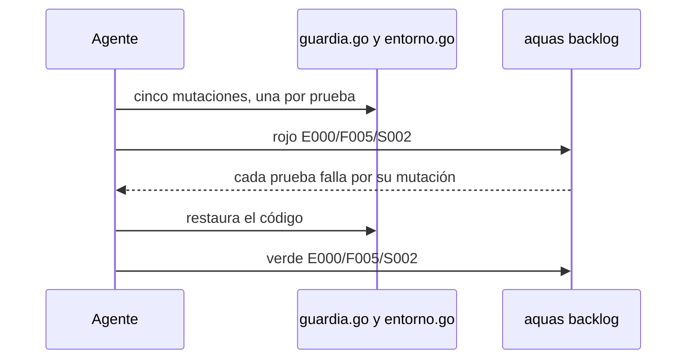
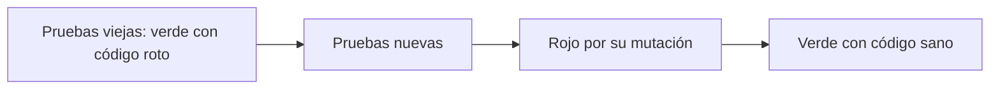

# S002 · Bloqueos con su motivo

[Inicio](../../README.md) › [E000](../README.md) › [F005](README.md) › S002

[Slice](../../glosario.md#slice) que endurece cinco pruebas de la guardia y del entorno. Antes les bastaba con que hubiera un bloqueo.

## En una frase

Cada bloqueo se prueba por su motivo, no solo porque ocurrió.

## Para qué existe

**El problema.** Cinco pruebas solo miraban si había un mensaje o un error:

- `TestValidarArchivoRotoBloquea` no miraba por qué bloqueaba.
- `TestSettingsSOSinConfigFalla` aceptaba cualquier error.
- `TestBashConCwdFuera` aceptaba cualquier bloqueo.
- `TestEntradaHook` comparaba solo «falla o no falla».
- `TestSinConfigTodoFueraBloqueado` no miraba qué ruta bloqueaba.

Un bloqueo por la causa equivocada pasaba igual. La guardia podía bloquear todo y las cinco seguían en verde.

**La solución.** Cada prueba exige el texto de su motivo.

Contrato del slice:

| Campo | Valor |
|---|---|
| Objetivo | Las cinco pruebas fallan si el bloqueo ocurre por otra causa |
| Incluye | Reescribir las cinco pruebas; rojo por mutación |
| Excluye | Cambiar el código de la guardia o del entorno |
| Prueba | `go test ./internal/guardia/ ./internal/entorno/` |

## Analogía

Piensa en un **portero de edificio**.

- Antes bastaba con que no dejara pasar a alguien.
- Pero si cierra la puerta a todos, también «funciona».
- Ahora se revisa que diga por qué: «no vive aquí», «no trae permiso».

Límite de la analogía: un portero puede dar otra razón válida. Aquí cada caso tiene un solo motivo correcto.

## Diagrama

Secuencia del rojo por mutación:

## Ejemplo de punta a punta

continúa: [EJ-E000-F005](README.md#EJ-E000-F005)

En la [feature](../../glosario.md#feature), la guardia se rompe a propósito. Con el directorio de trabajo fuera del repo, bloquea todo sin mirar el destino.

1. La prueba vieja corre. Pasa en verde: hubo bloqueo.
2. La prueba nueva exige «bloqueada: a.txt». Falla: el motivo fue otro.
3. Se restaura el código. La prueba nueva pasa.

## Paso a paso

1. Ver los mensajes reales con el código sano.
2. Reescribir las cinco pruebas con su motivo exacto.
3. Aplicar cinco mutaciones y correr `aquas backlog rojo`.
4. Correr las pruebas viejas sobre el mismo código roto.
5. Restaurar y correr `aquas backlog verde`.

## Cómo se usa

- Probar: `go test ./internal/guardia/ ./internal/entorno/`.
- Ver rojo y verde: `aquas backlog ver E000/F005/S002`.

## Contrato y evidencia

<!-- GENERADO por aquas desde trabajo/: no editar a mano; `aquas compilar` lo rehace. -->

| Prueba | Valida | Rojo cuando | Verde cuando | Rojo | Verde |
|---|---|---|---|---|---|
| `TestValidarArchivoRotoBloquea` | un archivo de entorno roto bloquea | el entorno ilegible no bloquea o no pide aquas iniciar | el mensaje dice «ilegible» y pide aquas iniciar | 2026-10-21 | 2026-10-21 |
| `TestSettingsSOSinConfigFalla` | un SO sin shell declarado falla nombrándolo | genera settings con un shell inventado para plan9 | falla con «sin shell declarado para el SO plan9» | 2026-10-21 | 2026-10-21 |
| `TestBashConCwdFuera` | Bash con cwd fuera del repo bloquea escrituras relativas | echo x > a.txt desde fuera del repo no se bloquea | bloquea con «escritura fuera del repositorio: a.txt» | 2026-10-21 | 2026-10-21 |
| `TestEntradaHook` | cada entrada del hook bloquea o pasa por su motivo | una entrada pasa cuando debía bloquear o al revés | Write y Read pasan; Edit, Bash fuera y JSON roto bloquean | 2026-10-21 | 2026-10-21 |
| `TestSinConfigTodoFueraBloqueado` | sin lista de permitidos todo lo de fuera se bloquea | una ruta fuera del repo pasa sin config | bloquea nombrando la ruta fuera del repositorio | 2026-10-21 | 2026-10-21 |

<!-- /GENERADO -->

Estado: hecho.

Pruebas del slice:

| Prueba | Qué demuestra |
|---|---|
| `TestValidarArchivoRotoBloquea` | El bloqueo dice que el archivo de entorno está roto y pide `aquas iniciar` |
| `TestSettingsSOSinConfigFalla` | El error nombra el sistema operativo sin configuración |
| `TestBashConCwdFuera` | Bloquea por el destino `a.txt`, relativo a un directorio de fuera |
| `TestEntradaHook` | Cada entrada del [hook](../../glosario.md#hook) bloquea o pasa por su motivo |
| `TestSinConfigTodoFueraBloqueado` | Sin lista de permitidos, bloquea y nombra la ruta de fuera |

Mutaciones del rojo, una por prueba:

| Mutación | Prueba que la detecta |
|---|---|
| El entorno roto se reporta como «no válido», sin decir ilegible | `TestValidarArchivoRotoBloquea` |
| El SO sin configuración da «plantilla incompleta» | `TestSettingsSOSinConfigFalla` |
| Con el directorio fuera, bloquea todo sin mirar el destino | `TestBashConCwdFuera` |
| `NotebookEdit` se trata como entrada ilegible | `TestEntradaHook` |
| El bloqueo oculta la ruta absoluta | `TestSinConfigTodoFueraBloqueado` |

Rojo visto: sí, el 2026-10-21, registrado por `aquas backlog rojo`. Cada prueba falló por su mutación. Con el mismo código roto, las cinco pruebas viejas pasaron en verde.

## Navegación

- ↑ Subir: [F005 · Calidad de las pruebas](README.md)
