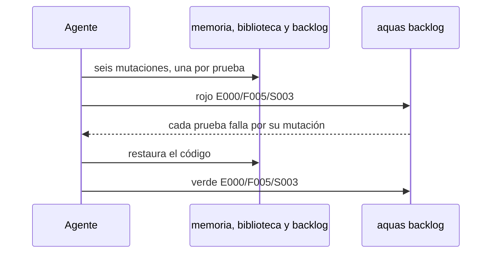
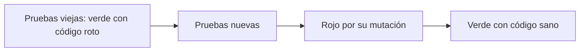

# S003 · Aserciones aisladas

[Inicio](../../README.md) › [E000](../README.md) › [F005](README.md) › S003

[Slice](../../glosario.md#slice) que endurece seis pruebas. Se cumplían por otra entrada del mismo pedido, o por una constante del mismo código.

## En una frase

Cada comprobación mira su propio caso, con un valor que la prueba fija por su cuenta.

## Para qué existe

**El problema.** Seis pruebas tenían una trampa:

- `TestVerMuestraFocoYRutas` esperaba la constante `Backlog` del código. Si la constante cambiaba, la prueba cambiaba con ella.
- `TestFijarGuardaLaHuella` comparaba con la misma función que calcula la huella.
- `TestLeerErroresPorRutaNoFrenanElLote` buscaba «fuera del repo», y otra ruta del lote ya lo daba.
- `TestLeerCasosBorde` no tenía ningún caso que llegara a «no se pudo leer».
- `TestValidarDetectaFichasMalas` buscaba fragmentos sueltos en todos los problemas juntos.
- `TestBacklogCLI` miraba la salida, no la ficha en disco.

**La solución.** Cada prueba usa valores literales o calculados aparte, y mira cada caso en su línea.

Contrato del slice:

| Campo | Valor |
|---|---|
| Objetivo | Las seis pruebas fallan si se rompe la regla que vigilan |
| Incluye | Reescribir las seis pruebas; rojo por mutación |
| Excluye | Cambiar el código vigilado |
| Prueba | `go test ./internal/memoria/ ./internal/biblioteca/ ./internal/backlog/ ./cmd/aquas/` |

## Analogía

Piensa en un **alumno que corrige su propio examen** con su hoja de respuestas.

- Si la hoja está mal, el examen sale bien igual.
- La corrección sirve solo con la hoja del profesor.

Límite de la analogía: aquí la «hoja del profesor» es un literal o un cálculo aparte. Un ejemplo es la suma [SHA-256](../../glosario.md#sha-256) del [commit](../../glosario.md#commit).

## Diagrama

Secuencia del rojo por mutación:

## Ejemplo de punta a punta

continúa: [EJ-E000-F005](README.md#EJ-E000-F005)

En la [feature](../../glosario.md#feature), la ruta del [backlog](../../glosario.md#backlog) en la memoria se cambia a propósito por `trabajo/archivo`.

1. La prueba vieja corre. Pasa: esperaba la misma constante.
2. La prueba nueva espera el literal `trabajo/activo`. Falla.
3. Se restaura el código. La prueba nueva pasa.

## Paso a paso

1. Leer el formato real de cada salida.
2. Reescribir las seis pruebas.
3. Aplicar seis mutaciones y correr `aquas backlog rojo`.
4. Correr las pruebas viejas sobre el mismo código roto.
5. Restaurar y correr `aquas backlog verde`.

## Cómo se usa

- Probar: `go test ./...`.
- Ver rojo y verde: `aquas backlog ver E000/F005/S003`.

## Contrato y evidencia

<!-- GENERADO por aquas desde trabajo/: no editar a mano; `aquas compilar` lo rehace. -->

| Prueba | Valida | Rojo cuando | Verde cuando | Rojo | Verde |
|---|---|---|---|---|---|
| `TestVerMuestraFocoYRutas` | ver muestra foco, rutas y comando de fijar | falta el foco, la ruta del slice, el backlog o el comando | el texto trae foco, tarea, siguiente, pendiente y rutas | 2026-10-21 | 2026-10-21 |
| `TestLeerErroresPorRutaNoFrenanElLote` | un error en una ruta no frena el resto del lote | una ruta mala corta el lote o falta su línea de error | cinco rutas dan cinco encabezados, cada uno con su estado | 2026-10-21 | 2026-10-21 |
| `TestLeerCasosBorde` | casos borde: vacío, carpeta, ilegible y repetidas | un error muestra la ruta absoluta o repetida cuenta doble | vacío, carpeta e ilegible tienen su línea; repetida cuenta una | 2026-10-21 | 2026-10-21 |
| `TestValidarDetectaFichasMalas` | cada ficha mala da su propio problema en su línea, incluido un padre incoherente | Validar no señala una ficha mala con su archivo y motivo, o da problemas en un backlog sano | cada ficha mala sale con su archivo y motivo, y un backlog sano no da problemas | 2026-10-21 | 2026-10-21 |
| `TestBacklogCLI` | cada paso del CLI backlog se comprueba leyendo la ficha en disco, no solo el exit | un paso sale 0 pero la ficha no queda con el campo esperado, o un uso malo no da exit 64 | cada paso deja la ficha con el valor esperado, uso malo da exit 64 y nuevo inválido exit 1 | 2026-10-21 | 2026-10-21 |
| `TestFijarGuardaLaHuella` | fijar guarda la huella del estado de git | la huella guardada difiere de sha256 de rev-parse HEAD | HuellaGit es igual al sha256 calculado aparte | 2026-10-21 | 2026-10-21 |

<!-- /GENERADO -->

Estado: hecho.

Pruebas del slice:

| Prueba | Qué demuestra |
|---|---|
| `TestVerMuestraFocoYRutas` | La ruta del backlog se compara con el literal `trabajo/activo` |
| `TestFijarGuardaLaHuella` | La huella guardada es la suma SHA-256 del commit, calculada en la prueba |
| `TestLeerErroresPorRutaNoFrenanElLote` | Cada ruta tiene su línea; la absoluta se comprueba con su nombre |
| `TestLeerCasosBorde` | Un archivo ilegible da «no se pudo leer» sin la ruta de la máquina |
| `TestValidarDetectaFichasMalas` | Cada ficha mala da su problema en su línea, también un padre incoherente |
| `TestBacklogCLI` | Cada paso del CLI se comprueba en la ficha en disco |

Mutaciones del rojo, una por prueba:

| Mutación | Prueba que la detecta |
|---|---|
| La memoria apunta a `trabajo/archivo` | `TestVerMuestraFocoYRutas` |
| La huella deja fuera el commit | `TestFijarGuardaLaHuella` |
| Se aceptan rutas absolutas | `TestLeerErroresPorRutaNoFrenanElLote` |
| El error de lectura muestra la ruta absoluta | `TestLeerCasosBorde` |
| `Validar` solo mira el tipo, no el padre | `TestValidarDetectaFichasMalas` |
| Un estado no terminal no se guarda | `TestBacklogCLI` |

Rojo visto: sí, el 2026-10-21, registrado por `aquas backlog rojo`. Cada prueba falló por su mutación. Con el mismo código roto, las seis pruebas viejas pasaron en verde.

Dos intentos de rojo fueron rechazados por `aquas`: la primera mutación no compilaba. Una prueba que no compila no cuenta como rojo.

Límite: el archivo ilegible depende del sistema. En Windows es un nombre con «<»; en otros, un archivo sin permisos. Con usuario root la prueba se salta. NO CONFIRMADO fuera de Windows.

## Navegación

- ↑ Subir: [F005 · Calidad de las pruebas](README.md)
