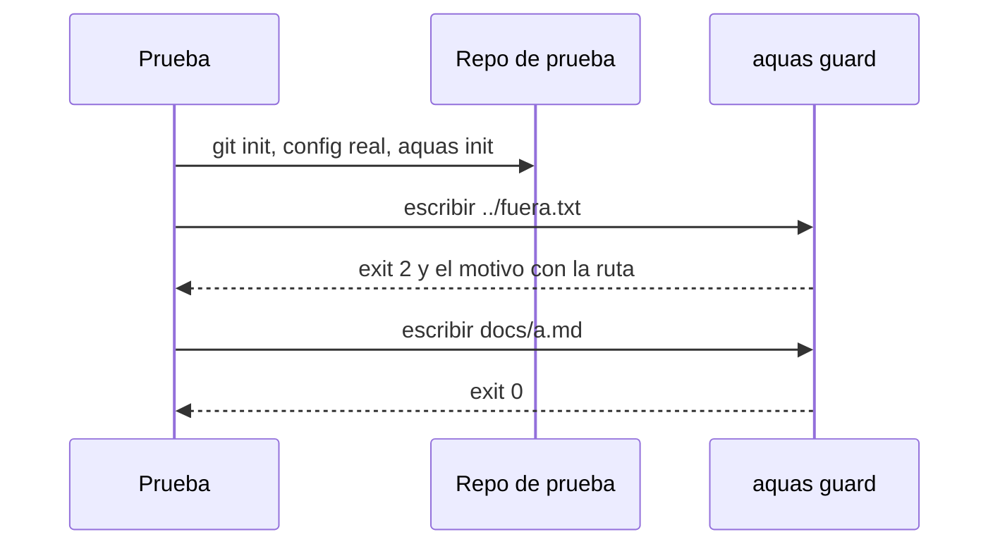

# S004 · Cableado de punta a punta

[Inicio](../../README.md) › [E000](../README.md) › [F005](README.md) › S004

[Slice](../../glosario.md#slice) que prueba el programa entero, como lo usa Claude Code. Mira el binario real, la configuración real y su código de salida.

## En una frase

Se prueba que el freno frena de verdad, no solo que la pieza de adentro funciona.

## Para qué existe

**El problema.** Las pruebas miraban las piezas por dentro. Nadie probaba el cableado de afuera:

- Que `aquas verify` salga con 1 cuando algo falla.
- Que `aquas guard` salga con 2: es el código que hace que Claude Code bloquee.
- Que la guardia bloquee todo si el entorno no está declarado.
- Que la plantilla real ponga la guardia delante de Bash y PowerShell.

Se rompió cada una a propósito. Todas las pruebas viejas siguieron en verde.

**La solución.** Cuatro pruebas que corren el binario sobre un repositorio de prueba. Ese repositorio copia la configuración real.

Contrato del slice:

| Campo | Valor |
|---|---|
| Objetivo | Cada salida del CLI que frena algo tiene una prueba que la mira |
| Incluye | `verify`, `guard`, entorno ausente y plantilla de [hooks](../../glosario.md#hook) |
| Excluye | Cambiar el código vigilado |
| Prueba | `go test ./cmd/aquas/ ./internal/entorno/` |

## Analogía

Piensa en los **frenos de un carro**.

- Probar la pastilla en un banco no basta.
- Hay que pisar el pedal y ver que el carro se detiene.

Límite de la analogía: aquí «el carro» es un repositorio de prueba. No es el repositorio real ni una sesión real de Claude Code.

## Diagrama

Secuencia de la prueba de la guardia:

## Ejemplo de punta a punta

continúa: [EJ-E000-F005](README.md#EJ-E000-F005)

En la [feature](../../glosario.md#feature), la guardia se cambia a propósito: avisa, pero sale con 0.

1. Todas las pruebas viejas pasan. Ninguna miraba el código de salida.
2. `TestGuardiaCLIBloquea` falla: esperaba exit 2.
3. Se restaura el código. La prueba pasa.

## Paso a paso

1. Escribir las cuatro pruebas.
2. Comprobar que pasan con el código sano.
3. Aplicar cuatro mutaciones y correr `aquas backlog red`.
4. Correr el resto de la suite con el código roto.
5. Restaurar y correr `aquas backlog green`.

## Cómo se usa

- Probar: `go test ./cmd/aquas/ ./internal/entorno/`.
- Ver rojo y verde: `aquas backlog show E000/F005/S004`.

## Contrato y evidencia

<!-- GENERADO por aquas desde trabajo/: no editar a mano; `aquas compile` lo rehace. -->

| Prueba | Valida | Rojo cuando | Verde cuando | Rojo | Verde |
|---|---|---|---|---|---|
| `TestVerificarDePuntaAPunta` | aquas verificar da exit 0 en repo sano y exit 1 con derivado editado o wiki rota | repo sano no da exit 0 con GATE OK, o derivado editado o wiki rota no dan exit 1 nombrándolo | sano sale 0; derivado editado sale 1 y lo nombra; tras compilar vuelve a 0; wiki rota sale 1 | 2026-10-21 | 2026-10-21 |
| `TestGuardiaCLIBloquea` | aquas guardia bloquea escrituras fuera del repo y deja pasar las de dentro | una escritura o redirección fuera del repo no sale 2, o una escritura dentro no sale 0 | fuera y redirección por Bash salen 2 con la ruta en el motivo; dentro sale 0 | 2026-10-21 | 2026-10-21 |
| `TestGuardiaCLISinEntornoBloquea` | sin entorno válido, aquas guardia bloquea todo y dice cómo arreglarlo | sin entorno o con el de otra carpeta, una escritura de dentro no se bloquea con exit 2 | sin entorno y con entorno de otra carpeta sale 2 y explica cómo arreglarlo | 2026-10-21 | 2026-10-21 |
| `TestSettingsRealTraeGuardiaYHook` | la plantilla real trae la guardia y el hook de compilar | falta PreToolUse de guardia o PostToolUse de hook en un SO | windows y linux traen ambos hooks con su matcher | 2026-10-21 | 2026-10-21 |

### Código

Sin código registrado: sus cambios no tocaron código ni configuración, o no nombran el ID (`aquas backlog code E000/F005/S004 <commit>…` los asigna).

<!-- /GENERADO -->

Estado: hecho.

Pruebas del slice:

| Prueba | Qué demuestra |
|---|---|
| `TestVerificarDePuntaAPunta` | El gate da exit 0 sano, y exit 1 con un derivado editado o una wiki rota |
| `TestGuardiaCLIBloquea` | Escribir fuera da exit 2, por Write y por Bash; dentro da exit 0 |
| `TestGuardiaCLISinEntornoBloquea` | Sin entorno, o con el de otra carpeta, se bloquea todo |
| `TestSettingsRealTraeGuardiaYHook` | La plantilla real pone la guardia delante de Bash y PowerShell |

Mutaciones del rojo, una por prueba:

| Mutación | Prueba que la detecta |
|---|---|
| Un derivado desfasado no hace fallar el gate | `TestVerificarDePuntaAPunta` |
| La guardia avisa pero sale con 0 | `TestGuardiaCLIBloquea` |
| Sin entorno se sigue como si nada | `TestGuardiaCLISinEntornoBloquea` |
| La guardia deja de cubrir Bash y PowerShell | `TestSettingsRealTraeGuardiaYHook` |

Rojo visto: sí, el 2026-10-21. Cada prueba falló por su mutación. Con el mismo código roto, el resto de la suite pasó en verde.

Límite: no corre una sesión real de Claude Code. Prueba lo que Claude Code recibe: el código de salida y el archivo de ajustes.

## Navegación

- ↑ Subir: [F005 · Calidad de las pruebas](README.md)
