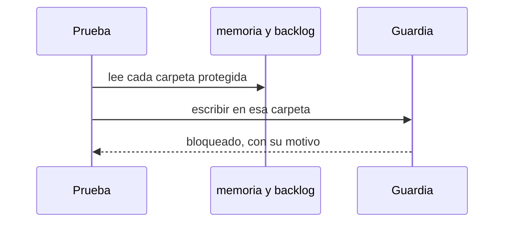

# S005 · Carpetas protegidas

[Inicio](../../README.md) › [E000](../README.md) › [F005](README.md) › S005

[Slice](../../glosario.md#slice) que hace que la guardia tome sus carpetas protegidas de los paquetes que las usan.

## En una frase

La guardia cuida la carpeta donde vive cada cosa, aunque la carpeta cambie de nombre.

## Para qué existe

**El problema.** Tres carpetas solo las escribe `aquas`: la memoria, su archivo y las fichas del [backlog](../../glosario.md#backlog). La guardia tenía sus nombres copiados a mano.

Si el paquete de memoria movía su carpeta, la guardia seguía cuidando la vieja. La nueva quedaba sin protección. Ninguna prueba lo notaba.

**La solución.** La guardia lee las rutas de los paquetes `memoria` y `backlog`. Hay una sola fuente para cada ruta.

Contrato del slice:

| Campo | Valor |
|---|---|
| Objetivo | Las carpetas protegidas salen de los paquetes que las usan |
| Incluye | Guardia de Write, Edit y Bash; una prueba; rojo por mutación |
| Excluye | Cambiar qué carpetas se protegen |
| Prueba | `go test ./internal/guardia/` |

## Analogía

Piensa en un **vigilante con una lista de oficinas**.

- Si la lista es una fotocopia, una mudanza lo deja cuidando la oficina vacía.
- Si la lista sale del registro del edificio, cuida la oficina nueva.

Límite de la analogía: aquí el «registro» son constantes de [Go](../../glosario.md#go). Cambian solo con un [commit](../../glosario.md#commit).

## Diagrama

Secuencia de la prueba:

## Ejemplo de punta a punta

continúa: [EJ-E000-F005](README.md#EJ-E000-F005)

En la [feature](../../glosario.md#feature), el backlog se muda a propósito a `fichas/`.

1. Con la guardia vieja, escribir en `fichas/archivo/` pasa. La prueba falla.
2. Con la guardia nueva, la misma escritura se bloquea. La prueba pasa, aun con la mudanza puesta.

## Paso a paso

1. Escribir la prueba con las rutas de los paquetes.
2. Mudar las tres carpetas y correr `aquas backlog rojo`.
3. Cambiar la guardia para leer las rutas de los paquetes.
4. Repetir la mudanza: la prueba pasa.
5. Restaurar y correr `aquas backlog verde`.

## Cómo se usa

- Probar: `go test ./internal/guardia/`.
- Ver rojo y verde: `aquas backlog ver E000/F005/S005`.

## Contrato y evidencia

<!-- GENERADO por aquas desde trabajo/: no editar a mano; `aquas compilar` lo rehace. -->

| Prueba | Valida | Rojo cuando | Verde cuando | Rojo | Verde |
|---|---|---|---|---|---|
| `TestCarpetasProtegidasSalenDeSusPaquetes` | la guardia protege las rutas de backlog y memoria tomadas de esos paquetes | — | — | 2026-10-21 | 2026-10-21 |

<!-- /GENERADO -->

Estado: hecho.

Pruebas del slice:

| Prueba | Qué demuestra |
|---|---|
| `TestCarpetasProtegidasSalenDeSusPaquetes` | Cada carpeta protegida se bloquea por Write y por Bash, con su motivo |

Rojo visto: sí, el 2026-10-21. Se mudaron la memoria, su archivo y el backlog. La guardia vieja dejó pasar la escritura.

Con el arreglo y la misma mudanza, la prueba pasó.

## Navegación

- ↑ Subir: [F005 · Calidad de las pruebas](README.md)
