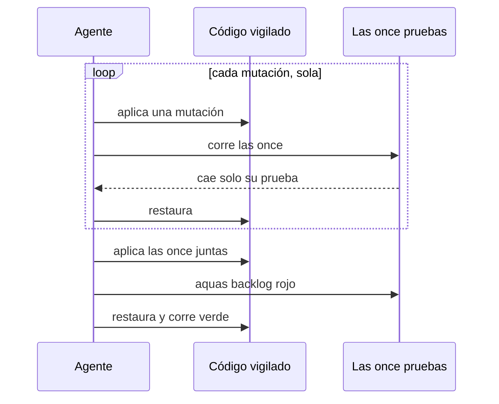

# S006 · Rojo de los slices viejos

[Inicio](../../README.md) › [E000](../README.md) › [F005](README.md) › S006

[Slice](../../glosario.md#slice) que muestra el rojo de once pruebas viejas. Se cerraron antes de que existiera el registro de rojo y verde.

## En una frase

Cada prueba vieja demuestra hoy que sabe fallar.

## Para qué existe

**El problema.** Cuatro slices viejos se cerraron sin rojo registrado. Sus once pruebas pasaban en verde, pero nadie las había visto fallar. Una prueba que nunca falla puede no vigilar nada.

**La solución.** Una mutación por prueba: se rompe a propósito la regla que vigila. Antes de registrar el rojo, una matriz comprueba que cada mutación tumba solo su prueba.

Contrato del slice:

| Campo | Valor |
|---|---|
| Objetivo | Las once pruebas tienen rojo y verde registrados |
| Incluye | Once mutaciones, matriz de aislamiento, rojo y verde |
| Excluye | Cambiar el código o las pruebas |
| Prueba | `go test ./internal/compilador/ ./internal/guardia/ ./internal/wiki/` |

## Analogía

Piensa en un **detector de humo** que nunca sonó.

- Que esté callado no prueba que funcione.
- Se le acerca humo a propósito y se ve si suena.

Límite de la analogía: aquí el «humo» es una línea de código rota. Se restaura apenas termina la prueba.

## Diagrama

Secuencia de la matriz y el rojo:

## Ejemplo de punta a punta

continúa: [EJ-E000-F005](README.md#EJ-E000-F005)

En la [feature](../../glosario.md#feature), la guardia compara rutas por prefijo de texto, no por carpeta.

1. Con la mutación, `C:/cache-gemelo` pasa como si fuera `C:/cache`.
2. `TestNoPermitidoSigueBloqueado` falla. Ninguna otra de las once cae.
3. Se restaura el código. La prueba pasa.

## Paso a paso

1. Leer qué regla vigila cada prueba.
2. Escribir una mutación por prueba.
3. Correr la matriz: cada mutación sola, las once pruebas.
4. Aplicar las once juntas y correr `aquas backlog rojo`.
5. Restaurar y correr `aquas backlog verde`.

## Cómo se usa

- Probar: `go test ./internal/compilador/ ./internal/guardia/ ./internal/wiki/`.
- Ver rojo y verde: `aquas backlog ver E000/F005/S006`.

## Contrato y evidencia

<!-- GENERADO por aquas desde trabajo/: no editar a mano; `aquas compilar` lo rehace. -->

| Prueba | Qué demuestra | Rojo | Verde |
|---|---|---|---|
| `TestCambioEnCanonicoRecompilaAgente` | editar un canónico cambia el agente compilado | 2026-10-21 | 2026-10-21 |
| `TestCompilarGeneraAgenteYDocumento` | compilar genera el agente y el documento desde sus canónicos | 2026-10-21 | 2026-10-21 |
| `TestPresupuestoDentroPasaGate` | una salida dentro de max_caracteres pasa el gate | 2026-10-21 | 2026-10-21 |
| `TestPresupuestoExcedidoFallaGate` | una salida que excede max_caracteres falla el gate | 2026-10-21 | 2026-10-21 |
| `TestSinPresupuestoSeRechaza` | una salida sin max_caracteres se rechaza | 2026-10-21 | 2026-10-21 |
| `TestConfigInvalida` | una config de permitidos inválida se rechaza con su motivo | — | 2026-10-21 |
| `TestNoPermitidoSigueBloqueado` | una ruta fuera y no permitida sigue bloqueada | 2026-10-21 | 2026-10-21 |
| `TestPermitidoFueraPasa` | una ruta fuera pero permitida pasa | 2026-10-21 | 2026-10-21 |
| `TestFallasRef` | una página de referencia mal armada falla el gate wiki | — | 2026-10-21 |
| `TestRefAceptaCualquierDiagrama` | la página de referencia acepta cualquier tipo de diagrama | 2026-10-21 | 2026-10-21 |
| `TestRefValidaPasa` | una página de referencia bien armada pasa | 2026-10-21 | 2026-10-21 |

<!-- /GENERADO -->

Estado: hecho.

Mutaciones del rojo, una por prueba:

| Mutación | Prueba que la detecta |
|---|---|
| El compilador no informa qué canónico cambió | `TestCambioEnCanonicoRecompilaAgente` |
| El agente sale sin su línea `effort` | `TestCompilarGeneraAgenteYDocumento` |
| Una salida justo dentro del tope se rechaza | `TestPresupuestoDentroPasaGate` |
| El tope se multiplica por mil | `TestPresupuestoExcedidoFallaGate` |
| Un agente sin tope se acepta | `TestSinPresupuestoSeRechaza` |
| Un permitido sin motivo se acepta | `TestConfigInvalida` |
| Los permitidos se comparan por prefijo de texto | `TestNoPermitidoSigueBloqueado` |
| Las variables `${…}` de los permitidos no se expanden | `TestPermitidoFueraPasa` |
| La referencia exige flowchart | `TestRefAceptaCualquierDiagrama` |
| La referencia rechaza flowchart | `TestRefValidaPasa` |
| La referencia no exige su ancla | `TestFallasRef` |

Rojo visto: sí, el 2026-10-21. La matriz mostró que cada mutación tumba solo su prueba.

Límite: dos mutaciones son artificiales: rechazar justo un tope de 5000 y rechazar flowchart. Esas pruebas vigilan que el [gate](../../glosario.md#gate) no frene de más, y no hay un error natural que lo provoque.

## Navegación

- ↑ Subir: [F005 · Calidad de las pruebas](README.md)
