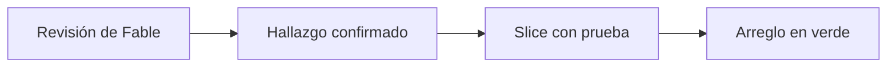
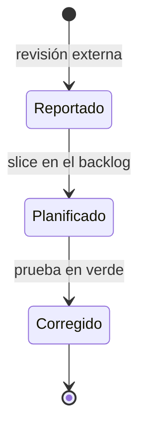

# F006 · Correcciones de la revisión externa

[Inicio](../../README.md) › [E000](../README.md) › F006

[Feature](../../glosario.md#feature) que corrige lo que encontró la revisión independiente de Fable del 2026-10-22. Cada hallazgo confirmado es un [slice](../../glosario.md#slice).

## En una frase

Lo que otro modelo vio y nosotros no, se arregla con prueba.

## Para qué existe

**El problema.** El informe propio omitía riesgos serios. El más grave: los [hooks](../../glosario.md#hook) dejaban de vigilar si el código no compilaba.

**La solución.** Un slice por hallazgo, cada uno con su [prueba en rojo](../../glosario.md#prueba-en-rojo) antes del arreglo.

## Analogía

Piensa en una **auditoría externa de un negocio**.

- El dueño revisa sus cuentas y cree que todo está bien.
- El auditor externo encuentra lo que el dueño ya no ve.

Límite de la analogía: aquí cada hallazgo se cierra con una prueba, no con una firma.

## Diagrama

Estados de un hallazgo:

| Slice | Qué entrega |
|---|---|
| [S001 Hooks fallan cerrados](S001.md) | El hook sigue vigilando aunque el código no compile |
| [S002 Ruta del módulo igual al remoto](S002.md) | `go install` encuentra el módulo en GitHub |
| [S005 Wiki y metodología al día](S005.md) | El gate revisa que los comandos citados existan |

## Ejemplo de punta a punta

continúa: [EJ-E000](../README.md#EJ-E000)

1. Fable reporta que los hooks fallan abiertos.
2. El slice S001 lo prueba en rojo: el hook salía con 1 y no bloqueaba.
3. Tras el arreglo, el hook usa la última versión que compiló.

## Paso a paso

1. Hooks fallan cerrados (S001).
2. Ruta del módulo igual al remoto (S002).
3. Features con prueba propia (S003).
4. Avisar oración larga al guardar (S004).
5. [Wiki](../../glosario.md#wiki) y metodología al día (S005).
6. CLI en inglés (S006).

## Cómo se usa

- Ver las fichas: `aquas backlog ver E000/F006`.
- Informe de origen: [revisión de Fable](../../../registro/informes/2026-10-22-fable.md).

## Contrato y evidencia

**Objetivo.** Cerrar cada hallazgo confirmado de la revisión externa con una prueba.

Prueba integral: `TestHookFallaCerrado`, en S001.

## Navegación

<!-- GENERADO por aquas desde trabajo/: no editar a mano; `aquas compilar` lo rehace. -->

| Hijo | Qué es | Estado |
|---|---|---|
| [S001](S001.md) | Hooks fallan cerrados | Hecho |
| [S002](S002.md) | Ruta del módulo igual al remoto | Hecho |
| S003 | Features con prueba propia y siguiente | Planeado |
| S004 | Avisar oración larga al guardar | Planeado |
| [S005](S005.md) | Wiki y metodología al día | Hecho |
| S006 | CLI en inglés | Planeado |
| S007 | Biblioteca cuenta bien lo devuelto | Planeado |
| [S008](S008.md) | Guardia sin falso binario viejo con go run | Hecho |
| S009 | aquas limpiar temporales del encargo | Planeado |
| S010 | Instrucciones sin go run para verificar | Planeado |

<!-- /GENERADO -->

- ↑ Subir: [E000 · Mantenimiento del gobierno](../README.md)
- Abajo: [S001 · Hooks fallan cerrados](S001.md)
- Abajo: [S002 · Ruta del módulo igual al remoto](S002.md)
- Abajo: [S005 · Wiki y metodología al día](S005.md)
