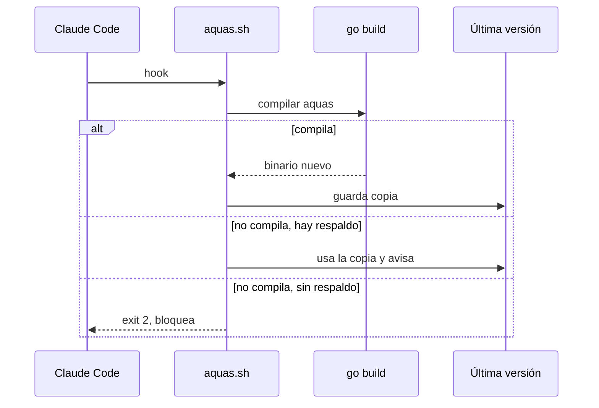

# S001 · Hooks fallan cerrados

[Inicio](../../README.md) › [E000](../README.md) › [F006](README.md) › S001

Si `aquas` no compila, el [hook](../../glosario.md#hook) ya no deja pasar a ciegas. Corre la última versión que compiló, o bloquea si no hay ninguna.

## En una frase

Un código roto ya no apaga la vigilancia.

## Para qué existe

**El problema.** `aquas.sh` compila `aquas` en cada llamada. Si fallaba, salía con 1, y Claude Code no bloquea con 1. Así se apagaban a la vez la guardia, la memoria y el cierre.

**La solución.** Guardar la última versión que compiló y usarla cuando el código esté roto. Sin ella, salir con 2 y bloquear.

Contrato del [slice](../../glosario.md#slice):

| Campo | Valor |
|---|---|
| Objetivo | Que un código que no compila no apague los hooks |
| Incluye | `.claude/hooks/aquas.sh` y su respaldo `.tmp/aquas-ultimo.exe` |
| Excluye | Hooks fuera del repo |
| Prueba | `go test ./cmd/aquas/ -run TestHookFallaCerrado` |

## Analogía

Piensa en una **alarma con batería de respaldo**.

- Si se va la luz, la alarma sigue con la batería.
- Si tampoco hay batería, la puerta queda trabada, no abierta.

Límite de la analogía: el respaldo es la versión anterior de las reglas, no la actual.

## Diagrama

## Ejemplo de punta a punta

continúa: [EJ-E000-F006](README.md#EJ-E000-F006)

1. La prueba arma un proyecto con un `main.go` roto y sin respaldo: el hook sale con 2.
2. Arregla el `main.go`: el hook compila, responde «ok» y guarda el respaldo.
3. Lo rompe de nuevo: el hook avisa «no compila» y responde «ok» con el respaldo.

## Paso a paso

1. El hook intenta compilar `aquas`.
2. Si compila, copia el binario a `.tmp/aquas-ultimo.exe`.
3. Si no compila y hay respaldo, lo usa y avisa por stderr.
4. Si no hay respaldo, sale con 2.

## Cómo se usa

- No hace falta hacer nada: corre en cada hook.
- En un clon nuevo, la primera compilación crea el respaldo.

## Contrato y evidencia

<!-- GENERADO por aquas desde trabajo/: no editar a mano; `aquas compilar` lo rehace. -->

| Prueba | Qué demuestra | Rojo | Verde |
|---|---|---|---|
| `TestHookFallaCerrado` | con aquas sin compilar el hook sale 2 y bloquea | 2026-10-22 | 2026-10-22 |

<!-- /GENERADO -->

Estado: hecho.

## Navegación

- ↑ Subir: [F006 · Correcciones de la revisión externa](README.md)
