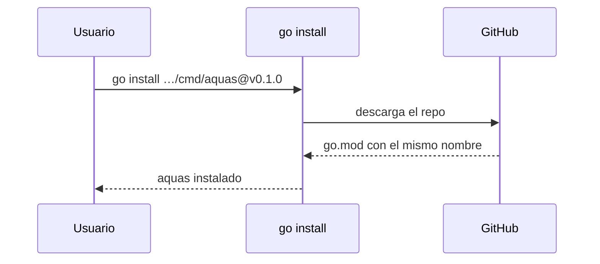

# S002 · Ruta del módulo igual al remoto

[Inicio](../../README.md) › [E000](../README.md) › [F006](README.md) › S002

El módulo [Go](../../glosario.md#go) se llama igual que el repo público en GitHub. Así `go install` puede instalar `aquas` en cualquier máquina.

## En una frase

El nombre del código coincide con su dirección pública.

## Para qué existe

**El problema.** `go.mod` decía `github.com/jliberal/aquas-harness-governance`, pero el repo vive en otra dirección. `go install` rechaza un módulo cuyo nombre no coincide con su repo.

**La solución.** Renombrar el módulo, los imports y la constitución a la dirección real del repo.

Contrato del [slice](../../glosario.md#slice):

| Campo | Valor |
|---|---|
| Objetivo | Que el módulo sea `github.com/jliberal-aquas/aquas-central-harness-government` |
| Incluye | `go.mod`, imports de `cmd/` e `internal/`, canónico de la constitución, remoto `origin` |
| Excluye | Publicar en GitHub (`git push`) |
| Prueba | `go test ./internal/compilador/ -run TestModuloIgualRemoto` |

## Analogía

Piensa en una **dirección postal**.

- Si el sobre dice una calle y la casa está en otra, el cartero no entrega.
- Con la dirección correcta, cualquiera puede mandar y recibir.

Límite de la analogía: aquí la «entrega» es descargar e instalar el programa.

## Diagrama

## Ejemplo de punta a punta

continúa: [EJ-E000-F006](README.md#EJ-E000-F006)

1. La prueba leyó `go.mod` y cayó: el módulo tenía el nombre viejo.
2. Se cambió el nombre en `go.mod`, en los imports y en la constitución.
3. La prueba pasó, junto con todas las demás.

## Paso a paso

1. `go mod edit -module` con la dirección nueva.
2. Reemplazar la ruta vieja en los imports.
3. Cambiar el principio 4 en el [canónico](../../glosario.md#canónico) y recompilar.
4. Conectar el remoto `origin`.

## Cómo se usa

- Tras publicar una versión: `go install github.com/jliberal-aquas/aquas-central-harness-government/cmd/aquas@vX.Y.Z`.

## Contrato y evidencia

<!-- GENERADO por aquas desde trabajo/: no editar a mano; `aquas compilar` lo rehace. -->

| Prueba | Qué demuestra | Rojo | Verde |
|---|---|---|---|
| `TestModuloIgualRemoto` | go.mod y constitución apuntan a github.com/jliberal-aquas/aquas-central-harness-government | 2026-10-22 | 2026-10-22 |

<!-- /GENERADO -->

Estado: hecho.

## Navegación

- ↑ Subir: [F006 · Correcciones de la revisión externa](README.md)
