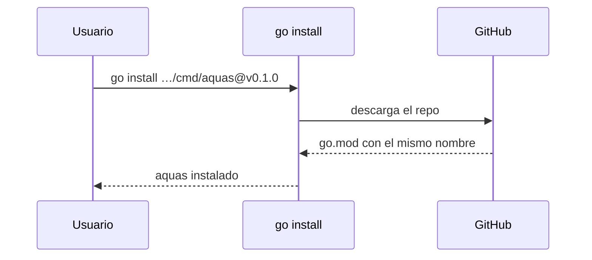

# S002 · Ruta del módulo igual al remoto

[Inicio](../../README.md) › [E000](../README.md) › [F006](README.md) › S002

El módulo [Go](../../glosario.md#go) se llama igual que el repo público en GitHub. Así `go install` puede instalar `aquas` en cualquier máquina.

## En una frase

El nombre del código coincide con su dirección pública.

## Para qué existe

**El problema.** `go.mod` decía `github.com/jliberal/aquas-harness-governance`, pero el repo vive en otra dirección. `go install` rechaza un módulo cuyo nombre no coincide con su repo.

**La solución.** Renombrar el módulo, los imports y la constitución a la dirección real del repo.

Contrato del [slice](../../glosario.md#slice):

| Campo | Valor |
|---|---|
| Objetivo | Que el módulo sea `github.com/jliberal-aquas/aquas-central-harness-government` |
| Incluye | `go.mod`, imports de `cmd/` e `internal/`, canónico de la constitución, remoto `origin` |
| Excluye | Publicar en GitHub (`git push`) |
| Prueba | `go test ./internal/compilador/ -run TestModuloIgualRemoto` |

## Analogía

Piensa en una **dirección postal**.

- Si el sobre dice una calle y la casa está en otra, el cartero no entrega.
- Con la dirección correcta, cualquiera puede mandar y recibir.

Límite de la analogía: aquí la «entrega» es descargar e instalar el programa.

## Diagrama

## Ejemplo de punta a punta

continúa: [EJ-E000-F006](README.md#EJ-E000-F006)

1. La prueba leyó `go.mod` y cayó: el módulo tenía el nombre viejo.
2. Se cambió el nombre en `go.mod`, en los imports y en la constitución.
3. La prueba pasó, junto con todas las demás.

## Paso a paso

1. `go mod edit -module` con la dirección nueva.
2. Reemplazar la ruta vieja en los imports.
3. Cambiar el principio 4 en el [canónico](../../glosario.md#canónico) y recompilar.
4. Conectar el remoto `origin`.

## Cómo se usa

- Tras publicar una versión: `go install github.com/jliberal-aquas/aquas-central-harness-government/cmd/aquas@vX.Y.Z`.

## Contrato y evidencia

<!-- GENERADO por aquas desde trabajo/: no editar a mano; `aquas compilar` lo rehace. -->

| Prueba | Valida | Rojo cuando | Verde cuando | Rojo | Verde |
|---|---|---|---|---|---|
| `TestModuloIgualRemoto` | go.mod y constitución nombran el mismo módulo remoto | go.mod o la constitución difieren del módulo remoto | ambos nombran github.com/jliberal-aquas/aquas-central-harness-government | 2026-10-22 | 2026-10-22 |

### Código

| Archivo | Función | Parámetros | Qué hace |
|---|---|---|---|
| [cmd/aquas/main.go](../../../cmd/aquas/main.go) | `main` | `()` | main despacha el subcomando de aquas (compilar, verificar, backlog, hooks…) y sale con su código. |
| [cmd/aquas/main.go](../../../cmd/aquas/main.go) | `hook` | `(raiz string)` | hook: exit 0 = nada que reportar; exit 2 = stderr se muestra a Claude. |
| [cmd/aquas/main.go](../../../cmd/aquas/main.go) | `compilarSettings` | `(w io.Writer)` | compilarSettings regenera .claude/settings.json; sin entorno declarado no inventa uno. |
| [cmd/aquas/main.go](../../../cmd/aquas/main.go) | `reportar` | `(w io.Writer, inf compilador.Informe)` | reportar imprime qué derivados escribió la compilación, o que todo estaba al día. |
| [cmd/aquas/main.go](../../../cmd/aquas/main.go) | `listar` | `(titulo string, problemas []string)` | listar imprime en stderr un título y cada problema en su viñeta. |
| [cmd/aquas/main.go](../../../cmd/aquas/main.go) | `lista` | `(xs []string) string` | lista une los textos con comas, o «—» si no hay ninguno. |
| [cmd/aquas/main.go](../../../cmd/aquas/main.go) | `fallar` | `(codigo int, err error)` | fallar imprime el error en stderr y termina con el código dado. |
| [cmd/aquas/main.go](../../../cmd/aquas/main.go) | `memoriaCLI` | `(raiz string, args []string)` | memoriaCLI: `ver` imprime la memoria; `fijar campo=valor…` la actualiza y la sella. |
| [cmd/aquas/main.go](../../../cmd/aquas/main.go) | `memoriaArchivada` | `(raiz, id string) error` | memoriaArchivada: CERRADO exige el archivo de memoria del slice, apunte o no la memoria a él (E001/F002/S009, X01). |
| [cmd/aquas/main.go](../../../cmd/aquas/main.go) | `focoEnBacklog` | `(raiz string, f memoria.Foco) error` | focoEnBacklog: la memoria solo fija el slice que el backlog tiene en curso (S003). |
| [cmd/aquas/main.go](../../../cmd/aquas/main.go) | `backlogCLI` | `(raiz string, args []string)` | backlogCLI: nuevo \\| ver [id] \\| tabla \\| prioridad \\| estado \\| siguiente \\| pruebas \\| rojo \\| verde. |
| [cmd/aquas/main.go](../../../cmd/aquas/main.go) | `turnoCLI` | `(raiz string, args []string)` | turnoCLI: auditoría de turnos (E001/F002/S001). Lee el JSON del hook por stdin. No imprime nada |
| [cmd/aquas/main.go](../../../cmd/aquas/main.go) | `defectoCLI` | `(raiz string, args []string) error` | defectoCLI: nuevo \\| ocurre \\| ver (E001/F004/S001). |
| [cmd/aquas/main.go](../../../cmd/aquas/main.go) | `versionBinario` | `() string` | versionBinario: versión del módulo con que se compiló el binario (= versión del gobierno embebido). |
| [cmd/aquas/main.go](../../../cmd/aquas/main.go) | `registrarCierre` | `(raiz, tipo, transcript, primera, resultado string)` | registrarCierre (E001/F004/S005, D000068) anota cada llamada del gancho cierre-agente en .tmp/hooks/cierre-agente.jsonl. |
| [internal/backlog/sello.go](../../../internal/backlog/sello.go) | `excluida` | `(p string) bool` | excluida: la ruta cae bajo una carpeta que el sello no revisa. |
| [internal/backlog/sello.go](../../../internal/backlog/sello.go) | `gitLineas` | `(raiz string, args ...string) ([]string, error)` | gitLineas corre git en la raíz y devuelve su salida línea por línea. |
| [internal/backlog/sello.go](../../../internal/backlog/sello.go) | `pagina` | `(id string) string` | pagina: ruta de la página wiki de una ficha según su nivel en el ID. |
| [internal/backlog/sello.go](../../../internal/backlog/sello.go) | `arbol` | `(raiz string, f Ficha) ([]Item, error)` | arbol: padre, abuelo, dependientes abiertos y páginas. |
| [internal/backlog/sello.go](../../../internal/backlog/sello.go) | `moduloGo` | `(raiz string) string` | moduloGo: ruta del módulo declarada en go.mod, o vacío si no hay. |
| [internal/backlog/sello.go](../../../internal/backlog/sello.go) | `lineaCon` | `(c, s string) string` | lineaCon: primera línea de c que contiene s, recortada; sirve de evidencia en el sello. |
| [internal/backlog/sello.go](../../../internal/backlog/sello.go) | `derivados` | `(raiz string) map[string]bool` | derivados: salidas del compilador según su archivo de sellos, más ese archivo (S014). Ya los vigila |
| [internal/backlog/sello.go](../../../internal/backlog/sello.go) | `archivos` | `(raiz, head string) ([]Item, error)` | archivos: quién nombra o importa lo tocado desde el HEAD del rojo. |
| [internal/backlog/sello.go](../../../internal/backlog/sello.go) | `Sello` | `(raiz, id string) ([]Item, error)` | Sello arma la lista del slice y le pega las marcas guardadas en su ficha. |
| [internal/backlog/sello.go](../../../internal/backlog/sello.go) | `sello` | `(raiz string, f Ficha) ([]Item, error)` | sello arma la lista de piezas que el cambio de un slice obliga a revisar. |
| [internal/backlog/sello.go](../../../internal/backlog/sello.go) | `selloCompleto` | `(raiz string, f Ficha) error` | selloCompleto: CERRADO exige marca en cada ítem, haya o no commit base (S013). |
| [internal/backlog/sello.go](../../../internal/backlog/sello.go) | `Marcar` | `(raiz, id, clave, marca, motivo string) (Ficha, error)` | Marcar guarda la revisión de un ítem del sello de un slice activo. |
| [internal/backlog/sello.go](../../../internal/backlog/sello.go) | `TextoSello` | `(xs []Item) string` | TextoSello: una línea por ítem; [ ] pendiente, [x] marcado con su marca y motivo. |
| [internal/guardia/guardia.go](../../../internal/guardia/guardia.go) | `Revisar` | `(raiz string, entrada []byte) string` | Revisar recibe el JSON del hook PreToolUse; "" = permitido, si no, el motivo del bloqueo. |
| [internal/guardia/guardia.go](../../../internal/guardia/guardia.go) | `RevisarArchivo` | `(raiz, p string) string` | RevisarArchivo valida una ruta de Write/Edit (absoluta o relativa a la raíz). |
| [internal/guardia/guardia.go](../../../internal/guardia/guardia.go) | `protegida` | `(raiz, abs, p string) string` | protegida: carpetas que solo escribe `aquas` (E001/F005, E001/F002). Las rutas salen de los |
| [internal/guardia/guardia.go](../../../internal/guardia/guardia.go) | `resolver` | `(base, p string) (string, bool)` | resolver lleva p a ruta absoluta del sistema. Entiende ~, /c/… (Git Bash) y relativas a base. |
| [internal/guardia/guardia.go](../../../internal/guardia/guardia.go) | `dentro` | `(raiz, abs string) bool` | dentro: la ruta absoluta queda dentro de la raíz del repo. |
| [internal/guardia/guardia.go](../../../internal/guardia/guardia.go) | `sinHeredocs` | `(c string) string` | sinHeredocs quita el cuerpo de cada heredoc: su contenido es texto, no comandos. |
| [internal/guardia/guardia.go](../../../internal/guardia/guardia.go) | `lexear` | `(c string) []palabra` | lexear parte un comando de shell en palabras, respetando comillas y operadores. |
| [internal/guardia/guardia.go](../../../internal/guardia/guardia.go) | `variable` | `(r []rune, i int) (string, int)` | variable reconoce $NOMBRE, ${NOMBRE}, $(…), `…` y %NOMBRE%; devuelve nombre ("?" = desconocida) y largo. |
| [internal/guardia/guardia.go](../../../internal/guardia/guardia.go) | `esNombre` | `(c rune) bool` | esNombre: el carácter vale en un nombre de variable de shell. |
| [internal/guardia/guardia.go](../../../internal/guardia/guardia.go) | `RevisarBash` | `(raiz, cwd, comando string) string` | RevisarBash analiza un comando de Bash; cwd es el directorio donde arranca. |
| [internal/guardia/guardia.go](../../../internal/guardia/guardia.go) | `segmento` | `(raiz string, cwd *string, cwdOK *bool, vars map[string]string, ps []palabra) string` | segmento revisa un comando simple: sigue cd y variables y devuelve el primer destino fuera del repo. |
| [internal/guardia/guardia.go](../../../internal/guardia/guardia.go) | `posicionales` | `(args []string) []string` | posicionales: argumentos que no son opciones (los que empiezan con «-», salvo «-» solo). |
| [internal/guardia/guardia.go](../../../internal/guardia/guardia.go) | `revisarDestino` | `(raiz, cwd string, cwdOK bool, vars map[string]string, d string) string` | revisarDestino: motivo de bloqueo si la ruta no se resuelve o cae fuera del repo; vacío si vale. |
| [internal/guardia/guardia.go](../../../internal/guardia/guardia.go) | `expandir` | `(s string, vars map[string]string, cwd string) (string, bool)` | expandir sustituye variables conocidas; HOME/USERPROFILE/TEMP/TMP salen del entorno real. |
| [internal/guardia/guardia.go](../../../internal/guardia/guardia.go) | `legible` | `(s string) string` | legible muestra las variables internas como $NOMBRE en los mensajes. |
| [internal/memoria/memoria.go](../../../internal/memoria/memoria.go) | `Fijar` | `(raiz string, pares []string, ahora time.Time) (Memoria, error)` | Fijar aplica pares campo=valor sobre la memoria actual y la sella. |
| [internal/memoria/memoria.go](../../../internal/memoria/memoria.go) | `FijarCon` | `(raiz string, pares []string, ahora time.Time, validar func(Foco) error) (Memoria, error)` | FijarCon: como Fijar, pero validar (si no es nil) revisa el foco resultante antes de escribir. |
| [internal/memoria/memoria.go](../../../internal/memoria/memoria.go) | `Leer` | `(raiz string) (Memoria, error)` | Leer carga la memoria y comprueba su sello. |
| [internal/memoria/memoria.go](../../../internal/memoria/memoria.go) | `decodificar` | `(b []byte) (Memoria, error)` | decodificar: campos fijos y sello sobre los bytes tal como se escribieron. |
| [internal/memoria/memoria.go](../../../internal/memoria/memoria.go) | `Rutas` | `(f Foco) Mapa` | Rutas: páginas wiki de la iniciativa, feature y slice del foco, más el backlog. |
| [internal/memoria/memoria.go](../../../internal/memoria/memoria.go) | `Texto` | `(m Memoria) string` | Texto: lo que imprime `aquas memoria ver` (y, en S002, el hook de inicio de sesión). |
| [internal/memoria/memoria.go](../../../internal/memoria/memoria.go) | `guion` | `(s string) string` | guion devuelve «—» si el texto está vacío. |
| [internal/memoria/memoria.go](../../../internal/memoria/memoria.go) | `lista` | `(b *strings.Builder, titulo string, xs []string)` | lista escribe un título y sus viñetas, o «—» si no hay ninguna. |
| [internal/memoria/memoria.go](../../../internal/memoria/memoria.go) | `codificar` | `(m Memoria) []byte` | codificar serializa la memoria como JSON indentado con salto final. |
| [internal/memoria/memoria.go](../../../internal/memoria/memoria.go) | `huella` | `(m Memoria) string` | huella: SHA-256 de la memoria codificada; detecta cambios. |
| [internal/memoria/memoria.go](../../../internal/memoria/memoria.go) | `escribir` | `(raiz string, m Memoria) error` | escribir: archivo temporal + rename, para no dejar una memoria a medias. |
| [internal/memoria/memoria.go](../../../internal/memoria/memoria.go) | `HuellaGit` | `(raiz string) string` | HuellaGit resume el estado del repo: HEAD + cada ruta de `git status` con el contenido de su |
| [internal/memoria/memoria.go](../../../internal/memoria/memoria.go) | `mismaCarpeta` | `(a, b string) bool` | mismaCarpeta: las dos rutas apuntan a la misma carpeta en disco. |
| [internal/memoria/memoria.go](../../../internal/memoria/memoria.go) | `Cierre` | `(raiz string, stopHookActive bool) string` | Cierre decide el hook Stop: "" deja cerrar el turno; si no, el motivo para seguir. |
| [internal/memoria/memoria.go](../../../internal/memoria/memoria.go) | `Inicio` | `(raiz string) string` | Inicio: texto que el hook SessionStart agrega al contexto. Nunca bloquea. |
| [internal/wiki/hijos.go](../../../internal/wiki/hijos.go) | `paginaDe` | `(id string) string` | paginaDe: la página de la wiki que corresponde a un id de ficha. |
| [internal/wiki/hijos.go](../../../internal/wiki/hijos.go) | `celda` | `(s string) string` | celda escapa saltos de línea y «\\|» para una celda de tabla Markdown. |
| [internal/wiki/hijos.go](../../../internal/wiki/hijos.go) | `existe` | `(raiz, rel string) bool` | existe: la ruta relativa existe en disco. |
| [internal/wiki/hijos.go](../../../internal/wiki/hijos.go) | `tablaHijos` | `(raiz, padreRel string, hijos []backlog.Ficha) string` | tablaHijos: una fila por hijo directo; enlace solo si su página existe. |
| [internal/wiki/hijos.go](../../../internal/wiki/hijos.go) | `fecha` | `(r *backlog.Registro) string` | fecha: día AAAA-MM-DD de un registro, o «—» si no hay. |
| [internal/wiki/hijos.go](../../../internal/wiki/hijos.go) | `oGuion` | `(s string) string` | oGuion: el texto como celda, o «—» si está vacío (pruebas anteriores a E001/F008/S001). |
| [internal/wiki/hijos.go](../../../internal/wiki/hijos.go) | `tablaPruebas` | `(f backlog.Ficha) string` | tablaPruebas: las pruebas del slice: qué validan, cuándo quedan en rojo y en verde, y si se vieron en rojo y en verde. |
| [internal/wiki/hijos.go](../../../internal/wiki/hijos.go) | `esperados` | `(raiz string) (map[string]esperado, []backlog.Ficha, error)` | esperados: página existente → bloque que debe llevar. Vacío si no hay fichas. |
| [internal/wiki/hijos.go](../../../internal/wiki/hijos.go) | `bloqueActual` | `(c string) (ini, fin int)` | bloqueActual: posición del bloque en c; ini < 0 = no hay; fin < 0 = sin cierre. |
| [internal/wiki/hijos.go](../../../internal/wiki/hijos.go) | `Generar` | `(raiz string) ([]string, error)` | Generar reescribe el bloque GENERADO de cada página desde las fichas; devuelve lo escrito. |
| [internal/wiki/hijos.go](../../../internal/wiki/hijos.go) | `revisarHijos` | `(raiz string, paginas map[string]*pagina, orden []string) ([]string, error)` | revisarHijos: bloque presente y al día, enlaces sin saltar niveles, ficha arrancada con página. |
| [internal/wiki/hijos.go](../../../internal/wiki/hijos.go) | `tablaArreglos` | `(f backlog.Ficha) string` | tablaArreglos: sección «Arreglos» de la ficha; vacía si no tiene. |

<!-- /GENERADO -->

Estado: hecho.

## Navegación

- ↑ Subir: [F006 · Correcciones de la revisión externa](README.md)
