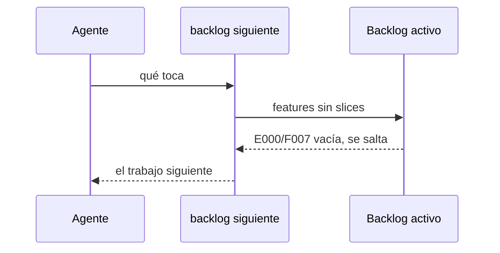

# S003 · Siguiente no exige definir Reincidencias vacía

[Inicio](../../README.md) › [E000](../README.md) › [F006](README.md) › S003

Este [slice](../../glosario.md#slice) evita que `aquas backlog siguiente` se trabe en la [feature](../../glosario.md#feature) de reincidencias mientras esté vacía.

## En una frase

La feature E000/F007 vacía no frena el trabajo: se llena sola cuando un defecto se repite.

## Para qué existe

**El problema.** `siguiente` exige definir toda feature sin slices antes de seguir. E000/F007 nace vacía a propósito. Por eso `siguiente` respondía «definir E000/F007» y no dejaba avanzar.

**Por qué importa.** Nadie debe inventar slices de reincidencia a mano. Los crea `aquas defecto ocurre` a la tercera aparición de un defecto, como explica [E001/F004/S003](../../E001/F004/S003.md).

**La solución.** `siguiente` salta E000/F007 mientras no tenga slices. Las demás features vacías se siguen exigiendo como antes.

**Origen.** La revisión externa (Fable #2) pedía revisar features y `siguiente`. El humano decidió el 2026-10-30 mantener la regla de cerrar features con todos sus slices cerrados. Este tramo quedó solo con el arreglo de reincidencias.

**Contrato.**

| Regla | Valor |
|---|---|
| E000/F007 sin slices | `siguiente` la salta y entrega el trabajo siguiente |
| E000/F007 con slices activos | sus slices compiten como cualquier otro |
| E000/F007 con slices solo archivados | tampoco se pide cerrarla: es un contenedor permanente; cerrada, `aquas defecto` ya no podría crear slices en ella |
| Otra feature sin slices | se exige definir, igual que antes |
| Una sola fuente | `backlog.FeatureReincidencias`; `defecto.Feature` la reutiliza |
| No cambia | la regla de cerrar las demás features con todos sus slices cerrados |
| Alcance | `internal/backlog/backlog.go`, `internal/backlog/siguiente_test.go`, `internal/defecto/defecto.go`, esta página y la de [F006](README.md) |

**Casos borde.**

| Categoría | Aplica | Prueba o motivo |
|---|---|---|
| cada tipo de ficha | sí | la excepción solo cubre la feature E000/F007; otra feature vacía con el mismo padre y la misma prioridad se sigue pidiendo: `TestSiguienteNoExigeDefinirReincidenciasVacia` |
| cada estado de origen | sí | E000/F007 vacía se salta; con su único slice CERRADO en el archivo tampoco se pide cerrarla: `TestSiguienteNoExigeDefinirReincidenciasVacia` |
| padre e hijo, activo y archivado | sí | E000/F007 archivada no entra en `siguiente`, que solo recorre fichas activas (`sinDefinir` recibe el mapa activo); su padre E000 tiene otra feature y no se pide definir: `TestSiguienteNoExigeDefinirReincidenciasVacia` |
| entrada ausente, vacía, mal escrita o duplicada | no | la feature se reconoce por su ID fijo; si no existe, no hay nada que saltar |
| choque con otro control | sí | `aquas defecto` crea slices en la misma feature, sin cambio: `TestReincidenciaCreaSlice` |
| quién habla: humano, agente o herramienta | no | `siguiente` responde igual a quien lo llame |
| fallo a mitad de camino | no | `siguiente` solo lee el backlog; no escribe nada |

## Analogía

Piensa en **el buzón de reclamos de una tienda**.

- Vacío no es una tarea pendiente.
- Solo pide atención cuando llega un reclamo.

Límite de la analogía: aquí el reclamo entra solo, por `aquas defecto`.

## Diagrama

## Ejemplo de punta a punta

continúa: [EJ-E000-F006](README.md#EJ-E000-F006)

1. El [backlog](../../glosario.md#backlog) tiene E000/F007 vacía y un slice libre.
2. Antes, `aquas backlog siguiente` respondía «definir E000/F007: crea sus slices».
3. Ahora entrega el slice libre.
4. Un defecto aparece por tercera vez y nace E000/F007/S001; desde ahí compite como cualquier slice.

## Paso a paso

1. Rojo de `TestSiguienteNoExigeDefinirReincidenciasVacia`: `siguiente` pedía definir E000/F007.
2. La constante pasa a `backlog.FeatureReincidencias`, que `sinDefinir` salta; verde.

## Cómo se usa

- Nada nuevo: `aquas backlog siguiente` ya no se traba en E000/F007 vacía.

## Contrato y evidencia

<!-- GENERADO por aquas desde trabajo/: no editar a mano; `aquas compilar` lo rehace. -->

| Prueba | Valida | Rojo cuando | Verde cuando | Rojo | Verde |
|---|---|---|---|---|---|
| `TestSiguienteNoExigeDefinirReincidenciasVacia` | valida que siguiente no pide definir la feature de reincidencias mientras no tiene slices | rojo cuando siguiente responde definir E000/F007 con la feature vacía | verde cuando siguiente la salta vacía y la pide definir otras features sin slices | 2026-10-30 | 2026-10-30 |

### Código

| Archivo | Función | Parámetros | Qué hace |
|---|---|---|---|
| [internal/backlog/backlog.go](../../../internal/backlog/backlog.go) | `terminal` | `(estado string) bool` | terminal: el estado ya no cambia (CERRADO o CANCELADO). |
| [internal/backlog/backlog.go](../../../internal/backlog/backlog.go) | `esta` | `(xs []string, x string) bool` | esta: x figura en la lista. |
| [internal/backlog/backlog.go](../../../internal/backlog/backlog.go) | `tipoYPadre` | `(id string) (tipo, padre string)` | tipoYPadre deriva del id: E001 → iniciativa; E001/F002 → feature de E001; E001/F002/S002 → slice. |
| [internal/backlog/backlog.go](../../../internal/backlog/backlog.go) | `nombre` | `(id string) string` | nombre: archivo JSON de una ficha, con «/» del ID cambiadas por «-». |
| [internal/backlog/backlog.go](../../../internal/backlog/backlog.go) | `todas` | `(raiz string) (act, arc map[string]Ficha, err error)` | todas lee activo y archivo. Una ficha ilegible es error: Validar la detalla. |
| [internal/backlog/backlog.go](../../../internal/backlog/backlog.go) | `Todas` | `(raiz string) ([]Ficha, error)` | Todas: las fichas de activo y archivo, ordenadas por id. Para quien solo lee (wiki, E001/F002/S010). |
| [internal/backlog/backlog.go](../../../internal/backlog/backlog.go) | `leer` | `(ruta string) (Ficha, error)` | leer carga una ficha desde su archivo JSON. |
| [internal/backlog/backlog.go](../../../internal/backlog/backlog.go) | `escribir` | `(raiz, dir string, f Ficha) error` | escribir guarda la ficha como JSON en trabajo/<dir>/, con listas vacías en vez de null. |
| [internal/backlog/backlog.go](../../../internal/backlog/backlog.go) | `Nuevo` | `(raiz string, campos []string) (Ficha, error)` | Nuevo crea una ficha desde campos id=… titulo=… que_hace=… prioridad=… motivo=… relacion=… [bloqueado_por=A,B]. |
| [internal/backlog/backlog.go](../../../internal/backlog/backlog.go) | `Ver` | `(raiz, id string) (Ficha, bool, error)` | Ver busca la ficha en activo y luego en archivo. |
| [internal/backlog/backlog.go](../../../internal/backlog/backlog.go) | `activa` | `(raiz, id string) (Ficha, error)` | activa: la ficha a cambiar; una archivada no cambia. |
| [internal/backlog/backlog.go](../../../internal/backlog/backlog.go) | `Prioridad` | `(raiz, id, prioridad, motivo string) (Ficha, error)` | Prioridad cambia la prioridad; el motivo es obligatorio. |
| [internal/backlog/backlog.go](../../../internal/backlog/backlog.go) | `Estado` | `(raiz, id, estado string) (Ficha, error)` | Estado cambia el estado. CERRADO o CANCELADO mueve la ficha al archivo. |
| [internal/backlog/backlog.go](../../../internal/backlog/backlog.go) | `sinHijosActivos` | `(act map[string]Ficha, f Ficha) error` | sinHijosActivos: cerrar o cancelar una feature o iniciativa exige sus hijos directos ya archivados. |
| [internal/backlog/backlog.go](../../../internal/backlog/backlog.go) | `ordenar` | `(fs []Ficha, arc map[string]Ficha)` | orden de `siguiente`: en curso → desbloqueado → prioridad → secuencia → id. |
| [internal/backlog/backlog.go](../../../internal/backlog/backlog.go) | `Activas` | `(raiz string) ([]Ficha, error)` | Activas: slices en el orden de `siguiente`; después iniciativas y features por secuencia. |
| [internal/backlog/backlog.go](../../../internal/backlog/backlog.go) | `Siguiente` | `(raiz string) (Ficha, bool, error)` | Siguiente: el primer slice del orden fijo que esté en curso o desbloqueado. |
| [internal/backlog/backlog.go](../../../internal/backlog/backlog.go) | `sinDefinir` | `(act map[string]Ficha) (Ficha, bool)` | sinDefinir (E001/F002/S008, regla del humano 2026-10-21): iniciativa o feature activa sin hijos |
| [internal/backlog/backlog.go](../../../internal/backlog/backlog.go) | `Definir` | `(raiz string, f Ficha) string` | Definir: qué hacer con lo que `siguiente` saca sin definir; "" para un slice. |
| [internal/backlog/backlog.go](../../../internal/backlog/backlog.go) | `libre` | `(f Ficha, arc map[string]Ficha) bool` | libre: no está BLOQUEADO y cada bloqueador ya terminó (archivado: CERRADO o CANCELADO). |
| [internal/backlog/backlog.go](../../../internal/backlog/backlog.go) | `Validar` | `(raiz string) []string` | Validar: problemas de las fichas en disco (gate). Sin carpeta trabajo/ no hay problemas. |
| [internal/backlog/backlog.go](../../../internal/backlog/backlog.go) | `Texto` | `(f Ficha) string` | Texto: una línea por ficha, para el agente. |
| [internal/defecto/defecto.go](../../../internal/defecto/defecto.go) | `Nuevo` | `(raiz string, c map[string]string) (Defecto, error)` | Nuevo crea el siguiente D000NNN. Todos los campos son obligatorios; la firma es kebab-case y única. |
| [internal/defecto/defecto.go](../../../internal/defecto/defecto.go) | `Ocurre` | `(raiz, id, turno string) (Defecto, error)` | Ocurre suma un turno T000NNN al defecto; el mismo turno no se cuenta dos veces. |
| [internal/defecto/defecto.go](../../../internal/defecto/defecto.go) | `sliceReincidencia` | `(raiz string, d Defecto) (string, error)` | sliceReincidencia devuelve el slice del defecto: el que ya lleve su título o uno nuevo P1 en Feature. |
| [internal/defecto/defecto.go](../../../internal/defecto/defecto.go) | `Leer` | `(raiz string) ([]Defecto, error)` | Leer devuelve todos los defectos, ordenados por ID. Sin carpeta = registro vacío. |
| [internal/defecto/defecto.go](../../../internal/defecto/defecto.go) | `leerUno` | `(raiz, id string) (Defecto, error)` | leerUno carga el defecto con ese ID; valida el formato D000001. |
| [internal/defecto/defecto.go](../../../internal/defecto/defecto.go) | `escribir` | `(raiz string, d Defecto) error` | escribir guarda el defecto como JSON en su carpeta. |
| [internal/defecto/defecto.go](../../../internal/defecto/defecto.go) | `Texto` | `(d Defecto) string` | Texto: una línea por defecto para `aquas defecto ver`. |
| [internal/defecto/defecto.go](../../../internal/defecto/defecto.go) | `revisarRelacion` | `(raiz, rel, que string, todos []Defecto) error` | revisarRelacion (E001/F009/S002): relacion=nuevo o el id de una ficha; sin ella, lista defectos y fichas parecidos. |

<!-- /GENERADO -->

## Navegación

- ↑ Subir: [F006](README.md)
