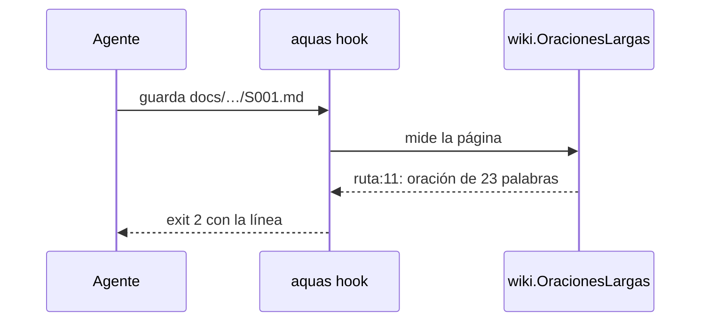

# S004 · Avisar oración larga al guardar

[Inicio](../../README.md) › [E000](../README.md) › [F006](README.md) › S004

Este [slice](../../glosario.md#slice) avisa cada oración larga en el momento de guardar una página de la [wiki](../../glosario.md#wiki).

## En una frase

Al guardar una página de `docs/`, el [hook](../../glosario.md#hook) nombra la línea de cada oración de más de 20 palabras.

## Para qué existe

**El problema.** La revisión externa contó 50 caídas del [gate](../../glosario.md#gate) por oraciones largas. El aviso llegaba recién en `aquas verify`, al final del trabajo.

**Por qué importa.** Cada caída obliga a volver a la página, buscar la oración y repetir el gate. El aviso tampoco decía en qué línea estaba.

**La solución.** El hook que corre al guardar mide la página y avisa la línea de cada oración larga. El gate usa la misma medida y también muestra la línea.

**Contrato.**

| Regla | Valor |
|---|---|
| Cuándo | cada vez que se guarda un `.md` bajo `docs/`, incluido el glosario |
| Qué avisa | `ruta:línea: oración de N palabras (máx. 20)` y sus seis primeras palabras |
| Línea | la línea donde empieza la oración, aunque siga en la siguiente |
| Qué no mide | bloques de código, tablas, títulos y navegación: lo mismo que ya excluye el gate |
| Salida | exit 2 si hay aviso, para que Claude lo vea; exit 0 si todas son cortas |
| No cambia | la regla de 20 palabras ni la medida de legibilidad del gate |
| Alcance | `cmd/aquas/main.go`, `cmd/aquas/oracion_hook_test.go`, `internal/wiki/wiki.go`, `internal/wiki/legibilidad.go`, `internal/wiki/legibilidad_test.go`, esta página y la de [F006](README.md) |

**Casos borde.**

| Categoría | Aplica | Prueba o motivo |
|---|---|---|
| cada tipo de ficha | no | mide páginas de la wiki, no fichas del backlog |
| cada estado de origen | sí | página con oraciones largas, con todas cortas y el glosario: `TestHookAvisaOracionLarga`; oración que no es la primera del párrafo o va tras un enlace partido en dos líneas: `TestOracionesConLinea` |
| padre e hijo, activo y archivado | no | la medida no depende de la página padre ni del estado de la ficha |
| entrada ausente, vacía, mal escrita o duplicada | sí | oración larga dentro de código o tabla no cuenta; «<» o «[» sueltos en prosa no desplazan la línea: `TestOracionesConLinea`; archivo fuera de `docs/` no se mide; dos oraciones largas dan dos avisos: `TestHookAvisaOracionLarga` |
| choque con otro control | sí | en un mismo guardado salen el enlace al glosario y el aviso, con exit 2: `TestHookAvisaOracionLarga`; el gate da la misma medida: `TestFallasLegibilidad` |
| quién habla: humano, agente o herramienta | no | el hook corre igual sin importar quién guarda |
| fallo a mitad de camino | no | el hook solo lee la página; si no puede leerla, calla y el gate la reporta |

## Analogía

Piensa en **el corrector de un procesador de texto**.

- Subraya la frase larga mientras escribes, no al imprimir.
- Señala dónde está, no solo que existe.

Límite de la analogía: aquí el aviso sale al guardar, no letra a letra.

## Diagrama

## Ejemplo de punta a punta

continúa: [EJ-E000-F006](README.md#EJ-E000-F006)

1. El [agente](../../glosario.md#agente) guarda una página con una oración de 23 palabras en la línea 11.
2. El hook responde `docs/E000/F001/S001.md:11: oración de 23 palabras`.
3. El agente parte la oración en dos antes de seguir.
4. El gate ya no cae por esa oración.

## Paso a paso

1. Rojo de `TestHookAvisaOracionLarga`.
2. La wiki guarda la línea de cada trozo de prosa y la oración sabe dónde empieza.
3. El hook llama a `wiki.OracionesLargas`; verde.

## Cómo se usa

- Nada que hacer: el aviso sale solo al guardar una página de `docs/`.

## Contrato y evidencia

<!-- GENERADO por aquas desde trabajo/: no editar a mano; `aquas compile` lo rehace. -->

| Prueba | Valida | Rojo cuando | Verde cuando | Rojo | Verde |
|---|---|---|---|---|---|
| `TestHookAvisaOracionLarga` | el hook avisa la línea de una oración larga al guardar una página de docs/ | se guarda docs/ con una oración de más de 20 palabras y el hook no avisa su línea | el hook avisa la línea de la oración larga y no avisa si todas son cortas | 2026-10-30 | 2026-10-30 |

### Código

Sin código registrado: sus cambios no tocaron código ni configuración, o no nombran el ID (`aquas backlog code E000/F006/S004 <commit>…` los asigna).

<!-- /GENERADO -->

Pruebas: `TestHookAvisaOracionLarga` y `TestOracionesConLinea`.

Fuera de este tramo quedan dos casos leves de la auditoría A3. Si una oración empieza dentro de un enlace partido en dos líneas, se avisa donde el enlace cierra. Un «<» y un «>» sueltos en líneas distintas del mismo párrafo hacen que el gate junte oraciones. El segundo ya pasaba antes de este tramo.

## Navegación

- ↑ Subir: [F006](README.md)
