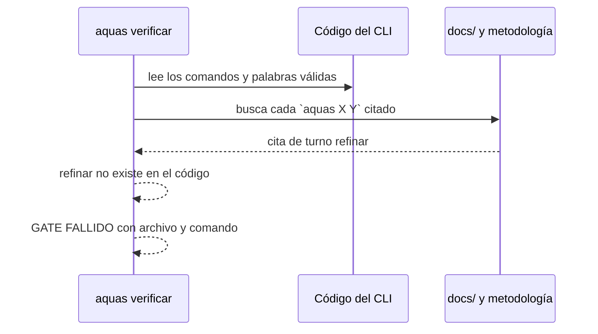

# S005 · Wiki y metodología al día

[Inicio](../../README.md) › [E000](../README.md) › [F006](README.md) › S005

El [gate](../../glosario.md#gate) ahora revisa que cada comando `aquas` citado en la [wiki](../../glosario.md#wiki) y en la metodología exista de verdad. Además, la portada cuenta el producto completo.

## En una frase

La prosa ya no puede prometer un comando que no existe.

## Para qué existe

**El problema.** La metodología citaba `turno refinar` y `ver`, que nunca existieron o se cancelaron. El gate revisaba formato, no si el texto seguía siendo verdad.

**La solución.** Una regla del gate compara cada comando citado contra el código del CLI. También se rehízo la portada y se creó el `README.md` de la raíz.

Contrato del [slice](../../glosario.md#slice):

| Campo | Valor |
|---|---|
| Objetivo | Que la prosa no cite comandos inexistentes y que la portada describa el producto |
| Incluye | `wiki.RevisarComandos`, metodología E001, `docs/README.md`, `README.md` raíz |
| Excluye | Juzgar si el sentido del texto es correcto: eso es criterio humano |
| Prueba | `go test ./internal/wiki/ -run TestComandoCitadoExiste` |

## Analogía

Piensa en un **menú de restaurante**.

- Si el menú ofrece un plato que la cocina ya no hace, el cliente se frustra.
- Aquí, antes de imprimir el menú, alguien revisa que cada plato exista.

Límite de la analogía: solo se revisa que el plato exista, no que la descripción sea buena.

## Diagrama

## Ejemplo de punta a punta

continúa: [EJ-E000-F006](README.md#EJ-E000-F006)

1. Al activar la regla, el gate cayó con cuatro citas viejas de la metodología.
2. Las cuatro eran las que señaló Fable: `turno refinar`, `ver` dos veces y `gobierno update`.
3. Se corrigieron, y el gate volvió a pasar.

## Paso a paso

1. Leer los `case` de `cmd/aquas` y los literales del código.
2. Buscar cada cita entre comillas invertidas que empiece por `aquas`.
3. Exigir que la primera palabra sea un comando y la segunda un literal conocido.
4. Lo que va sin comillas invertidas, como un comando en construcción, no se revisa.

## Cómo se usa

- Corre solo dentro de `aquas verificar`.
- Para citar un comando que aún no existe, escríbelo sin comillas invertidas.

## Contrato y evidencia

<!-- GENERADO por aquas desde trabajo/: no editar a mano; `aquas compilar` lo rehace. -->

| Prueba | Valida | Rojo cuando | Verde cuando | Rojo | Verde |
|---|---|---|---|---|---|
| `TestComandoCitadoExiste` | todo aquas X citado en docs/ y metodologias/ existe como comando del CLI | un comando citado inexistente no se reporta, o se reportan más o menos de los esperados | reporta exactamente los 2 comandos inexistentes sembrados y ninguno de los válidos | 2026-10-22 | 2026-10-22 |

### Código

| Archivo | Función | Parámetros | Qué hace |
|---|---|---|---|
| [internal/wiki/comandos.go](../../../internal/wiki/comandos.go) | `RevisarComandos` | `(raiz string) ([]string, error)` | RevisarComandos: todo `aquas X [Y]` citado entre comillas invertidas en docs/ y en |
| [internal/wiki/wiki.go](../../../internal/wiki/wiki.go) | `Verificar` | `(raiz string) ([]string, error)` | Verificar devuelve los problemas de la wiki bajo raiz/docs; vacío = gate OK. |
| [internal/wiki/wiki.go](../../../internal/wiki/wiki.go) | `relativa` | `(raiz, p string) string` | relativa: ruta de p respecto de la raíz, con barras «/». |
| [internal/wiki/wiki.go](../../../internal/wiki/wiki.go) | `clasificar` | `(rel string) *pagina` | clasificar asigna nivel, padre e id de ejemplo según la ruta; nil = fuera del árbol. |
| [internal/wiki/wiki.go](../../../internal/wiki/wiki.go) | `analizar` | `(raiz string, pg *pagina) error` | analizar lee la página: secciones H2, diagramas, anclas (id HTML y títulos) y enlaces fuera de código. |
| [internal/wiki/wiki.go](../../../internal/wiki/wiki.go) | `slug` | `(s string) string` | slug al estilo GitHub/VS Code: minúsculas, letras/dígitos/-/_ se conservan, espacio → guion. |
| [internal/wiki/wiki.go](../../../internal/wiki/wiki.go) | `pagina.seccion` | `(titulo string) *seccion` | seccion busca una sección de la página por su título; nil si no está. |
| [internal/wiki/wiki.go](../../../internal/wiki/wiki.go) | `revisarSecciones` | `(pg *pagina) []string` | revisarSecciones: faltan secciones fijas o están fuera de orden. |
| [internal/wiki/wiki.go](../../../internal/wiki/wiki.go) | `revisarDiagramas` | `(pg *pagina) []string` | revisarDiagramas: la sección Diagrama trae el Mermaid que pide su nivel. |
| [internal/wiki/wiki.go](../../../internal/wiki/wiki.go) | `revisarEjemplo` | `(pg *pagina, paginas map[string]*pagina) []string` | revisarEjemplo: el ejemplo lleva su ancla EJ- y encadena con el del padre. |
| [internal/wiki/wiki.go](../../../internal/wiki/wiki.go) | `revisarNavegacion` | `(pg *pagina, hijos []string) []string` | revisarNavegacion: hay ↑ Subir y un enlace Abajo a cada hija. |
| [internal/wiki/wiki.go](../../../internal/wiki/wiki.go) | `revisarEnlaces` | `(raiz string, pg *pagina, anclas map[string]map[string]bool) []string` | revisarEnlaces: cada enlace interno apunta a un archivo y ancla que existen. |
| [internal/wiki/wiki.go](../../../internal/wiki/wiki.go) | `revisarAlcance` | `(paginas map[string]*pagina, orden []string) []string` | revisarAlcance: toda página del árbol debe alcanzarse desde docs/README.md siguiendo enlaces. |
| [internal/wiki/wiki.go](../../../internal/wiki/wiki.go) | `resolver` | `(desde, destino string) (string, string)` | resolver convierte un destino relativo a la página en ruta relativa a la raíz + fragmento. |

<!-- /GENERADO -->

Estado: hecho.

## Navegación

- ↑ Subir: [F006 · Correcciones de la revisión externa](README.md)
