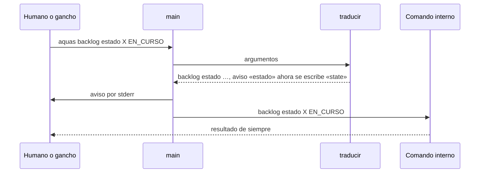

# S006 · CLI en inglés

[Inicio](../../README.md) › [E000](../README.md) › [F006](README.md) › S006

Este [slice](../../glosario.md#slice) pone en inglés los comandos y subcomandos de `aquas`, sin romper los nombres viejos.

## En una frase

`aquas verify` hace lo mismo que `aquas verificar`; el nombre viejo sigue andando y avisa el nuevo.

## Para qué existe

**El problema.** Los comandos de `aquas` estaban en castellano. La convención de las herramientas de línea de comandos es el inglés.

**Por qué importa.** Un cambio de nombre de golpe rompe ganchos, el [pre-commit](../../glosario.md#pre-commit) y la costumbre del humano. Por eso los dos nombres conviven un tiempo.

**La solución.** Una tabla traduce el nombre en inglés al nombre interno antes de despachar. Si llega el nombre viejo, `aquas` lo ejecuta igual y avisa por stderr.

**Origen.** La revisión externa (Fable #2) lo pidió. El humano decidió tres cosas el 2026-10-30. Traducir solo comandos y subcomandos (1a), dejar los nombres viejos con aviso (2a) y hacerlo en dos tramos (3a). La [wiki](../../glosario.md#wiki), los [canónicos](../../glosario.md#canónico) y los mensajes de uso pasan al inglés en [S012](README.md).

**Contrato.**

| Regla | Valor |
|---|---|
| Se traduce | el comando, su subcomando y la palabra `extend` de `backlog scope <id> extend` |
| No se traduce | estados (`EN_CURSO`), campos (`motivo=`), ids, rutas y mensajes |
| Nombre nuevo | responde igual que el viejo y no avisa |
| Nombre viejo | responde igual y avisa en stderr: «`estado` ahora se escribe `state`» |
| Palabra desconocida | pasa intacta; el error de comando desconocido sigue saliendo en `main` |
| Ganchos y pre-commit | usan los nombres nuevos: `guard`, `memory start`, `turn open`, `verify`… |
| Medidor de corridas | cuenta `verify` igual que `verificar`, también con el binario `aquas.exe` |
| Gate de la wiki | un comando citado vale si es un `case` o una llave de la tabla `comandos` |
| Freno de presupuesto | `memory set` suelta pasa sin contar, igual que `memoria fijar` |
| Tabla | `comandos` y `subcomandos` en `cmd/aquas/ingles.go`; ningún nombre nuevo es nombre viejo de otro |
| Alcance | `cmd/aquas/ingles.go`, `cmd/aquas/main.go`, `gobierno/config/claude_settings.json`, `.githooks/pre-commit`, el skill `/backlog`, `internal/vueltas/vueltas.go`, `internal/wiki/comandos.go`, `cmd/aquas/presupuesto.go`, las pruebas que fijaban los nombres viejos, esta página y la de [F006](README.md) |

**Casos borde.**

| Categoría | Aplica | Prueba o motivo |
|---|---|---|
| cada tipo de ficha | no | la traducción mira palabras de la orden, no fichas; un id pasa intacto |
| cada estado de origen | sí | el estado de la orden no se traduce: `backlog state X EN_CURSO` llega como `backlog estado X EN_CURSO`: `TestComandosEnIngles` |
| padre e hijo, activo y archivado | no | ningún nombre depende de la jerarquía del backlog |
| entrada ausente, vacía, mal escrita o duplicada | sí | palabra desconocida pasa intacta; `ver` como valor de un campo no se traduce; ningún nombre está repetido entre tablas: `TestComandosEnIngles` |
| choque con otro control | sí | los ganchos de Claude y el pre-commit usan los nombres nuevos y no avisan: `TestComandosEnIngles`; el medidor cuenta `verify`: `TestCuentaVueltasPorMotivo`; el gate de la wiki acepta `aquas turn open` y rechaza una llave de subcomando suelta: `TestComandoCitadoExiste`; el freno de presupuesto deja pasar `memory set` igual que `memoria fijar`: `TestFrenoDejaPasarMemoria` |
| quién habla: humano, agente o herramienta | sí | el gancho llama con el nombre nuevo y calla; el humano con el viejo recibe el aviso: `TestComandosEnIngles` |
| fallo a mitad de camino | no | la traducción no escribe nada; si el código no compila, el gancho usa la última versión compilada, que ya traduce |

## Analogía

Piensa en **una calle que cambia de nombre**.

- El cartero entrega en la dirección vieja y en la nueva.
- Al usar la vieja, te recuerda el nombre nuevo.

Límite de la analogía: aquí el nombre viejo dejará de existir en una ficha posterior.

## Diagrama

## Ejemplo de punta a punta

continúa: [EJ-E000-F006](README.md#EJ-E000-F006)

1. El humano escribe `aquas library read` con un lote de rutas; recibe las líneas pedidas.
2. Escribe `aquas biblioteca leer` con el mismo lote; recibe lo mismo.
3. En stderr ve «`biblioteca` ahora se escribe `library`» y «`leer` ahora se escribe `read`».
4. El gancho de guardia corre `aquas.sh guard`, sin aviso.

## Paso a paso

1. Rojo de `TestComandosEnIngles`: `library read` daba «subcomando desconocido».
2. `cmd/aquas/ingles.go` trae las tablas y `traducir`; `main` la llama antes de despachar.
3. Ganchos, pre-commit, skill `/backlog` y medidor pasan a los nombres nuevos; verde.

## Cómo se usa

- Usa los nombres en inglés: `aquas verify`, `aquas backlog next`, `aquas memory set`.
- Los nombres viejos siguen andando, con aviso.

## Contrato y evidencia

<!-- GENERADO por aquas desde trabajo/: no editar a mano; `aquas compile` lo rehace. -->

| Prueba | Valida | Rojo cuando | Verde cuando | Rojo | Verde |
|---|---|---|---|---|---|
| `TestComandosEnIngles` | los comandos en inglés responden y los nombres viejos avisan el nuevo | un comando en inglés no responde o un nombre viejo no indica el comando nuevo | build, verify y backlog responden y cada nombre viejo avisa su reemplazo | 2026-10-30 | 2026-10-30 |

### Código

| Archivo | Función | Parámetros | Qué hace |
|---|---|---|---|
| [.githooks/pre-commit](../../../.githooks/pre-commit) | — | — | — |
| [cmd/aquas/ingles.go](../../../cmd/aquas/ingles.go) | `traducir` | `(args []string) ([]string, []string)` | traducir devuelve los argumentos con los nombres internos y un aviso por cada nombre viejo usado. |
| [cmd/aquas/ingles.go](../../../cmd/aquas/ingles.go) | `traducirUna` | `(palabra string, tabla map[string]string, avisos *[]string) string` | traducirUna pasa una palabra a su nombre interno; si ya era el nombre viejo, anota el aviso. |
| [cmd/aquas/main.go](../../../cmd/aquas/main.go) | `main` | `()` | main despacha el subcomando de aquas (compilar, verificar, backlog, hooks…) y sale con su código. |
| [cmd/aquas/main.go](../../../cmd/aquas/main.go) | `hook` | `(raiz string)` | hook: exit 0 = nada que reportar; exit 2 = stderr se muestra a Claude. |
| [cmd/aquas/main.go](../../../cmd/aquas/main.go) | `compilarSettings` | `(w io.Writer)` | compilarSettings regenera .claude/settings.json; sin entorno declarado no inventa uno. |
| [cmd/aquas/main.go](../../../cmd/aquas/main.go) | `reportar` | `(w io.Writer, inf compilador.Informe)` | reportar imprime qué derivados escribió la compilación, o que todo estaba al día. |
| [cmd/aquas/main.go](../../../cmd/aquas/main.go) | `listar` | `(titulo string, problemas []string)` | listar imprime en stderr un título y cada problema en su viñeta. |
| [cmd/aquas/main.go](../../../cmd/aquas/main.go) | `lista` | `(xs []string) string` | lista une los textos con comas, o «—» si no hay ninguno. |
| [cmd/aquas/main.go](../../../cmd/aquas/main.go) | `fallar` | `(codigo int, err error)` | fallar imprime el error en stderr y termina con el código dado. |
| [cmd/aquas/main.go](../../../cmd/aquas/main.go) | `memoriaCLI` | `(raiz string, args []string)` | memoriaCLI: `ver` imprime la memoria; `fijar campo=valor…` la actualiza y la sella. |
| [cmd/aquas/main.go](../../../cmd/aquas/main.go) | `memoriaArchivada` | `(raiz, id string) error` | memoriaArchivada: CERRADO exige el archivo de memoria del slice, apunte o no la memoria a él (E001/F002/S009, X01). |
| [cmd/aquas/main.go](../../../cmd/aquas/main.go) | `focoEnBacklog` | `(raiz string, f memoria.Foco) error` | focoEnBacklog: la memoria solo fija el slice que el backlog tiene en curso (S003). |
| [cmd/aquas/main.go](../../../cmd/aquas/main.go) | `backlogCLI` | `(raiz string, args []string)` | backlogCLI: nuevo \\| ver [id] \\| tabla \\| prioridad \\| estado \\| siguiente \\| pruebas \\| rojo \\| verde. |
| [cmd/aquas/main.go](../../../cmd/aquas/main.go) | `turnoCLI` | `(raiz string, args []string)` | turnoCLI: auditoría de turnos (E001/F002/S001). Lee el JSON del hook por stdin. No imprime nada |
| [cmd/aquas/main.go](../../../cmd/aquas/main.go) | `defectoCLI` | `(raiz string, args []string) error` | defectoCLI: nuevo \\| ocurre \\| ver (E001/F004/S001). |
| [cmd/aquas/main.go](../../../cmd/aquas/main.go) | `versionBinario` | `() string` | versionBinario: versión del módulo con que se compiló el binario (= versión del gobierno embebido). |
| [cmd/aquas/main.go](../../../cmd/aquas/main.go) | `registrarCierre` | `(raiz, tipo, transcript, primera, resultado string)` | registrarCierre (E001/F004/S005, D000068) anota cada llamada del gancho cierre-agente en .tmp/hooks/cierre-agente.jsonl. |
| [cmd/aquas/presupuesto.go](../../../cmd/aquas/presupuesto.go) | `exentaDelFreno` | `(raiz string, e entradaPresupuesto) bool` | exentaDelFreno: true si la llamada es Bash y su comando entero es `aquas memory set campo=valor…`. |
| [cmd/aquas/presupuesto.go](../../../cmd/aquas/presupuesto.go) | `presupuestoCLI` | `(raiz string, args []string)` | presupuestoCLI: «prompt» reinicia el turno; «herramienta» cuenta la llamada y bloquea con exit 2 al pasar un tope. |
| [cmd/aquas/presupuesto.go](../../../cmd/aquas/presupuesto.go) | `frenoFeature` | `(raiz, dir string) string` | frenoFeature cuenta la llamada contra la feature del foco si está aprobada; "" si puede seguir. |
| [cmd/aquas/presupuesto.go](../../../cmd/aquas/presupuesto.go) | `anotar` | `(ruta string) int` | anotar suma una línea al archivo y devuelve el total. |
| [cmd/aquas/presupuesto.go](../../../cmd/aquas/presupuesto.go) | `contextoMedido` | `(ruta string) int` | contextoMedido: tokens de entrada de la última llamada del modelo en el transcript; 0 si después |
| [gobierno/config/claude_settings.json](../../../gobierno/config/claude_settings.json) | — | — | — |
| [internal/vueltas/vueltas.go](../../../internal/vueltas/vueltas.go) | `motivos` | `(tipo, salida string) []string` | motivos de una salida para un tipo; vacío = sin señal propia de fallo. |
| [internal/vueltas/vueltas.go](../../../internal/vueltas/vueltas.go) | `regla` | `(txt string) string` | regla: el mensaje del gate sin lo que cambia de página a página (citas, paréntesis, números). |
| [internal/vueltas/vueltas.go](../../../internal/vueltas/vueltas.go) | `Contar` | `(r io.Reader) (map[string]Conteo, error)` | Contar lee un historial .jsonl y agrupa por tipo ("go test", "verificar"). |
| [internal/vueltas/vueltas.go](../../../internal/vueltas/vueltas.go) | `texto` | `(raw json.RawMessage) string` | texto: el contenido de un resultado viene como cadena o como lista de bloques {type,text}. |
| [internal/vueltas/vueltas.go](../../../internal/vueltas/vueltas.go) | `Carpeta` | `(home, raiz string) string` | Carpeta del historial de Claude Code para este repo: ~/.claude/projects/<raíz con :\/ y espacios → ->. |
| [internal/vueltas/vueltas.go](../../../internal/vueltas/vueltas.go) | `Medir` | `(w io.Writer, home, raiz string, archivos []string) error` | Medir imprime una línea por historial y el total. Sin archivos: todos los .jsonl de Carpeta. |
| [internal/vueltas/vueltas.go](../../../internal/vueltas/vueltas.go) | `Linea` | `(nombre string, c map[string]Conteo) string` | Linea: «nombre · go test 92/47 (TestA 3, compilación 2) · verificar 102/37 (wiki 20)»; motivos de más a menos. |
| [internal/wiki/comandos.go](../../../internal/wiki/comandos.go) | `RevisarComandos` | `(raiz string) ([]string, error)` | RevisarComandos: todo `aquas X [Y]` citado entre comillas invertidas en docs/ y en |

<!-- /GENERADO -->

## Navegación

- ↑ Subir: [F006](README.md)
