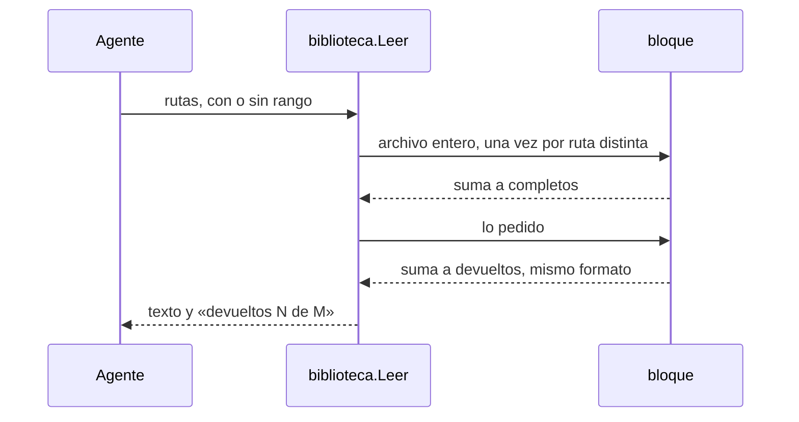

# S007 · Biblioteca cuenta bien lo devuelto

[Inicio](../../README.md) › [E000](../README.md) › [F006](README.md) › S007

Este [slice](../../glosario.md#slice) corrige la cuenta que la biblioteca imprime al final de cada lectura.

## En una frase

`aquas library read` mide lo devuelto y lo completo con la misma vara.

## Para qué existe

**El problema.** La revisión externa vio «devueltos 60081 de 56670». Devolvía más de lo que, según ella, tenía el archivo entero.

**Por qué importa.** La cuenta existe para mostrar el ahorro. Si dice que devolvió más que todo, nadie puede fiarse de ella.

**La causa.** Lo devuelto contaba cabeceras y números de línea. Lo completo contaba solo el texto crudo del archivo.

**La solución.** Lo completo ahora es lo que daría leer entero, una vez, cada ruta distinta del pedido. Usa el mismo formato que lo devuelto, con cabecera, números y avisos de error. Si aun así lo devuelto supera lo completo, la última línea dice por qué.

**Contrato.**

| Regla | Valor |
|---|---|
| Lectura entera | devueltos = completos |
| Rangos | devueltos suele quedar debajo de completos |
| Archivo repetido | cuenta una sola vez en completos, con cualquier grafía |
| Exceso | muchos rangos chicos, rangos repetidos o solapados, un rango tras el final de un archivo chico o un aviso repetido pueden superar completos: cada bloque suma su cabecera; la última línea agrega «(más que leer entero de una vez: cada rango o aviso suma su cabecera y lo repetido cuenta doble)» |
| Errores de ruta | su línea cuenta en ambos lados, una vez por línea distinta en completos |
| Rango fuera del archivo | su aviso cuenta solo en devueltos; la lectura entera traería el archivo |
| Corte por tope | devueltos = tope; completos sigue siendo la lectura entera |
| No cambia | el texto devuelto, el tope y la última línea, salvo la nota de exceso |
| Alcance | `internal/biblioteca/biblioteca.go`, `internal/biblioteca/biblioteca_test.go`, esta página y la de [F006](README.md) |

**Casos borde.**

| Categoría | Aplica | Prueba o motivo |
|---|---|---|
| cada tipo de ficha | no | la biblioteca lee archivos, no fichas del backlog |
| cada estado de origen | sí | archivo entero, varios con CRLF, vacío y rangos: `TestCuentaDevueltos`; rango de un archivo largo: `TestCuentaDeAhorro` |
| padre e hijo, activo y archivado | no | la cuenta no depende de carpetas padre ni del estado de ninguna ficha |
| entrada ausente, vacía, mal escrita o duplicada | sí | ruta inexistente, carpeta, fuera del repo, rango inválido, rango tras el final, error repetido y rangos repetidos o solapados: `TestCuentaDevueltos`; misma ruta con otra grafía: `TestLeerCasosBorde` |
| choque con otro control | sí | con corte por tope, devueltos = tope y completos sigue entero: `TestCuentaDevueltos`; el corte se avisa: `TestTopeCortaYLoDice` |
| quién habla: humano, agente o herramienta | no | la orden responde igual a quien la llame |
| fallo a mitad de camino | sí | una ruta con error no frena el lote y su línea cuenta en ambos lados: `TestCuentaDevueltos` |

## Analogía

Piensa en **una factura**.

- El total y el subtotal deben sumar lo mismo.
- Si uno incluye el IVA y el otro no, la factura parece mentir.

Límite de la analogía: aquí no hay dinero, solo caracteres.

## Diagrama

## Ejemplo de punta a punta

continúa: [EJ-E000-F006](README.md#EJ-E000-F006)

1. El [agente](../../glosario.md#agente) pide `internal/biblioteca/biblioteca.go` entero.
2. Antes la última línea podía decir que devolvió más que todo.
3. Ahora dice `== devueltos N de N caracteres`, con los dos números iguales.
4. Si pide un rango, devueltos queda por debajo y se ve el ahorro.

## Paso a paso

1. Rojo de `TestCuentaDevueltos`: «entero y error» daba 83 de 23.
2. La función `bloque` arma lo devuelto y también mide lo completo.
3. Las líneas de error cuentan en ambos lados, una vez por línea distinta en completos.
4. Si lo devuelto supera lo completo, la última línea lo explica; verde.

## Cómo se usa

- `aquas library read` sigue igual; su cuenta ya cuadra.
- Si la última línea avisa exceso, conviene pedir el archivo entero o rangos más grandes.

## Contrato y evidencia

<!-- GENERADO por aquas desde trabajo/: no editar a mano; `aquas compile` lo rehace. -->

| Prueba | Valida | Rojo cuando | Verde cuando | Rojo | Verde |
|---|---|---|---|---|---|
| `TestCuentaDevueltos` | valida que la biblioteca informa lo que de verdad devolvió | rojo cuando el total devuelto supera lo pedido | verde cuando el total coincide con lo devuelto | 2026-10-30 | 2026-10-30 |

### Código

| Archivo | Función | Parámetros | Qué hace |
|---|---|---|---|
| [internal/backlog/backlog.go](../../../internal/backlog/backlog.go) | `terminal` | `(estado string) bool` | terminal: el estado ya no cambia (CERRADO o CANCELADO). |
| [internal/backlog/backlog.go](../../../internal/backlog/backlog.go) | `esta` | `(xs []string, x string) bool` | esta: x figura en la lista. |
| [internal/backlog/backlog.go](../../../internal/backlog/backlog.go) | `tipoYPadre` | `(id string) (tipo, padre string)` | tipoYPadre deriva del id: E001 → iniciativa; E001/F002 → feature de E001; E001/F002/S002 → slice. |
| [internal/backlog/backlog.go](../../../internal/backlog/backlog.go) | `nombre` | `(id string) string` | nombre: archivo JSON de una ficha, con «/» del ID cambiadas por «-». |
| [internal/backlog/backlog.go](../../../internal/backlog/backlog.go) | `todas` | `(raiz string) (act, arc map[string]Ficha, err error)` | todas lee activo y archivo. Una ficha ilegible es error: Validar la detalla. |
| [internal/backlog/backlog.go](../../../internal/backlog/backlog.go) | `Todas` | `(raiz string) ([]Ficha, error)` | Todas: las fichas de activo y archivo, ordenadas por id. Para quien solo lee (wiki, E001/F002/S010). |
| [internal/backlog/backlog.go](../../../internal/backlog/backlog.go) | `leer` | `(ruta string) (Ficha, error)` | leer carga una ficha desde su archivo JSON. |
| [internal/backlog/backlog.go](../../../internal/backlog/backlog.go) | `escribir` | `(raiz, dir string, f Ficha) error` | escribir guarda la ficha como JSON en trabajo/<dir>/, con listas vacías en vez de null. |
| [internal/backlog/backlog.go](../../../internal/backlog/backlog.go) | `Nuevo` | `(raiz string, campos []string) (Ficha, error)` | Nuevo crea una ficha desde campos id=… titulo=… que_hace=… prioridad=… motivo=… relacion=… [bloqueado_por=A,B]. |
| [internal/backlog/backlog.go](../../../internal/backlog/backlog.go) | `Ver` | `(raiz, id string) (Ficha, bool, error)` | Ver busca la ficha en activo y luego en archivo. |
| [internal/backlog/backlog.go](../../../internal/backlog/backlog.go) | `activa` | `(raiz, id string) (Ficha, error)` | activa: la ficha a cambiar; una archivada no cambia. |
| [internal/backlog/backlog.go](../../../internal/backlog/backlog.go) | `Prioridad` | `(raiz, id, prioridad, motivo string) (Ficha, error)` | Prioridad cambia la prioridad; el motivo es obligatorio. |
| [internal/backlog/backlog.go](../../../internal/backlog/backlog.go) | `Estado` | `(raiz, id, estado string) (Ficha, error)` | Estado cambia el estado. CERRADO o CANCELADO mueve la ficha al archivo. |
| [internal/backlog/backlog.go](../../../internal/backlog/backlog.go) | `sinHijosActivos` | `(act map[string]Ficha, f Ficha) error` | sinHijosActivos: cerrar o cancelar una feature o iniciativa exige sus hijos directos ya archivados. |
| [internal/backlog/backlog.go](../../../internal/backlog/backlog.go) | `ordenar` | `(fs []Ficha, arc map[string]Ficha)` | orden de `siguiente`: en curso → desbloqueado → prioridad → secuencia → id. |
| [internal/backlog/backlog.go](../../../internal/backlog/backlog.go) | `Activas` | `(raiz string) ([]Ficha, error)` | Activas: slices en el orden de `siguiente`; después iniciativas y features por secuencia. |
| [internal/backlog/backlog.go](../../../internal/backlog/backlog.go) | `Siguiente` | `(raiz string) (Ficha, bool, error)` | Siguiente: el primer slice del orden fijo que esté en curso o desbloqueado. |
| [internal/backlog/backlog.go](../../../internal/backlog/backlog.go) | `sinDefinir` | `(act map[string]Ficha) (Ficha, bool)` | sinDefinir (E001/F002/S008, regla del humano 2026-10-21): iniciativa o feature activa sin hijos |
| [internal/backlog/backlog.go](../../../internal/backlog/backlog.go) | `Definir` | `(raiz string, f Ficha) string` | Definir: qué hacer con lo que `siguiente` saca sin definir; "" para un slice. |
| [internal/backlog/backlog.go](../../../internal/backlog/backlog.go) | `libre` | `(f Ficha, arc map[string]Ficha) bool` | libre: no está BLOQUEADO y cada bloqueador ya terminó (archivado: CERRADO o CANCELADO). |
| [internal/backlog/backlog.go](../../../internal/backlog/backlog.go) | `Validar` | `(raiz string) []string` | Validar: problemas de las fichas en disco (gate). Sin carpeta trabajo/ no hay problemas. |
| [internal/backlog/backlog.go](../../../internal/backlog/backlog.go) | `Texto` | `(f Ficha) string` | Texto: una línea por ficha, para el agente. |
| [internal/biblioteca/biblioteca.go](../../../internal/biblioteca/biblioteca.go) | `Leer` | `(raiz string, p Pedido) (texto string, devueltos, completos int)` | Leer devuelve el texto para el agente y cuántos caracteres devolvió de cuántos tiene |
| [internal/biblioteca/biblioteca.go](../../../internal/biblioteca/biblioteca.go) | `bloque` | `(rel string, lineas []string, desde, hasta int) string` | bloque: lo que Leer devuelve de las líneas desde-hasta de un archivo, cabecera incluida. |

<!-- /GENERADO -->

## Navegación

- ↑ Subir: [F006](README.md)
