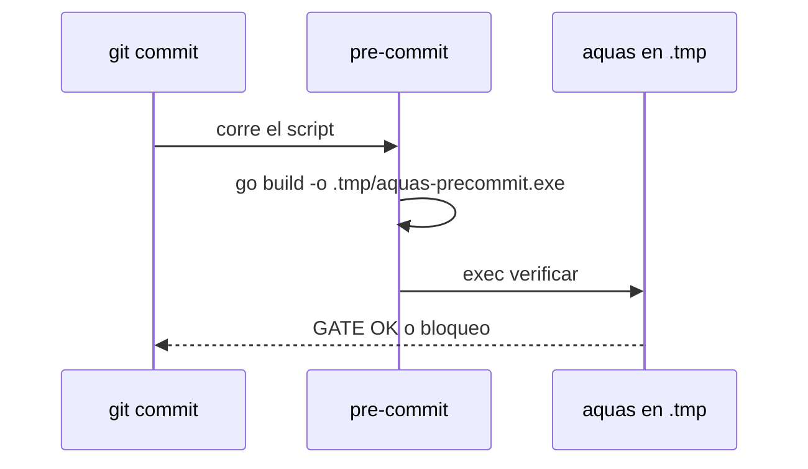

# S008 · Guardia sin falso binario viejo con go run

[Inicio](../../README.md) › [E000](../README.md) › [F006](README.md) › S008

Este [slice](../../glosario.md#slice) quita el falso aviso de binario viejo del [pre-commit](../../glosario.md#pre-commit). Estado: borrador; el contrato espera la aprobación del humano. Corrige el defecto D000034.

## En una frase

El pre-commit corre un binario de aquas recién construido, nunca uno guardado en la caché de [Go](../../glosario.md#go).

## Para qué existe

**El problema.** El pre-commit corre `go run ./cmd/aquas verificar`. A veces falla con «binario de aquas más viejo que internal/[backlog](../../glosario.md#backlog)/backlog.go» aunque el código ya está compilado. Hoy cada [commit](../../glosario.md#commit) necesita `GOFLAGS=-a` para pasar.

**La causa.** Desde Go 1.24, `go run` guarda su ejecutable en la caché de Go y lo reutiliza. La revisión `BinarioViejo` compara la fecha de ese ejecutable con la de cada `.go`. Un ejecutable reutilizado conserva su fecha vieja. La causa exacta es probable, no confirmada. Lo confirmado: con `GOFLAGS=-a` el mismo [gate](../../glosario.md#gate) da GATE OK.

**La solución.** El pre-commit construye aquas con `go build -o .tmp/aquas-precommit.exe ./cmd/aquas` y corre ese binario. `go build -o` escribe un archivo nuevo, con fecha de ahora. `BinarioViejo` no cambia: sigue protegiendo contra binarios realmente desfasados.

Contrato del slice:

| Campo | Valor |
|---|---|
| Historia | Como humano, quiero que el pre-commit no falle por un binario falsamente viejo, para no necesitar `GOFLAGS=-a` en cada commit |
| Objetivo | El pre-commit corre un binario construido en el momento dentro de `.tmp/` |
| Incluye | Cambio de `.githooks/pre-commit`; prueba que lee el script; reproducción manual del falso aviso antes y después |
| Excluye | Cambiar `BinarioViejo`; los hooks de Claude Code en `.claude/hooks`; hooks globales fuera del repo |
| Límite | Quita el falso aviso del pre-commit, no de otros sitios que usen `go run` |
| Alcance | `.githooks/**`, `cmd/aquas/**`, `docs/E000/F006/**`, `registro/defectos/**` |
| Prueba integral | la de E000/F006 |

Criterios de aceptación:

1. Dado el pre-commit, cuando se lee el script, entonces no contiene `go run` y construye a `.tmp/` con `go build -o`.
2. Dado un `.go` recién editado, cuando se hace un commit sin `GOFLAGS=-a`, entonces el gate no da el falso aviso.
3. Dado un fallo de compilación, cuando corre el pre-commit, entonces el commit se bloquea.

Estrategia:

1. El script hace `go build -o` y luego `exec` del binario, con TMP, TEMP y GOTMPDIR hacia `.tmp/`.
2. La prueba de Go lee `.githooks/pre-commit` y revisa el criterio 1; es determinista y barata.
3. El criterio 2 se demuestra a mano una vez, con la salida real en esta página.

Casos borde:

| Categoría | Caso | Qué debe pasar |
|---|---|---|
| Tipo de ficha | no aplica | el cambio es del pre-commit, no del backlog |
| Estado de origen | caché de Go vacía o llena | el binario se construye igual y tiene fecha de ahora |
| Padre e hijo | no aplica | — |
| Entrada | código que no compila; `.tmp/` inexistente | el commit se bloquea; el script crea `.tmp/` como hoy |
| Choque con otro control | `BinarioViejo` y el binario `.tmp/aq.exe` del agente | `BinarioViejo` sigue igual; el pre-commit usa otro nombre para no pisar `.tmp/aq.exe` |
| Quién habla | humano o agente con `git commit` | el mismo pre-commit para los dos |
| Fallo a medias | build falla después de crear el archivo | `exec` no corre; el commit se bloquea |

## Analogía

Piensa en **leer la fecha de una foto vieja reimpresa**.

- La copia trae la fecha del día en que se tomó la foto, no la de hoy.
- Si imprimes una foto nueva, la fecha dice hoy.

Límite de la analogía: aquí la foto vieja sí era igual a la nueva; solo la fecha engañaba.

## Diagrama

## Ejemplo de punta a punta

continúa: [EJ-E000-F006](README.md#EJ-E000-F006)

1. El [agente](../../glosario.md#agente) edita `internal/backlog/backlog.go`.
2. Hace `git commit` sin `GOFLAGS=-a`.
3. El pre-commit construye un binario nuevo en `.tmp/` y lo corre.
4. El gate da GATE OK sin el falso aviso.

## Paso a paso

1. Rojo de la prueba del script, cambio del pre-commit, verde.
2. Reproducción manual del commit sin `GOFLAGS=-a`.

## Cómo se usa

- No hay comando nuevo: `git commit` sigue igual, sin `GOFLAGS=-a`.

## Contrato y evidencia

<!-- GENERADO por aquas desde trabajo/: no editar a mano; `aquas compilar` lo rehace. -->

| Prueba | Valida | Rojo cuando | Verde cuando | Rojo | Verde |
|---|---|---|---|---|---|
| `TestPreCommitNoUsaGoRun` | valida que el pre-commit construye aquas a .tmp con go build -o y no usa go run | rojo cuando el script contiene go run | verde cuando el script construye a .tmp y hace exec del binario | — | — |

<!-- /GENERADO -->

## Navegación

- ↑ Subir: [F006](README.md)
