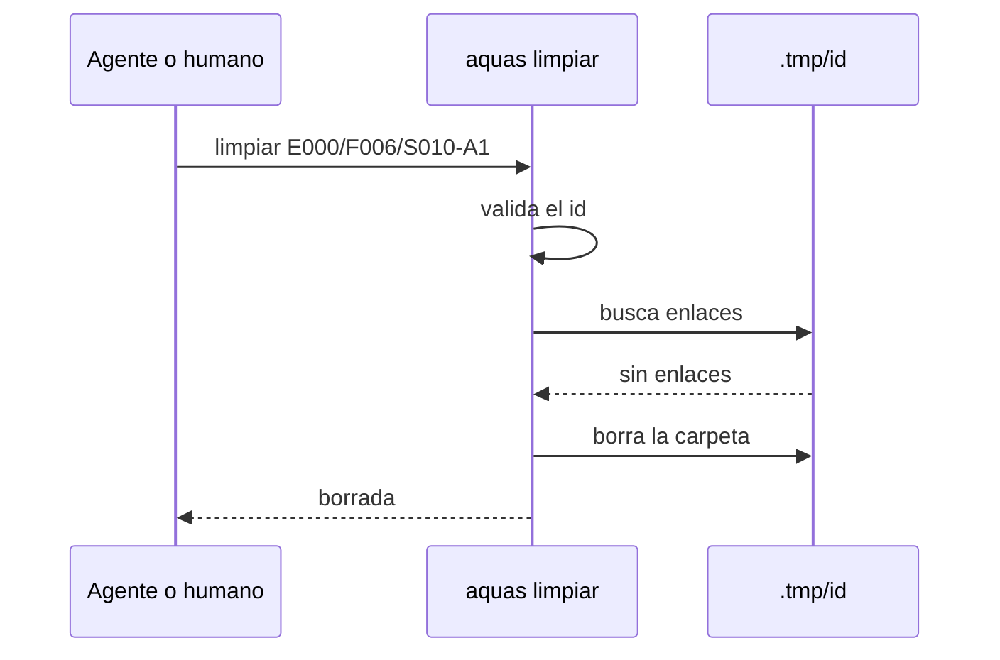

# S009 · aquas limpiar temporales del encargo

[Inicio](../../README.md) › [E000](../README.md) › [F006](README.md) › S009

Este [slice](../../glosario.md#slice) agrega «aquas limpiar», que borra la carpeta temporal de un encargo. Estado: cerrado; el humano aprobó el contrato el 2026-10-25.

## En una frase

«aquas limpiar <id>» borra `.tmp/<id>/` y rechaza cualquier otra ruta.

## Para qué existe

**El problema.** El [agente](../../glosario.md#agente) no tiene permiso de usar `rm`. Los auditores y los workers dejan copias en `.tmp/<id>/`. Esas copias se acumulan y el humano las borra a mano.

**La causa.** La regla de comunicación entre agentes manda borrar los temporales al cerrar. Hoy nadie tiene una forma segura de cumplirla.

**La solución.** Un comando de aquas borra solo la carpeta de un encargo. El humano decidió el 2026-10-25 que el agente puede usarlo.

Contrato del slice:

| Campo | Valor |
|---|---|
| Historia | Como humano, quiero que el agente borre los temporales de su encargo, para no limpiarlos yo a mano |
| Objetivo | «aquas limpiar <id>» borra `.tmp/<id>/` y nada más |
| Incluye | Comando nuevo; validación del id; rechazo de enlaces; prueba en un repo temporal |
| Excluye | Borrar fuera de `.tmp/`; borrar `.tmp` entero; carpetas sueltas sin id de encargo; cambiar permisos de `rm` |
| Límite | Solo carpetas con id de encargo estricto; ante la duda, no borra |
| Alcance | `cmd/aquas/**`, `docs/E000/F006/**`, `registro/defectos/**` |
| Prueba integral | la de E000/F006 |

Criterios de aceptación:

1. Dado un id válido como `E000/F006/S010-A1`, cuando se limpia, entonces desaparece `.tmp/E000-F006-S010-A1/` y nada más.
2. Dado un id inválido, vacío, con `..` o con separadores extra, cuando se limpia, entonces se rechaza y no borra nada.
3. Dada una carpeta del encargo con un enlace o *junction* dentro, cuando se limpia, entonces se rechaza entero y avisa.
4. Dado un id válido sin carpeta, cuando se limpia, entonces avisa que no hay nada y termina bien.

Estrategia:

1. El id acepta `/` o `-` y debe cumplir `E\d{3}-F\d{3}-S\d{3}-[AT]\d+`.
2. La ruta se arma desde la raíz del repo; nunca desde el id crudo.
3. Antes de borrar se recorre la carpeta; cualquier enlace frena todo.
4. La prueba arma un repo temporal con `.tmp/`, binarios falsos de [hooks](../../glosario.md#hook) y carpetas vecinas.

Casos borde:

| Categoría | Caso | Qué debe pasar |
|---|---|---|
| Tipo de ficha | encargo de worker `T` o de auditor `A` | los dos se aceptan |
| Estado de origen | carpeta inexistente | aviso y salida 0 |
| Padre e hijo | id de slice sin sufijo `-A1` o `-T1` | rechazo: no es un encargo |
| Entrada | `.tmp`, `..`, ruta absoluta, `s008r` | rechazo sin borrar |
| Choque con otro control | binarios de hooks en `.tmp/` | quedan intactos |
| Quién habla | humano o agente | la misma regla para los dos |
| Fallo a medias | un archivo bloqueado en Windows | error con la ruta; lo demás puede quedar borrado |

## Analogía

Piensa en **un conserje con la llave de un solo casillero**.

- Puede vaciar el casillero que lleva su número.
- No abre otros casilleros ni el cuarto entero.

Límite de la analogía: aquí, si el casillero tiene un pasadizo a otro cuarto, no lo vacía.

## Diagrama

## Ejemplo de punta a punta

continúa: [EJ-E000-F006](README.md#EJ-E000-F006)

1. El auditor termina el encargo `E000/F006/S010-A1`.
2. El agente corre «aquas limpiar E000/F006/S010-A1».
3. aquas borra `.tmp/E000-F006-S010-A1/` y deja intacto lo demás.

## Paso a paso

1. Rojo de la prueba, comando nuevo, verde.

## Cómo se usa

- «aquas limpiar E000/F006/S010-A1»

## Contrato y evidencia

<!-- GENERADO por aquas desde trabajo/: no editar a mano; `aquas compilar` lo rehace. -->

| Prueba | Valida | Rojo cuando | Verde cuando | Rojo | Verde |
|---|---|---|---|---|---|
| `TestLimpiarSoloTmpDelEncargo` | valida que borra solo .tmp/<id>/ y rechaza .tmp entero, rutas fuera y binarios de hooks | rojo cuando el comando no existe o borra fuera de .tmp/<id>/ | verde cuando borra la carpeta del encargo y rechaza los demás casos | 2026-10-25 | 2026-10-25 |

### Código

| Archivo | Función | Parámetros | Qué hace |
|---|---|---|---|
| [cmd/aquas/limpiar.go](../../../cmd/aquas/limpiar.go) | `limpiar` | `(raiz string, args []string) (string, error)` | limpiar (E000/F006/S009): borra .tmp/<id>/ de un encargo y nada más. |
| [cmd/aquas/main.go](../../../cmd/aquas/main.go) | `main` | `()` | main despacha el subcomando de aquas (compilar, verificar, backlog, hooks…) y sale con su código. |
| [cmd/aquas/main.go](../../../cmd/aquas/main.go) | `hook` | `(raiz string)` | hook: exit 0 = nada que reportar; exit 2 = stderr se muestra a Claude. |
| [cmd/aquas/main.go](../../../cmd/aquas/main.go) | `compilarSettings` | `(w io.Writer)` | compilarSettings regenera .claude/settings.json; sin entorno declarado no inventa uno. |
| [cmd/aquas/main.go](../../../cmd/aquas/main.go) | `reportar` | `(w io.Writer, inf compilador.Informe)` | reportar imprime qué derivados escribió la compilación, o que todo estaba al día. |
| [cmd/aquas/main.go](../../../cmd/aquas/main.go) | `listar` | `(titulo string, problemas []string)` | listar imprime en stderr un título y cada problema en su viñeta. |
| [cmd/aquas/main.go](../../../cmd/aquas/main.go) | `lista` | `(xs []string) string` | lista une los textos con comas, o «—» si no hay ninguno. |
| [cmd/aquas/main.go](../../../cmd/aquas/main.go) | `fallar` | `(codigo int, err error)` | fallar imprime el error en stderr y termina con el código dado. |
| [cmd/aquas/main.go](../../../cmd/aquas/main.go) | `memoriaCLI` | `(raiz string, args []string)` | memoriaCLI: `ver` imprime la memoria; `fijar campo=valor…` la actualiza y la sella. |
| [cmd/aquas/main.go](../../../cmd/aquas/main.go) | `memoriaArchivada` | `(raiz, id string) error` | memoriaArchivada: CERRADO exige el archivo de memoria del slice, apunte o no la memoria a él (E001/F002/S009, X01). |
| [cmd/aquas/main.go](../../../cmd/aquas/main.go) | `focoEnBacklog` | `(raiz string, f memoria.Foco) error` | focoEnBacklog: la memoria solo fija el slice que el backlog tiene en curso (S003). |
| [cmd/aquas/main.go](../../../cmd/aquas/main.go) | `backlogCLI` | `(raiz string, args []string)` | backlogCLI: nuevo \\| ver [id] \\| prioridad \\| estado \\| siguiente \\| pruebas \\| rojo \\| verde. |
| [cmd/aquas/main.go](../../../cmd/aquas/main.go) | `turnoCLI` | `(raiz string, args []string)` | turnoCLI: auditoría de turnos (E001/F002/S001). Lee el JSON del hook por stdin. No imprime nada |
| [cmd/aquas/main.go](../../../cmd/aquas/main.go) | `defectoCLI` | `(raiz string, args []string) error` | defectoCLI: nuevo \\| ocurre \\| ver (E001/F004/S001). |
| [cmd/aquas/main.go](../../../cmd/aquas/main.go) | `versionBinario` | `() string` | versionBinario: versión del módulo con que se compiló el binario (= versión del gobierno embebido). |
| [internal/backlog/rojo.go](../../../internal/backlog/rojo.go) | `problemaPrueba` | `(p Prueba) string` | problemaPrueba: por qué una prueba de la ficha está mal escrita ("" si está bien). |
| [internal/backlog/rojo.go](../../../internal/backlog/rojo.go) | `listaPruebas` | `(xs []string) ([]Prueba, error)` | listaPruebas convierte "./paquete:TestNombre=intención" en pruebas válidas, sin repetidas. |
| [internal/backlog/rojo.go](../../../internal/backlog/rojo.go) | `corriendo` | `(f Ficha) bool` | corriendo: la ficha está EN_CURSO o VERIFICANDO. |
| [internal/backlog/rojo.go](../../../internal/backlog/rojo.go) | `sliceEnCurso` | `(act map[string]Ficha) (string, bool)` | sliceEnCurso: el primer slice EN_CURSO o VERIFICANDO entre las activas, por id. |
| [internal/backlog/rojo.go](../../../internal/backlog/rojo.go) | `SliceEnCurso` | `(raiz string) (string, bool, error)` | SliceEnCurso: el único slice EN_CURSO o VERIFICANDO, si hay. |
| [internal/backlog/rojo.go](../../../internal/backlog/rojo.go) | `Pruebas` | `(raiz, id string, lista []string) (Ficha, error)` | Pruebas fija las pruebas de la ficha; cambiarlas borra rojo y verde. |
| [internal/backlog/rojo.go](../../../internal/backlog/rojo.go) | `corrible` | `(raiz, id string) (Ficha, error)` | corrible: ficha activa con pruebas; un slice además debe estar en curso. |
| [internal/backlog/rojo.go](../../../internal/backlog/rojo.go) | `Rojo` | `(raiz, id string, ahora time.Time) (Ficha, error)` | Rojo corre cada prueba sola con `go test -json`; exige que cada una falle por sí misma. |
| [internal/backlog/rojo.go](../../../internal/backlog/rojo.go) | `rojoHeredado` | `(raiz string, f Ficha) *Registro` | rojoHeredado (X02): rojo que un slice cerrado de la feature registró para todas sus pruebas |
| [internal/backlog/rojo.go](../../../internal/backlog/rojo.go) | `Verde` | `(raiz, id string, ahora time.Time) (Ficha, error)` | Verde corre las pruebas juntas tras el rojo; exige que todas pasen. |
| [internal/backlog/rojo.go](../../../internal/backlog/rojo.go) | `resultado.motivo` | `(siPasa string) string` | motivo: texto que explica el resultado de una prueba; siPasa se usa cuando pasó. |
| [internal/backlog/rojo.go](../../../internal/backlog/rojo.go) | `correr` | `(raiz string, ps []Prueba) (map[string]resultado, error)` | correr: `go test -json -count=1 -run ^(A\\|B)$ ./paquete` por paquete; resultado por prueba. |
| [internal/backlog/rojo.go](../../../internal/backlog/rojo.go) | `motivoDelFallo` | `(ls []string) string` | motivoDelFallo: la última línea «archivo.go:N: …» (la que hizo fallar); si no hay, la primera. |
| [internal/backlog/rojo.go](../../../internal/backlog/rojo.go) | `head` | `(raiz string) string` | head: commit actual del repo, o "" fuera de Git. |
| [internal/backlog/rojo.go](../../../internal/backlog/rojo.go) | `cierre` | `(f Ficha) error` | cierre: CERRADO exige pruebas, rojo y verde. |
| [internal/backlog/rojo.go](../../../internal/backlog/rojo.go) | `problemasRojoVerde` | `(rel string, f Ficha) []string` | problemasRojoVerde: chequeos del gate sobre pruebas, rojo y verde de una ficha. |
| [internal/backlog/rojo.go](../../../internal/backlog/rojo.go) | `Detalle` | `(f Ficha) string` | Detalle: pruebas con su intención, y rojo y verde, para `ver <id>`, `pruebas`, `rojo` y `verde`. |

<!-- /GENERADO -->

## Navegación

- ↑ Subir: [F006](README.md)
