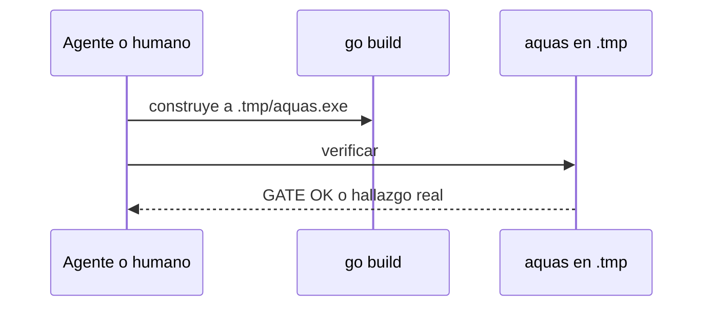

# S010 · Instrucciones sin go run para verificar

[Inicio](../../README.md) › [E000](../README.md) › [F006](README.md) › S010

Este [slice](../../glosario.md#slice) quita `go run ./cmd/aquas verificar` de las instrucciones. Estado: cerrado; el humano aprobó el contrato el 2026-10-25. Amplía E000/F006/S008 y cierra el resto del defecto D000034.

## En una frase

Toda instrucción para verificar construye aquas en `.tmp/` y corre ese binario, como el [pre-commit](../../glosario.md#pre-commit).

## Para qué existe

**El problema.** La constitución, el auditor y varias páginas mandan a correr `go run ./cmd/aquas verificar`. Ese comando puede dar el falso aviso «binario de aquas más viejo». El auditor de S019 lo sufrió el 2026-10-25.

**La causa.** `go run` reutiliza un ejecutable guardado en la caché de [Go](../../glosario.md#go), con su fecha vieja. Está verificada en S008: `go build -o` no da el aviso.

**La solución.** Cada instrucción dice `go build -o .tmp/aquas.exe ./cmd/aquas && ./.tmp/aquas.exe verificar`. Una prueba revisa los [canónicos](../../glosario.md#canónico) y la [wiki](../../glosario.md#wiki) para que no vuelva.

Contrato del slice:

| Campo | Valor |
|---|---|
| Historia | Como humano, quiero que las instrucciones para verificar no den falsos avisos, para confiar en el gate |
| Objetivo | Ningún canónico ni página manda `go run ./cmd/aquas verificar` |
| Incluye | Cambiar la constitución y el auditor en `gobierno/canonico/`; cambiar las páginas de `docs/`; prueba que lo revisa |
| Excluye | Registros de `auditoria/`; la historia del problema en S008; `go run ./cmd/aquas compilar` |
| Límite | Cambia instrucciones, no el gate: `BinarioViejo` sigue igual |
| Alcance | `README.md`, `gobierno/canonico/**`, `docs/**`, `cmd/aquas/**`, `registro/defectos/**`, más los compilados `CLAUDE.md` y `.claude/agents/**` |
| Prueba integral | la de E000/F006 |

Criterios de aceptación:

1. Dado `README.md`, `gobierno/canonico/**` y `docs/**`, cuando corre la prueba, entonces ninguno contiene `go run ./cmd/aquas verificar`.
2. Dada una página en la lista de excepciones, cuando lo contiene, entonces la prueba pasa.
3. Dado un archivo nuevo que lo contiene, cuando corre la prueba, entonces falla y nombra el archivo y la línea.

Estrategia:

1. La prueba lee `README.md`, recorre `gobierno/canonico` y `docs`, y busca el texto literal.
2. La lista de excepciones es explícita y corta: hoy `docs/E000/F006/S008.md` y esta página.
3. Los compilados se rehacen con `aquas compilar`; no se editan a mano.

Casos borde:

| Categoría | Caso | Qué debe pasar |
|---|---|---|
| Tipo de ficha | no aplica | el cambio es de texto, no del backlog |
| Estado de origen | página ya sin el texto | nada cambia |
| Padre e hijo | no aplica | — |
| Entrada | texto dentro de un diagrama | también cuenta y se cambia |
| Choque con otro control | glosario agrega enlaces al editar | la prueba busca el texto del comando, que no lleva enlaces |
| Quién habla | humano o agente | la misma instrucción para los dos |
| Fallo a medias | se cambia el canónico y no se compila | el gate falla por desfase, como hoy |

## Analogía

Piensa en **un manual que aún dice usar una pieza ya retirada**.

- El taller ya cambió la pieza.
- El manual sigue mandando a usar la vieja.

Límite de la analogía: aquí la pieza vieja a veces funciona; por eso el error se esconde.

## Diagrama

## Ejemplo de punta a punta

continúa: [EJ-E000-F006](README.md#EJ-E000-F006)

1. El auditor lee su instrucción de [gate](../../glosario.md#gate).
2. Construye aquas en `.tmp/` y corre `verificar`.
3. El gate no da el falso aviso de binario viejo.

## Paso a paso

1. Rojo de la prueba, cambio de canónicos y páginas, compilar, verde.

## Cómo se usa

- Para verificar: `go build -o .tmp/aquas.exe ./cmd/aquas && ./.tmp/aquas.exe verificar`.

## Contrato y evidencia

<!-- GENERADO por aquas desde trabajo/: no editar a mano; `aquas compilar` lo rehace. -->

| Prueba | Valida | Rojo cuando | Verde cuando | Rojo | Verde |
|---|---|---|---|---|---|
| `TestInstruccionesSinGoRunVerificar` | valida que canónicos y docs no mandan go run ./cmd/aquas verificar | rojo cuando algún canónico o página contiene go run ./cmd/aquas verificar | verde cuando ninguno lo contiene | 2026-10-25 | 2026-10-25 |

### Código

Sin código registrado: sus cambios no tocaron código ni configuración, o no nombran el ID (`aquas backlog codigo E000/F006/S010 <commit>…` los asigna).

<!-- /GENERADO -->

## Navegación

- ↑ Subir: [F006](README.md)
