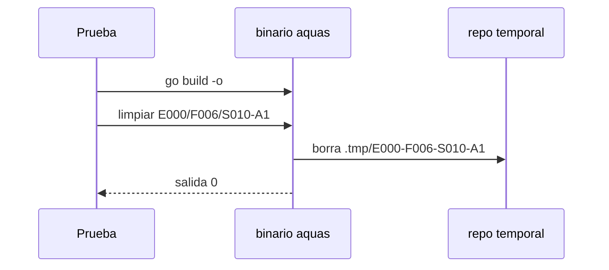

# S011 · aquas limpiar conectado: CLI y regla de encargos

[Inicio](../../README.md) › [E000](../README.md) › [F006](README.md) › S011

Este [slice](../../glosario.md#slice) prueba que `aquas limpiar` responde como subcomando y lo nombra en la regla de encargos. Estado: cerrado; el humano aprobó el contrato el 2026-10-25. Sigue a E000/F006/S009, ya cerrado.

## En una frase

Una prueba corre `aquas limpiar` de verdad, y la regla de encargos dice que se borra con él.

## Para qué existe

**El problema.** El auditor de S009 encontró dos huecos. La prueba llama a la función directo, no al subcomando. Además, la regla de encargos dice «borrarlos al cerrar» sin nombrar la herramienta.

**Por qué importa.** Si se rompe el despacho, las pruebas siguen en verde. Y un [agente](../../glosario.md#agente) sin el encargo a mano no sabe cómo borrar.

**La solución.** Una prueba construye aquas y corre el subcomando en un repo temporal. La regla [canónica](../../glosario.md#canónico) nombra `aquas limpiar <id>`.

Contrato del slice:

| Campo | Valor |
|---|---|
| Historia | Como humano, quiero que los agentes sepan y puedan borrar sus temporales, para no limpiarlos yo |
| Objetivo | El subcomando funciona probado y la regla lo nombra |
| Incluye | Prueba del binario con id válido e inválido; una línea en la regla canónica de encargos; compilar |
| Excluye | Cambiar cómo borra `aquas limpiar`; otras reglas; permisos de `rm` |
| Límite | Solo conecta lo que S009 ya hizo |
| Alcance | `cmd/aquas/**`, `gobierno/canonico/reglas/**`, `.claude/agents/**`, `gobierno/config/sellos.json`, `docs/E000/F006/**`, `registro/defectos/**` |
| Prueba integral | la de E000/F006 |

Criterios de aceptación:

1. Dado un repo temporal con `.tmp/<id>/`, cuando corre el binario `limpiar <id>`, entonces sale 0 y la carpeta desaparece.
2. Dado un id inválido, cuando corre el binario, entonces sale distinto de 0 y no borra nada.
3. Dada la regla canónica de encargos, cuando se lee, entonces nombra `aquas limpiar`.

Estrategia:

1. La prueba construye aquas en un directorio temporal con `go build -o`.
2. Corre el binario con el repo temporal como carpeta de trabajo.
3. La regla cambia en `gobierno/canonico/reglas/`; los agentes se recompilan con `aquas compilar`.

Casos borde:

| Categoría | Caso | Qué debe pasar |
|---|---|---|
| Tipo de ficha | no aplica | — |
| Estado de origen | carpeta inexistente | sale 0 con aviso |
| Padre e hijo | no aplica | — |
| Entrada | id inválido | salida distinta de 0 |
| Choque con otro control | tope de caracteres del agente compilado | si se excede, se sube el tope, no se recorta la regla |
| Quién habla | humano o agente | el mismo subcomando |
| Fallo a medias | el build falla | la prueba falla con el error del build |

## Analogía

Piensa en **un extintor nuevo que nadie señalizó**.

- Funciona, pero nadie sabe dónde está.
- El letrero en la pared lo resuelve.

Límite de la analogía: aquí también probamos que el extintor dispara.

## Diagrama

## Ejemplo de punta a punta

continúa: [EJ-E000-F006](README.md#EJ-E000-F006)

1. Un auditor lee la regla de encargos.
2. Ve que debe borrar con `aquas limpiar <id>`.
3. Lo corre al cerrar y su carpeta desaparece.

## Paso a paso

1. Rojo de la prueba, línea en la regla, compilar, verde.

## Cómo se usa

- `aquas limpiar E000/F006/S010-A1`

## Contrato y evidencia

<!-- GENERADO por aquas desde trabajo/: no editar a mano; `aquas compilar` lo rehace. -->

| Prueba | Valida | Rojo cuando | Verde cuando | Rojo | Verde |
|---|---|---|---|---|---|
| `TestLimpiarConectado` | valida que el CLI despacha limpiar y la regla de encargos lo nombra | rojo cuando el despacho falta o la regla no nombra aquas limpiar | verde cuando el CLI borra por subcomando y la regla lo nombra | 2026-10-25 | 2026-10-25 |

### Código

| Archivo | Función | Parámetros | Qué hace |
|---|---|---|---|
| [cmd/aquas/main.go](../../../cmd/aquas/main.go) | `main` | `()` | main despacha el subcomando de aquas (compilar, verificar, backlog, hooks…) y sale con su código. |
| [cmd/aquas/main.go](../../../cmd/aquas/main.go) | `hook` | `(raiz string)` | hook: exit 0 = nada que reportar; exit 2 = stderr se muestra a Claude. |
| [cmd/aquas/main.go](../../../cmd/aquas/main.go) | `compilarSettings` | `(w io.Writer)` | compilarSettings regenera .claude/settings.json; sin entorno declarado no inventa uno. |
| [cmd/aquas/main.go](../../../cmd/aquas/main.go) | `reportar` | `(w io.Writer, inf compilador.Informe)` | reportar imprime qué derivados escribió la compilación, o que todo estaba al día. |
| [cmd/aquas/main.go](../../../cmd/aquas/main.go) | `listar` | `(titulo string, problemas []string)` | listar imprime en stderr un título y cada problema en su viñeta. |
| [cmd/aquas/main.go](../../../cmd/aquas/main.go) | `lista` | `(xs []string) string` | lista une los textos con comas, o «—» si no hay ninguno. |
| [cmd/aquas/main.go](../../../cmd/aquas/main.go) | `fallar` | `(codigo int, err error)` | fallar imprime el error en stderr y termina con el código dado. |
| [cmd/aquas/main.go](../../../cmd/aquas/main.go) | `memoriaCLI` | `(raiz string, args []string)` | memoriaCLI: `ver` imprime la memoria; `fijar campo=valor…` la actualiza y la sella. |
| [cmd/aquas/main.go](../../../cmd/aquas/main.go) | `memoriaArchivada` | `(raiz, id string) error` | memoriaArchivada: CERRADO exige el archivo de memoria del slice, apunte o no la memoria a él (E001/F002/S009, X01). |
| [cmd/aquas/main.go](../../../cmd/aquas/main.go) | `focoEnBacklog` | `(raiz string, f memoria.Foco) error` | focoEnBacklog: la memoria solo fija el slice que el backlog tiene en curso (S003). |
| [cmd/aquas/main.go](../../../cmd/aquas/main.go) | `backlogCLI` | `(raiz string, args []string)` | backlogCLI: nuevo \\| ver [id] \\| prioridad \\| estado \\| siguiente \\| pruebas \\| rojo \\| verde. |
| [cmd/aquas/main.go](../../../cmd/aquas/main.go) | `turnoCLI` | `(raiz string, args []string)` | turnoCLI: auditoría de turnos (E001/F002/S001). Lee el JSON del hook por stdin. No imprime nada |
| [cmd/aquas/main.go](../../../cmd/aquas/main.go) | `defectoCLI` | `(raiz string, args []string) error` | defectoCLI: nuevo \\| ocurre \\| ver (E001/F004/S001). |
| [cmd/aquas/main.go](../../../cmd/aquas/main.go) | `versionBinario` | `() string` | versionBinario: versión del módulo con que se compiló el binario (= versión del gobierno embebido). |

<!-- /GENERADO -->

## Navegación

- ↑ Subir: [F006](README.md)
