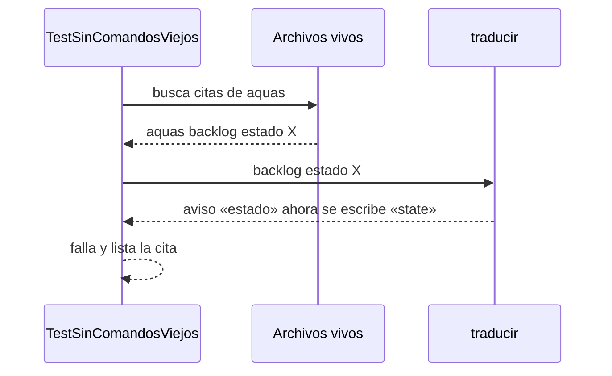

# S012 · Wiki y canónicos con comandos en inglés

[Inicio](../../README.md) › [E000](../README.md) › [F006](README.md) › S012

Este [slice](../../glosario.md#slice) cambia los nombres viejos de los comandos por los nuevos en todo texto vivo del repo.

## En una frase

Quien lea la [wiki](../../glosario.md#wiki), un [canónico](../../glosario.md#canónico) o un mensaje de `aquas` ve `aquas verify`, no `aquas verificar`.

## Para qué existe

**El problema.** [S006](S006.md) puso los comandos en inglés, pero el repo cita unas 780 veces los nombres viejos. Cada cita viaja al [agente](../../glosario.md#agente) o al humano y genera un aviso al copiarla.

**Por qué importa.** Los nombres viejos dejarán de existir más adelante. Cuando pase, cada cita vieja sería una instrucción rota.

**La solución.** Una pasada mecánica reemplaza el comando, su subcomando y la palabra `extend` de `backlog scope`. Una prueba recorre el repo y falla si queda una cita vieja.

**Origen.** El humano decidió el 2026-10-30 partir S006 en dos tramos (decisión 3a). También decidió migrar las páginas de tramos ya cerrados.

**Contrato.**

| Regla | Valor |
|---|---|
| Se migra | wiki (`docs/`), canónicos, compilados, `README.md` y los mensajes del programa |
| Páginas de tramos cerrados | también se migran: la wiki es documentación viva |
| No se migra | historia: `registro/`, `auditoria/`, `trabajo/` y los bloques que `aquas compile` rehace desde `trabajo/`; pruebas (`_test.go`), que ejercitan los nombres viejos a propósito |
| Excepciones | las páginas de [S006](S006.md) y esta, y `cmd/aquas/ingles.go`: explican el cambio de nombre |
| Cita detectada | el binario (`aquas`, `aquas.exe`, `aq.exe`, `aquas.sh`, `./cmd/aquas`) seguido de un nombre viejo; cada alternativa de `open|close` cuenta |
| No cuenta | el nombre del repo ni la prosa sin comando, como «aquas compila» |
| Alcance | `docs/**`, `gobierno/canonico/**`, `cmd/aquas/**`, `internal/**`, `README.md` y los compilados que regenera `aquas compile` |

**Casos borde.**

| Categoría | Aplica | Prueba o motivo |
|---|---|---|
| cada tipo de ficha | no | la prueba mira archivos de texto, no fichas |
| cada estado de origen | sí | las páginas de tramos cerrados se revisan igual que las de tramos en curso: `TestSinComandosViejos` |
| padre e hijo, activo y archivado | sí | recorre toda la wiki: iniciativas, features y slices, activos o archivados: `TestSinComandosViejos` |
| entrada ausente, vacía, mal escrita o duplicada | sí | el nombre del repo, la prosa y el nombre nuevo no cuentan; el viejo cuenta en cada posición, con puntuación detrás o como alternativa: `TestSinComandosViejos` |
| choque con otro control | sí | el gate de la wiki acepta los nombres nuevos: `TestComandoCitadoExiste`; el freno deja pasar `memory set`: `TestFrenoDejaPasarMemoria` |
| quién habla: humano, agente o herramienta | sí | se revisan los mensajes que el programa le da al agente y los agentes compilados que este lee: `TestSinComandosViejos` |
| fallo a mitad de camino | no | el reemplazo solo cambia texto; lo que quede lo detectan la prueba y el gate |

## Analogía

Piensa en **cambiar los letreros de una calle renombrada**.

- La dirección vieja aún llega.
- Los letreros nuevos evitan que alguien la siga usando.

Límite de la analogía: aquí el inspector es una prueba que recorre todo el repo.

## Diagrama

## Ejemplo de punta a punta

continúa: [EJ-E000-F006](README.md#EJ-E000-F006)

1. Una página de la wiki dice «corre `aquas verificar`».
2. `TestSinComandosViejos` la encuentra y falla.
3. La pasada la cambia a «corre `aquas verify`».
4. La prueba pasa y el [gate](../../glosario.md#gate) sigue en verde.

## Paso a paso

1. Rojo de `TestSinComandosViejos`: unas 780 citas viejas en 160 archivos.
2. Pasada mecánica con la tabla de S006, al revés; revisión de lo que cambió.
3. Las citas en listas de alternativas se migran a mano.
4. Pruebas que comparaban mensajes del programa pasan a los nombres nuevos; verde.
5. Hallazgos del auditor: citas sin binario delante, como `backlog nuevo`, se migran a mano. La prueba no las vigila: sin binario, «memoria» o «estado» son prosa común.
6. La prueba también salta `.aquas/`: guarda el estado de la sesión, no texto del repo.

## Cómo se usa

- Nada nuevo: la wiki y los mensajes ya muestran los nombres en inglés.

## Contrato y evidencia

<!-- GENERADO por aquas desde trabajo/: no editar a mano; `aquas compile` lo rehace. -->

| Prueba | Valida | Rojo cuando | Verde cuando | Rojo | Verde |
|---|---|---|---|---|---|
| `TestSinComandosViejos` | valida que el repo ya no nombra comandos viejos | rojo cuando una página, canónico o mensaje nombra un comando viejo | verde cuando solo quedan los nombres en inglés y el alias | 2026-10-30 | 2026-10-30 |

### Código

| Archivo | Función | Parámetros | Qué hace |
|---|---|---|---|
| [cmd/aquas/limpiar.go](../../../cmd/aquas/limpiar.go) | `limpiar` | `(raiz string, args []string) (string, error)` | limpiar (E000/F006/S009): borra .tmp/<id>/ de un encargo y nada más. |
| [cmd/aquas/main.go](../../../cmd/aquas/main.go) | `main` | `()` | main despacha el subcomando de aquas (compilar, verificar, backlog, hooks…) y sale con su código. |
| [cmd/aquas/main.go](../../../cmd/aquas/main.go) | `hook` | `(raiz string)` | hook: exit 0 = nada que reportar; exit 2 = stderr se muestra a Claude. |
| [cmd/aquas/main.go](../../../cmd/aquas/main.go) | `compilarSettings` | `(w io.Writer)` | compilarSettings regenera .claude/settings.json; sin entorno declarado no inventa uno. |
| [cmd/aquas/main.go](../../../cmd/aquas/main.go) | `reportar` | `(w io.Writer, inf compilador.Informe)` | reportar imprime qué derivados escribió la compilación, o que todo estaba al día. |
| [cmd/aquas/main.go](../../../cmd/aquas/main.go) | `listar` | `(titulo string, problemas []string)` | listar imprime en stderr un título y cada problema en su viñeta. |
| [cmd/aquas/main.go](../../../cmd/aquas/main.go) | `lista` | `(xs []string) string` | lista une los textos con comas, o «—» si no hay ninguno. |
| [cmd/aquas/main.go](../../../cmd/aquas/main.go) | `fallar` | `(codigo int, err error)` | fallar imprime el error en stderr y termina con el código dado. |
| [cmd/aquas/main.go](../../../cmd/aquas/main.go) | `memoriaCLI` | `(raiz string, args []string)` | memoriaCLI: `ver` imprime la memoria; `fijar campo=valor…` la actualiza y la sella. |
| [cmd/aquas/main.go](../../../cmd/aquas/main.go) | `memoriaArchivada` | `(raiz, id string) error` | memoriaArchivada: CERRADO exige el archivo de memoria del slice, apunte o no la memoria a él (E001/F002/S009, X01). |
| [cmd/aquas/main.go](../../../cmd/aquas/main.go) | `focoEnBacklog` | `(raiz string, f memoria.Foco) error` | focoEnBacklog: la memoria solo fija el slice que el backlog tiene en curso (S003). |
| [cmd/aquas/main.go](../../../cmd/aquas/main.go) | `backlogCLI` | `(raiz string, args []string)` | backlogCLI: nuevo \\| ver [id] \\| tabla \\| prioridad \\| estado \\| siguiente \\| pruebas \\| rojo \\| verde. |
| [cmd/aquas/main.go](../../../cmd/aquas/main.go) | `turnoCLI` | `(raiz string, args []string)` | turnoCLI: auditoría de turnos (E001/F002/S001). Lee el JSON del hook por stdin. No imprime nada |
| [cmd/aquas/main.go](../../../cmd/aquas/main.go) | `defectoCLI` | `(raiz string, args []string) error` | defectoCLI: nuevo \\| ocurre \\| ver (E001/F004/S001). |
| [cmd/aquas/main.go](../../../cmd/aquas/main.go) | `versionBinario` | `() string` | versionBinario: versión del módulo con que se compiló el binario (= versión del gobierno embebido). |
| [cmd/aquas/main.go](../../../cmd/aquas/main.go) | `registrarCierre` | `(raiz, tipo, transcript, primera, resultado string)` | registrarCierre (E001/F004/S005, D000068) anota cada llamada del gancho cierre-agente en .tmp/hooks/cierre-agente.jsonl. |
| [cmd/aquas/presupuesto.go](../../../cmd/aquas/presupuesto.go) | `exentaDelFreno` | `(raiz string, e entradaPresupuesto) bool` | exentaDelFreno: true si la llamada es Bash y su comando entero es `aquas memory set campo=valor…`. |
| [cmd/aquas/presupuesto.go](../../../cmd/aquas/presupuesto.go) | `presupuestoCLI` | `(raiz string, args []string)` | presupuestoCLI: «prompt» reinicia el turno; «herramienta» cuenta la llamada y bloquea con exit 2 al pasar un tope. |
| [cmd/aquas/presupuesto.go](../../../cmd/aquas/presupuesto.go) | `frenoFeature` | `(raiz, dir string) string` | frenoFeature cuenta la llamada contra la feature del foco si está aprobada; "" si puede seguir. |
| [cmd/aquas/presupuesto.go](../../../cmd/aquas/presupuesto.go) | `anotar` | `(ruta string) int` | anotar suma una línea al archivo y devuelve el total. |
| [cmd/aquas/presupuesto.go](../../../cmd/aquas/presupuesto.go) | `contextoMedido` | `(ruta string) int` | contextoMedido: tokens de entrada de la última llamada del modelo en el transcript; 0 si después |
| [internal/backlog/alcance.go](../../../internal/backlog/alcance.go) | `limpia` | `(r string) string` | limpia normaliza una ruta: barras «/», sin «./» inicial ni segmentos redundantes. |
| [internal/backlog/alcance.go](../../../internal/backlog/alcance.go) | `Alcance` | `(raiz, id string, rutas []string) (Ficha, error)` | Alcance declara (reemplaza) las rutas del slice. |
| [internal/backlog/alcance.go](../../../internal/backlog/alcance.go) | `Ampliar` | `(raiz, id, ruta, motivo string) (Ficha, error)` | Ampliar agrega una ruta al alcance; el motivo es obligatorio y de una línea. |
| [internal/backlog/alcance.go](../../../internal/backlog/alcance.go) | `cubre` | `(patron, rel string) bool` | cubre: «dir/**» cubre todo lo de dentro; si no, patrón de path.Match o ruta exacta. |
| [internal/backlog/alcance.go](../../../internal/backlog/alcance.go) | `FueraDeAlcance` | `(raiz, rel string) string` | FueraDeAlcance: "" si rel (relativa a la raíz) se puede tocar; si no, el motivo y cómo seguir. |
| [internal/backlog/aprobacion.go](../../../internal/backlog/aprobacion.go) | `seccionContrato` | `(texto string) (string, bool)` | seccionContrato: texto de «## Para qué existe» de la página, sin los bloques GENERADO de aquas. |
| [internal/backlog/aprobacion.go](../../../internal/backlog/aprobacion.go) | `Huella` | `(raiz string, f Ficha) (string, error)` | Huella: SHA-256 de las pruebas, el alcance (con sus ampliaciones) y la sección «Para qué existe» de la página. |
| [internal/backlog/aprobacion.go](../../../internal/backlog/aprobacion.go) | `Aprobar` | `(raiz, id, mensaje string, ahora time.Time) (Ficha, error)` | Aprobar registra la aprobación del contrato de un slice o de una feature (con la foto de sus slices) con la huella |
| [internal/backlog/aprobacion.go](../../../internal/backlog/aprobacion.go) | `aprobada` | `(raiz string, f Ficha) error` | aprobada: nil si el slice puede avanzar (EN_CURSO, rojo, verde, cierre); si no, el paso que falta. |
| [internal/backlog/aprobacion.go](../../../internal/backlog/aprobacion.go) | `abiertos` | `(raiz, feature string) int` | abiertos (E001/F015/X01): slices activos (ni CERRADO ni CANCELADO) de la feature; error de lectura = 0. |
| [internal/backlog/aprobacion.go](../../../internal/backlog/aprobacion.go) | `cubiertaPorFeature` | `(raiz string, p, f Ficha, aprobadas []Prueba) error` | cubiertaPorFeature (E001/F015/S001): el slice avanza si el contrato de su feature no cambió y cada prueba |
| [internal/backlog/arreglo.go](../../../internal/backlog/arreglo.go) | `idArreglo` | `(padre string, n int) string` | idArreglo: ID del n-ésimo arreglo (1, 2…) de padre: padre/X01. |
| [internal/backlog/arreglo.go](../../../internal/backlog/arreglo.go) | `dirDe` | `(archivada bool) string` | dirDe: carpeta de trabajo/ donde vive la ficha, según esté archivada o no. |
| [internal/backlog/arreglo.go](../../../internal/backlog/arreglo.go) | `Arreglar` | `(raiz, padre, titulo, motivo, absorbe string, ahora time.Time) (Arreglo, error)` | Arreglar anota un arreglo en la ficha de su slice o feature, abierta o archivada. |
| [internal/backlog/arreglo.go](../../../internal/backlog/arreglo.go) | `problemasArreglos` | `(rel string, f Ficha) []string` | problemasArreglos: chequeo del gate: IDs en secuencia bajo su ficha, con título y motivo. |
| [internal/backlog/arreglo_pruebas.go](../../../internal/backlog/arreglo_pruebas.go) | `padreDeArreglo` | `(id string) (string, bool)` | padreDeArreglo: el ID del slice o feature dueño, si id es de un arreglo (padre/Xnn). |
| [internal/backlog/arreglo_pruebas.go](../../../internal/backlog/arreglo_pruebas.go) | `cambiarArreglo` | `(raiz, id string, cambio func(a *Arreglo) error) (Ficha, error)` | cambiarArreglo carga la ficha dueña, aplica cambio al arreglo id y la guarda donde vive (activa o archivada). |
| [internal/backlog/arreglo_pruebas.go](../../../internal/backlog/arreglo_pruebas.go) | `rojoDe` | `(raiz string, ps []Prueba, ahora time.Time) (*Registro, error)` | rojoDe corre cada prueba sola; exige que cada una falle por sí misma. |
| [internal/backlog/arreglo_pruebas.go](../../../internal/backlog/arreglo_pruebas.go) | `verdeDe` | `(raiz, id string, ps []Prueba, rojo *Registro, ahora time.Time) (*Registro, error)` | verdeDe corre las pruebas juntas tras el rojo; exige que todas pasen. |
| [internal/backlog/arreglo_pruebas.go](../../../internal/backlog/arreglo_pruebas.go) | `pruebasArreglo` | `(raiz, id string, ps []Prueba) (Ficha, error)` | pruebasArreglo fija las pruebas del arreglo; cambiarlas borra su rojo y su verde. |
| [internal/backlog/arreglo_pruebas.go](../../../internal/backlog/arreglo_pruebas.go) | `rojoArreglo` | `(raiz, id string, ahora time.Time) (Ficha, error)` | rojoArreglo registra el rojo del arreglo. |
| [internal/backlog/arreglo_pruebas.go](../../../internal/backlog/arreglo_pruebas.go) | `verdeArreglo` | `(raiz, id string, ahora time.Time) (Ficha, error)` | verdeArreglo registra el verde del arreglo. |
| [internal/backlog/auditoria.go](../../../internal/backlog/auditoria.go) | `AnotarAuditoria` | `(raiz, id, veredicto string, ahora time.Time) error` | AnotarAuditoria anota el veredicto del auditor en la ficha de un slice EN_CURSO; gana el último. |
| [internal/backlog/auditoria.go](../../../internal/backlog/auditoria.go) | `veredictoVigente` | `(f Ficha) error` | veredictoVigente: CERRADO de un slice exige el último veredicto APROBADO, posterior al verde y sobre el mismo código. |
| [internal/backlog/auditoria.go](../../../internal/backlog/auditoria.go) | `derefHuella` | `(h *map[string]string) map[string]string` | derefHuella: la huella apuntada, o nil si no hay. |
| [internal/backlog/backlog.go](../../../internal/backlog/backlog.go) | `terminal` | `(estado string) bool` | terminal: el estado ya no cambia (CERRADO o CANCELADO). |
| [internal/backlog/backlog.go](../../../internal/backlog/backlog.go) | `esta` | `(xs []string, x string) bool` | esta: x figura en la lista. |
| [internal/backlog/backlog.go](../../../internal/backlog/backlog.go) | `tipoYPadre` | `(id string) (tipo, padre string)` | tipoYPadre deriva del id: E001 → iniciativa; E001/F002 → feature de E001; E001/F002/S002 → slice. |
| [internal/backlog/backlog.go](../../../internal/backlog/backlog.go) | `nombre` | `(id string) string` | nombre: archivo JSON de una ficha, con «/» del ID cambiadas por «-». |
| [internal/backlog/backlog.go](../../../internal/backlog/backlog.go) | `todas` | `(raiz string) (act, arc map[string]Ficha, err error)` | todas lee activo y archivo. Una ficha ilegible es error: Validar la detalla. |
| [internal/backlog/backlog.go](../../../internal/backlog/backlog.go) | `Todas` | `(raiz string) ([]Ficha, error)` | Todas: las fichas de activo y archivo, ordenadas por id. Para quien solo lee (wiki, E001/F002/S010). |
| [internal/backlog/backlog.go](../../../internal/backlog/backlog.go) | `leer` | `(ruta string) (Ficha, error)` | leer carga una ficha desde su archivo JSON. |
| [internal/backlog/backlog.go](../../../internal/backlog/backlog.go) | `escribir` | `(raiz, dir string, f Ficha) error` | escribir guarda la ficha como JSON en trabajo/<dir>/, con listas vacías en vez de null. |
| [internal/backlog/backlog.go](../../../internal/backlog/backlog.go) | `Nuevo` | `(raiz string, campos []string) (Ficha, error)` | Nuevo crea una ficha desde campos id=… titulo=… que_hace=… prioridad=… motivo=… relacion=… [bloqueado_por=A,B]. |
| [internal/backlog/backlog.go](../../../internal/backlog/backlog.go) | `Ver` | `(raiz, id string) (Ficha, bool, error)` | Ver busca la ficha en activo y luego en archivo. |
| [internal/backlog/backlog.go](../../../internal/backlog/backlog.go) | `activa` | `(raiz, id string) (Ficha, error)` | activa: la ficha a cambiar; una archivada no cambia. |
| [internal/backlog/backlog.go](../../../internal/backlog/backlog.go) | `Prioridad` | `(raiz, id, prioridad, motivo string) (Ficha, error)` | Prioridad cambia la prioridad; el motivo es obligatorio. |
| [internal/backlog/backlog.go](../../../internal/backlog/backlog.go) | `Estado` | `(raiz, id, estado string) (Ficha, error)` | Estado cambia el estado. CERRADO o CANCELADO mueve la ficha al archivo. |
| [internal/backlog/backlog.go](../../../internal/backlog/backlog.go) | `sinHijosActivos` | `(act map[string]Ficha, f Ficha) error` | sinHijosActivos: cerrar o cancelar una feature o iniciativa exige sus hijos directos ya archivados. |
| [internal/backlog/backlog.go](../../../internal/backlog/backlog.go) | `ordenar` | `(fs []Ficha, arc map[string]Ficha)` | orden de `siguiente`: en curso → desbloqueado → prioridad → secuencia → id. |
| [internal/backlog/backlog.go](../../../internal/backlog/backlog.go) | `Activas` | `(raiz string) ([]Ficha, error)` | Activas: slices en el orden de `siguiente`; después iniciativas y features por secuencia. |
| [internal/backlog/backlog.go](../../../internal/backlog/backlog.go) | `Siguiente` | `(raiz string) (Ficha, bool, error)` | Siguiente: el primer slice del orden fijo que esté en curso o desbloqueado. |
| [internal/backlog/backlog.go](../../../internal/backlog/backlog.go) | `sinDefinir` | `(act map[string]Ficha) (Ficha, bool)` | sinDefinir (E001/F002/S008, regla del humano 2026-10-21): iniciativa o feature activa sin hijos |
| [internal/backlog/backlog.go](../../../internal/backlog/backlog.go) | `Definir` | `(raiz string, f Ficha) string` | Definir: qué hacer con lo que `siguiente` saca sin definir; "" para un slice. |
| [internal/backlog/backlog.go](../../../internal/backlog/backlog.go) | `libre` | `(f Ficha, arc map[string]Ficha) bool` | libre: no está BLOQUEADO y cada bloqueador ya terminó (archivado: CERRADO o CANCELADO). |
| [internal/backlog/backlog.go](../../../internal/backlog/backlog.go) | `Validar` | `(raiz string) []string` | Validar: problemas de las fichas en disco (gate). Sin carpeta trabajo/ no hay problemas. |
| [internal/backlog/backlog.go](../../../internal/backlog/backlog.go) | `Texto` | `(f Ficha) string` | Texto: una línea por ficha, para el agente. |
| [internal/backlog/editar.go](../../../internal/backlog/editar.go) | `Editar` | `(raiz, id string, campos []string, ahora time.Time) (Ficha, error)` | Editar cambia título o bloqueado_por de una ficha en BORRADOR o LISTO y guarda campo, antes, después y motivo. |
| [internal/backlog/relacion.go](../../../internal/backlog/relacion.go) | `palabras` | `(s string) map[string]bool` | palabras: conjunto de palabras de tres o más letras, en minúscula. |
| [internal/backlog/relacion.go](../../../internal/backlog/relacion.go) | `parecidas` | `(raiz, titulo string, fichas ...map[string]Ficha) []parecida` | parecidas: hasta maxParecidas fichas (activas y archivadas) o defectos con más palabras en común con titulo. |
| [internal/backlog/relacion.go](../../../internal/backlog/relacion.go) | `revisarRelacion` | `(raiz, rel, titulo string, act, arc map[string]Ficha) error` | revisarRelacion valida el campo relacion contra las fichas existentes; sin él, lista las parecidas. |
| [internal/backlog/relacion.go](../../../internal/backlog/relacion.go) | `Parecidas` | `(raiz, texto string) ([]string, error)` | Parecidas: líneas «id · texto» de las fichas y defectos con más palabras en común con texto (E001/F009/S002). |
| [internal/backlog/rojo.go](../../../internal/backlog/rojo.go) | `problemaPrueba` | `(p Prueba) string` | problemaPrueba: por qué una prueba de la ficha está mal escrita ("" si está bien). |
| [internal/backlog/rojo.go](../../../internal/backlog/rojo.go) | `listaPruebas` | `(xs []string) ([]Prueba, error)` | listaPruebas convierte "./paquete:TestNombre=intención" en pruebas válidas, sin repetidas. |
| [internal/backlog/rojo.go](../../../internal/backlog/rojo.go) | `corriendo` | `(f Ficha) bool` | corriendo: la ficha está EN_CURSO o VERIFICANDO. |
| [internal/backlog/rojo.go](../../../internal/backlog/rojo.go) | `sliceEnCurso` | `(act map[string]Ficha) (string, bool)` | sliceEnCurso: el primer slice EN_CURSO o VERIFICANDO entre las activas, por id. |
| [internal/backlog/rojo.go](../../../internal/backlog/rojo.go) | `SliceEnCurso` | `(raiz string) (string, bool, error)` | SliceEnCurso: el único slice EN_CURSO o VERIFICANDO, si hay. |
| [internal/backlog/rojo.go](../../../internal/backlog/rojo.go) | `Pruebas` | `(raiz, id string, lista []string) (Ficha, error)` | Pruebas fija las pruebas de la ficha; cambiarlas borra rojo y verde. |
| [internal/backlog/rojo.go](../../../internal/backlog/rojo.go) | `corrible` | `(raiz, id string) (Ficha, error)` | corrible: ficha activa con pruebas; un slice además debe estar en curso. |
| [internal/backlog/rojo.go](../../../internal/backlog/rojo.go) | `Rojo` | `(raiz, id string, ahora time.Time) (Ficha, error)` | Rojo corre cada prueba sola con `go test -json`; exige que cada una falle por sí misma. |
| [internal/backlog/rojo.go](../../../internal/backlog/rojo.go) | `rojoHeredado` | `(raiz string, f Ficha) *Registro` | rojoHeredado (X02): rojo que un slice cerrado de la feature registró para todas sus pruebas |
| [internal/backlog/rojo.go](../../../internal/backlog/rojo.go) | `Verde` | `(raiz, id string, ahora time.Time) (Ficha, error)` | Verde corre las pruebas juntas tras el rojo; exige que todas pasen. |
| [internal/backlog/rojo.go](../../../internal/backlog/rojo.go) | `resultado.motivo` | `(siPasa string) string` | motivo: texto que explica el resultado de una prueba; siPasa se usa cuando pasó. |
| [internal/backlog/rojo.go](../../../internal/backlog/rojo.go) | `correr` | `(raiz string, ps []Prueba) (map[string]resultado, error)` | correr: `go test -json -count=1 -run ^(A\\|B)$ ./paquete` por paquete; resultado por prueba. |
| [internal/backlog/rojo.go](../../../internal/backlog/rojo.go) | `motivoDelFallo` | `(ls []string) string` | motivoDelFallo: la última línea «archivo.go:N: …» (la que hizo fallar); si no hay, la primera. |
| [internal/backlog/rojo.go](../../../internal/backlog/rojo.go) | `head` | `(raiz string) string` | head: commit actual del repo, o "" fuera de Git. |
| [internal/backlog/rojo.go](../../../internal/backlog/rojo.go) | `cierre` | `(raiz string, f Ficha) error` | cierre: CERRADO exige pruebas, rojo, verde y, si el verde trae huella, el mismo código Go. |
| [internal/backlog/rojo.go](../../../internal/backlog/rojo.go) | `problemasRojoVerde` | `(rel string, f Ficha) []string` | problemasRojoVerde: chequeos del gate sobre pruebas, rojo y verde de una ficha. |
| [internal/backlog/rojo.go](../../../internal/backlog/rojo.go) | `Detalle` | `(f Ficha) string` | Detalle: pruebas con su intención, y rojo y verde, para `ver <id>`, `pruebas`, `rojo` y `verde`. |
| [internal/backlog/sello.go](../../../internal/backlog/sello.go) | `excluida` | `(p string) bool` | excluida: la ruta cae bajo una carpeta que el sello no revisa. |
| [internal/backlog/sello.go](../../../internal/backlog/sello.go) | `gitLineas` | `(raiz string, args ...string) ([]string, error)` | gitLineas corre git en la raíz y devuelve su salida línea por línea. |
| [internal/backlog/sello.go](../../../internal/backlog/sello.go) | `pagina` | `(id string) string` | pagina: ruta de la página wiki de una ficha según su nivel en el ID. |
| [internal/backlog/sello.go](../../../internal/backlog/sello.go) | `arbol` | `(raiz string, f Ficha) ([]Item, error)` | arbol: padre, abuelo, dependientes abiertos y páginas. |
| [internal/backlog/sello.go](../../../internal/backlog/sello.go) | `moduloGo` | `(raiz string) string` | moduloGo: ruta del módulo declarada en go.mod, o vacío si no hay. |
| [internal/backlog/sello.go](../../../internal/backlog/sello.go) | `lineaCon` | `(c, s string) string` | lineaCon: primera línea de c que contiene s, recortada; sirve de evidencia en el sello. |
| [internal/backlog/sello.go](../../../internal/backlog/sello.go) | `derivados` | `(raiz string) map[string]bool` | derivados: salidas del compilador según su archivo de sellos, más ese archivo (S014). Ya los vigila |
| [internal/backlog/sello.go](../../../internal/backlog/sello.go) | `archivos` | `(raiz, head string) ([]Item, error)` | archivos: quién nombra o importa lo tocado desde el HEAD del rojo. |
| [internal/backlog/sello.go](../../../internal/backlog/sello.go) | `Sello` | `(raiz, id string) ([]Item, error)` | Sello arma la lista del slice y le pega las marcas guardadas en su ficha. |
| [internal/backlog/sello.go](../../../internal/backlog/sello.go) | `sello` | `(raiz string, f Ficha) ([]Item, error)` | sello arma la lista de piezas que el cambio de un slice obliga a revisar. |
| [internal/backlog/sello.go](../../../internal/backlog/sello.go) | `selloCompleto` | `(raiz string, f Ficha) error` | selloCompleto: CERRADO exige marca en cada ítem, haya o no commit base (S013). |
| [internal/backlog/sello.go](../../../internal/backlog/sello.go) | `Marcar` | `(raiz, id, clave, marca, motivo string) (Ficha, error)` | Marcar guarda la revisión de un ítem del sello de un slice activo. |
| [internal/backlog/sello.go](../../../internal/backlog/sello.go) | `TextoSello` | `(xs []Item) string` | TextoSello: una línea por ítem; [ ] pendiente, [x] marcado con su marca y motivo. |
| [internal/biblioteca/biblioteca.go](../../../internal/biblioteca/biblioteca.go) | `Leer` | `(raiz string, p Pedido) (texto string, devueltos, completos int)` | Leer devuelve el texto para el agente y cuántos caracteres devolvió de cuántos tiene |
| [internal/biblioteca/biblioteca.go](../../../internal/biblioteca/biblioteca.go) | `bloque` | `(rel string, lineas []string, desde, hasta int) string` | bloque: lo que Leer devuelve de las líneas desde-hasta de un archivo, cabecera incluida. |
| [internal/compilador/compilador.go](../../../internal/compilador/compilador.go) | `marca` | `(config string) string` | marca: comentario «GENERADO» que encabeza cada derivado y nombra su config. |
| [internal/compilador/compilador.go](../../../internal/compilador/compilador.go) | `Planificar` | `(raiz string) ([]Salida, error)` | Planificar lee la config y calcula todas las salidas sin tocar el disco. |
| [internal/compilador/compilador.go](../../../internal/compilador/compilador.go) | `compilarAgente` | `(raiz string, a Agente) (Salida, error)` | compilarAgente arma el .md de un agente desde su config y sus canónicos, y valida campos y tope. |
| [internal/compilador/compilador.go](../../../internal/compilador/compilador.go) | `Compilar` | `(raiz string) (Informe, error)` | Compilar escribe las salidas que cambiaron y actualiza el sello. |
| [internal/compilador/compilador.go](../../../internal/compilador/compilador.go) | `Verificar` | `(raiz string) ([]string, error)` | Verificar es el gate: devuelve un problema por cada salida o sello desfasado. |
| [internal/compilador/compilador.go](../../../internal/compilador/compilador.go) | `EsGobernado` | `(rel string) bool` | EsGobernado indica si una ruta relativa (con /) afecta la compilación. |
| [internal/compilador/compilador.go](../../../internal/compilador/compilador.go) | `EsSalida` | `(raiz, rel string) bool` | EsSalida indica si una ruta relativa es un archivo compilado. |
| [internal/compilador/compilador.go](../../../internal/compilador/compilador.go) | `sellar` | `(raiz string, salidas []Salida) (Sello, error)` | sellar calcula la huella SHA-256 de cada salida y de sus fuentes. |
| [internal/compilador/compilador.go](../../../internal/compilador/compilador.go) | `diferencias` | `(anterior, nuevo Sello) []string` | diferencias: rutas cuya huella cambió o que aparecen o desaparecen entre dos sellos. |
| [internal/compilador/compilador.go](../../../internal/compilador/compilador.go) | `leerCanonicos` | `(raiz string, rutas []string) ([]string, error)` | leerCanonicos lee las fuentes pedidas; rechaza las que no están bajo gobierno/canonico/. |
| [internal/compilador/compilador.go](../../../internal/compilador/compilador.go) | `leerJSON` | `(raiz, rel string, v any) error` | leerJSON lee y decodifica un JSON relativo a la raíz. |
| [internal/compilador/compilador.go](../../../internal/compilador/compilador.go) | `leerSello` | `(raiz string) (Sello, error)` | leerSello carga gobierno/config/sellos.json. |
| [internal/compilador/compilador.go](../../../internal/compilador/compilador.go) | `codificarSello` | `(s Sello) ([]byte, error)` | codificarSello serializa el sello como JSON indentado con salto final. |
| [internal/compilador/compilador.go](../../../internal/compilador/compilador.go) | `citarYAML` | `(s string) string` | citarYAML produce un escalar YAML entre comillas dobles (JSON es YAML válido). |
| [internal/compilador/compilador.go](../../../internal/compilador/compilador.go) | `normalizar` | `(b []byte) []byte` | normalizar cambia CRLF por LF para que la huella no dependa del sistema. |
| [internal/compilador/compilador.go](../../../internal/compilador/compilador.go) | `huella` | `(b []byte) string` | huella: SHA-256 en hexadecimal. |
| [internal/compilador/compilador.go](../../../internal/compilador/compilador.go) | `escribir` | `(raiz, rel string, datos []byte) error` | escribir guarda datos en la ruta relativa, creando sus carpetas. |
| [internal/defecto/defecto.go](../../../internal/defecto/defecto.go) | `Nuevo` | `(raiz string, c map[string]string) (Defecto, error)` | Nuevo crea el siguiente D000NNN. Todos los campos son obligatorios; la firma es kebab-case y única. |
| [internal/defecto/defecto.go](../../../internal/defecto/defecto.go) | `Ocurre` | `(raiz, id, turno string) (Defecto, error)` | Ocurre suma un turno T000NNN al defecto; el mismo turno no se cuenta dos veces. |
| [internal/defecto/defecto.go](../../../internal/defecto/defecto.go) | `sliceReincidencia` | `(raiz string, d Defecto) (string, error)` | sliceReincidencia devuelve el slice del defecto: el que ya lleve su título o uno nuevo P1 en Feature. |
| [internal/defecto/defecto.go](../../../internal/defecto/defecto.go) | `Leer` | `(raiz string) ([]Defecto, error)` | Leer devuelve todos los defectos, ordenados por ID. Sin carpeta = registro vacío. |
| [internal/defecto/defecto.go](../../../internal/defecto/defecto.go) | `leerUno` | `(raiz, id string) (Defecto, error)` | leerUno carga el defecto con ese ID; valida el formato D000001. |
| [internal/defecto/defecto.go](../../../internal/defecto/defecto.go) | `escribir` | `(raiz string, d Defecto) error` | escribir guarda el defecto como JSON en su carpeta. |
| [internal/defecto/defecto.go](../../../internal/defecto/defecto.go) | `Texto` | `(d Defecto) string` | Texto: una línea por defecto para `aquas defect show`. |
| [internal/defecto/defecto.go](../../../internal/defecto/defecto.go) | `revisarRelacion` | `(raiz, rel, que string, todos []Defecto) error` | revisarRelacion (E001/F009/S002): relacion=nuevo o el id de una ficha; sin ella, lista defectos y fichas parecidos. |
| [internal/defecto/fallo.go](../../../internal/defecto/fallo.go) | `RevisarFallo` | `(raiz, msg string) string` | RevisarFallo (E001/F004/S002) devuelve "" si pasa; si no, el motivo del freno. El campo «¿Salió algo mal?» |
| [internal/defecto/fallo.go](../../../internal/defecto/fallo.go) | `registrados` | `(raiz string) map[string]bool` | registrados: números con archivo en el registro. Registro ausente o ilegible = ninguno (hallazgo A1.2). |
| [internal/entorno/entorno.go](../../../internal/entorno/entorno.go) | `Leer` | `(raiz string) (Entorno, error)` | Leer carga el entorno declarado. |
| [internal/entorno/entorno.go](../../../internal/entorno/entorno.go) | `Validar` | `(raiz string) string` | Validar compara el entorno declarado con el real; "" = coincide, si no, el motivo del bloqueo. |
| [internal/entorno/entorno.go](../../../internal/entorno/entorno.go) | `Iniciar` | `(raiz string) (Entorno, error)` | Iniciar detecta SO y raíz (git) y escribe entorno.local.json; exige correr desde la raíz. |
| [internal/entorno/entorno.go](../../../internal/entorno/entorno.go) | `mismaRuta` | `(a, b string) bool` | mismaRuta compara dos rutas limpias; en Windows sin distinguir mayúsculas. |
| [internal/entorno/entorno.go](../../../internal/entorno/entorno.go) | `generarSettings` | `(fuente []byte, so string) ([]byte, error)` | generarSettings arma settings.json para un SO desde la plantilla canónica. Bytes estables. |
| [internal/entorno/entorno.go](../../../internal/entorno/entorno.go) | `Settings` | `(raiz string) ([]byte, error)` | Settings genera el settings.json esperado para el entorno declarado. |
| [internal/entorno/entorno.go](../../../internal/entorno/entorno.go) | `CompilarSettings` | `(raiz string) (bool, error)` | CompilarSettings escribe .claude/settings.json; devuelve true si cambió. |
| [internal/entorno/entorno.go](../../../internal/entorno/entorno.go) | `VerificarSettings` | `(raiz string) string` | VerificarSettings: "" si .claude/settings.json coincide con lo regenerado. |
| [internal/guardia/guardia.go](../../../internal/guardia/guardia.go) | `Revisar` | `(raiz string, entrada []byte) string` | Revisar recibe el JSON del hook PreToolUse; "" = permitido, si no, el motivo del bloqueo. |
| [internal/guardia/guardia.go](../../../internal/guardia/guardia.go) | `RevisarArchivo` | `(raiz, p string) string` | RevisarArchivo valida una ruta de Write/Edit (absoluta o relativa a la raíz). |
| [internal/guardia/guardia.go](../../../internal/guardia/guardia.go) | `protegida` | `(raiz, abs, p string) string` | protegida: carpetas que solo escribe `aquas` (E001/F005, E001/F002). Las rutas salen de los |
| [internal/guardia/guardia.go](../../../internal/guardia/guardia.go) | `resolver` | `(base, p string) (string, bool)` | resolver lleva p a ruta absoluta del sistema. Entiende ~, /c/… (Git Bash) y relativas a base. |
| [internal/guardia/guardia.go](../../../internal/guardia/guardia.go) | `dentro` | `(raiz, abs string) bool` | dentro: la ruta absoluta queda dentro de la raíz del repo. |
| [internal/guardia/guardia.go](../../../internal/guardia/guardia.go) | `sinHeredocs` | `(c string) string` | sinHeredocs quita el cuerpo de cada heredoc: su contenido es texto, no comandos. |
| [internal/guardia/guardia.go](../../../internal/guardia/guardia.go) | `lexear` | `(c string) []palabra` | lexear parte un comando de shell en palabras, respetando comillas y operadores. |
| [internal/guardia/guardia.go](../../../internal/guardia/guardia.go) | `variable` | `(r []rune, i int) (string, int)` | variable reconoce $NOMBRE, ${NOMBRE}, $(…), `…` y %NOMBRE%; devuelve nombre ("?" = desconocida) y largo. |
| [internal/guardia/guardia.go](../../../internal/guardia/guardia.go) | `esNombre` | `(c rune) bool` | esNombre: el carácter vale en un nombre de variable de shell. |
| [internal/guardia/guardia.go](../../../internal/guardia/guardia.go) | `RevisarBash` | `(raiz, cwd, comando string) string` | RevisarBash analiza un comando de Bash; cwd es el directorio donde arranca. |
| [internal/guardia/guardia.go](../../../internal/guardia/guardia.go) | `segmento` | `(raiz string, cwd *string, cwdOK *bool, vars map[string]string, ps []palabra) string` | segmento revisa un comando simple: sigue cd y variables y devuelve el primer destino fuera del repo. |
| [internal/guardia/guardia.go](../../../internal/guardia/guardia.go) | `posicionales` | `(args []string) []string` | posicionales: argumentos que no son opciones (los que empiezan con «-», salvo «-» solo). |
| [internal/guardia/guardia.go](../../../internal/guardia/guardia.go) | `revisarDestino` | `(raiz, cwd string, cwdOK bool, vars map[string]string, d string) string` | revisarDestino: motivo de bloqueo si la ruta no se resuelve o cae fuera del repo; vacío si vale. |
| [internal/guardia/guardia.go](../../../internal/guardia/guardia.go) | `expandir` | `(s string, vars map[string]string, cwd string) (string, bool)` | expandir sustituye variables conocidas; HOME/USERPROFILE/TEMP/TMP salen del entorno real. |
| [internal/guardia/guardia.go](../../../internal/guardia/guardia.go) | `legible` | `(s string) string` | legible muestra las variables internas como $NOMBRE en los mensajes. |
| [internal/guardia/permitidos.go](../../../internal/guardia/permitidos.go) | `cargar` | `(raiz string) ([]string, []string)` | cargar devuelve las carpetas permitidas ya resueltas y los problemas de la config. |
| [internal/guardia/permitidos.go](../../../internal/guardia/permitidos.go) | `expandirConfig` | `(s string) (string, bool)` | expandirConfig sustituye variables de entorno ${X} de la config; ok falso si falta alguna. |
| [internal/guardia/permitidos.go](../../../internal/guardia/permitidos.go) | `permitido` | `(raiz, abs string) bool` | permitido: abs cae dentro de alguna carpeta de la lista. |
| [internal/guardia/permitidos.go](../../../internal/guardia/permitidos.go) | `ValidarConfig` | `(raiz string) []string` | ValidarConfig es el gate de la lista de permitidos (lo llama `aquas verify`). |
| [internal/guardia/permitidos.go](../../../internal/guardia/permitidos.go) | `itoa` | `(i int) string` | itoa convierte un entero a texto. |
| [internal/memoria/archivar.go](../../../internal/memoria/archivar.go) | `RutaArchivo` | `(f Foco) string` | RutaArchivo: registro/memoria/<E>-<F>-<S>.json; "" si el foco no llega a slice. |
| [internal/memoria/archivar.go](../../../internal/memoria/archivar.go) | `Archivar` | `(raiz string, ahora time.Time) (string, error)` | Archivar copia los bytes sellados de la memoria a registro/memoria/<E>-<F>-<S>.json y deja |
| [internal/memoria/archivar.go](../../../internal/memoria/archivar.go) | `LeerArchivo` | `(ruta string) (Memoria, error)` | LeerArchivo carga una memoria archivada y comprueba su sello. |
| [internal/memoria/memoria.go](../../../internal/memoria/memoria.go) | `Fijar` | `(raiz string, pares []string, ahora time.Time) (Memoria, error)` | Fijar aplica pares campo=valor sobre la memoria actual y la sella. |
| [internal/memoria/memoria.go](../../../internal/memoria/memoria.go) | `FijarCon` | `(raiz string, pares []string, ahora time.Time, validar func(Foco) error) (Memoria, error)` | FijarCon: como Fijar, pero validar (si no es nil) revisa el foco resultante antes de escribir. |
| [internal/memoria/memoria.go](../../../internal/memoria/memoria.go) | `Leer` | `(raiz string) (Memoria, error)` | Leer carga la memoria y comprueba su sello. |
| [internal/memoria/memoria.go](../../../internal/memoria/memoria.go) | `decodificar` | `(b []byte) (Memoria, error)` | decodificar: campos fijos y sello sobre los bytes tal como se escribieron. |
| [internal/memoria/memoria.go](../../../internal/memoria/memoria.go) | `Rutas` | `(f Foco) Mapa` | Rutas: páginas wiki de la iniciativa, feature y slice del foco, más el backlog. |
| [internal/memoria/memoria.go](../../../internal/memoria/memoria.go) | `Texto` | `(m Memoria) string` | Texto: lo que imprime `aquas memory show` (y, en S002, el hook de inicio de sesión). |
| [internal/memoria/memoria.go](../../../internal/memoria/memoria.go) | `guion` | `(s string) string` | guion devuelve «—» si el texto está vacío. |
| [internal/memoria/memoria.go](../../../internal/memoria/memoria.go) | `lista` | `(b *strings.Builder, titulo string, xs []string)` | lista escribe un título y sus viñetas, o «—» si no hay ninguna. |
| [internal/memoria/memoria.go](../../../internal/memoria/memoria.go) | `codificar` | `(m Memoria) []byte` | codificar serializa la memoria como JSON indentado con salto final. |
| [internal/memoria/memoria.go](../../../internal/memoria/memoria.go) | `huella` | `(m Memoria) string` | huella: SHA-256 de la memoria codificada; detecta cambios. |
| [internal/memoria/memoria.go](../../../internal/memoria/memoria.go) | `escribir` | `(raiz string, m Memoria) error` | escribir: archivo temporal + rename, para no dejar una memoria a medias. |
| [internal/memoria/memoria.go](../../../internal/memoria/memoria.go) | `HuellaGit` | `(raiz string) string` | HuellaGit resume el estado del repo: HEAD + cada ruta de `git status` con el contenido de su |
| [internal/memoria/memoria.go](../../../internal/memoria/memoria.go) | `mismaCarpeta` | `(a, b string) bool` | mismaCarpeta: las dos rutas apuntan a la misma carpeta en disco. |
| [internal/memoria/memoria.go](../../../internal/memoria/memoria.go) | `Cierre` | `(raiz string, stopHookActive bool) string` | Cierre decide el hook Stop: "" deja cerrar el turno; si no, el motivo para seguir. |
| [internal/memoria/memoria.go](../../../internal/memoria/memoria.go) | `Inicio` | `(raiz string) string` | Inicio: texto que el hook SessionStart agrega al contexto. Nunca bloquea. |
| [internal/propuesta/insight.go](../../../internal/propuesta/insight.go) | `RevisarInsight` | `(msg string) string` | RevisarInsight devuelve "" si pasa; si no, el motivo del freno: insight PROPUESTO sin defecto registrado (E001/F002/S016). |
| [internal/wiki/codigo.go](../../../internal/wiki/codigo.go) | `funcionesGo` | `(raiz string) ([]funcion, error)` | funcionesGo recorre cmd/ e internal/ (sin _test.go ni testdata) y devuelve sus funciones en orden de archivo y línea. |
| [internal/wiki/codigo.go](../../../internal/wiki/codigo.go) | `revisarCodigo` | `(raiz string) ([]string, error)` | revisarCodigo: avisos por cada función sin comentario. |
| [internal/wiki/codigo.go](../../../internal/wiki/codigo.go) | `indiceCodigo` | `(raiz string) (string, error)` | indiceCodigo: tabla archivo → función → parámetros → primera línea de su comentario. |
| [internal/wiki/codigo.go](../../../internal/wiki/codigo.go) | `tablaCodigo` | `(raiz string, f backlog.Ficha) (string, error)` | tablaCodigo: sección «Código» de un slice: cada archivo tocado con sus funciones, parámetros y qué hacen. |
| [internal/wiki/hijos.go](../../../internal/wiki/hijos.go) | `paginaDe` | `(id string) string` | paginaDe: la página de la wiki que corresponde a un id de ficha. |
| [internal/wiki/hijos.go](../../../internal/wiki/hijos.go) | `celda` | `(s string) string` | celda escapa saltos de línea y «\\|» para una celda de tabla Markdown. |
| [internal/wiki/hijos.go](../../../internal/wiki/hijos.go) | `existe` | `(raiz, rel string) bool` | existe: la ruta relativa existe en disco. |
| [internal/wiki/hijos.go](../../../internal/wiki/hijos.go) | `tablaHijos` | `(raiz, padreRel string, hijos []backlog.Ficha) string` | tablaHijos: una fila por hijo directo; enlace solo si su página existe. |
| [internal/wiki/hijos.go](../../../internal/wiki/hijos.go) | `fecha` | `(r *backlog.Registro) string` | fecha: día AAAA-MM-DD de un registro, o «—» si no hay. |
| [internal/wiki/hijos.go](../../../internal/wiki/hijos.go) | `oGuion` | `(s string) string` | oGuion: el texto como celda, o «—» si está vacío (pruebas anteriores a E001/F008/S001). |
| [internal/wiki/hijos.go](../../../internal/wiki/hijos.go) | `tablaPruebas` | `(f backlog.Ficha) string` | tablaPruebas: las pruebas del slice: qué validan, cuándo quedan en rojo y en verde, y si se vieron en rojo y en verde. |
| [internal/wiki/hijos.go](../../../internal/wiki/hijos.go) | `esperados` | `(raiz string) (map[string]esperado, []backlog.Ficha, error)` | esperados: página existente → bloque que debe llevar. Vacío si no hay fichas. |
| [internal/wiki/hijos.go](../../../internal/wiki/hijos.go) | `bloqueActual` | `(c string) (ini, fin int)` | bloqueActual: posición del bloque en c; ini < 0 = no hay; fin < 0 = sin cierre. |
| [internal/wiki/hijos.go](../../../internal/wiki/hijos.go) | `Generar` | `(raiz string) ([]string, error)` | Generar reescribe el bloque GENERADO de cada página desde las fichas; devuelve lo escrito. |
| [internal/wiki/hijos.go](../../../internal/wiki/hijos.go) | `revisarHijos` | `(raiz string, paginas map[string]*pagina, orden []string) ([]string, error)` | revisarHijos: bloque presente y al día, enlaces sin saltar niveles, ficha arrancada con página. |
| [internal/wiki/hijos.go](../../../internal/wiki/hijos.go) | `tablaArreglos` | `(f backlog.Ficha) string` | tablaArreglos: sección «Arreglos» de la ficha; vacía si no tiene. |

<!-- /GENERADO -->

## Navegación

- ↑ Subir: [F006](README.md)
