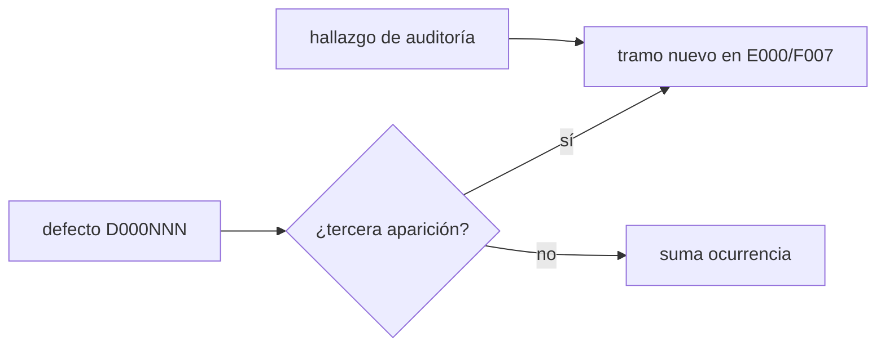
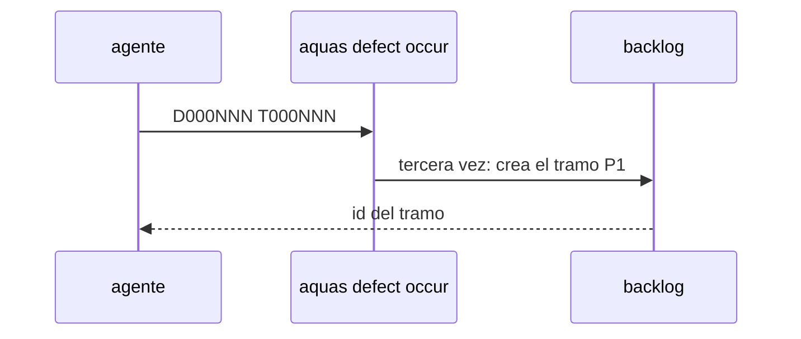
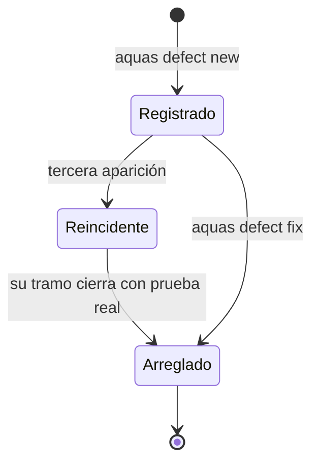

# F007 · Reincidencias de defectos

[Inicio](../../README.md) › [E000](../README.md) › F007

[Feature](../../glosario.md#feature) donde nacen los tramos que atacan un defecto repetido o un hueco que dejó una auditoría.

## En una frase

Cada defecto que vuelve, o que una auditoría deja abierto, tiene aquí su tramo de arreglo.

## Para qué existe

**El problema.** Un defecto que aparece tres veces necesita un arreglo de fondo, no otro parche. Lo mismo pasa con los huecos que una auditoría deja como observación.

**Por qué importa.** Sin un lugar fijo, esos arreglos se pierden en el chat y el defecto vuelve.

**La solución.** `aquas defect occur` crea aquí el tramo al tercer aviso (E001/F004/S003). Tres apariciones de una familia también crean su tramo (E001/F018/S003). Los huecos de auditoría también se anotan aquí.

**Origen.** Decisión del humano del 2026-10-30 (E001/F004/S003). Los tramos S001 a S003 llegaron el 2026-11-03.

## Analogía

Piensa en **el taller de garantías**.

- La pieza que falla tres veces no se cambia otra vez: se rediseña.
- Cada caso entra con su número de reclamo.

Límite de la analogía: aquí el número es el D000NNN.

## Diagrama

Estados de un defecto:

## Ejemplo de punta a punta

continúa: [EJ-E000](../README.md#EJ-E000)

1. El auditor de E001/F017/S009 nota que D000109 sigue diciendo «propuesto».
2. Nace S003: `aquas defect fix` marca el defecto como arreglado.
3. El registro de defectos vuelve a decir la verdad.

## Paso a paso

1. Marcar un defecto como arreglado (S003).
2. Editar el «qué hace» de una ficha (S002).
3. Exención del freno con rutas de Git Bash y mayúsculas (S001).

## Cómo se usa

- Los tramos de reincidencia nacen solos con `aquas defect occur`.
- Ver la ficha: `aquas backlog show E000/F007`.

## Contrato y evidencia

**Objetivo.** Ningún defecto repetido ni hueco de auditoría queda sin tramo.

Prueba integral: `TestReincidenciaCreaSlice`.

## Navegación

<!-- GENERADO por aquas desde trabajo/: no editar a mano; `aquas compile` lo rehace. -->

| Hijo | Qué es | Estado |
|---|---|---|
| [S001](S001.md) | el freno compara rutas como el sistema operativo y acepta el binario en forma Git Bash | Hecho |
| [S002](S002.md) | aquas backlog edit acepta que_hace con motivo y la wiki se rehace | Hecho |
| [S003](S003.md) | aquas defect fix D000NNN arreglo=… prueba=./paquete:TestX actualiza el arreglo con prueba real | Hecho |

<!-- /GENERADO -->

- ↑ Subir: [E000](../README.md)
