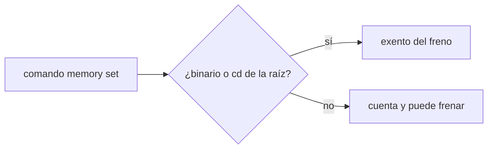
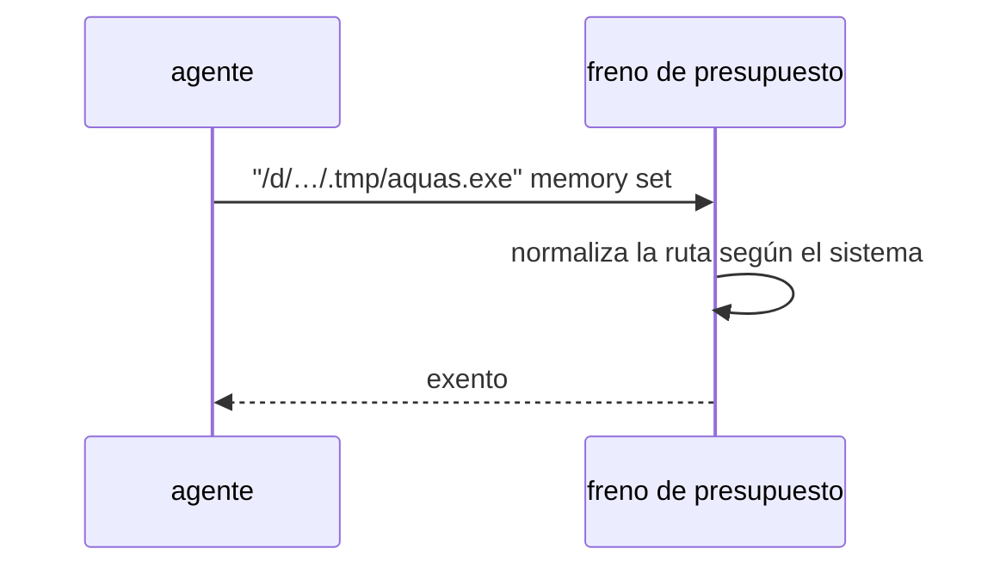

# S001 · Exención del freno con rutas de Git Bash y mayúsculas

[Inicio](../../README.md) › [E000](../README.md) › [F007](README.md) › S001

[Slice](../../glosario.md#slice) que nace de la auditoría E001/F017/S001-A3, hallazgos L1 y L2. La exención de `aquas memory set` en el freno tiene dos huecos.

## En una frase

La exención del freno reconoce el binario en forma Git Bash. Ignora mayúsculas solo donde el sistema no las distingue.

## Para qué existe

**El problema.** El freno deja pasar `aquas memory set` aunque el tope esté agotado (D000101). La auditoría E001/F017/S001-A3 encontró dos huecos. L1: el `cd <raíz>` previo se compara sin distinguir mayúsculas también en Linux. L2: el binario entre comillas en forma `/d/…` de Git Bash no queda exento.

**Por qué importa.** Con L2 el freno bloquea la memoria, el mismo fallo de D000101. Con L1, en Linux un `cd` a otra carpeta con otras mayúsculas pasaría como si fuera la raíz.

**La solución.** La raíz se compara sin distinguir mayúsculas solo en Windows. El binario entre comillas acepta también la forma `/d/…` de la raíz.

**Origen.** Auditoría E001/F017/S001-A3, aceptada por el humano con «apruebo E000/F007» el 2026-11-03.

**Contrato.**

| Regla | Valor |
|---|---|
| Mayúsculas | se ignoran solo en Windows |
| Forma Git Bash | `"/d/…/.tmp/aquas.exe"` de la raíz queda exento |
| Sigue frenando | binario de otra carpeta y `cd` a otra carpeta |
| Límite | solo cubre las formas de ruta de Windows y Git Bash |
| Alcance | `cmd/aquas/**`, `docs/**` |

**Casos borde.**

| Categoría | Aplica | Prueba o motivo |
|---|---|---|
| cada tipo de ficha | no | el freno no lee fichas para esta exención |
| cada estado de origen | no | la exención no depende del estado del trabajo |
| padre e hijo, activo y archivado | no | sin fichas en juego |
| entrada ausente, vacía, mal escrita o duplicada | sí | ruta con otras mayúsculas, forma `/d/` y binario de otra carpeta: `TestExencionRutasDelSistema` |
| choque con otro control | sí | la guardia sigue frenando las órdenes de hook: `TestExencionRutasDelSistema` |
| quién habla: humano, agente o herramienta | no | el freno solo ve el comando |
| fallo a mitad de camino | no | la exención es una comparación de texto, sin pasos |

## Analogía

Piensa en **la lista de invitados**.

- El nombre debe coincidir, escrito como sea que lo anote la recepción.
- Un nombre parecido de otra familia no entra.

Límite de la analogía: aquí la recepción es Windows o Git Bash.

## Diagrama

## Ejemplo de punta a punta

continúa: [EJ-E000-F007](README.md#EJ-E000-F007)

1. El tope de la [feature](../../glosario.md#feature) está agotado.
2. El [agente](../../glosario.md#agente) corre `"/d/Agents Factory/claude-code-scaffolding/.tmp/aquas.exe" memory set tarea=…`.
3. El freno lo deja pasar: es el binario de la raíz.

## Paso a paso

1. Prueba `TestExencionRutasDelSistema` en rojo.
2. Implementación mínima.
3. [Prueba en verde](../../glosario.md#prueba-en-verde) y [gate](../../glosario.md#gate).

## Cómo se usa

- No se usa a mano: corre en el [hook](../../glosario.md#hook) de presupuesto.

## Contrato y evidencia

<!-- GENERADO por aquas desde trabajo/: no editar a mano; `aquas compile` lo rehace. -->

| Prueba | Valida | Rojo cuando | Verde cuando | Rojo | Verde |
|---|---|---|---|---|---|
| `TestExencionRutasDelSistema` | valida que la exención compara rutas según el sistema | rojo cuando /d/ entre comillas no exenta o en Linux otra mayúscula exenta | verde cuando ambas formas se comportan como el sistema | — | — |

<!-- /GENERADO -->

## Navegación

- ↑ Subir: [F007](README.md)
