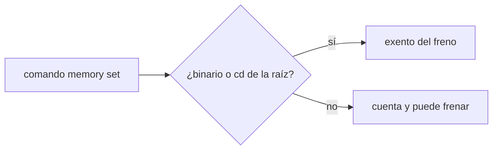
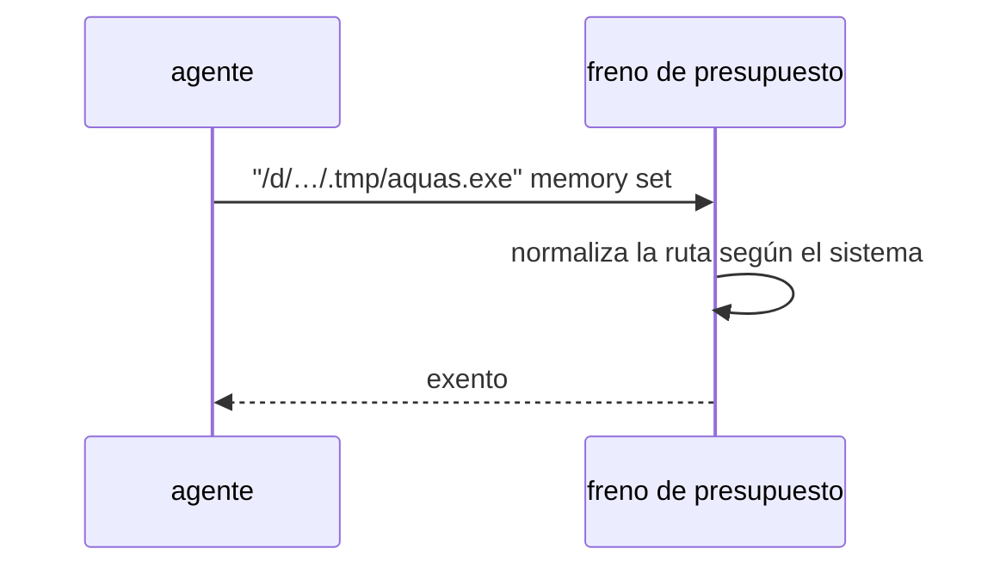

# S001 · Exención del freno con rutas de Git Bash y mayúsculas

[Inicio](../../README.md) › [E000](../README.md) › [F007](README.md) › S001

[Slice](../../glosario.md#slice) que nace de la auditoría E001/F017/S001-A3, hallazgos L1 y L2. La exención de `aquas memory set` en el freno tiene dos huecos.

## En una frase

La exención del freno reconoce el binario en forma Git Bash. Ignora mayúsculas solo donde el sistema no las distingue.

## Para qué existe

**El problema.** El freno deja pasar `aquas memory set` aunque el tope esté agotado (D000101). La auditoría E001/F017/S001-A3 encontró dos huecos. L1: el `cd <raíz>` previo se compara sin distinguir mayúsculas también en Linux. L2: el binario entre comillas en forma `/d/…` de Git Bash no queda exento.

**Por qué importa.** Con L2 el freno bloquea la memoria, el mismo fallo de D000101. Con L1, en Linux un `cd` a otra carpeta con otras mayúsculas pasaría como si fuera la raíz.

**La solución.** La raíz se compara sin distinguir mayúsculas solo en Windows. El binario entre comillas acepta también la forma `/d/…` de la raíz.

**Origen.** Auditoría E001/F017/S001-A3, aceptada por el humano con «apruebo E000/F007» el 2026-11-03.

**Contrato.**

| Regla | Valor |
|---|---|
| Mayúsculas | se ignoran solo en Windows |
| Forma Git Bash | `"/d/…/.tmp/aquas.exe"` de la raíz queda exento |
| Sigue frenando | binario de otra carpeta y `cd` a otra carpeta |
| Límite | solo cubre las formas de ruta de Windows y Git Bash |
| Alcance | `cmd/aquas/**`, `docs/**` |

**Casos borde.**

| Categoría | Aplica | Prueba o motivo |
|---|---|---|
| cada tipo de ficha | no | el freno no lee fichas para esta exención |
| cada estado de origen | no | la exención no depende del estado del trabajo |
| padre e hijo, activo y archivado | no | sin fichas en juego |
| entrada ausente, vacía, mal escrita o duplicada | sí | ruta con otras mayúsculas, forma `/d/` y binario de otra carpeta: `TestExencionRutasDelSistema` |
| choque con otro control | sí | la guardia sigue frenando las órdenes de hook: `TestExencionRutasDelSistema` |
| quién habla: humano, agente o herramienta | no | el freno solo ve el comando |
| fallo a mitad de camino | no | la exención es una comparación de texto, sin pasos |

## Analogía

Piensa en **la lista de invitados**.

- El nombre debe coincidir, escrito como sea que lo anote la recepción.
- Un nombre parecido de otra familia no entra.

Límite de la analogía: aquí la recepción es Windows o Git Bash.

## Diagrama

## Ejemplo de punta a punta

continúa: [EJ-E000-F007](README.md#EJ-E000-F007)

1. El tope de la [feature](../../glosario.md#feature) está agotado.
2. El [agente](../../glosario.md#agente) corre `"/d/Agents Factory/claude-code-scaffolding/.tmp/aquas.exe" memory set tarea=…`.
3. El freno lo deja pasar: es el binario de la raíz.

## Paso a paso

1. Prueba `TestExencionRutasDelSistema` en rojo.
2. Implementación mínima.
3. [Prueba en verde](../../glosario.md#prueba-en-verde) y [gate](../../glosario.md#gate).

## Cómo se usa

- No se usa a mano: corre en el [hook](../../glosario.md#hook) de presupuesto.
- La comparación vive en `rutasIguales` de `cmd/aquas/presupuesto.go`; la usan el `cd` previo y el binario entre comillas.

## Contrato y evidencia

<!-- GENERADO por aquas desde trabajo/: no editar a mano; `aquas compile` lo rehace. -->

| Prueba | Valida | Rojo cuando | Verde cuando | Rojo | Verde |
|---|---|---|---|---|---|
| `TestExencionRutasDelSistema` | valida que la exención compara rutas según el sistema | rojo cuando /d/ entre comillas no exenta o en Linux otra mayúscula exenta | verde cuando ambas formas se comportan como el sistema | 2026-11-03 | 2026-11-03 |

### Código

| Archivo | Función | Parámetros | Qué hace |
|---|---|---|---|
| [cmd/aquas/presupuesto.go](../../../cmd/aquas/presupuesto.go) | `leerTope` | `(primera string, ap *apruebo)` | leerTope: «tope 25M» o «tope 25 M» → tokens ponderados; «tope 900» solo, o seguido de «con» o «y» → llamadas (el viejo). |
| [cmd/aquas/presupuesto.go](../../../cmd/aquas/presupuesto.go) | `pesoVeinteavos` | `(u usoRespuesta) int64` | pesoVeinteavos: el usage de una respuesta ponderado por precio, en veinteavos de token para no usar decimales. |
| [cmd/aquas/presupuesto.go](../../../cmd/aquas/presupuesto.go) | `millones` | `(n int64) string` | millones: 15000000 → «15M»; 15000001 → «15,0M». |
| [cmd/aquas/presupuesto.go](../../../cmd/aquas/presupuesto.go) | `rutaComparableEn` | `(goos, r string) string` | rutaComparableEn: la ruta limpia con «/»; en Windows la forma Git Bash «/d/…» pasa a «D:/…» (A2.4; sistema dado: E000/F007/S001). |
| [cmd/aquas/presupuesto.go](../../../cmd/aquas/presupuesto.go) | `exentaDelFreno` | `(raiz, herramienta, comando string) bool` | exentaDelFreno: true si el comando Bash entero es `aquas memory set …` o `aquas defect new\\|occur …`. |
| [cmd/aquas/presupuesto.go](../../../cmd/aquas/presupuesto.go) | `rutasIguales` | `(goos, a, b string) bool` | rutasIguales (E000/F007/S001, hallazgos L1 y L2; no confundir con entorno.mismaRuta, que no entiende «/d/…»): misma carpeta según el sistema; mayúsculas iguales solo en Windows. |
| [cmd/aquas/presupuesto.go](../../../cmd/aquas/presupuesto.go) | `exentaDelFrenoEn` | `(goos, raiz, herramienta, comando string) bool` | exentaDelFrenoEn: exentaDelFreno para un sistema dado (E000/F007/S001). |
| [cmd/aquas/presupuesto.go](../../../cmd/aquas/presupuesto.go) | `ordenDeCierre` | `(raiz, herramienta, comando string) bool` | ordenDeCierre (E001/F019/S003): true si el comando Bash entero es una orden de cierre de reCierre. |
| [cmd/aquas/presupuesto.go](../../../cmd/aquas/presupuesto.go) | `ordenEnteraEn` | `(goos, raiz, herramienta, comando string, re *regexp.Regexp) bool` | ordenEnteraEn: el comando Bash entero cumple la lista blanca re; el `cd` solo vale a la raíz y un binario entre |
| [cmd/aquas/presupuesto.go](../../../cmd/aquas/presupuesto.go) | `presupuestoCLI` | `(raiz string, args []string)` | presupuestoCLI: «herramienta» cuenta el gasto en el registro (tokens ponderados o llamadas, E001/F019/S001) y bloquea con exit 2 al pasar un tope. |
| [cmd/aquas/presupuesto.go](../../../cmd/aquas/presupuesto.go) | `marcaDir` | `(raiz string) string` | marcaDir: carpeta de las marcas de aviso; borrarlas repite un aviso, no quita un freno. |
| [cmd/aquas/presupuesto.go](../../../cmd/aquas/presupuesto.go) | `avisarGasto` | `(raiz string, c *cuentaFeature) string` | avisarGasto: aviso al cruzar el 50% o el 80% del tope, una vez por umbral y apruebo. La marca guarda la hora del |
| [cmd/aquas/presupuesto.go](../../../cmd/aquas/presupuesto.go) | `frenar` | `(formato string, a ...any)` | frenar escribe el motivo en stderr y bloquea la llamada. |
| [cmd/aquas/presupuesto.go](../../../cmd/aquas/presupuesto.go) | `avisarContexto` | `(raiz string, e entradaPresupuesto, turno string) string` | avisarContexto pide /compact una vez por turno cuando el contexto medido pasa el umbral; la marca guarda el |
| [cmd/aquas/presupuesto.go](../../../cmd/aquas/presupuesto.go) | `recorrerRegistro` | `(ruta string, f func(pos int64, l lineaLlamadas)) error` | recorrerRegistro abre un registro y entrega cada línea legible con su posición; las rotas se ignoran. |
| [cmd/aquas/presupuesto.go](../../../cmd/aquas/presupuesto.go) | `llamadas` | `(raiz string, l lineaLlamadas) []string` | llamadas: ids de los tool_use de una línea de asistente, sin las llamadas exentas. |
| [cmd/aquas/presupuesto.go](../../../cmd/aquas/presupuesto.go) | `escanear` | `(raiz, ruta string) (escaneo, error)` | escanear lee un registro una vez. D000096: el turno y el apruebo vigente se eligen por hora, no por posición: |
| [cmd/aquas/presupuesto.go](../../../cmd/aquas/presupuesto.go) | `carpetaProyecto` | `(ruta string) string` | carpetaProyecto: la carpeta de las sesiones del proyecto; desde un registro de subagente sube a ella. |
| [cmd/aquas/presupuesto.go](../../../cmd/aquas/presupuesto.go) | `escanearProyecto` | `(raiz, ruta string) (map[string]escaneo, error)` | escanearProyecto lee cada registro de sesión de la carpeta del proyecto; sin registro legible, error. |
| [cmd/aquas/presupuesto.go](../../../cmd/aquas/presupuesto.go) | `featureCerrada` | `(raiz, id string) bool` | featureCerrada (E001/F017/S001, D000091): true solo si la feature y todos sus slices (al menos uno) están en CERRADO. |
| [cmd/aquas/presupuesto.go](../../../cmd/aquas/presupuesto.go) | `frenoFeature` | `(raiz, ruta string, sesiones map[string]escaneo) (msg string, cuenta *cuentaFeature)` | frenoFeature: el último apruebo de feature del humano fija feature, tope y hora; se cuentan los tokens ponderados |
| [cmd/aquas/presupuesto.go](../../../cmd/aquas/presupuesto.go) | `contextoMedido` | `(ruta string) int` | contextoMedido: tokens de entrada de la última llamada del modelo en el transcript; 0 si después |

<!-- /GENERADO -->

## Navegación

- ↑ Subir: [F007](README.md)
