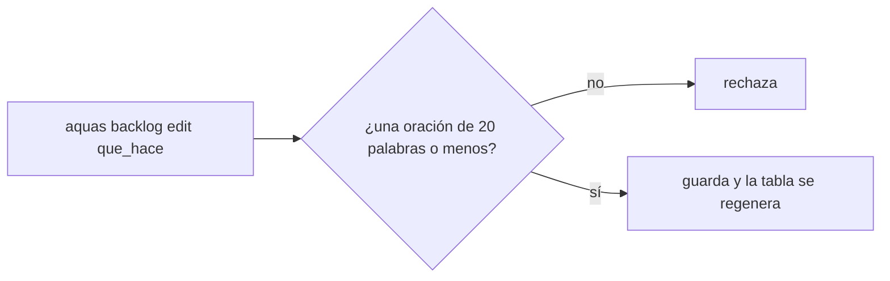
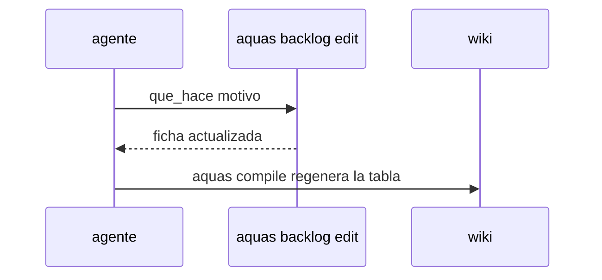

# S002 · Editar el «qué hace» de una ficha por comando

[Inicio](../../README.md) › [E000](../README.md) › [F007](README.md) › S002

[Slice](../../glosario.md#slice) que nace de la auditoría E001/F017/S002-A5. Hoy el campo que_hace de una ficha no se puede corregir.

## En una frase

`aquas backlog edit <id> que_hace=… motivo=…` corrige el «qué hace» de una ficha.

## Para qué existe

**El problema.** `aquas backlog edit` cambia el título y los bloqueos, pero no el «qué hace». La tabla de F017 quedó vieja por eso (auditoría E001/F017/S002-A5).

**Por qué importa.** La tabla de cada [feature](../../glosario.md#feature) se genera desde ese campo. Si no se puede corregir, la [wiki](../../glosario.md#wiki) dice algo que ya no es cierto.

**La solución.** `edit` acepta `que_hace=…` con la misma regla que `new`: una oración de 20 palabras como máximo, y con motivo.

**Origen.** Auditoría E001/F017/S002-A5, aceptada por el humano con «apruebo E000/F007» el 2026-11-03.

**Contrato.**

| Regla | Valor |
|---|---|
| Orden | `aquas backlog edit <id> que_hace=… motivo=…` |
| Regla del texto | la de `new`: una oración, 20 palabras como máximo |
| Rechaza | que_hace vacío o largo, ficha inexistente, falta de motivo |
| Límite | no juzga si el texto es bueno; eso lo juzga el auditor |
| Alcance | `internal/backlog/**`, `cmd/aquas/**`, `docs/**` |

**Casos borde.**

| Categoría | Aplica | Prueba o motivo |
|---|---|---|
| cada tipo de ficha | sí | slice y feature aceptan que_hace: `TestEditaQueHace` |
| cada estado de origen | sí | ficha BORRADOR y CERRADO archivada: `TestEditaQueHace` |
| padre e hijo, activo y archivado | sí | la tabla del padre muestra el texto nuevo: `TestEditaQueHace` |
| entrada ausente, vacía, mal escrita o duplicada | sí | que_hace vacío, de 21 palabras o sin motivo: `TestEditaQueHace` |
| choque con otro control | sí | la huella de aprobación no incluye que_hace y no se invalida: `TestEditaQueHace` |
| quién habla: humano, agente o herramienta | no | la orden la corre quien tenga el repo |
| fallo a mitad de camino | sí | un rechazo no cambia la ficha: `TestEditaQueHace` |

## Analogía

Piensa en **la etiqueta de una caja**.

- Si el contenido cambia, la etiqueta se corrige, no se tira la caja.
- La corrección se firma con su motivo.

Límite de la analogía: aquí la firma es el motivo que queda en la ficha.

## Diagrama

## Ejemplo de punta a punta

continúa: [EJ-E000-F007](README.md#EJ-E000-F007)

1. La tabla de F017 describe mal a S002.
2. El [agente](../../glosario.md#agente) corre `aquas backlog edit E001/F017/S002 que_hace=… motivo=…`.
3. `aquas compile` regenera la tabla con el texto correcto.

## Paso a paso

1. Prueba `TestEditaQueHace` en rojo.
2. Implementación mínima.
3. [Prueba en verde](../../glosario.md#prueba-en-verde) y [gate](../../glosario.md#gate).

## Cómo se usa

- `aquas backlog edit <id> que_hace=… motivo=…`.

## Contrato y evidencia

<!-- GENERADO por aquas desde trabajo/: no editar a mano; `aquas compile` lo rehace. -->

| Prueba | Valida | Rojo cuando | Verde cuando | Rojo | Verde |
|---|---|---|---|---|---|
| `TestEditaQueHace` | valida que backlog edit cambia que_hace | rojo cuando edit rechaza que_hace | verde cuando edit lo cambia y la tabla de la feature lo muestra | — | — |

<!-- /GENERADO -->

## Navegación

- ↑ Subir: [F007](README.md)
