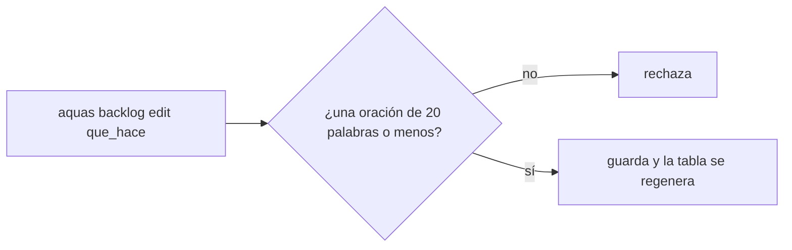
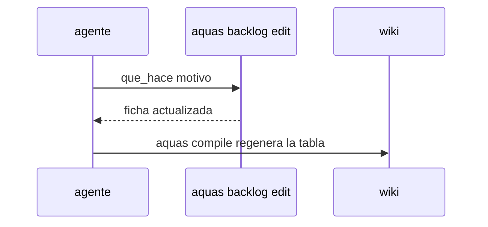

# S002 · Editar el «qué hace» de una ficha por comando

[Inicio](../../README.md) › [E000](../README.md) › [F007](README.md) › S002

[Slice](../../glosario.md#slice) que nace de la auditoría E001/F017/S002-A5. Hoy el campo que_hace de una ficha no se puede corregir.

## En una frase

`aquas backlog edit <id> que_hace=… motivo=…` corrige el «qué hace» de una ficha.

## Para qué existe

**El problema.** `aquas backlog edit` cambia el título y los bloqueos, pero no el «qué hace». La tabla de F017 quedó vieja por eso (auditoría E001/F017/S002-A5).

**Por qué importa.** La tabla de cada [feature](../../glosario.md#feature) se genera desde ese campo. Si no se puede corregir, la [wiki](../../glosario.md#wiki) dice algo que ya no es cierto.

**La solución.** `edit` acepta `que_hace=…` con la misma regla que `new`: una oración de 20 palabras como máximo, y con motivo.

**Origen.** Auditoría E001/F017/S002-A5, aceptada por el humano con «apruebo E000/F007» el 2026-11-03.

**Contrato.**

| Regla | Valor |
|---|---|
| Orden | `aquas backlog edit <id> que_hace=… motivo=…` |
| Regla del texto | la de `new`: una oración, 20 palabras como máximo |
| Rechaza | que_hace vacío o largo, ficha inexistente, falta de motivo |
| Límite | no juzga si el texto es bueno; eso lo juzga el auditor |
| Alcance | `internal/backlog/**`, `cmd/aquas/**`, `docs/**` |

**Casos borde.**

| Categoría | Aplica | Prueba o motivo |
|---|---|---|
| cada tipo de ficha | sí | slice y feature aceptan que_hace: `TestEditaQueHace` |
| cada estado de origen | sí | ficha BORRADOR y CERRADO archivada: `TestEditaQueHace` |
| padre e hijo, activo y archivado | sí | la tabla del padre muestra el texto nuevo: `TestEditaQueHace` |
| entrada ausente, vacía, mal escrita o duplicada | sí | que_hace vacío, de 21 palabras o sin motivo: `TestEditaQueHace` |
| choque con otro control | sí | la huella de aprobación no incluye que_hace y no se invalida: `TestEditaQueHace` |
| quién habla: humano, agente o herramienta | no | la orden la corre quien tenga el repo |
| fallo a mitad de camino | sí | un rechazo no cambia la ficha: `TestEditaQueHace` |

## Analogía

Piensa en **la etiqueta de una caja**.

- Si el contenido cambia, la etiqueta se corrige, no se tira la caja.
- La corrección se firma con su motivo.

Límite de la analogía: aquí la firma es el motivo que queda en la ficha.

## Diagrama

## Ejemplo de punta a punta

continúa: [EJ-E000-F007](README.md#EJ-E000-F007)

1. La tabla de F017 describe mal a S002.
2. El [agente](../../glosario.md#agente) corre `aquas backlog edit E001/F017/S002 que_hace=… motivo=…`.
3. `aquas compile` regenera la tabla con el texto correcto.

## Paso a paso

1. Prueba `TestEditaQueHace` en rojo.
2. Implementación mínima.
3. [Prueba en verde](../../glosario.md#prueba-en-verde) y [gate](../../glosario.md#gate).

## Cómo se usa

- `aquas backlog edit <id> que_hace=… motivo=…`: vale en cualquier estado, también en fichas archivadas; título y bloqueos siguen editándose solo antes de arrancar.
- Primer uso: corrigió el «qué hace» de E001/F017/S002, que todavía nombraba el «dale».

## Contrato y evidencia

<!-- GENERADO por aquas desde trabajo/: no editar a mano; `aquas compile` lo rehace. -->

| Prueba | Valida | Rojo cuando | Verde cuando | Rojo | Verde |
|---|---|---|---|---|---|
| `TestEditaQueHace` | valida que backlog edit cambia que_hace | rojo cuando edit rechaza que_hace | verde cuando edit lo cambia y la tabla de la feature lo muestra | 2026-11-03 | 2026-11-03 |

### Código

| Archivo | Función | Parámetros | Qué hace |
|---|---|---|---|
| [cmd/aquas/main.go](../../../cmd/aquas/main.go) | `main` | `()` | main despacha el subcomando de aquas (compilar, verificar, backlog, hooks…) y sale con su código. |
| [cmd/aquas/main.go](../../../cmd/aquas/main.go) | `hook` | `(raiz string)` | hook: exit 0 = nada que reportar; exit 2 = stderr se muestra a Claude. |
| [cmd/aquas/main.go](../../../cmd/aquas/main.go) | `compilarSettings` | `(w io.Writer)` | compilarSettings regenera .claude/settings.json; sin entorno declarado no inventa uno. |
| [cmd/aquas/main.go](../../../cmd/aquas/main.go) | `reportar` | `(w io.Writer, inf compilador.Informe)` | reportar imprime qué derivados escribió la compilación, o que todo estaba al día. |
| [cmd/aquas/main.go](../../../cmd/aquas/main.go) | `listar` | `(titulo string, problemas []string)` | listar imprime en stderr un título y cada problema en su viñeta. |
| [cmd/aquas/main.go](../../../cmd/aquas/main.go) | `lista` | `(xs []string) string` | lista une los textos con comas, o «—» si no hay ninguno. |
| [cmd/aquas/main.go](../../../cmd/aquas/main.go) | `fallar` | `(codigo int, err error)` | fallar imprime el error en stderr y termina con el código dado. |
| [cmd/aquas/main.go](../../../cmd/aquas/main.go) | `revisarAislamiento` | `() (fallo, aviso string)` | revisarAislamiento: fallo para el gate y aviso para el arranque (E000/F008/S003, D000079). |
| [cmd/aquas/main.go](../../../cmd/aquas/main.go) | `memoriaCLI` | `(raiz string, args []string)` | memoriaCLI: `ver` imprime la memoria; `fijar campo=valor…` la actualiza y la sella. |
| [cmd/aquas/main.go](../../../cmd/aquas/main.go) | `memoriaArchivada` | `(raiz, id string) error` | memoriaArchivada: CERRADO exige el archivo de memoria del slice, apunte o no la memoria a él (E001/F002/S009, X01). |
| [cmd/aquas/main.go](../../../cmd/aquas/main.go) | `focoEnBacklog` | `(raiz string, f memoria.Foco) error` | focoEnBacklog: la memoria solo fija el slice que el backlog tiene en curso (S003). |
| [cmd/aquas/main.go](../../../cmd/aquas/main.go) | `backlogCLI` | `(raiz string, args []string)` | backlogCLI: nuevo \\| ver [id] \\| tabla \\| prioridad \\| estado \\| siguiente \\| pruebas \\| rojo \\| verde. |
| [cmd/aquas/main.go](../../../cmd/aquas/main.go) | `gateDefectos` | `(raiz string) (frena []string, aviso string)` | gateDefectos (E001/F017/S005): lo que el gate dice del registro de defectos. Prueba nombrada que ya no existe |
| [cmd/aquas/main.go](../../../cmd/aquas/main.go) | `turnoCLI` | `(raiz string, args []string)` | turnoCLI: auditoría de turnos (E001/F002/S001). Lee el JSON del hook por stdin. No imprime nada |
| [cmd/aquas/main.go](../../../cmd/aquas/main.go) | `retroCLI` | `(raiz string, args []string) (backlog.Retro, error)` | retroCLI (E001/F018/S002): cerrar fichas=A,B motivo=…; cada clave una vez. |
| [cmd/aquas/main.go](../../../cmd/aquas/main.go) | `defectoCLI` | `(raiz string, args []string) error` | defectoCLI: nuevo \\| ocurre \\| arreglar \\| ver (E001/F004/S001; arreglar: E000/F007/S003). |
| [cmd/aquas/main.go](../../../cmd/aquas/main.go) | `versionBinario` | `() string` | versionBinario: versión del módulo con que se compiló el binario (= versión del gobierno embebido). |
| [cmd/aquas/main.go](../../../cmd/aquas/main.go) | `registrarCierre` | `(raiz, tipo, transcript, primera, resultado string)` | registrarCierre (E001/F004/S005, D000068) anota cada llamada del gancho cierre-agente en .tmp/hooks/cierre-agente.jsonl. |
| [cmd/aquas/main.go](../../../cmd/aquas/main.go) | `esUpdate` | `(datos []byte) bool` | esUpdate (E003/F006/S001): la entrada de la guardia es una orden Bash que es exactamente `aquas update` (PowerShell lo frena la guardia siempre). |
| [cmd/aquas/main.go](../../../cmd/aquas/main.go) | `entornoHijo` | `(raiz string)` | entornoHijo (E003/F001/S003) declara el entorno del hijo, como aquas init en la central: |
| [internal/backlog/editar.go](../../../internal/backlog/editar.go) | `Editar` | `(raiz, id string, campos []string, ahora time.Time) (Ficha, error)` | Editar cambia título o bloqueado_por (solo en BORRADOR o LISTO) o que_hace (en cualquier estado) y guarda el cambio con su motivo. |

<!-- /GENERADO -->

## Navegación

- ↑ Subir: [F007](README.md)
