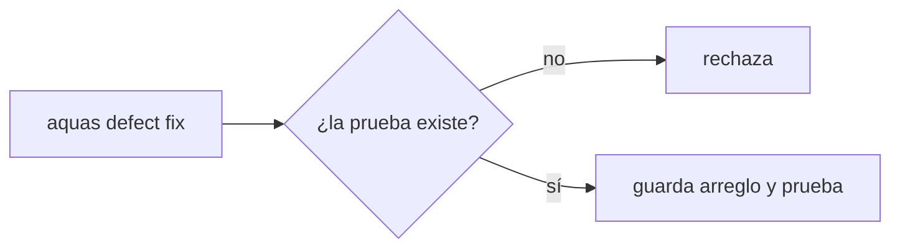
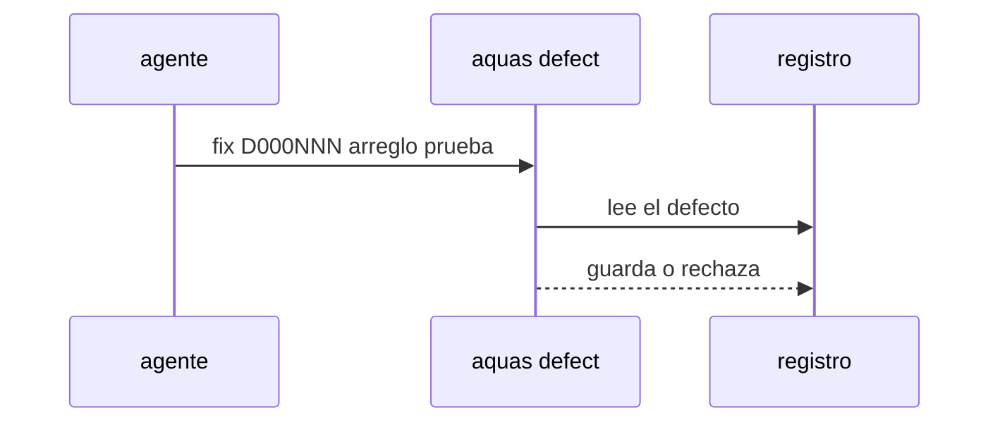

# S003 · Marcar un defecto como arreglado

[Inicio](../../README.md) › [E000](../README.md) › [F007](README.md) › S003

[Slice](../../glosario.md#slice) que nace del defecto D000109. Hoy un defecto no puede pasar de «propuesto» a «arreglado».

## En una frase

`aquas defect fix` marca un defecto como arreglado y nombra la prueba real que lo vigila.

## Para qué existe

**El problema.** `aquas defect` solo ofrece `new`, `occur` y `show`. Cuando el control de un defecto se implementa después, su registro sigue diciendo «propuesto» (D000109).

**Por qué importa.** El registro y el código cuentan historias distintas. Quien lee el defecto cree que falta un control que ya existe.

**La solución.** Una orden nueva, `aquas defect fix D000NNN arreglo=… prueba=./paquete:TestNombre`. Reemplaza el arreglo y la prueba. La prueba debe existir en el código, con la misma revisión que usa `defect new`.

**Origen.** Observación del auditor de E001/F017/S009, aceptada por el humano el 2026-11-03.

**Contrato.**

| Regla | Valor |
|---|---|
| Orden | `aquas defect fix D000NNN arreglo=… prueba=…` |
| Prueba | real: `./paquete:TestNombre` que existe; `pendiente:` no vale al marcar arreglado |
| Rechaza | defecto inexistente, arreglo vacío, prueba ausente o inexistente |
| Límite | no juzga si el arreglo es bueno; eso lo juzga el auditor |
| Alcance | `internal/defecto/**`, `cmd/aquas/**`, `docs/**` |

**Casos borde.**

| Categoría | Aplica | Prueba o motivo |
|---|---|---|
| cada tipo de ficha | no | trabaja sobre defectos, no sobre fichas |
| cada estado de origen | sí | defecto con prueba pendiente y defecto viejo sin prueba: `TestDefectoArreglado` |
| padre e hijo, activo y archivado | no | los defectos no tienen padre |
| entrada ausente, vacía, mal escrita o duplicada | sí | id mal escrito o inexistente, arreglo vacío, prueba inexistente: `TestDefectoArreglado` |
| choque con otro control | sí | el gate de pruebas nombradas (E001/F017/S005) acepta el defecto arreglado: `TestDefectoArreglado` |
| quién habla: humano, agente o herramienta | no | la orden la corre quien tenga el repo; el registro no distingue |
| fallo a mitad de camino | sí | un rechazo no cambia el archivo del defecto: `TestDefectoArreglado` |

## Analogía

Piensa en **el libro de reclamos**.

- El reclamo se anota con número.
- Cuando se resuelve, se anota cómo y quién lo revisa.

Límite de la analogía: aquí quien revisa es una prueba que corre sola.

## Diagrama

## Ejemplo de punta a punta

continúa: [EJ-E000-F007](README.md#EJ-E000-F007)

1. D000109 dice «propuesto» con `pendiente:E001/F015`.
2. El [agente](../../glosario.md#agente) corre `aquas defect fix D000109 arreglo=… prueba=./cmd/aquas:TestFrenoTurnoCedeConFeatureAprobada`.
3. El registro guarda el arreglo y la prueba real.

## Paso a paso

1. Prueba `TestDefectoArreglado` en rojo.
2. Implementación mínima.
3. [Prueba en verde](../../glosario.md#prueba-en-verde) y [gate](../../glosario.md#gate).

## Cómo se usa

- `aquas defect fix D000NNN arreglo=… prueba=./paquete:TestNombre`.

## Contrato y evidencia

<!-- GENERADO por aquas desde trabajo/: no editar a mano; `aquas compile` lo rehace. -->

| Prueba | Valida | Rojo cuando | Verde cuando | Rojo | Verde |
|---|---|---|---|---|---|
| `TestDefectoArreglado` | valida que un defecto pasa a arreglado con prueba real | rojo cuando el arreglo no se puede actualizar o acepta prueba inexistente | verde cuando fix guarda arreglo y prueba real y rechaza la inexistente | — | — |

<!-- /GENERADO -->

## Navegación

- ↑ Subir: [F007](README.md)
