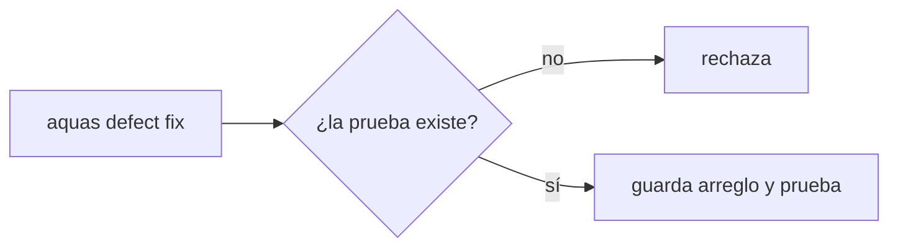
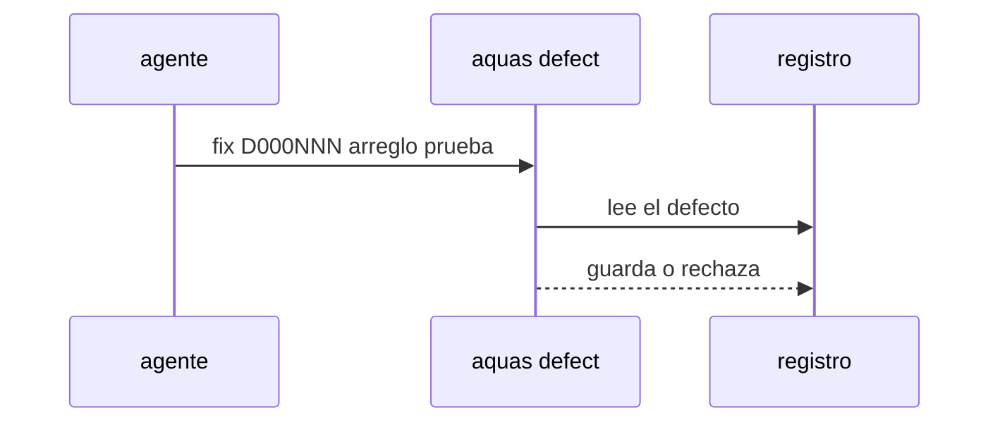

# S003 · Marcar un defecto como arreglado

[Inicio](../../README.md) › [E000](../README.md) › [F007](README.md) › S003

[Slice](../../glosario.md#slice) que nace del defecto D000109. Hoy un defecto no puede pasar de «propuesto» a «arreglado».

## En una frase

`aquas defect fix` marca un defecto como arreglado y nombra la prueba real que lo vigila.

## Para qué existe

**El problema.** `aquas defect` solo ofrece `new`, `occur` y `show`. Cuando el control de un defecto se implementa después, su registro sigue diciendo «propuesto» (D000109).

**Por qué importa.** El registro y el código cuentan historias distintas. Quien lee el defecto cree que falta un control que ya existe.

**La solución.** Una orden nueva, `aquas defect fix D000NNN arreglo=… prueba=./paquete:TestNombre`. Reemplaza el arreglo y la prueba. La prueba debe existir en el código, con la misma revisión que usa `defect new`.

**Origen.** Observación del auditor de E001/F017/S009, aceptada por el humano el 2026-11-03.

**Contrato.**

| Regla | Valor |
|---|---|
| Orden | `aquas defect fix D000NNN arreglo=… prueba=…` |
| Prueba | real: `./paquete:TestNombre` que existe; `pendiente:` no vale al marcar arreglado |
| Rechaza | defecto inexistente, arreglo vacío, prueba ausente o inexistente |
| Límite | no juzga si el arreglo es bueno; eso lo juzga el auditor |
| Alcance | `internal/defecto/**`, `cmd/aquas/**`, `docs/**` |

**Casos borde.**

| Categoría | Aplica | Prueba o motivo |
|---|---|---|
| cada tipo de ficha | no | trabaja sobre defectos, no sobre fichas |
| cada estado de origen | sí | defecto con prueba pendiente y defecto viejo sin prueba: `TestDefectoArreglado` |
| padre e hijo, activo y archivado | no | los defectos no tienen padre |
| entrada ausente, vacía, mal escrita o duplicada | sí | id mal escrito o inexistente, arreglo vacío, prueba inexistente: `TestDefectoArreglado` |
| choque con otro control | sí | el gate de pruebas nombradas (E001/F017/S005) acepta el defecto arreglado: `TestDefectoArreglado` |
| quién habla: humano, agente o herramienta | no | la orden la corre quien tenga el repo; el registro no distingue |
| fallo a mitad de camino | sí | un rechazo no cambia el archivo del defecto: `TestDefectoArreglado` |

## Analogía

Piensa en **el libro de reclamos**.

- El reclamo se anota con número.
- Cuando se resuelve, se anota cómo y quién lo revisa.

Límite de la analogía: aquí quien revisa es una prueba que corre sola.

## Diagrama

## Ejemplo de punta a punta

continúa: [EJ-E000-F007](README.md#EJ-E000-F007)

1. D000109 dice «propuesto» con `pendiente:E001/F015`.
2. El [agente](../../glosario.md#agente) corre `aquas defect fix D000109 arreglo=… prueba=./cmd/aquas:TestFrenoTurnoCedeConFeatureAprobada`.
3. El registro guarda el arreglo y la prueba real.

## Paso a paso

1. Prueba `TestDefectoArreglado` en rojo.
2. Implementación mínima.
3. [Prueba en verde](../../glosario.md#prueba-en-verde) y [gate](../../glosario.md#gate).

## Cómo se usa

- `aquas defect fix D000NNN arreglo=… prueba=./paquete:TestNombre`: reemplaza arreglo y prueba; `aquas defect show D000NNN` no los muestra todavía, se leen en `registro/defectos/`.
- `pendiente:<ficha>` no vale aquí: un defecto arreglado nombra su prueba real.

## Contrato y evidencia

<!-- GENERADO por aquas desde trabajo/: no editar a mano; `aquas compile` lo rehace. -->

| Prueba | Valida | Rojo cuando | Verde cuando | Rojo | Verde |
|---|---|---|---|---|---|
| `TestDefectoArreglado` | valida que un defecto pasa a arreglado con prueba real | rojo cuando el arreglo no se puede actualizar o acepta prueba inexistente | verde cuando fix guarda arreglo y prueba real y rechaza la inexistente | 2026-11-03 | 2026-11-03 |

### Código

| Archivo | Función | Parámetros | Qué hace |
|---|---|---|---|
| [cmd/aquas/ingles.go](../../../cmd/aquas/ingles.go) | `traducir` | `(args []string) ([]string, []string)` | traducir devuelve los argumentos con los nombres internos y un aviso por cada nombre viejo usado. |
| [cmd/aquas/ingles.go](../../../cmd/aquas/ingles.go) | `traducirUna` | `(palabra string, tabla map[string]string, avisos *[]string) string` | traducirUna pasa una palabra a su nombre interno; si ya era el nombre viejo, anota el aviso. |
| [cmd/aquas/main.go](../../../cmd/aquas/main.go) | `main` | `()` | main despacha el subcomando de aquas (compilar, verificar, backlog, hooks…) y sale con su código. |
| [cmd/aquas/main.go](../../../cmd/aquas/main.go) | `hook` | `(raiz string)` | hook: exit 0 = nada que reportar; exit 2 = stderr se muestra a Claude. |
| [cmd/aquas/main.go](../../../cmd/aquas/main.go) | `compilarSettings` | `(w io.Writer)` | compilarSettings regenera .claude/settings.json; sin entorno declarado no inventa uno. |
| [cmd/aquas/main.go](../../../cmd/aquas/main.go) | `reportar` | `(w io.Writer, inf compilador.Informe)` | reportar imprime qué derivados escribió la compilación, o que todo estaba al día. |
| [cmd/aquas/main.go](../../../cmd/aquas/main.go) | `listar` | `(titulo string, problemas []string)` | listar imprime en stderr un título y cada problema en su viñeta. |
| [cmd/aquas/main.go](../../../cmd/aquas/main.go) | `lista` | `(xs []string) string` | lista une los textos con comas, o «—» si no hay ninguno. |
| [cmd/aquas/main.go](../../../cmd/aquas/main.go) | `fallar` | `(codigo int, err error)` | fallar imprime el error en stderr y termina con el código dado. |
| [cmd/aquas/main.go](../../../cmd/aquas/main.go) | `revisarAislamiento` | `() (fallo, aviso string)` | revisarAislamiento: fallo para el gate y aviso para el arranque (E000/F008/S003, D000079). |
| [cmd/aquas/main.go](../../../cmd/aquas/main.go) | `memoriaCLI` | `(raiz string, args []string)` | memoriaCLI: `ver` imprime la memoria; `fijar campo=valor…` la actualiza y la sella. |
| [cmd/aquas/main.go](../../../cmd/aquas/main.go) | `memoriaArchivada` | `(raiz, id string) error` | memoriaArchivada: CERRADO exige el archivo de memoria del slice, apunte o no la memoria a él (E001/F002/S009, X01). |
| [cmd/aquas/main.go](../../../cmd/aquas/main.go) | `focoEnBacklog` | `(raiz string, f memoria.Foco) error` | focoEnBacklog: la memoria solo fija el slice que el backlog tiene en curso (S003). |
| [cmd/aquas/main.go](../../../cmd/aquas/main.go) | `backlogCLI` | `(raiz string, args []string)` | backlogCLI: nuevo \\| ver [id] \\| tabla \\| prioridad \\| estado \\| siguiente \\| pruebas \\| rojo \\| verde. |
| [cmd/aquas/main.go](../../../cmd/aquas/main.go) | `gateDefectos` | `(raiz string) (frena []string, aviso string)` | gateDefectos (E001/F017/S005): lo que el gate dice del registro de defectos. Prueba nombrada que ya no existe |
| [cmd/aquas/main.go](../../../cmd/aquas/main.go) | `turnoCLI` | `(raiz string, args []string)` | turnoCLI: auditoría de turnos (E001/F002/S001). Lee el JSON del hook por stdin. No imprime nada |
| [cmd/aquas/main.go](../../../cmd/aquas/main.go) | `defectoCLI` | `(raiz string, args []string) error` | defectoCLI: nuevo \\| ocurre \\| arreglar \\| ver (E001/F004/S001; arreglar: E000/F007/S003). |
| [cmd/aquas/main.go](../../../cmd/aquas/main.go) | `versionBinario` | `() string` | versionBinario: versión del módulo con que se compiló el binario (= versión del gobierno embebido). |
| [cmd/aquas/main.go](../../../cmd/aquas/main.go) | `registrarCierre` | `(raiz, tipo, transcript, primera, resultado string)` | registrarCierre (E001/F004/S005, D000068) anota cada llamada del gancho cierre-agente en .tmp/hooks/cierre-agente.jsonl. |
| [cmd/aquas/main.go](../../../cmd/aquas/main.go) | `entornoHijo` | `(raiz string)` | entornoHijo (E003/F001/S003) declara el entorno del hijo, como aquas init en la central: |
| [internal/defecto/defecto.go](../../../internal/defecto/defecto.go) | `TituloFamilia` | `(familia string) string` | TituloFamilia: título del tramo de reincidencia de una familia en Feature. |
| [internal/defecto/defecto.go](../../../internal/defecto/defecto.go) | `Nuevo` | `(raiz string, c map[string]string) (Defecto, error)` | Nuevo crea el siguiente D000NNN. Todos los campos son obligatorios; la firma es kebab-case y única. |
| [internal/defecto/defecto.go](../../../internal/defecto/defecto.go) | `Ocurre` | `(raiz, id, turno string) (Defecto, error)` | Ocurre suma un turno T000NNN al defecto; el mismo turno no se cuenta dos veces. |
| [internal/defecto/defecto.go](../../../internal/defecto/defecto.go) | `sliceReincidencia` | `(raiz string, d Defecto) (string, error)` | sliceReincidencia devuelve el slice del defecto: el que ya lleve su título o uno nuevo P1 en Feature. |
| [internal/defecto/defecto.go](../../../internal/defecto/defecto.go) | `revisarFamilia` | `(raiz string, d Defecto) (Defecto, error)` | revisarFamilia (E001/F018/S003): si la familia de d junta Umbral apariciones entre defectos sin tramo propio ni de |
| [internal/defecto/defecto.go](../../../internal/defecto/defecto.go) | `tramoFamilia` | `(raiz, familia string, n int) (string, error)` | tramoFamilia devuelve el tramo abierto de la familia o crea uno nuevo P1 en Feature; uno archivado no se reutiliza. |
| [internal/defecto/defecto.go](../../../internal/defecto/defecto.go) | `hijosVivos` | `(raiz string) ([]backlog.Ficha, error)` | hijosVivos: los slices de Feature, activos o archivados; Feature archivada se niega (hallazgo A1.1 de E001/F004/S003). |
| [internal/defecto/defecto.go](../../../internal/defecto/defecto.go) | `siguienteSlice` | `(fs []backlog.Ficha) string` | siguienteSlice: el SNNN siguiente al mayor de Feature, no el primer hueco (hallazgo A1.4 de E001/F004/S003). |
| [internal/defecto/defecto.go](../../../internal/defecto/defecto.go) | `Leer` | `(raiz string) ([]Defecto, error)` | Leer devuelve todos los defectos, ordenados por ID. Sin carpeta = registro vacío. |
| [internal/defecto/defecto.go](../../../internal/defecto/defecto.go) | `leerUno` | `(raiz, id string) (Defecto, error)` | leerUno carga el defecto con ese ID; valida el formato D000001. |
| [internal/defecto/defecto.go](../../../internal/defecto/defecto.go) | `escribir` | `(raiz string, d Defecto) error` | escribir guarda el defecto como JSON en su carpeta. |
| [internal/defecto/defecto.go](../../../internal/defecto/defecto.go) | `Texto` | `(d Defecto) string` | Texto: una línea por defecto para `aquas defect show`. |
| [internal/defecto/defecto.go](../../../internal/defecto/defecto.go) | `revisarRelacion` | `(raiz, rel, que string, todos []Defecto) error` | revisarRelacion (E001/F009/S002): relacion=nuevo o el id de una ficha; sin ella, lista defectos y fichas parecidos. |
| [internal/defecto/defecto.go](../../../internal/defecto/defecto.go) | `Arreglar` | `(raiz, id, arreglo, prueba string) (Defecto, error)` | Arreglar (E000/F007/S003, D000109): marca el defecto como arreglado. Reemplaza arreglo y prueba; la prueba debe ser |

<!-- /GENERADO -->

## Navegación

- ↑ Subir: [F007](README.md)
