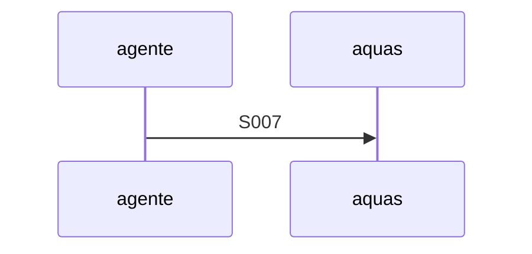

# S007 · Reincidencia familia aprobaciones

[Inicio](../../README.md) › [E000](../README.md) › [F007](README.md) › S007

ataca la causa común de los defectos de la familia aprobaciones

## En una frase

ataca la causa común de los defectos de la familia aprobaciones

## Para qué existe

**El problema.** la familia aprobaciones juntó 3 apariciones (E001/F018/S003)

**La solución.** ataca la causa común de los defectos de la familia aprobaciones

**Contrato.**

| Regla | Valor |
|---|---|
| PENDIENTE: el agente lo decide antes del apruebo | — |

**Casos borde.**

| Categoría | Aplica | Prueba o motivo |
|---|---|---|
| cada tipo de ficha | no | PENDIENTE: el agente lo decide antes del apruebo |
| cada estado de origen | no | PENDIENTE: el agente lo decide antes del apruebo |
| padre e hijo, activo y archivado | no | PENDIENTE: el agente lo decide antes del apruebo |
| entrada ausente, vacía, mal escrita o duplicada | no | PENDIENTE: el agente lo decide antes del apruebo |
| choque con otro control | no | PENDIENTE: el agente lo decide antes del apruebo |
| quién habla: humano, agente o herramienta | no | PENDIENTE: el agente lo decide antes del apruebo |
| fallo a mitad de camino | no | PENDIENTE: el agente lo decide antes del apruebo |

## Analogía

PENDIENTE: el agente lo decide antes del apruebo.

## Diagrama

## Ejemplo de punta a punta

continúa: [EJ-E000-F007](README.md#EJ-E000-F007)

1. PENDIENTE: el agente lo decide antes del apruebo.

## Paso a paso

1. PENDIENTE: el agente lo decide antes del apruebo.

## Cómo se usa

- PENDIENTE: el agente lo decide antes del apruebo.

## Contrato y evidencia

<!-- GENERADO por aquas desde trabajo/: no editar a mano; `aquas compile` lo rehace. -->

| Prueba | Valida | Rojo cuando | Verde cuando | Rojo | Verde |
|---|---|---|---|---|---|
| `TestReincidenciaFamiliaAprobaciones` | valida que la familia aprobaciones no vuelve | rojo cuando un defecto de la familia se reproduce | verde cuando el control lo impide | — | — |

<!-- /GENERADO -->

## Navegación

- ↑ Subir: [F007](README.md)
