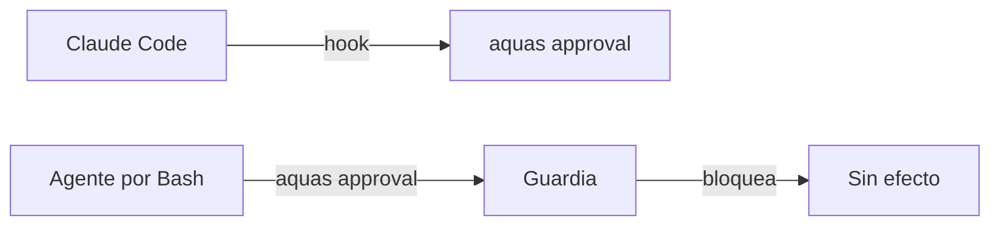
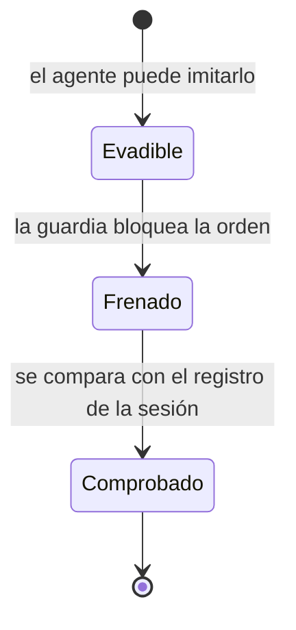

# F008 · Frenos que el agente no puede falsificar

[Inicio](../../README.md) › [E000](../README.md) › F008

[Feature](../../glosario.md#feature) que impide que el [agente](../../glosario.md#agente) imite a Claude Code para saltarse un freno del gobierno.

## En una frase

Las órdenes que solo deben correr como [hooks](../../glosario.md#hook) no se pueden lanzar a mano.

## Para qué existe

**El problema.** La auditoría general del 2026-10-30 encontró D000077. El agente puede lanzar por Bash `aquas approval` con un JSON inventado. Así registra un «apruebo» que el humano nunca escribió. Lo mismo vale para el veredicto del auditor y el contador del tope.

**Por qué importa.** La puerta humana, el auditor y el tope existen para frenar al agente. Si el agente puede imitarlos, dependen solo de su obediencia.

**La solución.** Primero, la guardia frena por Bash cada orden reservada a los hooks. Después, cada freno se comprueba contra el registro de la sesión que escribe Claude Code fuera del repo.

**Origen.** El humano aprobó el orden recomendado de la auditoría el 2026-10-31. Este arreglo va primero.

## Analogía

Piensa en **la firma de un cheque**.

- Antes, cualquiera con el talonario podía firmar con el nombre del dueño.
- Ahora, el banco compara la firma con la que tiene guardada en su bóveda.

Límite de la analogía: la bóveda aquí es el registro de la sesión, y la guardia impide escribir en él.

## Diagrama

Estados de un freno:

| Slice | Qué entrega |
|---|---|
| [S001 Órdenes de hook solo desde Claude Code](S001.md) | La guardia frena por Bash cada orden reservada a los hooks |

## Ejemplo de punta a punta

continúa: [EJ-E000](../README.md#EJ-E000)

1. El agente intenta `./.tmp/aquas.exe approval` con un JSON inventado.
2. La guardia lo bloquea y nombra la orden reservada.
3. La ficha sigue sin aprobación; el humano tiene que escribir «apruebo».

## Paso a paso

1. Órdenes de hook solo desde Claude Code (S001).
2. Siguientes [slices](../../glosario.md#slice): comprobar aprobación, veredicto y tope contra el registro de la sesión.

## Cómo se usa

- No se usa: la guardia actúa sola en cada llamada a Bash.
- Ver la ficha: `aquas backlog show E000/F008`.

## Contrato y evidencia

**Objetivo.** Ninguna orden reservada a los hooks corre por Bash.

Prueba integral: `TestFrenosNoFalsificables` (el agente lanza `approval`, `agent-close` o `budget` por Bash → exit 2; `memory set` pasa). Rojo contra el código sin S001.

Pruebas de los slices: `TestGanchoAManoBloqueado`.

## Navegación

<!-- GENERADO por aquas desde trabajo/: no editar a mano; `aquas compile` lo rehace. -->

| Hijo | Qué es | Estado |
|---|---|---|
| [S001](S001.md) | la guardia frena por Bash cada orden reservada a los hooks | Hecho |
| [S002](S002.md) | Una aprobación vale solo si su mensaje humano está en el registro de la sesión | Hecho |
| [S003](S003.md) | El gate exige aislamiento estricto donde existe y el arranque avisa en Windows nativo | Hecho |
| [S004](S004.md) | Un slice cierra solo si el registro del auditor trae su APROBADO después del verde | Hecho |

<!-- /GENERADO -->

- ↑ Subir: [E000](../README.md)
