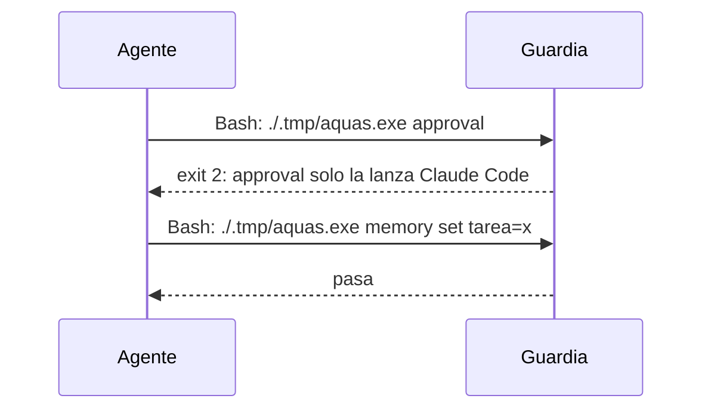

# S001 · Órdenes de hook solo desde Claude Code

[Inicio](../../README.md) › [E000](../README.md) › [F008](README.md) › S001

Este [slice](../../glosario.md#slice) hace que la guardia frene por Bash las órdenes reservadas a los [hooks](../../glosario.md#hook).

## En una frase

Una llamada a `aquas` por Bash con una orden de hook se bloquea.

## Para qué existe

**El problema.** D000077: el [agente](../../glosario.md#agente) puede lanzar `aquas approval` por Bash con un JSON inventado. Registra así un «apruebo» falso, un veredicto falso o un contador en cero.

**Por qué importa.** Esas órdenes solo las debe lanzar Claude Code. Si el agente las lanza, la puerta humana deja de ser una puerta.

**La solución.** La guardia reconoce una llamada a `aquas` dentro de un comando Bash. Si la orden es de hook, bloquea con exit 2 y nombra la orden.

**Origen.** Auditoría general del 2026-10-30, hallazgo G1. El humano aprobó el orden recomendado el 2026-10-31.

**Límite.** Este freno es probabilístico: el shell tiene infinitas formas de armar un comando. Lo evaden un binario renombrado, un programa propio y `xargs` con la orden por stdin. También la orden en una variable o el nombre armado con `$(…)`. Los slices siguientes cierran la puerta de forma determinista: comparan contra el registro de la sesión. Precio aceptado: un texto que cita la orden, con o sin comillas, también se bloquea. La guardia oculta un heredoc solo si entiende cada línea. Además, el heredoc debe abrir en la primera línea, con solo `cd … &&` delante. Su cuerpo debe ir a `cat`, `tee` o `git commit`, sin tubería detrás. Si no la entiende, revisa todo lo que sigue y puede bloquear de más.

**Contrato.**

| Regla | Valor |
|---|---|
| Órdenes de hook | `approval`, `agent-close`, `budget`, `turn`, `proposal`, `guard`, `hook`, `memory start`, `memory close` |
| Nombres viejos | también: `aprobacion`, `cierre-agente`, `presupuesto`, `turno`, `propuesta`, `guardia`, `memoria inicio`, `memoria cierre` |
| Llamada a `aquas` | palabra que termina en `aquas`, `aquas.exe`, `aq.exe` o `aquas.sh`, con o sin ruta ni comillas; `go run` con su paquete; o una variable usada como comando |
| Dónde | en el texto del comando sin heredocs: tras `&&`, `;`, `\|`, redirecciones o prefijos, dentro de `$(…)` o de `sh -c` |
| Respuesta | exit 2 y un mensaje que nombra la orden y dice que solo la lanza Claude Code |
| Órdenes libres | `memory set`, `memory show`, `memory archive`, `backlog`, `defect`, `verify` y el resto pasan |
| Alcance | `internal/guardia/**`, `cmd/aquas/**`, `docs/**` |

**Casos borde.**

| Categoría | Aplica | Prueba o motivo |
|---|---|---|
| cada tipo de ficha | no | la guardia no lee fichas para esta regla |
| cada estado de origen | no | la regla no depende del estado de ninguna ficha |
| padre e hijo, activo y archivado | no | no hay fichas en juego; el binario `aquas` de un hijo se cubre en la fila de entrada |
| entrada ausente, vacía, mal escrita o duplicada | sí | nombre viejo o cruzado, mayúsculas, ruta absoluta, comillas, redirección delante, `go run` y `memory set` libre: `TestGanchoAManoBloqueado` |
| choque con otro control | sí | cada orden de hook de `claude_settings.json`, con cada nombre que la CLI acepta, queda bloqueada: `TestFrenosNoFalsificables` |
| quién habla: humano, agente o herramienta | sí | un subagente con `agent_type` también se bloquea; los hooks reales no pasan por Bash: `TestGanchoAManoBloqueado` |
| fallo a mitad de camino | no | la guardia solo decide; no escribe nada |

## Analogía

Piensa en **una sala de máquinas con la puerta rotulada**.

- Antes, cualquiera podía entrar y mover las palancas.
- Ahora, el portero no deja pasar a nadie con la llave del maquinista.

Límite de la analogía: quien fabrique otra llave pasa; eso lo cierran los slices siguientes.

## Diagrama

## Ejemplo de punta a punta

continúa: [EJ-E000-F008](README.md#EJ-E000-F008)

1. El agente lanza `echo '{}' | ./.tmp/aquas.exe approval`.
2. La guardia ve una llamada a `aquas` con la orden `approval`.
3. Bloquea con exit 2; la ficha no cambia.

## Paso a paso

1. Rojo de la prueba.
2. Reconocer la llamada a `aquas` en cada segmento y comparar su orden con la lista.

## Cómo se usa

- No se usa: la guardia actúa sola en cada llamada a Bash.

## Contrato y evidencia

<!-- GENERADO por aquas desde trabajo/: no editar a mano; `aquas compile` lo rehace. -->

| Prueba | Valida | Rojo cuando | Verde cuando | Rojo | Verde |
|---|---|---|---|---|---|
| `TestGanchoAManoBloqueado` | valida que la guardia bloquea por Bash las órdenes de hook y deja pasar las libres | rojo cuando aquas approval por Bash pasa | verde cuando cada orden de hook da exit 2 y memory set pasa | 2026-10-31 | 2026-10-31 |

### Código

| Archivo | Función | Parámetros | Qué hace |
|---|---|---|---|
| [internal/guardia/gancho.go](../../../internal/guardia/gancho.go) | `RevisarHook` | `(comando string) string` | RevisarHook: motivo de bloqueo si el comando lanza una orden de hook; «» si no. |
| [internal/guardia/guardia.go](../../../internal/guardia/guardia.go) | `Revisar` | `(raiz string, entrada []byte) string` | Revisar recibe el JSON del hook PreToolUse; "" = permitido, si no, el motivo del bloqueo. |
| [internal/guardia/guardia.go](../../../internal/guardia/guardia.go) | `RevisarArchivo` | `(raiz, p string) string` | RevisarArchivo valida una ruta de Write/Edit (absoluta o relativa a la raíz). |
| [internal/guardia/guardia.go](../../../internal/guardia/guardia.go) | `protegida` | `(raiz, abs, p string) string` | protegida: carpetas que solo escribe `aquas` (E001/F005, E001/F002). Las rutas salen de los |
| [internal/guardia/guardia.go](../../../internal/guardia/guardia.go) | `resolver` | `(base, p string) (string, bool)` | resolver lleva p a ruta absoluta del sistema. Entiende ~, /c/… (Git Bash) y relativas a base. |
| [internal/guardia/guardia.go](../../../internal/guardia/guardia.go) | `dentro` | `(raiz, abs string) bool` | dentro: la ruta absoluta queda dentro de la raíz del repo. |
| [internal/guardia/guardia.go](../../../internal/guardia/guardia.go) | `lectorDeTexto` | `(antes, despues string) bool` | lectorDeTexto: el cuerpo va a `cat`, `tee` o `git commit` y su salida no sigue por una tubería. |
| [internal/guardia/guardia.go](../../../internal/guardia/guardia.go) | `sinHeredocs` | `(c string) string` | sinHeredocs quita el cuerpo de cada heredoc que entiende: su contenido es texto, no comandos. |
| [internal/guardia/guardia.go](../../../internal/guardia/guardia.go) | `lexear` | `(c string) []palabra` | lexear parte un comando de shell en palabras, respetando comillas y operadores. |
| [internal/guardia/guardia.go](../../../internal/guardia/guardia.go) | `variable` | `(r []rune, i int) (string, int)` | variable reconoce $NOMBRE, ${NOMBRE}, $(…), `…` y %NOMBRE%; devuelve nombre ("?" = desconocida) y largo. |
| [internal/guardia/guardia.go](../../../internal/guardia/guardia.go) | `esNombre` | `(c rune) bool` | esNombre: el carácter vale en un nombre de variable de shell. |
| [internal/guardia/guardia.go](../../../internal/guardia/guardia.go) | `RevisarBash` | `(raiz, cwd, comando string) string` | RevisarBash analiza un comando de Bash; cwd es el directorio donde arranca. |
| [internal/guardia/guardia.go](../../../internal/guardia/guardia.go) | `segmento` | `(raiz string, cwd *string, cwdOK *bool, vars map[string]string, ps []palabra) string` | segmento revisa un comando simple: sigue cd y variables y devuelve el primer destino fuera del repo. |
| [internal/guardia/guardia.go](../../../internal/guardia/guardia.go) | `destinoPorOpcion` | `(cmd string, args []string) (dirs, resto []string)` | destinoPorOpcion (E000/F001/S001/X02): carpetas destino dadas por -t DIR, -tDIR, -rtDIR, --target-directory DIR, |
| [internal/guardia/guardia.go](../../../internal/guardia/guardia.go) | `posicionales` | `(args []string) []string` | posicionales: argumentos que no son opciones (los que empiezan con «-», salvo «-» solo). |
| [internal/guardia/guardia.go](../../../internal/guardia/guardia.go) | `revisarDestino` | `(raiz, cwd string, cwdOK bool, vars map[string]string, d string) string` | revisarDestino: motivo de bloqueo si la ruta no se resuelve o cae fuera del repo; vacío si vale. |
| [internal/guardia/guardia.go](../../../internal/guardia/guardia.go) | `expandir` | `(s string, vars map[string]string, cwd string) (string, bool)` | expandir sustituye variables conocidas; HOME/USERPROFILE/TEMP/TMP salen del entorno real. |
| [internal/guardia/guardia.go](../../../internal/guardia/guardia.go) | `legible` | `(s string) string` | legible muestra las variables internas como $NOMBRE en los mensajes. |

<!-- /GENERADO -->

## Navegación

- ↑ Subir: [F008](README.md)
