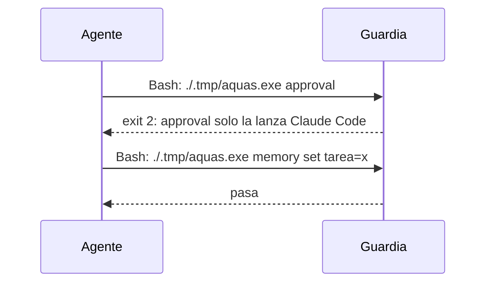

# S001 · Órdenes de hook solo desde Claude Code

[Inicio](../../README.md) › [E000](../README.md) › [F008](README.md) › S001

Este [slice](../../glosario.md#slice) hace que la guardia frene por Bash las órdenes reservadas a los [hooks](../../glosario.md#hook).

## En una frase

Una llamada a `aquas` por Bash con una orden de hook se bloquea.

## Para qué existe

**El problema.** D000077: el [agente](../../glosario.md#agente) puede lanzar `aquas approval` por Bash con un JSON inventado. Registra así un «apruebo» falso, un veredicto falso o un contador en cero.

**Por qué importa.** Esas órdenes solo las debe lanzar Claude Code. Si el agente las lanza, la puerta humana deja de ser una puerta.

**La solución.** La guardia reconoce una llamada a `aquas` dentro de un comando Bash. Si la orden es de hook, bloquea con exit 2 y nombra la orden.

**Origen.** Auditoría general del 2026-10-30, hallazgo G1. El humano aprobó el orden recomendado el 2026-10-31.

**Límite.** Un binario renombrado o un programa propio evade este freno. Los slices siguientes lo cierran comparando contra el registro de la sesión.

**Contrato.**

| Regla | Valor |
|---|---|
| Órdenes de hook | `approval`, `agent-close`, `budget`, `turn`, `proposal`, `guard`, `hook`, `memory start`, `memory close` |
| Nombres viejos | también: `aprobacion`, `cierre-agente`, `presupuesto`, `turno`, `propuesta`, `guardia`, `memoria inicio`, `memoria cierre` |
| Llamada a `aquas` | palabra que termina en `aquas`, `aquas.exe`, `aq.exe` o `aquas.sh`, con o sin ruta ni comillas; o `go run ./cmd/aquas` |
| Dónde | cualquier segmento del comando: tras `&&`, `;`, `\|` o dentro de `sh -c` |
| Respuesta | exit 2 y un mensaje que nombra la orden y dice que solo la lanza Claude Code |
| Órdenes libres | `memory set`, `memory show`, `memory archive`, `backlog`, `defect`, `verify` y el resto pasan |
| Alcance | `internal/guardia/**`, `cmd/aquas/**`, `docs/**` |

**Casos borde.**

| Categoría | Aplica | Prueba o motivo |
|---|---|---|
| cada tipo de ficha | no | la guardia no lee fichas para esta regla |
| cada estado de origen | no | la regla no depende del estado de ninguna ficha |
| padre e hijo, activo y archivado | no | no hay fichas en juego; el binario `aquas` de un hijo se cubre en la fila de entrada |
| entrada ausente, vacía, mal escrita o duplicada | sí | nombre viejo, ruta absoluta, comillas, `aquas` pelado, `go run ./cmd/aquas` y `memory set` libre: `TestGanchoAManoBloqueado` |
| choque con otro control | sí | `memory set`, exento del freno de presupuesto, sigue pasando por la guardia: `TestGanchoAManoBloqueado` |
| quién habla: humano, agente o herramienta | sí | un subagente con `agent_type` también se bloquea; los hooks reales no pasan por Bash: `TestGanchoAManoBloqueado` |
| fallo a mitad de camino | no | la guardia solo decide; no escribe nada |

## Analogía

Piensa en **una sala de máquinas con la puerta rotulada**.

- Antes, cualquiera podía entrar y mover las palancas.
- Ahora, el portero no deja pasar a nadie con la llave del maquinista.

Límite de la analogía: quien fabrique otra llave pasa; eso lo cierran los slices siguientes.

## Diagrama

## Ejemplo de punta a punta

continúa: [EJ-E000-F008](README.md#EJ-E000-F008)

1. El agente lanza `echo '{}' | ./.tmp/aquas.exe approval`.
2. La guardia ve una llamada a `aquas` con la orden `approval`.
3. Bloquea con exit 2; la ficha no cambia.

## Paso a paso

1. Rojo de la prueba.
2. Reconocer la llamada a `aquas` en cada segmento y comparar su orden con la lista.

## Cómo se usa

- No se usa: la guardia actúa sola en cada llamada a Bash.

## Contrato y evidencia

<!-- GENERADO por aquas desde trabajo/: no editar a mano; `aquas compile` lo rehace. -->

| Prueba | Valida | Rojo cuando | Verde cuando | Rojo | Verde |
|---|---|---|---|---|---|
| `TestGanchoAManoBloqueado` | valida que la guardia bloquea por Bash las órdenes de hook y deja pasar las libres | rojo cuando aquas approval por Bash pasa | verde cuando cada orden de hook da exit 2 y memory set pasa | — | — |

<!-- /GENERADO -->

## Navegación

- ↑ Subir: [F008](README.md)
