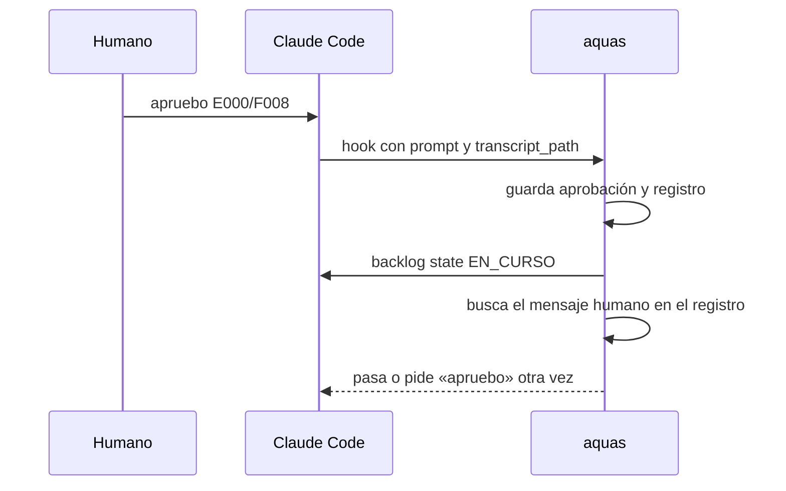

# S002 · Apruebo comprobado contra el registro de la sesión

[Inicio](../../README.md) › [E000](../README.md) › [F008](README.md) › S002

Este [slice](../../glosario.md#slice) hace que un «apruebo» valga solo si el humano lo escribió en el chat.

## En una frase

Una aprobación sin su mensaje humano en el registro de la sesión no deja avanzar.

## Para qué existe

**El problema.** D000077: la ficha guarda la aprobación como un dato más. Quien escriba ese dato finge un «apruebo» del humano.

**Por qué importa.** La aprobación es la puerta humana del flujo. Si se puede fingir, el humano deja de decidir.

**La solución.** El [hook](../../glosario.md#hook) guarda la ruta del registro de la sesión junto a la aprobación. Al usarla, `aquas` busca ahí el mensaje humano exacto.

**Origen.** Auditoría general del 2026-10-30, hallazgo G1. El humano eligió la opción 3 el 2026-10-31.

**Límite.** El registro lo escribe Claude Code fuera del repo. Es determinista solo si el sistema operativo impide al [agente](../../glosario.md#agente) escribir ahí. Eso lo da el aislamiento de Bash, que comprueba S003. En Windows nativo no hay aislamiento: este freno es una segunda barrera, probabilística (D000079). Un registro borrado por antigüedad anula su aprobación; el humano la repite. El registro prueba qué id aprobó el humano, no qué huella vio. Quien escriba la ficha puede recalcular la huella tras cambiar el contrato. Eso lo frena el auditor al revisar el diff.

**Contrato.**

| Regla | Valor |
|---|---|
| Qué guarda el hook | la aprobación, más `registro`: el `transcript_path` que Claude Code entrega en `UserPromptSubmit` |
| Registro válido | archivo `.jsonl` dentro de `~/.claude/projects/` (o de `CLAUDE_CONFIG_DIR/projects/`) |
| Mensaje válido | línea con `type` `user`, `origin.kind` `human` y texto igual al mensaje guardado |
| Mensaje atado | el mensaje guardado es «apruebo <id>» de esa misma ficha; un push exige «con push» en su primera línea |
| Dónde se comprueba | en cada uso de la aprobación: estado EN_CURSO, rojo, verde y cierre |
| Respuesta si falla | error que nombra la causa y pide al humano escribir «apruebo <id>» otra vez |
| Aprobaciones viejas | sin `registro` no valen; el humano las repite una vez |
| Alcance | `internal/backlog/**`, `cmd/aquas/**`, `docs/**` |

**Casos borde.**

| Categoría | Aplica | Prueba o motivo |
|---|---|---|
| cada tipo de ficha | sí | aprobación de slice propia y por foto de la feature: `TestApruebaSoloConMensajeHumano` |
| cada estado de origen | sí | EN_CURSO, rojo, verde y cierre rechazan la aprobación sin respaldo: `TestApruebaSoloConMensajeHumano` |
| padre e hijo, activo y archivado | sí | feature aprobada sin respaldo, o con push escrito a mano, no cubre a sus slices: `TestApruebaSoloConMensajeHumano` |
| entrada ausente, vacía, mal escrita o duplicada | sí | sin `registro`, ruta fuera de projects, archivo ausente, línea rota, texto distinto, mensaje de otro id: `TestApruebaSoloConMensajeHumano` |
| choque con otro control | sí | la huella del contrato sigue mandando: contrato cambiado anula aunque haya respaldo: `TestApruebaSoloConMensajeHumano` |
| quién habla: humano, agente o herramienta | sí | mensaje del agente, de otra sesión o resultado de herramienta no cuenta: `TestApruebaSoloConMensajeHumano` |
| fallo a mitad de camino | sí | registro borrado entre la aprobación y su uso cuenta como sin respaldo (caso archivo ausente): `TestApruebaSoloConMensajeHumano` |

## Analogía

Piensa en **un cheque con firma**.

- Antes, el banco pagaba si el cheque decía «firmado».
- Ahora, el banco compara la firma con la de su archivo.

Límite de la analogía: si alguien entra al archivo del banco, también falsifica la firma. Eso lo impide el aislamiento (S003).

## Diagrama

## Ejemplo de punta a punta

continúa: [EJ-E000-F008](README.md#EJ-E000-F008)

1. El agente escribe en la ficha una aprobación con un registro inventado.
2. `aquas backlog state` busca el mensaje en ese registro y no lo halla.
3. El estado no cambia; el error pide que el humano escriba «apruebo».

## Paso a paso

1. Rojo de la prueba.
2. El hook guarda `registro` con la aprobación.
3. `aprobada` comprueba registro y mensaje antes que la huella.

## Cómo se usa

- No se usa: actúa sola en cada paso que exige aprobación.

## Contrato y evidencia

<!-- GENERADO por aquas desde trabajo/: no editar a mano; `aquas compile` lo rehace. -->

| Prueba | Valida | Rojo cuando | Verde cuando | Rojo | Verde |
|---|---|---|---|---|---|
| `TestApruebaSoloConMensajeHumano` | valida que una aprobación sin mensaje humano en el registro no deja avanzar | rojo cuando una aprobación sin registro deja pasar a EN_CURSO | verde cuando solo pasa la que tiene el mensaje humano exacto | 2026-10-31 | 2026-10-31 |

### Código

| Archivo | Función | Parámetros | Qué hace |
|---|---|---|---|
| [cmd/aquas/aprobacion.go](../../../cmd/aquas/aprobacion.go) | `aprobacionCLI` | `(raiz string)` | aprobacionCLI: solo un evento UserPromptSubmit cuenta como mensaje del humano. PreToolUse, PostToolUse, |
| [cmd/aquas/presupuesto.go](../../../cmd/aquas/presupuesto.go) | `exentaDelFreno` | `(raiz, herramienta, comando string) bool` | exentaDelFreno: true si la herramienta es Bash y su comando entero es `aquas memory set campo=valor…`. |
| [cmd/aquas/presupuesto.go](../../../cmd/aquas/presupuesto.go) | `presupuestoCLI` | `(raiz string, args []string)` | presupuestoCLI: «herramienta» cuenta las llamadas en el registro y bloquea con exit 2 al pasar un tope. |
| [cmd/aquas/presupuesto.go](../../../cmd/aquas/presupuesto.go) | `frenar` | `(formato string, a ...any)` | frenar escribe el motivo en stderr y bloquea la llamada. |
| [cmd/aquas/presupuesto.go](../../../cmd/aquas/presupuesto.go) | `avisarContexto` | `(raiz string, e entradaPresupuesto, turno string)` | avisarContexto pide /compact una vez por turno cuando el contexto medido pasa el umbral; la marca guarda el |
| [cmd/aquas/presupuesto.go](../../../cmd/aquas/presupuesto.go) | `recorrerRegistro` | `(ruta string, f func(pos int64, l lineaLlamadas)) error` | recorrerRegistro abre un registro y entrega cada línea legible con su posición; las rotas se ignoran. |
| [cmd/aquas/presupuesto.go](../../../cmd/aquas/presupuesto.go) | `llamadas` | `(raiz string, l lineaLlamadas) []string` | llamadas: ids de los tool_use de una línea de asistente, sin las llamadas exentas. |
| [cmd/aquas/presupuesto.go](../../../cmd/aquas/presupuesto.go) | `textoHumano` | `(l lineaLlamadas) string` | textoHumano: el texto de una línea de usuario con origen humano, sin marcas de aviso de agente; "" si no lo es. |
| [cmd/aquas/presupuesto.go](../../../cmd/aquas/presupuesto.go) | `escanear` | `(raiz, ruta string) (escaneo, error)` | escanear lee un registro una vez. |
| [cmd/aquas/presupuesto.go](../../../cmd/aquas/presupuesto.go) | `carpetaProyecto` | `(ruta string) string` | carpetaProyecto: la carpeta de las sesiones del proyecto; desde un registro de subagente sube a ella. |
| [cmd/aquas/presupuesto.go](../../../cmd/aquas/presupuesto.go) | `escanearProyecto` | `(raiz, ruta string) (map[string]escaneo, error)` | escanearProyecto lee cada registro de sesión de la carpeta del proyecto; sin registro legible, error. |
| [cmd/aquas/presupuesto.go](../../../cmd/aquas/presupuesto.go) | `frenoFeature` | `(raiz, ruta string, sesiones map[string]escaneo) string` | frenoFeature: el último apruebo de feature del humano fija feature, tope y hora; se cuentan las llamadas |
| [cmd/aquas/presupuesto.go](../../../cmd/aquas/presupuesto.go) | `contextoMedido` | `(ruta string) int` | contextoMedido: tokens de entrada de la última llamada del modelo en el transcript; 0 si después |
| [internal/backlog/aprobacion.go](../../../internal/backlog/aprobacion.go) | `seccionContrato` | `(texto string) (string, bool)` | seccionContrato: texto de «## Para qué existe» de la página, sin los bloques GENERADO de aquas. |
| [internal/backlog/aprobacion.go](../../../internal/backlog/aprobacion.go) | `Huella` | `(raiz string, f Ficha) (string, error)` | Huella: SHA-256 de las pruebas, el alcance (con sus ampliaciones) y la sección «Para qué existe» de la página. |
| [internal/backlog/aprobacion.go](../../../internal/backlog/aprobacion.go) | `Aprobar` | `(raiz, id, mensaje, registro string, ahora time.Time) (Ficha, error)` | Aprobar registra la aprobación del contrato de un slice o de una feature (con la foto de sus slices) con la huella |
| [internal/backlog/aprobacion.go](../../../internal/backlog/aprobacion.go) | `aprobada` | `(raiz string, f Ficha) error` | aprobada: nil si el slice puede avanzar (EN_CURSO, rojo, verde, cierre); si no, el paso que falta. |
| [internal/backlog/aprobacion.go](../../../internal/backlog/aprobacion.go) | `abiertos` | `(raiz, feature string) int` | abiertos (E001/F015/X01): slices activos (ni CERRADO ni CANCELADO) de la feature; error de lectura = 0. |
| [internal/backlog/aprobacion.go](../../../internal/backlog/aprobacion.go) | `cubiertaPorFeature` | `(raiz string, p, f Ficha, aprobadas []Prueba) error` | cubiertaPorFeature (E001/F015/S001): el slice avanza si el contrato de su feature no cambió y cada prueba |
| [internal/backlog/aprobacion.go](../../../internal/backlog/aprobacion.go) | `AvisoFeatureAprobada` | `(raiz string, f Ficha) string` | AvisoFeatureAprobada: aviso al crear un slice cuya feature ya está aprobada; "" si no aplica. |
| [internal/backlog/aprobacion.go](../../../internal/backlog/aprobacion.go) | `pideFeature` | `(p Ficha) string` | pideFeature: el apruebo de la feature que hay que pedir, con «con push» si la aprobación anterior lo tenía. |
| [internal/backlog/respaldo.go](../../../internal/backlog/respaldo.go) | `carpetaRegistros` | `() (string, error)` | carpetaRegistros: <CLAUDE_CONFIG_DIR o ~/.claude>/projects, donde Claude Code guarda los registros de sesión. |
| [internal/backlog/respaldo.go](../../../internal/backlog/respaldo.go) | `bajo` | `(padre, hija string) bool` | bajo: la ruta real hija queda dentro de la ruta real padre. |
| [internal/backlog/respaldo.go](../../../internal/backlog/respaldo.go) | `real` | `(p string) (string, error)` | real: ruta absoluta sin enlaces; si no existe, error. |
| [internal/backlog/respaldo.go](../../../internal/backlog/respaldo.go) | `respaldada` | `(raiz, id string, a *Aprobacion) error` | respaldada: nil si a.Mensaje aprueba justo ese id (con «con push» solo si a.Push) y está como mensaje humano |
| [internal/backlog/respaldo.go](../../../internal/backlog/respaldo.go) | `registroValido` | `(raiz, ruta string) (string, error)` | registroValido: la ruta real de un registro de Claude Code, si es un .jsonl de la carpeta de registros y queda |
| [internal/backlog/respaldo.go](../../../internal/backlog/respaldo.go) | `UltimoMensajeHumano` | `(ruta string) (string, error)` | UltimoMensajeHumano (E000/F010/S001): texto del mensaje que abrió el turno, si lo escribió el humano; "" si no. |
| [internal/backlog/respaldo.go](../../../internal/backlog/respaldo.go) | `deAgente` | `(t string) bool` | deAgente: el texto trae alguna marca de mensaje de agente. |
| [internal/backlog/respaldo.go](../../../internal/backlog/respaldo.go) | `mensajeHumano` | `(ruta, mensaje string) (bool, error)` | mensajeHumano: alguna línea de usuario con origen humano trae ese texto exacto; un mensaje guardado con 300 |
| [internal/backlog/respaldo.go](../../../internal/backlog/respaldo.go) | `textoUsuario` | `(c json.RawMessage) string` | textoUsuario: contenido como texto, o la unión de sus bloques «text»; otros bloques (tool_result) no cuentan. |
| [internal/backlog/respaldo.go](../../../internal/backlog/respaldo.go) | `IDAprobado` | `(prompt string) (string, bool)` | IDAprobado: id de la PRIMERA línea no vacía si es «apruebo <id>»; una línea que termina en «?» es pregunta. |

<!-- /GENERADO -->

## Navegación

- ↑ Subir: [F008](README.md)
