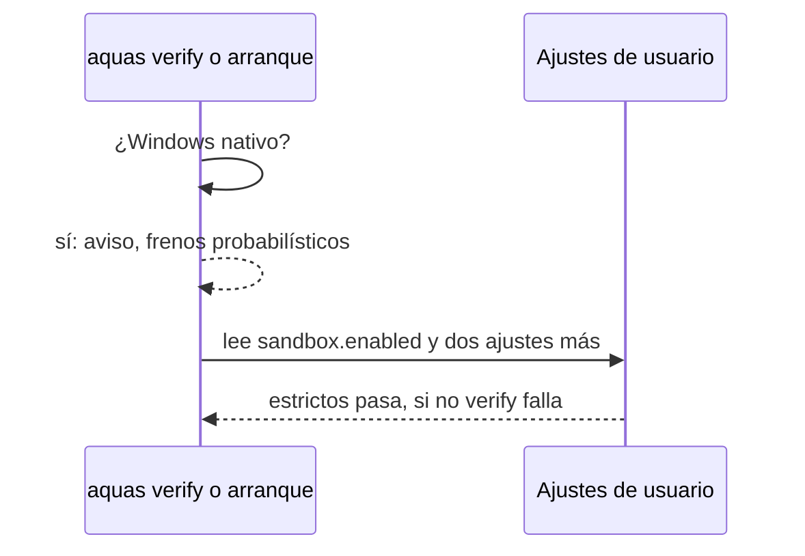

# S003 · Aislamiento de Bash comprobado

[Inicio](../../README.md) › [E000](../README.md) › [F008](README.md) › S003

Este [slice](../../glosario.md#slice) comprueba que el sistema operativo encierra los comandos Bash del [agente](../../glosario.md#agente).

## En una frase

Sin aislamiento estricto, el arranque avisa y el [gate](../../glosario.md#gate) falla donde el aislamiento existe.

## Para qué existe

**El problema.** D000079: en Windows nativo, Claude Code corre Bash sin aislamiento. Todo freno contra el agente depende de leer el texto del comando.

**Por qué importa.** Leer texto es probabilístico. Solo el sistema operativo garantiza que el agente no escriba fuera del repo.

**La solución.** `aquas` revisa los ajustes del aislamiento de Claude Code. Donde existe, lo exige estricto. En Windows nativo, avisa al arrancar cada sesión.

**Origen.** Opción 3 elegida por el humano el 2026-10-31. Doc oficial consultada ese día: `https://code.claude.com/docs/en/sandboxing`.

**Límite.** En Windows nativo el aislamiento no existe: S003 solo lo hace visible. Los ajustes se leen del archivo; un `--settings` de línea de comandos no se ve.

**Contrato.**

| Regla | Valor |
|---|---|
| Ajustes estrictos | `sandbox.enabled` true, `sandbox.allowUnsandboxedCommands` false, `sandbox.failIfUnavailable` true |
| Dónde se leen | ajustes de usuario `~/.claude/settings.json` o ajustes gestionados; nunca los del repo, que el agente edita |
| macOS, Linux y WSL2 | sin ajustes estrictos, `aquas verify` falla y el arranque lo avisa |
| Windows nativo | el arranque avisa que los frenos son probabilísticos (D000079); el gate no falla |
| Alcance | `internal/entorno/**`, `cmd/aquas/**`, `docs/**` |

**Casos borde.**

| Categoría | Aplica | Prueba o motivo |
|---|---|---|
| cada tipo de ficha | no | la regla lee ajustes de Claude Code, no fichas |
| cada estado de origen | no | no depende del estado de ninguna ficha |
| padre e hijo, activo y archivado | no | sin fichas en juego; un repo hijo hereda la regla por el binario (E003) |
| entrada ausente, vacía, mal escrita o duplicada | sí | sin archivo, JSON roto, clave ausente, valor de otro tipo, ajuste solo en el repo: `TestAislamientoEstricto` |
| choque con otro control | sí | ajuste gestionado manda sobre el de usuario: `TestAislamientoEstricto` |
| quién habla: humano, agente o herramienta | sí | un ajuste en `.claude/settings.json` del repo no cuenta, porque lo edita el agente: `TestAislamientoEstricto` |
| fallo a mitad de camino | no | solo lee y decide; no escribe nada |

## Analogía

Piensa en **una caja fuerte**.

- Antes, confiábamos en que nadie intentara abrirla.
- Ahora, revisamos que la cerradura esté puesta antes de empezar.

Límite de la analogía: en Windows nativo la caja no tiene cerradura; solo avisamos.

## Diagrama

## Ejemplo de punta a punta

continúa: [EJ-E000-F008](README.md#EJ-E000-F008)

1. El humano abre Claude Code en WSL2 sin `sandbox.enabled`.
2. `aquas verify` falla y nombra los tres ajustes que faltan.
3. El humano los pone en sus ajustes de usuario; el gate pasa.

## Paso a paso

1. Rojo de la prueba.
2. Leer ajustes de usuario y gestionados.
3. Decidir por sistema operativo: aviso o fallo.

## Cómo se usa

- El humano pone los tres ajustes en `~/.claude/settings.json` dentro de WSL2.

## Contrato y evidencia

<!-- GENERADO por aquas desde trabajo/: no editar a mano; `aquas compile` lo rehace. -->

| Prueba | Valida | Rojo cuando | Verde cuando | Rojo | Verde |
|---|---|---|---|---|---|
| `TestAislamientoEstricto` | valida que sin ajustes estrictos de aislamiento el gate falla o avisa según el sistema | rojo cuando sin sandbox estricto en Linux el gate pasa | verde cuando falla en Linux sin ajustes y solo avisa en Windows nativo | — | — |

<!-- /GENERADO -->

## Navegación

- ↑ Subir: [F008](README.md)
